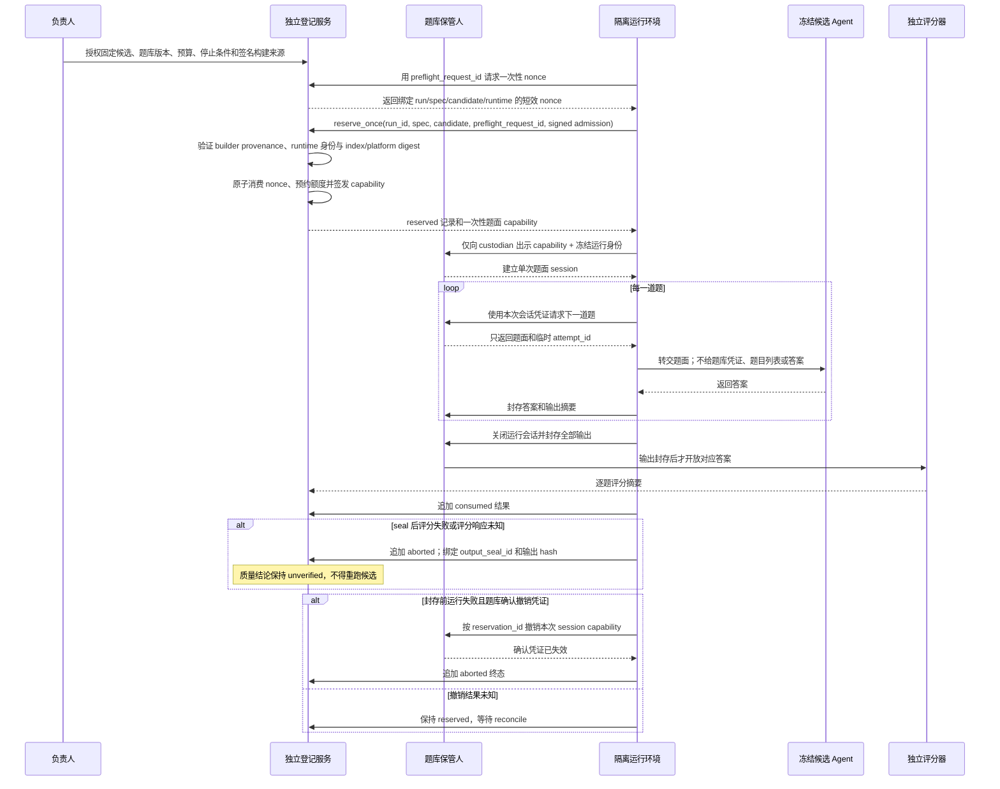
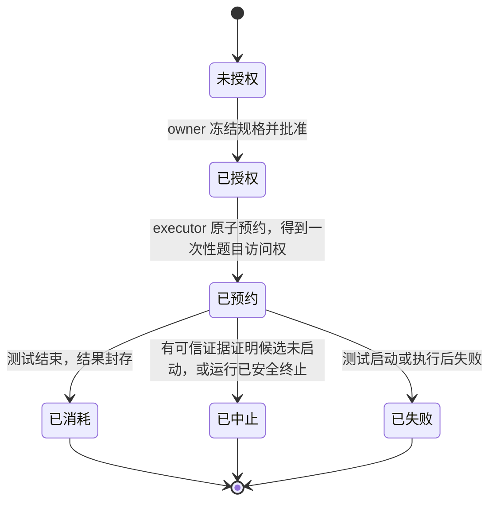
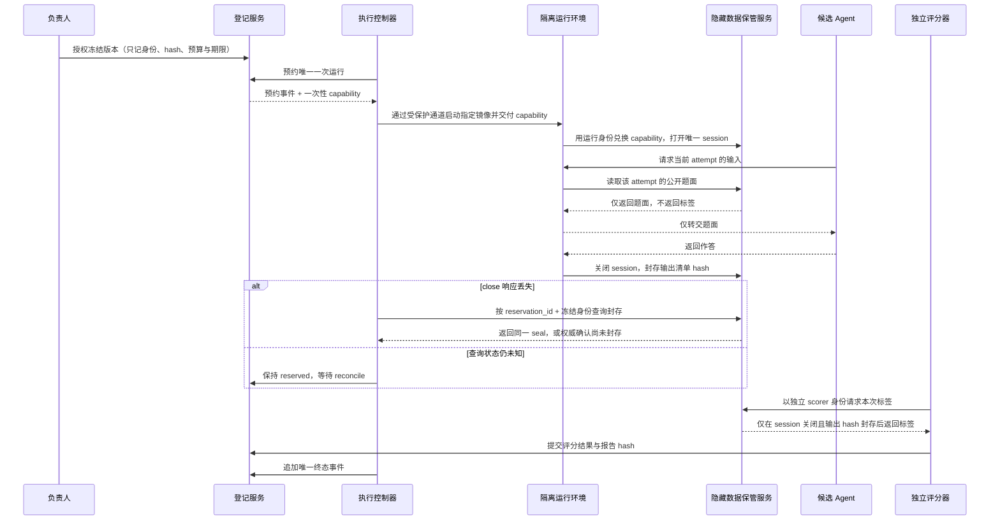

# Stage 5 — 可交付 Agent Capstone 实施计划

> 依据：[课程可靠性设计 §3.2、§6、§7.2、§7.4、§8 W5](../specs/2026-10-19-curriculum-reliability-design.md)。这是 W5 的执行计划；只有证据达到对应范围时才关闭事项。

> **当前推进范围**：本轮只完善协议文档、状态语义、声明式 JSON Schema 与后续验收标准；不实现身份认证/IdP、身份源 adapter 或生产 acceptance wiring。下列实现与部署任务仍是未来正式验收的硬门，不因当前阶段只写设计而视为完成。
>
> **进度口径**：本计划所有复选框统计的是 Stage 5 的整体交付门禁，包含真实 provider 观察、运行时代码、外部服务部署、独立签署与人工交接；该比例不是“设计文档完成度”。文档合同、结构 schema 和离线合同测试可以在当前范围内完成，但不能替代这些运行与外部证据。
>
> **文档入口**：Stage 5 主规格、schema、向量与离线合同测试按主题的导航见[设计索引](../specs/stage5-registry-audit-integrity-index.md)。

## 目标与当前缺口

交付 `p5-agent-delivery`：后端工程师能从干净环境安装、启动、运行有限真实模型任务、检查结果与 usage、演练审批恢复和外部未知状态，并由另一位接手者按发布包独立复现。阶段 3 当前提供 Anthropic Messages + MCP 的只读真实模型循环；阶段 4 提供 PostgreSQL 持久任务、审批、预算和合成投递。P5 已新增 durable provider-call host、bounded model-round driver 与 `resume_agent_turn()` 协调器，PostgreSQL 集成测试现覆盖合成 provider → 审批暂停/恢复 → 独立 sink 投递 → 新 worker 接续模型，以及投递 unknown 时停止模型调用。真实 provider 运行命令、在线证据与生产级交接仍未完成；阶段 5 不能把合成 adapter 结果称作在线验收。

### Task 1 当前已实现的切片（总体仍 open）

- [x] `0005_provider_calls.sql` + caller-owned lifecycle helpers：request/response hash、usage settlement、unknown 防重发；新 owner 可原子放弃确定未发送的 prepared 并释放 reservation/slot，sending 不可走释放路径。
- [x] `0006_final_outputs.sql` + `finalize_output`：引用当前 tenant/resource/version/ACL 检查、所有 action 与写回执检查、输出持久化与 completed 同事务；移除 `output_valid` 布尔绕过。
- [x] 一轮 host boundary：严格要求 `max_retries=0`；先提交 prepared、再提交 sending、之后才调用注入的 provider adapter；保存 response/usage，网络模糊失败为 unknown。
- [x] 增加 Anthropic Messages SDK 适配器和可选 `provider` 依赖组；SDK client 构造固定 `max_retries=0`、有限 timeout，API key 只由调用方注入，不进入可持久化 request body。
- [x] 以 `request_id` 绑定 action `turn_id`；重建 assistant 原始 block + 每个 tool-use id 的真实 action result。构造及 sending 前重新验证 caller、ACL/version、approval 与写投递回执；授权在 prepared→sending 的当前租约事务内复查。
- [x] `drive_provider_round()` 根据最新 provider call 选择恢复动作：响应已保存时只消费、不重发；tool action 未解决时等待；完成后按原始 assistant/tool-result blocks 重建 continuation。首轮前把 endpoint/model/release、prompt/tool hashes、预算预留和 round limit 固定到 task checkpoint；配置漂移拒绝继续。PostgreSQL 集成测试覆盖两轮 read→final、响应保存后接管、未解决 action 等待和配置漂移拒绝。
- [x] `resume_agent_turn()` 将 P4 read execution、已批准动作冻结/outbox scheduling、单次 delivery dispatch 和模型 continuation 串为单次受 fencing 的 host wake-up；delivery 提交会释放 lease，后续动作和模型续接必须由 successor claim 执行。Unknown 结果停止，不自动重试模型。
- [x] 增加显式 `runner.py --live`：只接受 loopback PostgreSQL、合成租户 Alice 的固定提示词、可信本地 MCP server 与本地 sink；固定 4 轮、每轮 512 output tokens、SDK retries=0、有限请求 timeout，并写入不含 prompt/body/headers/key 的 per-wakeup 报告。离线 contract test 验证缺配置失败、非 live 不读取配置、非本地 sink 拒绝和报告脱敏；另有一次受限真实 smoke，当前在人工审批前暂停，详见 Task 4。
- [x] runner 报告升级到 `p5-live-smoke-v3`，记录 UTC 时间、逐轮请求/stop reason/usage/耗时/工具状态、输出 hash、SDK 版本及 release/prompt/tool/dataset/scorer/code/lock provenance；运行前校验冻结 evaluator materials，报告仅保留 allowlist 字段，不包含 tool arguments。
- [x] 每次运行在 ignored `verify-output/stage5-live/<run-id>/` 写出 root-bound materials/artifact manifest，并通过 Task 2a classifier 生成单 gate acceptance report；文件采用 exclusive-create，重复 run id 不覆盖既有报告；缺其余 gate 时决策保持 `incomplete`。离线合同测试只验证结构和脱敏，不代表真实 provider 观察。
- [x] Live gate 仅在 task/output 均持久完成、输出 hash 合法且每一轮均有 request id、processed 状态和完整 token/tool usage 时标记 `passed`；缺 usage、缺 round 或 ambiguous runner outcome 为 `unverified`，已知协议/传输/截断失败为 `failed`。
- [ ] 真 provider 故障注入和完整 bounded live observation 仍未完成。2026-10-20 已开始唯一预声明的合成订单通知 smoke：DeepSeek Messages 兼容端点完成两轮真实调用，`lookup_order` 与 `search_policy` 成功，随后模型提出冻结的 `send_notice` 动作并进入 `waiting_approval`。当时只生成了待审批动作，没有调用 sink；因未收到人工决定，任务于 08:47:29 UTC 到期，系统将 task 标为 failed、approval/action 标为 cancelled。终态事实保存在 ignored `verify-output/stage5-live/5f394310-aaae-4043-aac1-7cd9a3f42fd1/task-terminal-state.json`；report/evidence registry 仍为 `incomplete`。保存的本地 acceptance matrix 复核结果是 18 项 gate 缺失、live gate 为 `unverified`；该矩阵生成于任务终态之前，且只证明本地结构一致性。无论该 smoke 后续是否重跑，这次单一合成观察都不证明质量或生产可靠性。

PostgreSQL 全量回归 `uv run --frozen pytest -q` 为 `144 passed`：127 项 integration、17 项 offline；新增测试覆盖到期审批清理、到期前取消 queued delivery 与有 epoch fence 的 wake-up lease release。只读工具结果带当前授权 chunk citation，并由 P5 continuation 写入最终输出；最后补强的 provider-round 引用断言定向复验通过。授权失效测试现通过 `finally` 恢复资源/policy 版本、ACL 和 identity，避免共享 corpus 污染。P5 集成测试覆盖审批暂停/恢复、一次 sink 投递、successor worker 的精确 continuation，以及投递 unknown 时不再调用模型；同一 PostgreSQL integration suite 还验证 live runner 从 action/approval 表读取的 witness 只在审批人与冻结参数及资源/ACL/policy 版本匹配时为真。`pnpm verify:examples` 通过，含 25 项 P5 live-runner 离线安全合同测试；它们不发网络请求。

## 不变量

- 所有真实模型请求显式运行；默认离线验证不读取或输出密钥，不访问供应商。
- 模型只能通过服务端可信工具注册表提议动作；身份、租户、权限、审批状态与预算不能由模型决定。
- provider 请求前要建立持久 send intent 和共享预算预留；缺少 usage 时消费保持 unknown，不自动退款。
- worker epoch 失效后不得写检查点、动作或事件；审批等待和重启必须复用冻结参数，不重新规划已审批动作。
- holdout 在候选代码、prompt、工具 schema、评分器冻结后只运行一次。运行失败也消耗这次预算；修规则后需要新版本 holdout，不能覆盖旧结果。
- `completed` 必须基于终态、最终输出校验、全部动作已解决和证据引用校验；模型 `end_turn` 不足以完成业务任务。
- `p5-agent-delivery` 以薄应用层复用阶段 3/4 实现，不复制其控制流、授权或数据库逻辑。

## 工作包

### Task 1 — 可信宿主模型适配器

- [x] 为阶段 4 runtime 定义单一宿主驱动接口，连接 provider adapter、租约 fencing、provider 并发槽和 token/tool 共享预算。接口明确分为 `prepare`、`send`、`persist_response`、`consume`，不能让 provider SDK 隐式重试。
- [x] 将模型调用拆为可恢复边界：短事务持久化 `prepared` 意图/预算/并发槽 → 短事务改为 `sending` 并提交 → 发出请求 → 独立短事务持久化 usage/response 与预算结算 → 当前有效租约 `consume_response` → 动作分流；任何跨网络请求不得持有数据库事务。只有 `sending` 状态提交成功之后才可执行网络 send；`prepared` 可安全释放，`sending` 超时/进程接管一律标记 `unknown` 且不得自动重发；迟到响应只允许幂等结算该 request 的 usage，不得越过 epoch fencing 改任务。
- [x] 仅从 P4 服务端 `actions.REGISTRY` 构造模型 schema；只读 MCP 调用复用 `execute_reads`，且需把 MCP peer 广告 schema 与注册表逐项校验，一项不符即失败关闭；写动作必须进入现有冻结参数、审批与 outbox 流程。
- [x] 新增 provider-call durable record，唯一绑定 task/round/request、release/model、请求 hash、reservation、epoch、response hash、stop reason、usage 与有限状态（`prepared/sending/response_saved/processed/unknown/failed`）；响应与 usage 对账必须幂等。保存最小且有大小/保留限制的消息延续：原始 assistant tool-use block、顺序及每个 `tool_use_id` 对应的真实 tool result。审批恢复后只消费已存 response，不重规划已批准动作。缺失 usage 保持 unknown reservation，不能记为零。
- [x] final output 必须落入持久列/记录；在有效租约下由可信 validator 检查终态、引用/来源、全部 action/receipt 已解决，并与 `completed` 转移处于同一事务。不能再用调用方布尔 `output_valid=True` 代替校验事实。
- [x] 加入确定性 DB fault tests：发送前 intent 未提交、`prepared` 后崩溃、`sending` 后 provider 响应前崩溃、持久响应后接管、迟到 response usage 结算但旧 epoch 不能写任务、重复结算幂等、usage 缺失、拒绝/截断/未知 stop reason、工具关联、审批恢复后只有一个冻结 outbox item、无存储有效输出不得 completed。

验收：每条失败分支在 Postgres/接收服务事实状态和预算账本中可观察；失败关闭而不产生未经授权投递。provider HTTP 调用仍由独立显式命令触发。

### Task 2a — 可验证 evidence gate

早期版本只检查报告自填的 `kind/status/locator`，不能证明证据文件存在或属于该次 release。当前 v2 已在受控 evidence root 校验实际文件、hash、manifest、冻结材料与 gate payload，并要求正式 blind holdout gate；仍不认证本地签名者、外部 registry 或现实执行事实。接入范围与验收边界如下：

- [x] 报告必须绑定 run id、release/commit、lockfile、prompt、tool schema、dataset/scorer hashes、provider/model、执行时间、证据类型与状态；证据 locator 必须在指定 evidence root 内解析为文件并核对 hash，禁止 arbitrary URI、路径穿越、缺文件或自报 `live` 冒充真实在线证据。
- [x] 每个 gate 的接受策略按 evidence kind 检查来源和必需字段；`fixture`/`replay` 不能满足 `live`，离线 fixture 不能满足 integration，人工 gate 需要审阅者与审阅记录。所有 gate 通过只进入人工验收，不自动发布。

验收：证据文件路径受 root 限制、hash 与 manifest 一致、run/release provenance 匹配、错误来源类型失败关闭；本地清单只证明一致性，不充当数字签名或 provider/human 真实性证明。

### Task 2b — 冻结评测集与报告器

- [x] 建立无个人信息的版本化 synthetic dev 与 holdout fixture，以及任务级判分器；每个 case 要有唯一 id、目标状态、必要引用、拒绝/澄清期望与 hard-gate 标签。holdout 输入与参考输出均在仓库中，因此它是 scorer/control-flow fixture，不是盲测集。
- [x] 固定评分器、数据集、prompt、工具 schema、代码提交与 provider/model 参数的 hash；重复 id、缺少必需 case、空分母或 hash 不一致必须使报告无效。
- [x] 将任务质量、工具正确性、检索引用、拒绝/完成分类、token usage、外部工具成本和延迟分别报告；未定义值输出 `null`，不伪造零。
- [x] 输出任务级原始分类与区间/样本量说明；同任务重复运行不能当作独立任务样本。离线报告标记 synthetic fixture replay 是否已消耗，并显式声明没有消耗官方 holdout。
- [x] 加测试证明 fixture 报告不能满足 live gate、dev 可重复运行、fixture replay 第二次运行被拒绝、冻结材料改动会使报告失效。
- [x] 为离线 fixture 增加候选来源一致性检查：运行前复核候选自哈希、当前 clean commit、全部 tracked release materials、冻结评测身份与六项 drill evidence；CLI/API 显式要求 `--fixture-only` 或 `--candidate-manifest`。报告明确 `blind_holdout: false`、`official_holdout_consumed: false`。本地 marker 仅约束 fixture 重放，可被删除，不能替代外部治理。

验收：本地固定 fixture 可重现报告；其结果只证明评分器与控制流，不宣称真实模型质量。现有自填分类器通过不能证明证据真实性。

### Task 3 — 运行手册与故障演练证据

- [x] 建立 `examples/p5-agent-delivery/` 薄入口并锁定阶段 3/4 调用契约；新增 `examples/p5-agent-delivery/RUNBOOK.md`，覆盖 clean-checkout 安装、迁移、seed、服务启动/健康检查、固定合成任务、人工审批、单次运行、停止与清理。手册明确区分 bounded live smoke 与发布验收。
- [x] 将阶段 4 PostgreSQL integration drills 作为底层演练，不复制其测试；阶段 5 以 `DRILLS.md` 和 `run_drills.py` 汇总六类场景：审批恢复、撤权/取消竞争、跨进程幂等、外部调用 unknown/reconcile、租约接管、预算 unknown。
- [x] 每项演练由集成测试输出与 node id 绑定的数据库状态快照；报告收集测试结果、事件、检查点、预算、环境、清理状态和 artifact hash。六类场景各有一份本地合成 run 报告通过；运行目录在忽略的 `verify-output/stage5-drills/`，所用开发 worktree 有改动，不能当作冻结发布证据。
- [x] 发布操作说明已补到 `OPERATIONS.md` 和 `RUNBOOK.md`：架构/威胁边界、限制、unknown 对账、迁移策略、停止/回滚触发条件和命令；文档明确不包含生产凭据、个人数据或原始 provider 内容。
- [x] 2026-10-20 从当前实现导出一个不含 `.git`、密钥或既有虚拟环境的隔离冷启动副本；按 RUNBOOK 安装锁定依赖、Compose 构建 API/sink 镜像、执行 migration/seed/corpus 初始化，检查 PostgreSQL/API/sink 健康，并通过 API 创建和读取固定 synthetic queued task；随后停止容器并删除本次专用 volume。记录只证明本地副本部署路径可行，不等于从已冻结 Git commit 的 clean checkout 独立复现。
- [x] 同一无 `.git` 冷启动副本中执行 `uv run --frozen pytest -m integration -q`：`123 passed, 17 deselected`（125.60s）；fixture 创建的 Compose PostgreSQL 容器在测试后清理。覆盖只证明当前导出快照的 P4 integration 边界通过，不等于 reviewer 独立接手或发布候选验证。

验收：必要 Docker/PostgreSQL 条件缺失时 integration gate 非零退出，不静默 skip（collector 已检查）；当前已完成隔离冷启动部署，但尚未从冻结 Git commit 做 clean-checkout 验收，也没有另一位接手者独立复现，Task 3 保持 open。

### Task 4 — bounded live provider 验收

- [x] 增加独立 `--live` 入口，读取项目显式配置；只接受固定 synthetic task/本地 MCP/local sink，固定模型配置、request/round/tool/token 上限并禁用 SDK 隐式重试；报告脱敏保存在忽略目录。
- [x] 实现 release/dataset/scorer/code provenance、逐轮调用/工具状态/异常报告与 Task 2a evidence registry 的 hash/source 绑定；离线合同验证已通过；另有一份真实 live partial report，仍须保持 `needs-review`，人工复核前不能作为发布证据。
- [x] 报告记录 UTC 时间、provider host（去除路径与 query）、模型标识、SDK 版本、prompt/schema/data/scorer/code/lock hashes、参数、每轮 stop reason、工具状态、usage、耗时、请求 id、异常类型与报告状态；partial live report 已记录一次真实调用观察，但尚无完整任务结果、最终输出或人工 review；真实值仅适用于本次单次观察。
- [x] 在线报告不保存 credential、headers、原始错误 body、未经筛选的请求/响应对象；报告固定标 `needs-review`，须首次人工检查才能成为可发布证据。
- [x] `evaluation/live-smoke.json` 预先声明单个合成订单通知 case、必需成功工具和轮数/token 上限；runner 把它纳入 dataset hash，报告绑定 case id，live gate 只在 `lookup_order` 与审批后的 `send_notice` 都成功时通过；后者的脱敏证据核对批准人并匹配 action 参数与资源/ACL/policy 版本。
- [x] 状态分类合同测试覆盖缺配置、`runner_error`（含超时/异常类）、`transport_error`、截断、工具错误、协议错误、缺失 usage 和缺少 smoke 必需动作；所有路径均为 `failed` 或 `unverified`，不可能因 fixture 缺失而通过。25 项离线 live-runner 测试不发网络请求，因此不证明真实 provider timeout 行为。相同 run id 的材料先完整写入同目录临时文件，再以不覆盖的原子硬链接发布，避免并发读取到半份证据。显式 live 预检失败同样落盘脱敏报告，并将 evidence registry 标记为 `not-evaluated`；它不伪装成 provider 证据。Provider 调用后读取持久证据失败则记录 `runner_error` 与未知 task 状态，防止尝试无报告或被误判为未执行。
- [ ] 在线质量集先只运行此预先声明的 smoke case；该 case 已发生两轮真实调用，后因审批任务到期而取消；没有 sink 投递。完整闭环与人工复核待完成。holdout 的发布候选冻结和唯一运行安排在 Task 5 人工交接前，绝不在迭代中试跑。

验收：脱敏报告通过 schema 与 evidence registry 校验；一次 smoke 只证明该端点/模型/请求/合成任务下观察到的行为，不泛化成成功率或生产能力。

### Task 5 — 冻结发布候选与独立交接

#### 用白话看正式盲测

这里的“登记服务”不是学习网站的后台，也不是让读者搭一个账号系统。它是最终验收时由独立团队使用的**一次性考试记录簿**：记录谁批准了哪一个冻结版本、谁执行、额度是多少、运行最后是完成还是中止。它不保存题目答案，也不负责运行 Agent。

举个例子：课程网站和本地练习都不需要接入它。只有团队要正式比较一个冻结版本的 Agent 是否达到发布标准时，独立负责人和执行者才通过这本“记录簿”登记授权、开始、结束或中止；之后审阅者查看记录，确认结果对应的是获批的那次运行。若没有这项正式验收需求，就不需要部署登记服务。

角色边界是设计的核心：负责人只能授权；登记服务只管单次授权、预约和终态；题库保管人保管题目与答案；候选只收到逐题题面；评分器在运行环境关闭、输出封存后才取得答案。发生超时、身份不匹配或证据缺失时，这次额度记为中止或待调查，先查登记记录，不能用同一题库版本重跑来“补一次”。

仓库当前的 Python `Protocol`、fake registry 和 subprocess adapter 只是把调用顺序写清楚并测试本地合同。它们仍在同一个开发仓库里，不能实现题库保密、真实身份认证、容器隔离或独立评分；因此上图是正式部署必须满足的边界，不是声称已有的服务。普通学习、写代码和本地调试都不需要这套登记服务。

- [x] 新增 `release_candidate.py` 作为冻结前置检查：只接受 clean Git worktree、commit-tracked 的发布材料、有效冻结评测材料、OCI SHA-256 digest，以及同一 commit 且 clean 的六项通过 drill artifacts；输出逐材料 hash、镜像 digest、drill run/hash、candidate id/hash，并把 holdout/review 保持未运行/待人工状态。写入只允许 ignored `verify-output/` 或 checkout 外部路径；候选 JSON 先 fsync 临时文件，再通过不覆盖的原子硬链接发布。十项离线测试覆盖 clean-tree、image digest、冻结材料、UTC 时间戳、dirty drill、同 commit drill 绑定、append-only 和发布前不可见性。
- [x] 离线 fixture runner 可核验候选来源后做一次 synthetic replay；它只重放仓库内预制输出，不运行候选、不消费正式 holdout，报告明确其非盲测和 `official_holdout_consumed: false`。
- [x] 实现 release-candidate manifest 生成器：commit 与 OCI digest 为顶层身份；`materials` 为 commit-tracked 发布材料逐项绑定 SHA-256，覆盖依赖锁、prompt、工具 schema、dev/holdout 数据、评分器与文档；离线合同测试验证 manifest 自哈希和材料覆盖。
- [x] 定义并做结构合同测试 `p5-build-provenance-v1.schema.json`：严格绑定 source commit/tree、规范化 materials closure、build recipe/invocation、builder/toolchain、target platform、OCI index/platform manifest、构建时间与 JCS 签名元数据；Ajv 覆盖有效记录、额外字段、URI 非 ASCII/含空格、缺 material kind 和未知 hash profile。签名/身份/来源闭包/哈希语义仍由 verifier 检查。
- [x] 定义并做结构合同测试 `p5-runtime-image-admission-v1.schema.json`：签名 supervisor admission 绑定 preflight nonce、run/candidate/frozen spec/build-provenance、runtime identity、target platform、OCI index 与 selected platform manifest digest；Ajv 覆盖有效形状、未知字段、过短 nonce、profile 和 platform 子对象错误。单次消费、签名/工作负载信任、时间、digest 映射和 launch 事实仍是语义/服务验收。
- [x] 定义并做结构合同测试 `p5-holdout-capability-grant-v1.schema.json` 与 `p5-holdout-session-open-request-v1.schema.json`：固定 Ed25519/JCS grant 签名轮廓、token SHA-256、capability ID/短时 bearer token、唯一 `redeem_request_id`、run/reservation/spec/candidate/build provenance/runtime admission/platform manifest/runtime subject/custodian/dataset/session policy/expiry/attempt limit/operation/scope digest；32-byte token 使用 canonical 43 字符 unpadded base64url。Ajv 覆盖有效 grant/request、未知字段、错误签名 profile/摘要、短/非 canonical token、越权操作和非法预算。签名真实性/密钥状态、token-to-grant hash、scope digest 的 JCS 重算、认证调用方、原子单 session 与 exact-retry recovery 仍是 custodian 服务语义，不能由 schema 证明。
- [x] 定义并做结构合同测试 `p5-holdout-custodian-event-v1.schema.json`：为兑换、预兑换撤销、过期、session 撤销/关闭定义签名的 append-only event envelope，绑定 grant/scope/run/reservation/runtime、per-capability sequence 与前序 hash；Ajv 覆盖合法兑换/撤销、缺少条件字段、错误 reason-state 组合、序号错误、未知字段及 token 泄露字段。事件签名、head freshness、CAS 状态机、revoke/renew 幂等与服务身份仍需真实 custodian 验收。
- [x] 定义并做结构合同测试 `p5-holdout-output-seal-v1.schema.json`：custodian 签名 seal 绑定 run/reservation、frozen spec、candidate、runtime admission/image、dataset 与 capability scope，及输出 manifest/attempt count、runtime-stop record、usage-ledger closed head/完整 closure-envelope digest 和完整签名 `session-closed` envelope digest；session closure 使用稳定 `close_request_id`，event 先提交、seal 后签发，事件不回指 seal 以避免循环。Ajv 覆盖有效封存、缺 close id、非法摘要/序号和额外字段。当前只锁定形状与幂等恢复协议，不证明签名、真实最新 head、stop-record 内容或生产 custodian 行为。
- [x] 定义并做结构合同测试 `p5-runtime-usage-entry-v1.schema.json` 与 `p5-runtime-usage-closure-v1.schema.json`：签名 usage entry 绑定冻结运行 scope、provider call/attempt、幂等键、每次状态迁移、序号/前序 digest、请求/响应摘要、精确十进制 token 计数和 supervisor 单调耗时；closure receipt 绑定幂等 closure id、最终 ledger head、runtime-stop digest 和 provider operation 终态计数。Output seal 同时引用完整签名 closure envelope digest 和闭合 head。Ajv 覆盖合法 prepared→cancelled 与 unknown→reconciled responded/authoritative `confirmed-not-executed`、post-stop 必须绑定 stop-record、非法迁移、incomplete final closure 与错误 genesis head。完整链语义、计数重算、签名/身份/新鲜 head/抗回滚与 egress 完整性仍需 verifier 和真实服务验收。
- [x] 定义并做结构合同测试 `p5-runtime-stop-record-v1.schema.json`：trusted supervisor 的 signed stop receipt 绑定 admitted run scope、process/egress policy digests、confirmed process termination、egress-fenced 状态、stop 时 usage ledger head 与每个 provider call 的 latest state/entry digest；只允许 `termination_status=confirmed` 且 `egress_status=fenced` 的记录进入封存流程。语义 verifier 仍须向 control-plane source 核实 process inventory 完整、所有进程已退出、call inventory 与 ledger 完全相同、sequence/head 对齐及 stop-request 幂等；schema 不证明执行事实。
- [x] 在主规格中定义 runtime usage verifier 的规范检查顺序和 verdict：current source/trust、严格解析与签名、append-chain、frozen scope、逐 call 状态机/用量重算、stop-prefix/control-plane、post-stop reconciliation suffix、all-terminal closure、custodian output-seal/label release 与 `invalid`/`unverified`/`PENDING_RECONCILIATION` 边界（pending closure 不出 receipt，原 closure idempotency fingerprint 可在对账完成后精确重试）。这里只完成文档合同；reference verifier、property/fault tests、生产源接入仍未完成。
- [ ] 实现并验收官方 candidate source-to-image provenance：外部可信 build workload 对不可变 source commit/tree、完整材料 closure（含 submodule/generated inputs）、build recipe/invocation、builder/toolchain image、target platform、OCI index 与实际平台 manifest digest 签署来源证明；verifier 从独立 pin 获取 builder trust root/current key status 并按冻结策略验证。隐藏题 capability 发放前，registry lifecycle authority 按 `preflight_request_id` 幂等发短效一次性 preflight nonce；trusted runtime supervisor 按 frozen index digest 解析平台 child manifest，并签署绑定 request id/nonce/run/candidate/spec/runtime/平台/双镜像 digest 的 admission。Registry 验证来源与 admission 后，在同一事务消费 nonce、追加 reservation 并签发 256-bit opaque capability，同时生成 `ed25519-jcs-p5-holdout-capability-grant-v1` 签名 grant，绑定 token hash 和完整 capability scope。Registry 只持久化 `capability_id`、不可逆 token verifier、grant、scope digest、expiry 与 reservation 绑定；token 与 grant 仅在首次成功响应披露，reconcile 均不重发。Capability scope 限定 run/reservation/spec/candidate/provenance/admission/platform manifest/runtime subject/custodian/dataset/session policy/expiry/attempt limit/read operation。custodian 用独立 pin 的 registry workload key/current status 校验 grant 与 token，不访问人类身份认证；只接受固定 audience 与 caller workload identity，并以 CAS 创建题面 session。兑换使用 durable CAS 和唯一 `redeem_request_id`，同一请求原样重试只找回同一 session，换 request id 或 scope 冲突，不能开第二个 session。`revoke_capability` 必须与 redemption 共用线性化状态转换：未兑换时 revoke 成功后不能再开 session；已兑换时 revoke 关闭现有 session 的后续题面读取，但不伪称 runtime 已停止；`not-redeemed` 查询不是 revoke，也不能单独支持 `aborted`。仅一个 nonce 可 active；过期/显式失效后新 attempt 必须用新 request id，旧 nonce/admission 永不复用。之后按 child manifest digest 启动，runtime ledger 再记录实际 launch digest。未经验证的 unsigned local candidate inventory/self-hash 不能满足 gate，也不能触发题面 capability。测试覆盖重复/未排序 materials URI、来源闭包遗漏、构建时间倒置、错误 builder trust、OCI index/平台 digest 不一致、缺失/篡改 admission 时无 capability、grant 签名/key status/token hash/scope 不匹配时 custodian 不开 session、nonce 跨 scope 重放/过期/替换、reservation 与 redemption/revocation 响应丢失后的原请求 reconcile/不重发 secret、redeem-vs-revoke 并发 CAS、无第二 session、capability scope 越权、custodian event signature/sequence/head freshness/key revocation、映像启动后 digest mismatch 时撤销 session 并保持 reservation 待对账。CI vendor 与 machine trust root 由部署负责人选择；此 gate 不替代人类身份认证。
- [x] 增加 POSIX `SubprocessCandidateRuntime` 参考 adapter：通过文件句柄发送输入，逐块读取 stdout 并最多缓冲 `max_output_bytes + 1`，超限或 deadline 到达时杀掉整个进程组（包括父进程已退出但仍持有输出管道的后代进程），stderr 不进入报告，默认不继承父进程环境；严格解析单个 JSON 对象，拒绝重复键与 NaN/Infinity。编排器在消耗 reservation 前核验 adapter 的流式输出上限与冻结规格完全相等；冻结的 `executor_sha256` 以确定性长度前缀编码绑定 `official_holdout.py`、`subprocess_candidate.py` 与直接导入的 `canonicalization.py`，改任一文件都会使旧授权在 reserve 前失败。release manifest 另逐项 pin 三份源码；依赖锁与 evaluator runtime image 作为独立 handoff 字段固定。8 项离线测试覆盖正常/恶意 JSON、输出超限、后代进程清理、deadline、非零退出及环境凭据不继承；2 项合同测试覆盖冻结上限绑定和完整 adapter/orchestrator 闭环。该 adapter 不提供 OCI/OS 沙箱、网络隔离或 provider 费用硬限额，不能作为正式隐藏集运行时。
- [ ] 冻结实际发布候选：需在 clean commit 上生成，并绑定同一 commit 的六项真实 drill 报告与 OCI digest。目前工作树有未提交/未跟踪改动，尚未产生可交接候选；不得把临时测试仓库里的合成结果当成实际冻结。
- [ ] 明确正式 holdout 单次运行负责人、预算、终止条件与报告路径；holdout 结果写入新 run id，不覆盖数据或既有失败。填写 [正式盲测运行登记表](../templates/official-holdout-run-record.md)，不得在真实负责人、预算和外部服务确定前将 TODO 当成批准。
- [ ] 实现或接入正式 blind holdout 执行器：隐藏输入不得与候选代码同仓库发布；执行冻结候选并收集真实输出，独立评分，写入外部 append-only registry。当前 `evaluation/run_fixture.py` 只能重放仓库内预制 synthetic results，不能完成该验收。
- [x] 将本地编排合同改为分离 registry、题面 data plane、候选 runtime 与 scorer：`HoldoutReservation` 不再携带案例；data plane 按 attempt 流式返回题面，runner 逐项提交输出，关闭并封存后校验 attempt 清单、输出 hash 与 run/reservation/spec/candidate/image/dataset/scorer 身份绑定，才调用独立 scorer；失败时必须按 reservation id 确认撤销数据 session capability，撤销结果未知则保持 registry reservation 开放并等待 reconcile。50 项 offline runner contracts 通过，包含“先 seal 后 score”、close 响应丢失后的同 seal reconcile、评分响应丢失后的同 seal 查分/精确重放、任一查询未知时不写终态、撤销歧义不写 aborted、custodian 错误正文回显 capability 时异常链仍脱敏，以及评分失败后 aborted 报告仍保留已生成 seal id/output hash 的回归。此项只证明本地接口顺序，不提供身份认证、进程/容器隔离或真实题库保密。
- [ ] 部署正式隐藏数据 data plane：用一次性 capability 建立绑定 run/candidate/dataset/runtime 的 session，逐 attempt 取题；候选进程不能访问 capability、题库列表或标签；关闭 runtime 并封存输出 hash 后才向独立 scorer 开放标签。需验证真实服务的 capability 范围/重放拒绝、session 过期与撤销、身份/进程隔离和失败恢复；本地 Python Protocol/fake adapter 不能替代这些服务级证据。
- [x] Python 侧的候选清单、冻结评测摘要、盲测规格/event/报告和 acceptance gate 已统一调用 `evaluation/canonicalization.py` 的 RFC 8785 helper；spec、event、release 和 report 显式绑定 `jcs-rfc8785-v1`，runner/evidence envelope/candidate/evaluation report 采用新 schema 版本。strict JSON reader 拒绝重复 key、非 JSON 常量和无效 Unicode；官方 RFC 8785 §3.2 向量及错误输入单测通过。当前验收只证明 Python producer/verifier 的本地合同。
- [x] 提供共享 RFC §3.2、registry/report/event/envelope/receipt 与 monitor probe journal page JCS 向量；Python helper 与 Node.js `canonicalize@5.1.0` 对 7 个 canonical JSON 样本独立生成相同 UTF-8 bytes 和 SHA-256，并以共享 monitor page 向量验证同一 Ed25519 签名及单字段篡改失败。该 JS library 由 RFC 8785 Appendix G 列为 verified-compatible implementation；回归入口 `pnpm test:jcs:interop` 与 P5 Python canonicalization tests 均纳入 `pnpm verify:examples`。由于该库本身接受超出项目 safe-integer 约束的数值，Node 参考 adapter 的 `jcs-profile.mjs` 会先拒绝超界整数；调用方仍须使用能拒绝重复 key 的严格 JSON parser。此项证明两种本地实现对这些冻结向量互操作，不代表未来 registry/API 已使用它们。
- [ ] 在最终选定的 registry 语言/实现与真实 API 服务上复跑 RFC 和项目 frozen-spec/event/report 向量，确认 canonical bytes、SHA-256 与 profile 一致；验证 `hash_profile` 缺失/未知、重复 key、非法 Unicode/lone surrogate、非有限数值及超出项目 safe-integer 范围的输入均失败关闭；另核验 UTF-16 property ordering、数组顺序、负零处理、不同 Unicode normalization form 保持不同字符串、binary64 number serialization 与跨语言 canonical UTF-8 输出。此项未完成前不得宣称外部 JCS 互操作。
- [ ] 为 verifier parser/canonicalizer 选择并通过 risk-owner 审批 `stage5-verifier-input-limits-v1` 实例；其 JCS digest 必须进入 v7 frozen spec 的 `verifier_input_limits_sha256`，并由 verifier 外部 pin 独立核对。它必须限制压缩/解压后字节、JSON depth/token 数、对象成员/数组项、解码字符串/数字 token、canonical 输出体积、每请求 wall/CPU 时间、单 worker/池总内存、全局/per-workload-principal active job 与 queued metadata 上限；配置启用前以 checked exact-integer 算术验证 `global active jobs × per-worker memory ≤ pool memory`，principal 并发/队列也不得超过全局 cap，并在跨副本预留完整 worker 内存后才能读 body。已有 limits/error strict schemas 和结构样例测试；解析失败必须返回固定 `stage5-verifier-protocol-error-v1`，不能带回报文片段、阈值、身份 claims 或异常文本，也不签 decision receipt；trusted ingress 与反向代理需统一 request-id/error body 与 HTTP 状态映射，错误码须区分 malformed input、unsupported encoding/profile、input limit、capacity exhaustion、verifier not ready 和 schema invalid；wall/CPU/worker-memory 限制须各有稳定的 `limit_dimension`。生产服务还须通过压缩炸弹、每个边界的 at-limit/over-limit、深层输入、超大 token/string、worker kill、global/per-principal concurrency saturation、公平轮转、伪造 body principal、队列满、代理不缓冲 body、autoscaler 不能突破全局 semaphore、bounded memory/CPU 与零部分副作用验收。完整 genesis 历史超过部署上限时必须 fail closed，不能静默截断；需另批准 checkpoint/range-proof 版本后才可扩容处理。
- [ ] 另一位未参与实现的接手者按 clean-checkout 文档部署，核验关键故障剧本、答辩问题、密钥路径和回滚；留存身份角色、环境/版本、命令、实际结果、偏差与日期。
- [x] 准备 `examples/p5-agent-delivery/HANDOFF.md` 与 JSON record template，覆盖候选身份、独立操作员、干净 clone、六类 drills、live report、holdout owner/budget/stop conditions、review findings 与 rollback/publication decision；模板空白状态明确标为 `not_started`/`pending`，不能当作验收证据。
- [x] `build_acceptance_matrix()` 输出固定 19 个 gate 的逐项状态（missing/failed/unverified/passed/invalid-report/not-evaluated），并写入 live-runner 的 acceptance report；缺 gate 在其他 gate 失败时仍明确显示为 missing。矩阵声明 `authenticated: false` 和 local structural validation scope；contract tests 验证 holdout 缺失、fixture holdout 与 live smoke incomplete 状态。矩阵不是外部证据或发布审批。
- [x] 增加 `evaluation/official_holdout.py` 的本地编排边界：执行前核对 candidate runtime 的 source/image identity、scorer hash 与 executor 源码 hash；reserve 必须同时返回授权→预约的 allowlist 事件快照，本地核对 owner/executor actor role 与冻结的稳定 subject ID、run/spec/component hashes、前序 ID、UTC 顺序和规范 payload digest 后才可启动 candidate；再只传非语义 attempt ID、本次冻结测试输入（不含参考答案或评分标签）、deadline 和逐 task 精确剩余预算，集中收集输出后评分。限制预声明样本、输出大小和报告成本，逐 task 记录分数/token/cost/latency/output hash；缺 usage 不记零，预算与金额输入均要求精确十进制字符串并拒绝 JSON 数值，再用 Decimal 精确累计。运行前冻结停止条件（至少 budget/deadline/side-effect/permission-boundary/evidence-missing/label-leak/identity-mismatch）、最低样本数、最低通过率 basis points 与全通过要求，流程完成状态与质量结论分离。只有 adapter 能实际执行 provider 单次请求硬预算与超时终止，本地编排层在调用返回后只能检测超支；当前 `max_output_bytes` 检查在 `candidate.execute` 返回后，只能做结构拒绝，不能阻止适配器提前缓冲超大响应，正式 runtime 必须在流式/IPC 读取阶段限字节并在超限时终止进程。registry protocol 包含只读 `reconcile(run_id) -> RegistrySnapshot` 和独立 recovery operator 的 `recover_abort(...)`；区分 not-found/authorized/reserved，reservation capability 丢失时只允许在受信运行时审计证明 candidate 未启动后追加 aborted，否则保持待调查，绝不重跑候选。测试覆盖状态链、身份/摘要绑定与证据引用/hash 格式；这些数据结构和 fake 测试没有实现进程/容器隔离，也不认证 registry/scorer/recovery evidence 的真实性。
- [ ] 接入可信外部 append-only registry、独立隐藏数据 custodian、隔离 candidate runtime 与独立 scorer，并在固定真实候选上运行一次受控官方 holdout。上述本地接口测试不构成该验收。
- [ ] 生成正式验收矩阵并由独立 reviewer 签署。hard gate 任一失败即不通过；全绿也只进入人工发布审批，不自动发布。
- [x] `examples/capstone-acceptance/acceptance.py` v5 将 `official_blind_holdout` 设为必需 gate，并要求 `official-blind-holdout-evidence-envelope-v6`；runner 单独输出 `official-blind-holdout-run-result-v4`，两层须由 evidence assembler 显式组合，不能把本地 runner JSON 当成完整 acceptance artifact。结构校验候选/image/holdout/scorer/executor 身份、字符串 hash、整数样本数、十进制字符串预算与费用、唯一的 authorization/reservation/terminal event id，并要求报告事件 ID 与 registry 序列逐项绑定，且 `previous_event_id` 形成 authorized→reserved→terminal 链；报告携带完整 frozen spec，本地门禁重算 canonical SHA-256，并检查 authorized/reserved/terminal 三类 registry event 都绑定同一个 hash。终态事件还必须绑定报告规范正文的 `report_sha256`，验收器重算该 digest；外层验收字段和 registry 快照不进正文 hash，避免自引用。它同时核对规格中的 owner/executor/recovery operator 稳定 subject ID 互异且与 registry actor 绑定，以及质量阈值、必需停止条件、预算、样本数、输出上限和截止时间，按整数 basis points 重算通过率与质量结论，并要求聚合 metrics 对象（样本、通过数、阈值、总 token usage、成本）与其 metrics hash 一致，事件时间非递减。恢复人作为终态 actor 时，必须附运行审计与 capability 撤销引用/hash；若恢复的是完整通过/失败评分，还必须带 usage ledger ref/hash，结构门禁才接受。任何 aborted 终态也必须携带运行停止与 capability 撤销证据；当前 actor ID 与引用 hash 检查仍不能验证外部审计源真实性。缺 gate、fixture 冒充、身份不匹配或质量字段矛盾均不能到达 `ready-for-human-acceptance`；abort 事件可以缺少尚未产生的评分指标，但必须有一致的 aborted 终态、尝试数和失败类型，且只能保留为 `unverified`。最近的门禁修正还规定：结构完整的 v5 仍标为 `unverified`，不能满足签名 receipt gate；60 项离线测试覆盖结构、事件顺序与前序链接、executor hash/registry identity 绑定、结果正文/终态 hash 绑定、数值金额拒绝、冻结规格正文/hash、metrics 内容/hash、恢复人完成结果凭据、unknown usage abort 与终态关闭证据、质量阈值、必需停止条件和 abort 分类；它不能认证外部 registry，也不代表已有真实 holdout artifact。
- [x] 发布外部 registry 服务级 conformance 矩阵和正式运行登记表模板，并将关键字段同步到 `HANDOFF-RECORD.template.json` v3、Draft 2020-12 的 `HANDOFF-RECORD.schema.json` 与 `HANDOFF.md`：schema 随模板纳入 release-candidate 的哈希材料；schema 限定必填结构、状态集合、hash/金额字段形状及禁止记录凭据；测试确认空白模板有效、未知状态/额外字段/浮点金额/凭据记录被拒绝。它只校验结构，不证明身份或证据真实。服务级矩阵覆盖并发 authorize/reserve、commit/response 歧义、capability 范围/重放、candidate 关闭后的 scorer 标签释放、终态竞争、幂等、重启持久性和脱敏；记录使用稳定 subject ID，分开 registry state、runner outcome、执行观察确定性和质量决定，不使用可能与事件链矛盾的 `consumed` 布尔字段；职责矩阵列明风险负责人、身份权限管理员、handoff reviewer、评分者、验收人和发布人之间的职责边界，增加双人角色变更、自我授予拒绝、角色历史可审计性和管理员威胁范围说明；`stage5-identity-role-change-v1` strict schema 固定标准化角色/密钥变更审计事件，并以结构测试锁定 approver 签署的变更意图、预期 head 与 role/key action 绑定；`stage5-identity-role-change-policy-v1` strict schema 固定角色变更授权矩阵、分离控制、bootstrap approval 引用和策略迁移字段；`stage5-identity-role-change-policy-transition-v1` 固定基于旧策略批准新摘要、预期 pin revision 与独立 pin-authority 签名的迁移记录；`stage5-identity-role-history-package-v1` 固定从 genesis 返回全量角色/密钥变更历史及查询绑定、签名 head，V1 不接受过滤/分页或未定义的 checkpoint proof。主规格进一步约束 `read_role_history` 返回完整作用域链或从 pinned checkpoint 到 fresh head 的可验证完整性证明，并定义截断、回滚、断链与陈旧 head 的失败语义。Schema 不验证签名、摘要重算、规则覆盖/head CAS、主体冲突或事件真实性。另区分 verifier-ready 后的人工 acceptance authority 与其后的独立 release authority，并为 recovery operator 列明 `recover_abort` / `recover_finalize` 两条不同证明路径，默认 no-go。此项只交付设计/材料，未验证真实 registry，也没有授权正式运行。
- [x] 补充 registry 审计完整性设计：区分应用层 append-only、独立锚定后的 tamper-evident 与事件陈述真实性；将签名条件追加日志设为历史权威、PostgreSQL 设为可重建投影；明确 append-before-project 的崩溃恢复、签名回执、管理域分离、缺少回执时 gate 保持 `unverified`，并把数据库 owner 篡改、锚服务不可用、密钥轮换/保留、caller clock 欺骗与伪造事实陈述列入服务级合同测试。该设计还要求追加服务拒绝重复 JSON key、无效 Unicode、非有限数值和超范围整数，并由权威服务分配事件序号/记录时间；receipt 签名绑定环境与 log identity；transport-neutral append/read/export contract 固定了请求字段、权威生成字段、幂等冲突与 `NOT_FOUND`/`UNAVAILABLE`/`OUTCOME_UNKNOWN` 语义。此项是设计产物，尚未选择或部署真实 append authority。
- [ ] 在真实 registry 部署中验证独立条件追加与签名回执：并发相同 head 只能有一个 successor；提交后丢响应可按原 idempotency key 找回同一 receipt；数据库 owner 改写投影可被独立审计发现并从权威日志修复；append authority/lookup 未知时不产生可验收终态；签名轮换、旧回执验证和保留策略由独立审计身份复核。
- [x] 将本地 evidence envelope v6 接入 acceptance gate：携带每个 registry event 的完整签名 receipt、root-signed trust bundle 和其摘要；门禁在既有 holdout 业务校验后核验 JCS event/receipt digests、事件 predecessor/sequence、环境与 log、固定 signer、Ed25519 签名、通过 `KeyStatusSource` 每次获取的 fresh key-status/revocation snapshot，以及 key 在事件时间的有效状态。Python 全路径测试覆盖有效 authorized→reserved→terminal 链、缺外部 verifier inputs、不可达/陈旧 source、事件载荷错配和新状态序号落库；底层 Python/Node verifier 另外覆盖 RFC 8032/JCS golden vectors、签名/载荷篡改、未知/撤销 key、跨域和 trust bundle digest。v5 及缺 status source 保持 `unverified`。当前 status source 仍只是测试/调用方注入的 adapter contract，anchor 记录仍随证据 artifact 提交；尚不能声称生产 registry、authenticated status/anchor service 或 anti-rollback store 已接入。
- [x] 为 `ed25519-jcs-receipt-v1` 定义 root-signed trust bundle：root fingerprint 由 release materials 独立 pin，bundle 固定 environment/log/key id/public key/状态/有效期并由 frozen spec 绑定 digest；key id 不复用，轮换保留旧公钥供历史校验，撤销由单独 root-signed status statement 更新。明确了陈旧/不可达的撤销状态源必须令验收保持 `unverified`，而非继续信任冻结旧 bundle；只完成协议设计，JSON Schema、验证器和真实密钥仪式还未实现。
- [x] 定义 Draft 2020-12 trust-bundle payload schema，并用 Ajv 正反例锁定未知字段、wildcard scope、状态元数据、UTC 格式和 Ed25519 公钥编码形状；接入 `pnpm verify:examples`。
- [x] 实现本地 reference trust-bundle verifier：验证 Draft 2020-12 payload schema、冻结 digest、独立 pin 的 root key id 与 raw-key SHA-256 fingerprint、detached Ed25519 根签名、唯一 key id、严格 base64url/真实 UTC 日历与有效期、以及 frozen environment/log/permitted signer 绑定；`receiptKeyStatusAt` 按 authority 记录时间判定 active/retired，revoked fail closed。测试含 RFC 8032 Ed25519 vector 1、签名/载荷/digest/root fingerprint 篡改、重复 key id、非法日期与跨域绑定。它是本地 verifier reference，不是正式 acceptance gate。
- [x] 定义并实现本地 root-signed key-status snapshot contract：绑定 frozen bundle digest/environment/log，包含单调序号、签发/到期时间和完整撤销列表；reference verifier 要求外部持久 sequence floor、部署 freshness TTL 与 clock-skew policy，拒绝缺失/过期/未来/回滚、签名错误、错域、未知/重复 key 或不合法撤销时间。`key-status.schema.json` 与 `pnpm test:key-status-verifier` 覆盖离线语义；这不证明 remote source 返回最新状态，也不等同外部源集成。
- [x] 固定 registry event v1 的 genesis predecessor 为 64 个 `0`，明确 `actor_asserted_at` 在 event hash preimage 中始终存在（未提供时为 JSON `null`），以及 receipt 签名输入为 canonical receipt 减去且仅减去 `signature`。共享 Python/Node JCS vectors 增加 event payload、event preimage 与 receipt preimage；Ed25519 signature golden vector 和跨语言 canonical bytes/hash 均有自动测试。
- [x] 实现本地 `registry-receipt-chain-verifier.mjs`：将 root-signed trust bundle、最新状态快照与完整 `{event, receipt}` 链组合验证，从 genesis 开始重算 payload/event hash，核对序号/前序/authoritative time、receipt scope/identity、固定 signer、Ed25519 签名与 key validity/revocation；6 组 Node 测试覆盖正向单/双事件及篡改、跨域、换 key、撤销、顺序失败。事件状态机与具体 event payload schemas、严格 JSON parser、Python evidence v6 集成仍开放。
- [x] 在 `docs/superpowers/specs/2026-10-23-stage5-registry-audit-integrity.md` 固定 official envelope v6 的信任边界和校验顺序：artifact 只能携带待验证事件/receipt 与可审计 trust bundle 副本，root pin、当前撤销状态、sequence floor、当前时间和 freshness policy 必须来自 verifier 外部配置/受认证源；列明 v5 降级、缺回执、篡改、跨域、未知/撤销 key、陈旧/回滚状态等 negative cases。此项是协议设计完成，不代表 v6 schema 或 acceptance gate 已实现。
- [x] 设计并实现本地 compromised-key 历史例外 reference verifier：key-status v2 schema/verifier 提供 reviewed compromise boundary；`pre-compromise-anchor.schema.json` 与 `registry-receipt-chain-verifier.mjs` 只接受外部 pin 的 anchor key 对完整 `{event, receipt}` 精确字节所作的有效签名，且 anchor 时间严格早于边界并不早于事件记录时间。测试覆盖有效锚、等于/晚于边界、不同收据字节、错误签名和缺外部 pin；reference 实现不证明服务管理域独立、真实检索、长期保留或 Python acceptance 集成。
- [x] 增加并集成 Python `registry_receipt_verifier.py` reference port：在 supplied external trust root / signed status / persisted sequence floor / verifier clock 下验证 trust bundle、fresh v1/v2 key status、JCS payload/event/receipt digests、Ed25519 signatures、scope、sequence/predecessor 和 v2 pre-compromise anchors。P4 将 `cryptography` 声明为直接依赖并更新 lock/manifest digest；底层 Python 测试覆盖有效/篡改/过期/回滚/布尔序号和历史锚边界，acceptance 全路径测试覆盖 v6。
- [x] 增加 `SqliteSequenceFloorStore` 本地参考持久层：以 environment/log/bundle digest 隔离序号，使用 SQLite `BEGIN IMMEDIATE` 比较并推进单调 floor；测试覆盖重开后持久性、并发争用、回滚、范围隔离与布尔序号拒绝。它不能抵御管理员恢复旧数据库，也未接入验收流程，不可作为生产 anti-rollback 存储。
- [x] 将 registry verifier 和 sequence store 接入本地 evidence envelope v6 acceptance path：`acceptance.decide` 先复用 v5 业务不变量，再验证独立签名状态快照并立即原子前推 scoped sequence floor，然后核验 receipt 事件与 domain summary 和完整签名链；因此无效 receipt artifact 不能阻止已验证的较新撤销状态被持久记录。v5、缺 verifier inputs、陈旧状态或 floor race 均保持 `unverified`。全路径覆盖有效链、事件篡改时仍推进状态 floor、缺配置、陈旧状态、重复读取，以及 revoked-key 历史回执只有完整 pre-compromise anchor 且严格早于 boundary 才通过。
- [x] 在本地 v6 verifier 中加入 `KeyStatusSource` adapter contract：每次验收都重新查询，并检查固定 source id、scope 与 fetch time；source 不可达、响应陈旧或 scope 不符保持 `unverified`。该接口不证明 transport authentication 或服务端绕过缓存。
- [x] 把生产 status-source 适配边界写成可验收协议：明确服务端/客户端身份、origin 与重定向校验、缓存旁路/current-head 语义、超时与未知状态处理、序号持久化顺序及重启/并发 conformance；未实现真实 transport 或服务。
- [x] 固定生产 sequence-floor store contract：跨 verifier replicas 强一致 compare-and-advance 与 ack 后耐故障；明确非零 bootstrap minimum 不能单独检测较新但过期的备份，若 state-store admin rollback 在威胁模型内，每次已确认推进还需不同管理域的单调 checkpoint；本地 SQLite 不满足生产要求。
- [x] 固定独立 anchor service contract：由独立 workload identity 从 authoritative append log 读取并核验 receipt 后自行计算 digest/时间并签名；定义幂等重试、冲突、authenticated lookup、retention 和管理域证据，禁止只给 registry 转发的 digest 盖时间戳。
- [x] 将 anchor 查询接入本地 v6 acceptance：对当前 status statement 已撤销 key 签署的每条 receipt，按精确 scope/event/receipt digest 调用 `KeyAnchorSource`；忽略证据 artifact 自带 anchor 作为信任输入；source 不可达、未找到、source identity 错误均保持 `unverified`。测试 adapter 验证调用方 fail-closed 行为，不证明真实管理域独立性。
- [ ] 在生产接入中由独立 authenticated status source 查询最新状态；anchor 需要服务端认证查询、不同管理域证明与持久保留。不可达、过期或 freshness 不明必须保持 `unverified`。SQLite 只作单实例参考，真实状态/anchor 服务、跨部署防回滚存储和生产密钥仪式仍未完成。
- [x] 固定部署 assurance profile 及其风险语义：`local-reference` 永不作为正式 holdout；`single-authority-v1` 只在风险负责人接受 append authority/key-custodian 信任边界、且其攻破/串通不在威胁模型内时可选；若在威胁模型内，必须切换 `dual-witness-v1`，由独立 witness 自己读取并校验日志 head，终态要求两份回执。明确 pre-compromise anchor 不替代持续 witness。
- [x] 将 assurance profile、风险负责人、append authority/key-custodian 管理域、是否将其攻破纳入威胁模型、witness 身份/指纹与终态双回执引用加入 handoff record schema/template；同步升至 v3、结构测试与 W6 verifier。已验证 schema 条件和跨管理域标签检查；这只保证记录字段完整，不证明组织管理域真实独立。
- [x] 纠正 handoff 字段与真实签署证据的边界：v3 的风险负责人和 reviewer 字段是自述，不等于认证签字；spec 现要求签名 profile-approval 与独立 review attestation，绑定 frozen-spec/handoff digest、身份角色、时间和策略版本。当前 acceptance/schema 未实现这些 attestation 的签发与验证，不能把 JSON 中的 `accepted` 当作签署证据。
- [x] 补齐 governance-attestation 设计合同：分别定义 approval/review 的必填声明、规范签名范围、身份/角色查询接口、失败状态语义、独立性规则和重签触发条件；明确 `evidence_integrity` 与 `governance_authorization` 是两个维度，只有两者同时通过才能构成正式验收。设计不依赖特定 IdP，但推荐正式环境使用组织身份根/IdP；个人公钥 pin 只适用于本地原型，单纯文档状态继续阻止正式验收。
- [x] 修正治理签署的可信时间漏洞：attestation 内签名保护的 `signed_at_utc` 仍是签署者自报，不能证明审批早于授权或 review 晚于终态；正式顺序必须来自同一权威 append log 的已验证 sequence/authority timestamp（或另行 pin 的可信时间戳回执），且身份角色按该权威记录时间核验。
- [x] 收敛治理事件与 handoff digest 契约：定义 `assurance-approved` / `handoff-reviewed` 两种不改变 run 状态的 append-only 事件、所需 payload、role/conflict 校验和 sequence 顺序；区分 `handoff_core` 与 `handoff_evidence`，使 reviewer 签名绑定核心内容摘要而不产生签名/receipt 自引用。
- [x] 明确 `SignerIdentitySource` 的验证边界：配置 pin 住服务身份与 origin；按 authority sequence/time 查询主体、密钥指纹、历史 role grant、当前 credential/revocation 状态；响应必须 scoped、fresh、可审计且带 decision ref/digest，验收仍需每次查最新状态。OIDC/mTLS/workload identity 等具体 adapter profile留作部署绑定。
- [x] 消除 append 前后顺序造成的身份时点循环：增加短效、nonce/digest-bound 的 `preflight_signer` 以拒绝明显无权写入，再用 append authority 的真实 sequence/time 调用 `verify_committed_signer` 进行最终角色/密钥时点核验；preflight 成功不能作为正式签署证明。
- [x] 固定治理 envelope 版本边界：v6 继续表示签名 registry/holdout 证据，不把人类批准混进旧结构；新增 v7 设计容纳 approval/review attestation 与事件、handoff core、identity decision refs 和由 verifier 派生的两个决策维度。holdout report digest 排除治理/receipt 包，outer envelope 再整体绑定，避免自引用。
- [x] 明确 v7 的派生结果矩阵与优先级：分开计算 evidence integrity、governance authorization、holdout outcome 与 acceptance readiness；无效证据优先，其次未验证；区分原始拒绝 `rejected` 与事后撤回 `revoked`，两者都阻断 readiness；通过仅能到 `ready-for-human-acceptance`，不能表示发布或部署批准。
- [x] 把派生结果从提交的 evidence envelope 中剥离，定义 verifier 单独签发 `stage5-acceptance-decision-v1`，绑定 envelope/report/spec digest、四个派生维度、信任状态序号、policy/build 和短时有效期；下游先验签/比对/检查新鲜度，不能把该 receipt 当成自动发布授权。
- [x] 为 `ed25519-jcs-stage5-decision-v1` 增加仅供测试的 RFC 8032 seed golden vector：Node `canonicalize` 与 Python `rfc8785` 独立复核 JCS bytes、SHA-256、Ed25519 验签及篡改拒绝，并由 schema 合同确认完整 receipt 形状。该 seed 是公开测试材料，绝不可用于部署；此项不实现生产签名、密钥保管或 receipt consumer。
- [x] 固定 v7 事件链为唯一事件/回执副本，governance 只引用 event ids；定义 `assurance-approved → authorized → reserved → terminal → handoff-reviewed` 次序、精确终态集合、成功/拒绝/不完整 run 的基数规则，以及终态后撤回如何影响 readiness 且不改变 run terminal state；另明确 registry terminal 与报告 outcome/scorer quality decision 的正交语义：完整评分的 pass/fail 都可为 `consumed`，`failed` terminal 必须有冻结策略支持的硬失败证据，`aborted` 表示有可信停止但无法给出完整结论，reserved 无终态仍为 incomplete。
- [x] 固定 v7 digest preimage：report hash 复用 v6→v5 normalization 并明确排除 envelope/governance/receipt/trust copies；handoff core/evidence 分别 hash 且证据对象只存 event-id references；outer envelope hash 覆盖完整 v7 输入但不含自身字段或 detached decision receipt。合成 preimage golden vector 由 Node 与 Python 独立复算四个 JCS/SHA-256 值，并验证 receipt-chain、identity-decision、handoff-core 与 report 字段各自只影响规定的摘要边界。该向量不满足正式 envelope schema，也不构成生产 verifier。
- [x] 对齐未知成本与冻结预算门禁：当前 v7 frozen spec 的 `max_budget_usd` 是必需 acceptance gate；`passed`/`failed` 必须有可信 `actual_usd`，cost unknown 时报告为 `outcome=aborted`、顶层 `status=incomplete`、`holdout_outcome=unverified`；若可信 ledger 正确记录 unknown，`evidence_integrity` 仍可为 `valid`，只有来源缺失/陈旧/不可验证时才为 `unverified`，不得因独立评分已完成而升级通过。区分 `aborted`（有受信终态但评测不完整）与 `incomplete`（终态尚未确认）；报告 status 不能替代 registry lifecycle evidence。若持久 scorer 已提交独立评分，保留其引用供审计；不把未知成本伪装成零或把质量分数当成预算证据。此项依据当前 v7 schema 与 acceptance 参考实现；完整 usage verifier 仍未实现。
- [x] 定义并测试 `stage5-handoff-core-v1`、`stage5-governance-object-v1` 与 `stage5-identity-decision-v1` strict JSON Schema：锁定 handoff 内容、治理对象引用、preflight/record-time identity-source 响应及 `decision_sha256` 的 JCS preimage；14 项 schema contract tests 通过。结构校验不证明身份、角色授权、签名、摘要值或证据真实性。当前只完善设计合同与离线结构/语义样例，不接入 IdP、不建立身份认证服务或生产 acceptance verifier。
- [x] 为 `governance.identity_decisions` 增加可执行参考 conformance helper：针对已验证 receipt chain 与已验证的新鲜 identity-source 结果，检查 governance event id/type、精确双阶段覆盖、按 receipt sequence 排序、preflight payload 绑定、record-time ref/digest/sequence/time 绑定；缺失、重复、孤立、乱序、过量 source result 与绑定不一致均有负例。它是可移植的合同样例，不是生产验收实现；通过 `pnpm test:stage5-governance-contract` 运行，总计 17 项。
- [x] 为 `official-blind-holdout-evidence-envelope-v7` 定义并测试 strict JSON Schema：固定顶层/嵌套字段 allowlist，删除重复的 `registry.events` 摘要副本，只保留 `registry.receipt_chain` 作为事件来源；由 14 项 schema contract tests 覆盖有效 v7 包、拒绝未知字段、拒绝派生结果字段、拒绝 v6 版本冒充及事件类型错配。结构校验通过不替代事件、签名和身份语义验证。
- [x] 修正 v7 incomplete envelope 的结构表达：`reserved` 无 terminal 时允许 `review_attestation`、`review_event_id`、`handoff_core` 与摘要为空，并只要求 approval/revocation 的身份决策引用；存在 review 时仍强制完整 identity decision 最小数量。局部 lifecycle conformance 覆盖主序列、重复授权、有效授权前撤回/no-start、撤回或拒绝后错误授权、无 terminal、review terminal 错绑、consumed/pass-fail、aborted/incomplete，以及 early-failure 成本/截止时间重算与缺失/无效证据分类。该 helper 只校验已验签前缀与已核验 source evidence，不是完整 acceptance verifier。
- [x] 收紧 `failed` terminal 的 v7 schema 与本地语义合同：frozen spec 显式固定 budget/deadline `disabled|fail-before-scoring`，failed event 必须绑定精确 gate、report、runtime stop/audit 与闭合 usage ledger。增加重算合同，要求评分/attempt 未完成、所有 provider call 已终态、来源可信且所有必需指标已知，并以精确十进制/微秒比较 `actual_usd > max_budget_usd` 或 `stop_time > deadline`；等于边界、缺来源/closure、缺指标或策略关闭都拒绝 `failed`。该参考 helper 不验证签名或 source freshness，完整 acceptance verifier 仍开放。
- [x] 增加局部 v7 lifecycle conformance tests：覆盖 approval→authorize→reserve→terminal→review 顺序、重复 authorize/reserve/terminal、rejected/revoked approval 后错误 authorize、有效授权前撤回的 no-start、缺 terminal、review 错绑 terminal、终态后撤回不改 run terminal、consumed pass/fail、aborted/incomplete，以及 early-failure 的可信证据与预算/截止时间重算；14 项本地合同测试已加入 `pnpm test:stage5-governance-contract`。helper 只消费已验证事件和 source evidence，不是 acceptance verifier。
- [ ] 将局部 lifecycle 合同接入完整 v7 acceptance verifier：由实际 schema/binding 检查、registry receipt 与身份/治理 source 验证、digest 重算统一判定 lifecycle；证明结构错误不签 receipt，语义矛盾才签绑定输入的 `invalid-report`，并完成真实服务/故障恢复 conformance。当前阶段仅文档、schema 与离线合同样例，不实现身份认证或生产接入。
- [x] 新增局部 v7 decision-dimensions conformance helper 与 9 项矩阵样例：覆盖 invalid 优先、source/state uncertainty、holdout pass 与 governance unverified、拒绝+source outage、holdout failed/invalid/unverified、终态 revoke/reject、只有全部通过才 ready，以及已知 invalid attestation 走 governance error。helper 假设各来源结果已独立验证，不签 detached receipt，也不构成 acceptance verifier。
- [x] 将 v7 decision procedure 落成局部组合合同测试：覆盖 integrity/state contradiction 优先成为 `invalid-report`、独立 holdout 结果保留但不越过无效 receipt、source 缺失与撤回后执行状态未决保持 `unverified`、holdout pass 与治理身份不可用并存、rejection 与 outage 并存、holdout `failed|invalid|unverified` 区分、终态拒绝/撤回、ready 全条件、detached receipt 维度与最早 freshness expiry 绑定、顶层状态/结果映射、early-failure 可信边界，以及结构错误不签 decision receipt。相关局部 v7 lifecycle/decision/receipt 合同已纳入 `pnpm test:stage5-governance-contract`（当前 Node 119 项 + Python canonicalization 13 项）。这些 helper 假设上游 schema、签名、digest 与来源查询均已验证，不是 production acceptance verifier.
- [ ] 将上述局部合同接入完整 v7 acceptance verifier：由实际解析与 schema/binding、registry/runtime-usage/governance/identity source 验证、digest 重算与 detached receipt 签发统一驱动维度；继续覆盖跨进程恢复、真实签名与真实 source outage。身份认证和生产接入仍按当前决定延后，不在本轮实现。
- [x] 新增 verifier decision receipt 的严格 JSON Schema 草案与 dual-witness/额外状态字段负例，纳入 `test-governance-schemas.mjs`；允许 source 不可用时签发明确为 `unverified` 的审计回执（缺失的 registry/usage 状态序号与 usage head 用 `null`，dual-witness head 可省略），但 ready/not-eligible 决策必须绑定 registry 与 runtime-usage trust bundles/status/closed head；`local-reference` profile 只能产生 `unverified|invalid-report` readiness。输出签名本身、下游 pinning 与新鲜度消费仍待实现。
- [x] 定义下游 human-acceptance/release 声明式 schema：分别绑定 verifier decision receipt、evidence/spec、接受人/发布人角色、registry/runtime-usage/governance/identity/可选 witness source-head digest/sequence/observation time、最大 snapshot skew、幂等键与 release artifact/image；release 另绑定唯一 `deployment_operation_id`；加入 content-pinned acceptance/release policy digest 与固定 `bounded-snapshot-v1` 一致性声明；identity-source head 带绑定非循环 `authorization_intent_sha256` 的逐主体/角色 allow 决策引用，单独的 `stage5-decision-consumer-identity-decision-v1` schema 定义绑定 environment/log/record/subject/role 的 intent-scoped positive identity response。要求 consumer 精确核对预期决定集合并对照冻结参与人做职责分离；区分签名 attestation 与可信 append receipt。Ajv 结构测试覆盖有效形状、未知字段、错误角色、回执类型错配、空/deny identity-decision 集、缺少角色、错误一致性 profile 和错误 image digest。JSON Schema 不验证签名、身份授权/职责分离、跨源 freshness、摘要一致性或 acceptance→release 状态机。
- [ ] 正式 identity-source/acceptance adapter 验收必须先完成 bootstrap/genesis replay：root trust pin 与 policy digest 必须共同授权有序初始管理员/风险负责人/密钥绑定；完整历史前 N 个事件从 sequence 1 精确匹配清单且逐项验证 root 对 event intent 的签名；缺失、重排、替换、重复 id、scope 错配、root key 撤销或只签 policy 未签事件均 fail closed；仅通过 genesis replay 后才允许普通 policy actor/approver 规则启动。`stage5-identity-bootstrap-root-pin-update-v1` strict schema 已固定 planned rollover 与 emergency recovery 的不同授权字段、旧/新 scope、root key fingerprints、pin revision、next-key proof-of-possession 和独立 config-authority record signature；Ajv 正反例纳入治理合同测试。运行时验收还须证明 2-of-3 recovery key 的独立 pin/不同保管人、实际签名和摘要、+1 root-pin revision、planned scope continuity、独立 witness 对前一 identity-history head 的精确 anchor、policy-transition id/digest 一致、`stage5-verifier-pin-bundle-commit-v1` receipt 精确绑定 before/after pin state digest、独立 policy/root pin revisions、配置 revision 与两条更新记录；policy/root pin updates 必须原子 compare-and-advance（部分应用必须拒绝），并在提交后读取 fresh authenticated config head 重算 digest；config-store rollback 若在威胁范围内还需独立 `PinBundleWitnessSource`：只能在 verifier 独立认证配置 head 后追加 witness chain，V1 完整 genesis 到 head、challenge nonce 防重放、cache/stale fail-closed；配置已提交但 witness ack 丢失时派生状态只能是 `committed-unwitnessed`，禁止治理决定及同环境后续 pin bundle，按原 bundle id/idempotency key reconcile，不可新建 bundle 或回滚；只有 fresh config read 与 fresh full witness history 完全一致才派生 `active`，状态不可由 mutable flag 或 evidence 自报。其 signed head/status rotation、history/event digest 与 fresh config 对齐都要做服务级故障测试；若 witness rollback 也在威胁范围，再要求第三管理域单调 anchor。另验 emergency fresh policy/log 与旧 head anchor、response-loss exact reconciliation、stale/replay 拒绝及旧 root compromise/loss fail-closed。现有 policy-transition schema 不得冒充 root-key rotation。随后还必须补测 nonce 与 append 联合生命周期：持久化 pending/consumed 状态；response-loss exact retry；跨 subject/role/record/intent 重放冲突；过期/未知/已消费 nonce 不产生新 allow；身份源或 caller 重启后 reconciliation；append `OUTCOME_UNKNOWN` 时只重放原始字节/idempotency key；授权失效后的新决定必须使用新 record id/key/nonce 并重算 intent/signature；任一状态不明时 fail closed；身份角色变更还必须验证 approver 对精确 intent/policy/expected-head 的签名、actor 与 approver 的当前角色、角色历史完整性、历史读取 fresh challenge nonce 与 exact-retry/replay 拒绝、expected-head CAS、verifier policy-pin revision/history 对齐、跨源 policy-update race 的 fencing 或已批准 bounded-snapshot TTL/skew、同 id/bytes 响应丢失重试、changed-bytes 冲突、撤权并发和最后授权路径保护。schema 仅约束 nonce/approval/policy 字段形状，不能证明熵、单次使用、签名、策略覆盖、持久化或跨服务恢复。

- [ ] 所有 Stage 5/P5 版本化 wire schema 的整数都必须限制在 `0..2^53-1`（signed payload 中的负数同理限制在 `-(2^53-1)`），并由 schema 合同测试防止新字段遗漏 `maximum`；v1 不允许 JSON floating-point `number`，精确小数用受限十进制字符串。已为当前 schema 补齐上界并加入 89 个整数节点的全目录静态合同测试。注意 Ajv 等 schema validator 接收到的已解析 JS number 看不到原始十进制 token：例如 JSON.parse 会把 `9007199254740991.1` 舍入成合法上界；真实 verifier 必须在转换前对每个原始数值 token 做任意精度十进制解析，接受 safe-range 内的整数值（含精确整数指数记法），拒绝分数与越界值，然后再做 schema/JCS 校验。[`stage5-jcs-number-token-vectors-v1.json`](../specs/stage5-jcs-number-token-vectors-v1.json) 已固定边界案例并接入离线精确算术测试；生产 parser 仍须跨语言运行同一向量。Pin-bundle witness 另需语义校验 head count、genesis zero digest、连续序号、前序 digest 与 config/policy/root revisions 各自严格 +1；跨记录关系不能由 JSON Schema 表达。
- [x] 新增局部 detached decision receipt claims conformance helper 与 6 项测试：对照 verifier 预期 binding 检查四个派生维度与 envelope/report/spec/run、trust/usage/identity heads、verifier policy/build，要求有效期精确等于传入的认证 freshness expiries 最早值，并以微秒精度验证过期边界。helper 假定 schema、签名和 expiry 来源已分别验证，不实现签名或消费端。
- [ ] 实现并测试下游运行时 consumer 与可信 decision append service：提交 acceptance 前重查各 trust head 与 receipt freshness；按策略检查主体/角色、职责分离、精确 decision/evidence/spec/source-head 绑定与 snapshot skew；按 RFC 8785 精确签署 attestation、计算包含签名的 record digest、验证 append receipt；决策日志以 64 个零 genesis、原子 expected-head CAS、唯一 sequence/record id 与单调可信时间推进；在同一 decision log 保证 release sequence 晚于其 acceptance；只有未撤回且未 challenged 的 accepted record 才能授权精确 artifact/image 和唯一 `deployment_operation_id`；deployment controller 必须按该 operation id 幂等 claim/reconcile，unknown 时不得换 id 重试，并独立提供部署终态证据；source update/revocation 必须 challenge 并阻断 release；response loss 只允许按 `(log_id, record_type, subject_id, idempotency_key)` 查回原记录，`OUTCOME_UNKNOWN` 不可重提。Identity decision refs 必须从 pinned authenticated source 读取并按 digest/scope/subject/role/revocation 重验。Conformance 必须覆盖角色决策集合漏项/重复项、时间窗口、最大 skew、单源 TTL、dual-witness 缺 head 与 append 前源状态变化。当前阶段暂不实现身份认证，正式 consumer 依赖未来选定并认证的身份源。
- [x] 定义 `stage5-deployment-operation-v1` strict statement/receipt schema：绑定 release authorization、唯一 operation id、target/artifact/image、controller、idempotency 与 statement predecessor；约束 claimed/started/terminal/correction 结构，禁止 unknown 冒充 terminal。结构测试覆盖合法 claim、状态错配、unknown terminal、receipt type 与未知字段。Schema 不验证签名、receipt 链、发布授权或状态转换。
- [ ] 为真实 deployment controller 实现并验收 APIs：`start_once` 原子 claim/replay dedupe；`get_operation` 明确权威 `NOT_FOUND` 与 unavailable/unknown；签名状态只允许 `claimed→started→succeeded|failed|cancelled`，其中 `started` 要有目标平台已接受操作的权威证据，unknown 为非终态；目标平台必须支持用同一个 `deployment_operation_id` 做持久幂等与权威查询、拒绝同 key 的不同 request digest，并将去重记录保留至恢复窗口结束（无界恢复窗口则保留 tombstone）；controller 在 claim 与 started 之间崩溃时只能查询或重放完全相同请求/同一 id，目标不具备这些保证则拒绝正式发布；状态修正追加并引用当前前态，不覆盖；terminal correction 回到 started 时只可恢复同 operation id，绝不能重启副作用；rollback 是新操作绑定原 deployment。强制测试 claim 后崩溃、目标已接受但 controller 未记录 started 时崩溃、目标响应丢失、重复调用、changed-payload conflict、idempotency retention 到期/淘汰、status-source outage、challenge 在授权后/启动前到达及 rollback 独立证据。当前未接入控制面。
- [x] 定义 `stage5-decision-challenge-events-v1` strict record schema，覆盖 source-head 与 policy trigger、service/human initiator、idempotency key、challenge/resolution 和同一决策日志 append receipt；challenge receipt digest 的 JCS preimage 明确排除 receipt 防自引用。结构测试覆盖错误 receipt type、事件类型混淆、未知字段与摘要格式错误；event type/id 与 receipt type/id 相等及 initiator 身份/权限仍是 verifier 语义检查。
- [x] 新增 `stage5-decision-challenge-events-v2`，要求每个 challenge 将 `trigger_evidence_sha256` 写入 append-digest preimage；新增签名 `stage5-source-outage-episode-v1` 与 `stage5-source-probe-journal-page-v1`，episode 绑定 probe 记录 digest、前序 digest、trusted start/completion 和 per-source sequence，journal page 绑定 nonce、精确范围和当前 head。离线合同覆盖 JCS probe digest 与 Ed25519 page-signature golden vector、整数微秒 timeout/阈值边界、probe cadence 上界、缺失 sequence/断链、成功读中断 episode 与错误 failure class 拒绝；超过 256 probes 不可截断，需走固定 head 分页并 fail closed。生产 verifier 仍须实现 monitor key/freshness/transport/signature 与完整 journal 对账；v1 event 不能作为正式 source challenge。
- [x] 定义 `stage5-decision-consumption-policy-v1`：strictly binds policy type/id, bounded-snapshot consistency, source-specific TTLs, maximum snapshot skew, challenge trigger/resolution rules, and residual-risk disclosure. Acceptance/release records bind the exact canonical policy digest; the approved frozen spec and verifier pin must contain that exact policy digest. Structural tests reject unsupported atomicity claims, missing risk disclosure, and mutable extra fields.
- [x] 新增 `stage5-decision-consumption-policy-v2` strict schema，机器绑定 challenge-monitor SLA：monitoring mode、通知投递上限、全量 reconciliation 周期/耗时、target fanout 上限、最大检测时延、source probe 间隔与单次超时、不可信来源 outage 阈值、challenge monitor source TTL 及 cursor-gap/coverage-unknown 的固定 fail-closed 行为，且强制包含 `source-unavailable` trigger；同时固定 official challenge event 为 v2、触发证据摘要 profile 为 `sha256-jcs-signed-evidence-v1`，避免策略 digest 被解释成不绑定触发证据的 v1 事件合同；Ajv 正反例锁定 polling-only 与 notification mode 的约束，语义合同用精确整数验证 `maximum_detection_delay_seconds >= max(reconciliation interval + end-to-end duration, notification delivery + target fanout, outage threshold + 2 × (probe interval + probe timeout) + target fanout)`，并覆盖超出 safe-integer 求和边界时拒绝。v1 仅是结构兼容样例，不能用于声称正式 monitor 有有界检测 SLA；真实部署实测与 risk-owner 批准的冻结 policy 仍开放。
- [x] 实现本地纯函数 challenge reducer：只消费上游已验证的连续 receipt prefix、已认证且满足冻结 freshness policy 的 trigger snapshot，以及 challenge/resolution id 到各自已验证 evidence digest 的精确一对一映射；fresh trigger snapshot 还必须绑定 challenge 中的 source id 或精确 policy/rule tuple，并精确绑定预期 environment/log；按单个 decision log 重放 challenge/resolution，拒绝序号缺口、重复/未知 resolution、resolution 先于 challenge、同 log 内 target record id 改 digest、目标 tuple 或 challenge digest 不匹配，以及 fresh snapshot 未精确匹配 resolution 引用的 decision id/receipt digest。只接受 v2 challenge/resolution，拒绝 v1 和未知版本；缺失/多余/格式错误/不匹配的 trigger 或 resolution evidence digest、错误 source/policy trigger shape 均 fail closed。多 challenge 分别派生，source unavailable 为 `unverified`，source advance 不隐式清除 challenge，challenge gate 仅表示单一维度。17 项测试覆盖上述状态与边界。本实现不验证身份、签名/receipt、monitor key/journal 或实时 source，不提供 append API 或部署 release gate。
- [x] 实现本地 challenge 维度 gate projector：对精确 `(record_type, record_id, digest)` 返回 `blocked|unverified|clear`；没有 challenge 只表示 challenge 这一维 clear，不代表可发布。
- [ ] 将正式 consumer 升级到只接受 v2 challenge：验证 `trigger_evidence_sha256` 对应完整签名证据、monitor workload/key status、source-policy-rule 映射、完整有序 outage probes 和阈值算术；v1 只能保留为兼容样例，不能用于官方 acceptance/release。该项需要真实 monitor/key/journal 服务适配器和 service conformance。
- [ ] 将纯 reducer 与 gate projector 接入有权威 append receipt 验证、fresh source/policy snapshot 与其余发布条件的 acceptance verifier，并完成服务 conformance。主规格“Source-change to challenge-event producer contract”规定监测器须保留 decision baseline、监视完整 source scope、对变化按 target/trigger 幂等追加，并在漏通知或 append 结果未知时全量对账；持久 cursor 只有在相关 target 全部 reconciled 后才能推进，恢复时从 verified decision log 重建 target inventory；内部状态 `covered/dirty/append-pending/coverage-unknown` 及允许的恢复转换已明确，未确认 challenge receipt 不得推进 cursor；已知 baseline mismatch 但 challenge receipt 未确认时为 `unverified` 并阻止正向动作。主规格“Acceptance/release consumer integration contract”已固定 7 步执行序列与输出语义：先验证完整可信 log prefix，再查实时 source/policy、精确目标归约、独立合并其他 gates、基于最新 head 做 expected-head CAS、按原 key/bytes reconcile 未知 append 结果，最后由 controller 在副作用前再次检查 challenge 并复用唯一 operation id。challenge 绑定目标记录 digest、trigger、观察时间、reason、actor/service 与可信 append receipt；resolution 绑定同一目标及唯一原 challenge digest、fresh verifier decision，不删除历史。Reducer 只回放通过验证的可信 receipt prefix，按 challenge id 独立配对 resolution，并以当前 source/policy snapshot 检查 trigger；未解决、trigger 仍成立或来源不可用时保持阻断，source advance 本身不能隐式清除历史 challenge。按 challenge 分别派生 active/resolved；同一目标存在多个 active challenge 时，解决一个不能清除其他。服务测试还必须覆盖通知漏失/乱序、cursor 回退、投影篡改、monitor 在 append 前后崩溃、同一变更影响多个 target、baseline mismatch 但 append 不可用、瞬时 source outage 恢复、持续 outage 达阈值并恢复、认证/完整性失败不得混作 availability outage、monitor clock rollback；同一日志用 expected-head CAS 串行化 challenge/release 竞争。外部多源更新无法和该日志原子提交，v1 仅承诺受 TTL/skew 限制的 snapshot-based authorization，并将检测窗口列为签署风险；若需零窗口保证，须另做共享序列化 authority/fencing 协议。challenge 清除本身不触发 dispatch/resume/suspend/rollback；target outcome 可能未知时继续 reconcile 原 operation id，并由授权运维人员作独立 incident 决策。部署 suspend/rollback 另需控制面证据。Schema 不验证签名、权限、时序、当前 source head 或状态转换。该事项仍是实现和真实服务验收 gate，不因 consumer 流程已有文档而关闭。
- [x] 定义治理决定撤回：增加针对单份 attestation digest 的 append-only revocation 事件；审批在 authorize 前撤回则拒绝运行，在执行中撤回则先停新请求并核实 capability/runtime，未知时保持 `reserved`；review 撤回后要求新 handoff core；发布后撤回触发独立 incident/release 决策，不改写历史结果。
- [x] 固定审批/审查生命周期：一次 frozen run 的 approval 仅允许一个 accept/reject 与可选单次 revoke；一份 handoff core 的 review 同样不可用后续正向声明覆盖 reject/revoke；角色后续移除按冻结 policy 处理历史授权，不与 signing-key compromise 或显式撤回混为一类。
- [x] 为治理链路列出真实服务 conformance 场景：回填时间、审批/终态顺序颠倒、角色冒用与授权历史、撤销并发、幂等重放、handoff digest 循环、v6 冒充治理通过，以及 subject alias 在单个 log 内稳定、跨 environment/log 不可关联、输出不含姓名/邮箱/目录用户名等 PII；明确需由外部服务集成测试验证，不能用本地 fake 替代。
- [x] 新增身份源中立的 JSON Schema 草案与可复用的 strict-mode node:test，约束 governance attestation 与 approval/review/revocation event payload，拒绝未知字段并锁定签名 profile、摘要/标识格式和 dual-witness 条件；strict v7 envelope 另由 14 项 schema contract tests 覆盖字段 allowlist、v6 冒充和事件类型路由。结构只验证 wire shape，不证明身份授权或 evidence authenticity。identity profile 的 JCS/SHA-256/Ed25519 向量现由 Node 与 Python 双实现核对；真实 identity-source adapter 与端到端 production acceptance integration 仍未完成。
- [x] 补充身份信任架构的 provider-neutral 目标形态：分离 OIDC/SSO 人员登录、绑定个人主体的 attestation 签名密钥、维护角色历史/撤销的 identity authority，以及持有独立 workload identity 的 verifier；明确登录令牌、签名、角色授权各自能证明什么，定义不可共享的签名主体、服务查询信任边界与隐私/失败默认值。具体 IdP、密钥运营方、保管人和部署仍由部署负责人选择；本项只完成设计，不接入认证。
- [ ] 将治理事件 schema 接入 append contract 与 v7 acceptance：把 attestation digest、subject、固定 role、frozen-spec/handoff digest、policy id 和身份决策引用绑定到权威 sequence/time；acceptance 只有在 approval 早于 authorize、review 晚于 terminal 且身份状态有效时才标 governance approved。当前本地原型没有治理事件 receipts，不能证明此时序。
- [x] 为 identity profile 提供跨语言 golden-vector 复核：Node `canonicalize` 与 Python `rfc8785` 分别核对全部身份角色/密钥变更、历史 head、policy/root/pin/witness 的 canonical UTF-8、SHA-256 与 Ed25519 签名，并验证 tamper rejection；共享向量经 `pnpm test:stage5-governance-contract` 执行（当前 Node 119 项 + Python canonicalization 13 项）。这是离线互操作合同，不证明生产 identity adapter 或 key custody。
- [ ] 在完整 verifier/W6 acceptance 中覆盖身份源不可用、角色历史不匹配、撤销与冲突角色；仓库已有 JSON Schema 与本地 reference helpers，但尚未接入 production credential resolution 或真实 identity-source adapter。生产身份根/IdP 仍由部署负责人选择；当前阶段只完善设计，不实现身份认证。
- [x] 新增独立 witness 回执链本地参考验证，并接入 `acceptance.decide`：每条权威事件对应一条 witness 回执，绑定精确 `{event, receipt}` authority entry digest、run-scoped witness 序号、前序 witness receipt digest、scope、event head 和观察时间；使用 verifier 外部 pin 的 witness Ed25519 key/fingerprint，并拒绝 witness 与 append authority/key custodian 域标签相同。双见证模式每次从配置的 source 查询最新链，校验 source identity/scope/freshness，并将终态回执摘要与独立 handoff pin 对照；测试覆盖正向验收、source 不可用/陈旧、同域配置、receipt 篡改与 handoff digest 不符。JSON Schema 与结构/密码学双层合同测试已加入。这是本地接口合同，不证明 witness 实际独立读取日志、管理域真实隔离、跨进程持久保留或线上服务身份。
- [x] 把生产 witness source 收敛成可验收服务合同：verifier pin 的服务身份/origin、每次绕过不可信缓存并读取权威当前 head、只读 authority 身份、独立重算 authority receipt、完整链/最新 head 对齐、单调持久 witness sequence、幂等只读重试，以及身份/重定向/过期 head/未知状态时 fail closed。文档明确 `fetched_at_utc` 本身不是新鲜性的密码学证明，若 witness 服务也不可信则需单独设计 freshness challenge/attestation profile。当前仅完成协议规格，无线上 adapter 或部署证据。
- [ ] 由真实部署风险负责人选择并签署 assurance profile；部署独立 witness service，证明其身份、独立读取并确认最新日志 head、跨进程持久保留及管理域隔离，再跑 equivocation/rollback 故障演练。当前本地 runner 尚未产生正式 evidence envelope，外部证据 assembler、真实 status/anchor/witness 服务与跨部署防回滚状态仍未交付；本地 Python v6 acceptance 支持双见证验证逻辑，但不能替代这些部署证据。
- [ ] 实现并接入 `stage5-assurance-approval-v1` 与独立 handoff-review attestation：先按上方 schema/向量固定 wire contract，再接入组织认可的身份根/IdP 和当前状态查询；验收核对审批人在授权发生时有角色、签署内容绑定冻结规格与所选 assurance profile、reviewer 无实现利益冲突。当前 Python v6 只有直接个人公钥 pin 的本地参考验证，能校验签名与摘要绑定；verifier 仍未验证组织身份/角色授权、线上撤销状态或 key-to-person 绑定。身份服务的具体运营方和部署方式待部署负责人确认。主规格现将这些前置决策拆为身份权威、个人签名密钥绑定/保管、历史授权与实时状态、服务认证、人工职责分离、隐私与审计六项；默认推荐复用组织管理的登录和角色目录，但未选定之前不得把本地 key pin 或 schema-valid attestation 称为身份认证。当前阶段只完善此设计，不实现 IdP 或身份服务。
- [ ] 把 executor 进程崩溃恢复纳入外部服务验收：在 provider send、usage closure、custodian output seal、持久评分和 terminal commit 边界分别强制重启；恢复身份只能查回原 usage closure、output seal、评分和受信 runtime ledger，不能重新执行 candidate 或补发 capability。主规格现定义 ledger 的 supervisor-only append/closure/read 语义、不可变 correction、逐量 provenance、独立签名根/状态/序号 floor、candidate egress 必须由 supervisor 全量中介，以及 `prepared→sent→responded|unknown`、`prepared→cancelled`、authoritative `unknown→responded|confirmed-not-executed` 状态机；runtime stop 后只允许带 stop-record digest 终态化 stop inventory 中的既有 call（unknown 做权威对账，prepared 证明未发送后取消），未全部终态前拒绝 final closure、seal 与标签释放。还明确 usage closure 与 custodian output seal 属于不同权威、output seal 引用签名 closure 与闭合 ledger head，二者都不单独证明 runtime 已停止，终态 abort/fail 另需可信 stop record。usage entry/closure 与 trusted runtime-stop wire schemas 已定义；语义 verifier、control-plane adapter、ledger 服务适配器和恢复测试仍未实现。若执行已确认停止但 usage/cost 缺失，指标必须保留为 `unknown`；当前 frozen `max_budget_usd` 是验收门禁，cost unknown 依 v7 走 `outcome=aborted`、顶层 `status=incomplete`、`holdout_outcome=unverified`，即使评分完成也不得升级为通过；若已认证 ledger 正确声明未知，`evidence_integrity` 仍可为 `valid`。若有独立持久 scorer result 则保留其引用供审计；执行状态未知时保持 `reserved` 并升级调查。当前 runner 的 usage 仍只在进程内累计，此恢复行为尚无实现或故障注入测试。
- [x] 更新 `docs/PROGRESS.md`、P5 课程项目卡和总设计状态；课程要求现明确外部 append-only holdout 记录、候选/image/scorer 绑定、独立 reviewer 签署和结构矩阵边界。真实接手者、正式 holdout 与 live evidence 仍保持 open。

验收：独立接手人无需作者私有文件或现场操作即可完成部署及交接；证据经过首次人工 review；holdout/在线结果各自标明精确作用域。

### 正式 blind holdout 协议（本地合同已实现，正式盲测未完成）

当前仓库中的 `evaluation/holdout.json` 与 `holdout-results.json` 都是公开 synthetic fixture。`evaluation/official_holdout.py` 已实现可替换 registry/runtime/scorer adapter 的本地编排合同：冻结身份和预算、预约后才执行、屏蔽标签、独立评分、固定质量门槛、精确成本，以及不确定写入时停止并 reconcile。它不提供真正的外部 registry、隔离 runtime 或隐藏数据。下面的协议定义正式执行的验收边界；在外部登记、隔离运行时、独立评分和真实运行证据齐备前，Task 5 不得把 fixture 报告标成正式 holdout。

1. **冻结与授权**：holdout owner 在看到任何候选输出前确定 holdout 版本、候选 SHA/image digest、评测器版本与 hash、硬门槛、统计报告口径、最高费用、时限、停止条件和 run id。停止条件至少覆盖预算超限、deadline、真实副作用、权限边界破坏、证据缺失、标签泄露和身份不符；owner 可以再增加限制。candidate manifest 只能绑定身份，不能自行授权运行或宣称通过。
2. **隔离数据**：题面和标签由独立 custodian 保存，不进入候选 checkout、镜像、开发者可读日志或 candidate manifest。执行器只把题面发送给候选，不把标签暴露给候选或 provider prompt；scorer 在执行结束后才从受控路径读取标签。公开 fixture 必须在报告中标为非盲测。
3. **单次消费**：外部 append-only registry 用事务先把 `(holdout_version, run_id)` 从 `authorized` 保留为指定 `candidate_hash` 的 `reserved`；已有 reservation/consumption 时拒绝。reservation 后候选一旦可能启动，该版本就不可再次执行或补发 capability；成功、失败、超时、中断或预算停止等事实确认后，记录相应终态并消耗额度。若执行结果仍未知，保持 `reserved` 并走受控恢复/调查，不能为了清理状态猜写终态。需要换候选重测时，owner 必须授权新 holdout 版本；不能删标记或复用失败 run。
4. **执行与评分隔离**：冻结候选对每个任务执行预先声明的固定次数，只能访问合成/沙箱服务，不能读取标签。执行器在每次调用前传递精确剩余预算；隔离 runtime 必须把它转成 provider/任务级硬限制，单次请求也不能越过上限，且必须能强制终止超时进程。执行器收集每任务最终状态、必要引用、拒绝/澄清、hard gates、工具结果、逐轮 usage/cost/latency 与失败类型；独立 scorer 按任务聚合，报告所有硬门槛、样本量、区间和成本，不把重复 attempt 充成独立样本。执行结果 hash、executor hash 和 scorer hash 必须进入报告。
5. **停止与报告**：超出费用/时限、发生真实副作用、权限边界破坏、证据缺失、标签泄露或身份不符时立即停止，并以 `failed`/`aborted` 记录；不补跑或删掉失败项。区分执行终态和质量结论：正常完成评分的 run 即使低于冻结质量门槛也以 `consumed` 结束，报告 `decision=completed`、`quality_decision=failed`；只有执行中断或完整性/安全边界失效才记为 `aborted`/`failed`。报告至少绑定 holdout version、candidate hash、image digest、run id、执行器/scorer hashes、reservation 与终态 registry event、逐任务结果摘要、聚合指标、偏差及 reviewer decision。
6. **发布门槛**：通过 holdout 只表示预先声明的这一版本、这一候选和这一评测范围通过；不等于生产质量保证或自动发布。发布审批与回滚负责人仍独立签署。数据 custodian、holdout operator、实现者、scorer、runtime operator 和 reviewer 的身份及重叠情况必须留档；owner/executor/recovery operator 必须互异，scorer 不得兼任候选实现者/executor/runtime operator，independent reviewer 不得兼任候选实现者/executor/scorer。其他重叠须记录补偿控制并由无利益冲突的 reviewer 接受；无法满足硬分离时状态为 `blocked`/`unverified`，不能默认为 pass。执行观察为 `unknown` 时不伪造 registry terminal state 或质量结论。

验收证据必须来自真实冻结候选的一次受控运行，以及外部 registry 的不可覆盖记录。`run_fixture.py` 的本地 marker 只验证教学控制流，不能满足以上任何一项正式 holdout 证据要求。

### 外部盲测登记服务契约（后端无关）

一句话版：**这不是教程网站的登录/内容后台，而是将来正式考试用的独立“记账员”**。它记录“谁批准测哪个冻结版本、唯一名额有没有用掉”，防止服务超时后把同一场考试重复跑；它本身不保管标准答案，答案由另一个独立的数据保管方保存。当前计划只写未来服务必须遵守的规则，不要求现在搭建服务。

这里的“后端无关”是说**现在不需要先选数据库或平台**：将来无论用托管数据库、内部服务还是独立评测平台，都必须提供同样的记录与权限行为。下表是对接清单，不是要求你现在搭建某个具体服务；仓库里的 fake registry 只用于测试调用顺序，不算正式登记服务。

先用不带术语的话理解这件事：**盲测就是候选程序在运行时能看到本次测试题目并作答，但看不到标准答案；题目在运行前仍是保密数据。登记服务负责记住“谁批准了哪个冻结版本、这次额度是否已经用掉”，避免网络超时后误把同一份额度再跑一次。** 这份计划只规定将来接入的服务必须做到什么，不要求现在建设这个服务。

图里的状态是登记服务保存的**事实**。`not_found`（查不到授权）和 `unavailable`（服务暂时查不了）是查询结果，不是可以继续执行的状态；尤其不能把超时当成“从没跑过”。题目访问权只给受信运行环境读取本次冻结的测试输入，不含参考答案或评分标签；候选及其调用的模型只能看到作答所需的输入，看不到标签。若预约已经成功但一次性访问权的响应丢了，就先查登记记录：确认仍是 `authorized` 且没有预约事件，才允许按原规格重试；若已经 `reserved`，禁止重发访问权或启动第二次运行，必须依据可信运行审计安全中止，无法确认是否启动时保持待调查。

先解决一个容易漏掉的身份顺序问题：`authorization_event_id` 必须由 owner 在授权前生成（例如 UUID），然后写进完整 frozen spec 并计算 `frozen_spec_sha256`。`authorize` 接收这个预先生成的 ID，并以它作为事件 ID；服务端不能先生成 ID 再返回，因为该 ID 已参与规格 hash，后生成会形成“要先知道事件 ID 才能计算 hash、但要授权后才拿到事件 ID”的循环。owner 先保存完整规格和 hash，再提交授权；响应丢失时按同一 ID 查询，不另造一份授权。

| 操作                                         | 输入                                                                                                                                                                                                                                                                                       | 成功结果                                                                                                                                                                                                                                                                                                                                                                                       | 必须拒绝的情况                                                                                                                                                                                                    |
| -------------------------------------------- | ------------------------------------------------------------------------------------------------------------------------------------------------------------------------------------------------------------------------------------------------------------------------------------------ | ---------------------------------------------------------------------------------------------------------------------------------------------------------------------------------------------------------------------------------------------------------------------------------------------------------------------------------------------------------------------------------------------- | ----------------------------------------------------------------------------------------------------------------------------------------------------------------------------------------------------------------- |
| `authorize`（owner）                         | 预先生成的 authorization event id、holdout version、owner/executor/recovery operator 的稳定身份系统 subject ID、完整 frozen spec hash、候选/image/dataset/scorer/executor 身份、预算、样本上限、最低任务数、最低通过率 basis points、全通过要求、输出上限、截止时间、停止条件、唯一 run id | 以请求中的 event id 写入不可变授权事件；返回同一授权记录                                                                                                                                                                                                                                                                                                                                       | 版本已授权/消费、event id 冲突、principal ID 缺失或角色不匹配、授权者不是 owner、角色 subject ID 不同/缺失、质量阈值不合法                                                                                        |
| `reserve`（executor）                        | run id、授权事件 id、frozen spec hash、executor subject ID                                                                                                                                                                                                                                 | 唯一 `reservation_event_id`、题面读取 capability 与完整脱敏事件快照；executor 在启动 candidate 前核对授权→预约两条事件、actor subject IDs、前序 ID、UTC 顺序和 canonical payload hash                                                                                                                                                                                                          | hash/授权不匹配、subject ID 与冻结身份不符、快照缺失/字段越界/链断裂、已有 reservation 或终态、授权过期、预算/样本额度不符                                                                                        |
| `append_terminal`（executor）                | run id、reservation event id、唯一 terminal event id、`consumed / aborted / failed`、报告规范正文 hash、停止原因；对 `aborted/failed` 附运行已停止与 capability 撤销的受信证据引用/hash                                                                                                    | registry 独立重算规范正文 hash；非成功终态还须向受信 runtime/custodian 核实已无可继续执行的 candidate/session；未知 usage/cost 明确保留 unknown。完全相同的重放返回原事件                                                                                                                                                                                                                      | 执行仍可能继续、session 未撤销、停止证据来源/身份/hash 不符、unknown 被写成零、已有终态、event id 冲突或调用者身份不符                                                                                            |
| `recover_abort`（独立 recovery operator）    | run id、reservation event id、terminal event id、原因、受信运行时审计引用及其 SHA-256                                                                                                                                                                                                      | registry 从受信审计源核实证据后，以 `aborted` 追加唯一终态；同 ID/同 payload 重放返回原事件                                                                                                                                                                                                                                                                                                    | candidate 已启动或无法证明未启动、引用不在受信审计源、hash 不符、reservation 不匹配、已有终态、缺少独立 recovery 权限                                                                                             |
| `recover_finalize`（独立 recovery operator） | run id、reservation event id、terminal event id、`consumed / aborted / failed`、完整结果报告与规范正文 hash、seal/scorer/runtime-ledger 引用及受信审计摘要                                                                                                                                 | registry 不信任请求方自报的证据 locator/hash；它必须通过服务端认证查询受信 runtime audit/ledger，或验证可信签发方的回执，并核对回执绑定的 run/reservation/candidate/image/attempt 与不可变记录。确认 candidate 已停止、capability 已撤销且没有在途请求后，才校验报告/seal/评分/usage 并追加唯一终态；完整证据支持 completed，指标缺失时只能 aborted + unknown；同 ID/同 payload 重放返回原事件 | runtime 仍可能运行、session 未撤销、报告/hash 或 seal/评分/ledger 引用不匹配、completed 缺完整指标、aborted 把 unknown 写成零、仅有客户端自填 URI/hash 而无可信源端证明、无独立恢复权限、已有终态或 event id 冲突 |
| `reconcile`（executor/reviewer）             | run id、预期 event id 与 payload hash（可选）                                                                                                                                                                                                                                              | 当前完整不可变事件序列、状态、payload hash；没有授权事件时返回 `not_found`；只有授权事件时返回 `authorized`                                                                                                                                                                                                                                                                                    | 无权读取该 run，或请求的关联身份与记录不符                                                                                                                                                                        |

`reserve` 返回的题目读取 capability（可理解为**一次性门禁钥匙**）不是普通字段：它只能交给受信 executor，不能交给 candidate，也不能写入事件、日志或报告。完整 opaque-token 格式、scope 与状态语义见[registry audit integrity 设计](../specs/2026-10-23-stage5-registry-audit-integrity.md#preflight-nonce-and-holdout-capability-lifecycle)。它必须短时有效，并绑定唯一的 run/reservation、frozen spec、candidate、build provenance、runtime admission、image、dataset、受信 runtime 身份和 custodian；权限只允许读取本次 run 预先冻结的测试输入，不允许列出数据集、访问参考答案/评分标签或读取其他 run。registry 必须在同一原子操作里完成“从 authorized 转为 reserved”和“一次性签发 capability”；若两个 executor 并发预约，只能有一个成功。custodian 对 capability redemption 使用 durable CAS，只能建立一个 session；若创建 session 的响应丢失，用相同 `redeem_request_id` 和 scope 重试只找回原 session，换 id 或改 scope 都拒绝。capability 本身只在 reserve 首次成功响应里出现一次，不能从 `reconcile` 再取回。若 reserve 已成功但响应丢失，或 runtime 未在有效期内安全接收它，按 `recover_abort` 流程处置并消耗该版本额度，不得重新发钥或改派另一执行器；redemption 状态未知时保持 `reserved` 并继续 reconcile。capability 过期、兑换和拒绝都要留下不含密钥值的审计记录。

### 题面和答案怎样分开送达

这里的“登记后端”只负责**一次性记账和发放运行许可**；它不应把整套题目、答案或评分规则打包交给运行程序。真正的数据访问由受控的数据保管服务负责。系统边界按下面的顺序实现：

数据接口采用 transport-neutral 的逻辑合同；HTTP/gRPC、云厂商和密钥产品留待部署设计决定，不能因此放宽访问边界。

评分请求也必须具备可恢复的幂等键：`(seal_id, scorer_sha256, output_sha256)`。runner 收到评分响应丢失时，只能按这三个冻结字段查询同一结果；custodian/scorer 确认“尚无结果”后，可对同一 seal 精确重放一次。评分查询失败或状态未知时保持 registry `reserved`，等待 reconcile；绝不重跑 candidate，也不先写 aborted。只有取得持久分数，或得到可审计的确定失败，才能追加唯一终态事件。

| 接口                                                            | 调用身份                                    | 允许的结果                                                                                           | 必须拒绝                                                                |
| --------------------------------------------------------------- | ------------------------------------------- | ---------------------------------------------------------------------------------------------------- | ----------------------------------------------------------------------- |
| `open_session(capability, runtime_identity, redeem_request_id)` | 与预约绑定的隔离 runtime                    | 以 durable CAS 建立唯一 session；精确重放同一 request id/scope 返回既有 session 状态，不新开 session | 换 request id 重放、身份/镜像/run/scope 不匹配、capability 过期或已撤销 |
| `read_input(session_id, attempt_id)`                            | 已打开 session 中的候选 runtime             | 返回该次 attempt 的题面；按冻结样本数逐题读取                                                        | 列举整个数据集、跨 run/attempt 读取、读取参考答案或标签                 |
| `close_session(session_id, output_manifest_sha256)`             | runtime supervisor                          | 撤销输入权限，封存输出清单摘要和关闭时间                                                             | 未知 session、重复关闭时提交不同摘要、session 仍有候选进程              |
| `reconcile_seal(reservation_id, runtime_identity)`              | 同一冻结身份的受信 runtime/recovery adapter | 返回已持久化的同一 seal；`None` 只表示 custodian 权威确认从未封存                                    | 身份不匹配、返回不同 seal、把超时/查询失败解释为“未封存”                |
| `release_labels(session_id, output_manifest_sha256)`            | 独立 scorer                                 | runtime 已关闭且摘要一致时，返回本 run 对应的评分标签                                                | runtime 未关闭、输出摘要不符、调用身份不是冻结 scorer、修改评分器或输出 |

capability 只在控制器到 runtime 的受保护启动通道中短暂出现，不进入候选环境变量、命令行、文件、trace、日志、错误信息或评分报告。传输层错误也可能把请求头或参数原样带回，因此调用 `open_session` 的适配器必须丢弃底层异常对象与正文，只向上抛出固定错误码；仅用 `raise ... from None` 隐藏 traceback 不够，因为原异常仍能通过 `__context__` 访问。日志记录器不得格式化原始异常、请求对象或授权头。回归测试要构造“custodian 错误内容回显 capability”，检查完整异常 cause/context 链、traceback、runner report 与事件记录都不包含凭据；生产日志与 telemetry 仍须由真实服务验收。候选只拿到 `attempt_id` 和当前题面；不能拿到 session capability、registry 查询权限或标签 API。数据保管服务按 session 记录每个 attempt 的读取次数，禁止重复取题；需要重试时将其视为同一次 attempt 的重复投递，返回完全相同题面，不能分配新题或重置预算。候选输出先离开 runtime 并封存 hash，之后 runtime 才能关闭；标签仅在关闭事实可从受信 runtime audit 复核后释放给 scorer。

**当前实现的边界：** `evaluation/official_holdout.py` 已把本地接口改成 reservation 只含事件身份和不进入 repr 的一次性 capability，不携带题目；capability 用不可变、拒绝空值的 opaque wrapper 包装：repr 脱敏，`dataclasses.asdict()` 深拷贝成 `<redacted>`，直接 JSON 序列化和 pickle 均拒绝，且仅允许向 data plane 出示一次，避免常见误日志和意外重放，runner 只在调用 data plane 时显式解包，candidate adapter 只收到逐题公开输入。这个包装只防意外序列化，不防同进程恶意代码或显式 introspection，不能当安全边界。`close_and_seal` 响应丢失时，runner 按 reservation event 与冻结身份调用 `reconcile_seal`：找回同一 durable seal 后继续评分，不再运行候选；只有 custodian 权威确认未封存才撤销 session 并记录 aborted；查询失败或状态未知时保持 registry `reserved`，不猜测终态。sealed output manifest 绑定 run/reservation/frozen-spec/candidate/image/dataset/scorer 身份；评分按 `(seal_id, scorer_sha256, output_sha256)` 幂等，响应丢失时先 reconcile，同 seal 可精确重放，状态未知则保持 `reserved`。完成报告另记录 custodian 的 `output_seal_id`，并由报告正文 hash 和终态 registry event 一起固定，便于从评分结果追溯到唯一封存。完成结果缺少 seal id 时 acceptance gate 拒绝；若评分在 seal 后失败，aborted 报告保留 seal id 和输出 hash，且必须成对、格式有效；封存前中止则不虚构 seal id。封存前的失败必须按 reservation id 得到 data plane 的撤销确认，否则 registry 保持 `reserved`。这消除了 runner API 直接接收整份带标签案例的做法，但 Python Protocol、fake data plane、runner 和 scorer 仍可在同一进程调用，不能证明服务身份、capability 保密、运行隔离或标签真实保密。正式实现必须把上表的数据接口落到独立身份和进程/服务边界，并用真实服务合同测试验证，不能把当前 Python Protocol 直接当成生产传输协议。

### 外部 registry 接入前的服务级合同测试

本地 fake 只检查调用方如何处理返回值；不能证明 registry 原子耐崩溃、custodian 撤销 capability，或 scorer 幂等保密。正式接入前，独立验收者必须对真实 registry、题库 custodian 和 scorer 运行下表中的并发与故障注入，并保存服务版本、测试身份、并发屏障/故障点、请求与脱敏响应、最终事件序列和审计查询结果。验收不能只看 HTTP 状态码：每个场景都要重新读取持久状态，确认没有重复授权、重复执行额度或泄露的题面/密钥。

| 场景                                                         | 注入方式                                                                                                                                                                              | 必须观察到的服务事实                                                                                                                                                                                                                                                                                                                                                                                                                                                                                                                                        | 失败判据                                                                                                                            |
| ------------------------------------------------------------ | ------------------------------------------------------------------------------------------------------------------------------------------------------------------------------------- | ----------------------------------------------------------------------------------------------------------------------------------------------------------------------------------------------------------------------------------------------------------------------------------------------------------------------------------------------------------------------------------------------------------------------------------------------------------------------------------------------------------------------------------------------------------- | ----------------------------------------------------------------------------------------------------------------------------------- |
| 并发授权                                                     | owner 对同一 `(holdout_version, run_id)` 并发提交不同 authorization event id/spec；再用相同 event id + payload 重放                                                                   | 最多一个规格进入 authorized；另一个冲突且不能覆盖赢家；完全相同重放返回原授权事件                                                                                                                                                                                                                                                                                                                                                                                                                                                                           | 同一 holdout/run 获得两份授权、赢家 payload 被覆盖，或 event id 冲突时返回不同记录                                                  |
| 并发预约                                                     | 两个不同 executor 对同一 authorized run 同时调用 `reserve`，在服务提交点前用屏障同步                                                                                                  | 只有一个 `authorized → reserved` 事件和一个绑定获胜 runtime 的 capability；另一请求得到冲突结果且拿不到题面                                                                                                                                                                                                                                                                                                                                                                                                                                                 | 双方都拿到 capability、出现两条 reservation、或失败方能读题                                                                         |
| 预约提交后丢响应                                             | 服务提交 reservation 与 capability 后，由代理丢弃成功响应；executor 随后 `reconcile` 并尝试重试                                                                                       | 状态保持 reserved；原 capability 不由查询重新返回；候选没有自动启动；独立 recovery 可按运行时审计证据安全终止                                                                                                                                                                                                                                                                                                                                                                                                                                               | 查询重发 capability、第二次 reserve 产生新钥匙，或未知执行状态被记成零成本/零尝试                                                   |
| capability 范围与重放                                        | 将已兑换 capability 分别用于第二 session、过期请求、错误 runtime、不同 candidate、dataset、run 和标签 API                                                                             | 每个越权请求均拒绝且不返回数据；只允许已绑定 runtime 读取冻结 run 的固定题面                                                                                                                                                                                                                                                                                                                                                                                                                                                                                | 任一重放/换身份可读到题面，或 candidate 可读标签/其他 run                                                                           |
| capability 错误脱敏                                          | 让 custodian 在 `open_session` 失败时故意把 capability 放进错误正文；扫描 runner traceback、服务日志、trace 与失败报告                                                                | 上层只看到固定错误码/脱敏原因；各类记录中均无 capability、授权头或请求体                                                                                                                                                                                                                                                                                                                                                                                                                                                                                    | capability 出现在异常链、日志、trace、报告或错误返回中                                                                              |
| 题面 session 响应歧义                                        | custodian 创建 session 后由代理丢弃 `open_session` 响应；以相同 `redeem_request_id` 精确重试，再尝试用新 id 重放；并发执行 revoke；随后丢弃 revoke 响应并按 reservation id 查审计状态 | 相同请求只找回原 session；新 id 不能创建第二个 session。revoke 与 redemption 恰有一个 CAS 先提交；确认 revoke 后不得有新题面读取，但还须独立确认 runtime 已停止和请求已终结才能写 `aborted`；状态未知则保持 reserved 待 reconcile                                                                                                                                                                                                                                                                                                                           | 第二个 session 被创建、`not-redeemed` 被当成 revoke/stop 证据，运行时仍能取题却记为 aborted，或换个 run id 重发同版本题目           |
| scorer 标签释放时序                                          | candidate session 仍打开或输出尚未封存时请求标签；关闭 runtime 并封存 output hash 后再以 scorer 身份请求                                                                              | 前置请求拒绝；仅在运行关闭、结果封存且 scorer 身份获授权后释放该 run 标签                                                                                                                                                                                                                                                                                                                                                                                                                                                                                   | candidate/runtime 提前读到标签，或 scorer 能修改 candidate output、分数基准或冻结规格                                               |
| seal / scorer 响应丢失                                       | 分别丢弃 close 响应与评分响应；关闭后按 reservation + 冻结身份查询 seal，再以 `(seal_id, scorer_sha256, output_sha256)` 查询/重放评分                                                 | close reconcile 返回同一 durable seal，或权威确认未封存；评分 reconcile 返回同一 durable score，或权威确认未提交后允许同请求重放一次；任一查询状态未知都保持 reserved；candidate 不重跑、不释放新 capability                                                                                                                                                                                                                                                                                                                                                | 查询失败被当作“未封存/未评分”并写终态、同一 seal 出现不同输出/评分、评分器看到未封存输出，或 response lost 导致 holdout 再执行      |
| executor 进程在 provider-call/seal/scoring/terminal 边界崩溃 | 分别在 provider send intent 后、data plane 持久 seal 后、scorer 持久评分后、registry terminal commit 前强杀 executor；由独立 recovery operator 启动不含 candidate 执行权限的恢复流程  | 恢复流程按 reservation 找回原 seal、评分和 runtime audit ledger；绝不重新调用 candidate，且 ledger 对每个 provider operation id 可幂等查询。仅当执行已明确停止且证据足够时才追加终态；执行已明确终止但 usage/cost 无法恢复时，将指标记为 `unknown`；当前 `max_budget_usd` 是 frozen gate，cost unknown 必须走 `outcome=aborted`/`holdout_outcome=unverified`，不能因质量评分完成而通过；可信 ledger 记录 unknown 时 evidence integrity 可保持 valid；若有独立持久 scorer result 则保留引用供审计；candidate/runtime 是否仍可能执行未知时继续保持 `reserved` | 重跑 candidate、补发 capability、生成第二个 seal/评分、把缺失 usage/cost 填零，或在执行仍可能继续时猜写终态                         |
| runtime usage ledger 来源认证                                | candidate 尝试直接写 ledger、伪造 provider_call_id、跨 run 重放旧 usage 记录、runtime identity 与 reservation 不符、篡改已提交 payload/hash                                           | ledger 只接受经 workload identity 认证的 trusted supervisor；服务端写入顺序/时间及提交回执可独立验证；记录严格绑定 run/reservation/candidate/image/attempt，重复相同键同内容幂等、不同内容拒绝                                                                                                                                                                                                                                                                                                                                                              | candidate 可自行申报可信 usage、executor 可冒用其他 runtime、跨 run 重放被接受，或已提交审计记录可改写/删除                         |
| recovery evidence 源端核验                                   | executor 提交格式正确但不存在/被撤销/属于其他 run 的 runtime audit 或 usage-ledger ref/hash；尝试用客户端自签 JSON 替代服务端回执                                                     | registry 经服务到服务的认证路径向可信 runtime audit/ledger 查询，或验证由受信密钥签发且绑定 run/reservation/candidate/image/attempt 的回执；确认进程终止、session 已撤销、无 in-flight provider call；核验引用字节 hash 与服务端当前不可变记录一致                                                                                                                                                                                                                                                                                                          | registry 只检查 URI/hash 外形、相信客户端自报“stopped/revoked”，接受跨 run 证据或已撤销回执，或无法证明 evidence 来源主体和签发时间 |
| 终态并发竞争                                                 | executor 同时提交 `consumed`，recovery operator 同时提交 `aborted`，并发点落在状态转换处                                                                                              | 只追加一个 terminal event；另一个收到可审计冲突；最终状态与唯一事件一致                                                                                                                                                                                                                                                                                                                                                                                                                                                                                     | 两条终态、状态与事件不一致，或失败请求覆盖先写记录                                                                                  |
| aborted/failed 终态关闭证明                                  | 分别在候选未启动、候选已启动并被杀、custodian 撤权响应丢失后提交中止；伪造或跨 run 重用关闭回执                                                                                       | registry 必须核验可信 supervisor 已证明未启动或已彻底停止所有候选/provider 子进程，并确认 capability/session 已撤销；证据未知时保持 reserved；usage/cost 可 unknown 但不得记零                                                                                                                                                                                                                                                                                                                                                                              | 只凭执行器报告“已停止”就写终态、session 仍能取题、candidate 仍存活、撤权未确认或关闭证据引用被伪造                                  |
| 幂等与冲突                                                   | 对同一 event id + payload 重放，再对同一 event id 提交不同 payload；注入 commit 前后断连                                                                                              | 完全相同的重放返回同一事件；冲突 payload 被拒绝；commit 前断连不留下半条事件，commit 后断连可通过 reconcile 查到唯一完整事件                                                                                                                                                                                                                                                                                                                                                                                                                                | 事件重复、内容被覆盖、半写入，或服务端无法区分提交前后未知结果                                                                      |
| 跨语言 hash 互操作                                           | Python 与至少一种 registry 实现语言分别计算 RFC 8785 官方向量和项目 frozen-spec/event/report 向量；另提交重复 key、非法 Unicode、非有限数值                                           | 每个合法向量的 canonical bytes 与 SHA-256 完全一致；非法输入被拒绝；所有摘要显式绑定同一 `hash_profile`                                                                                                                                                                                                                                                                                                                                                                                                                                                     | 只测同一 Python helper 自洽、不同语言 bytes/digest 不同、非法输入被归一化接受，或 profile 缺失仍被当作有效                          |
| 持久性与脱敏                                                 | 服务端在授权、预约、终态提交后分别强制重启；以低权限审计身份查询并扫描响应/日志                                                                                                       | 已提交事件重启后仍完整可查、不可改写；查询仅含 allowlist 元数据/hash，日志不含 capability、题面、标签或候选原始输出                                                                                                                                                                                                                                                                                                                                                                                                                                         | 已提交事件丢失/变化，低权限读到私有数据，或日志捕获秘密                                                                             |
| 独立审计锚定                                                 | 以数据库 owner 权限修改、删除、重排 PostgreSQL 投影行并重算本地 hash；同时模拟 append authority 不可用                                                                                | 独立审计端用注册表管理域外的签名 append receipt 验证事件链；投影可从权威日志修复；无 receipt 时 acceptance 保持 `unverified`                                                                                                                                                                                                                                                                                                                                                                                                                                | 把 DB trigger、同库 hash chain 或备份称为防管理员篡改；接受未锚定/改写后的 terminal event                                           |
| 权威日志时间与 receipt                                       | 提交伪造的未来/过期 caller timestamp，并跨环境重放另一 log receipt                                                                                                                    | append authority 自行分配 sequence/recorded_at；签名 receipt 绑定 environment、log、event、predecessor 与 key id，独立 verifier 拒绝跨域重放                                                                                                                                                                                                                                                                                                                                                                                                                | caller clock 决定顺序、receipt 不含域/日志身份，或接受未知/撤销的签名 key                                                           |
| 幂等键与查询未知                                             | 同 writer 重放同 key 不同 payload；再分别模拟 event 确认不存在、权限拒绝、未知 log 与 lookup timeout                                                                                  | 内容冲突返回 `IDEMPOTENCY_CONFLICT`；只有权威查询返回 `NOT_FOUND`，其他状态保持 unknown 且不得追加冲突事件                                                                                                                                                                                                                                                                                                                                                                                                                                                  | 未知被当成不存在、异身份读到 receipt、或同 key 覆盖原事件                                                                           |

**追加审计的信任边界：** “append-only”必须说明它抵御哪类主体。PostgreSQL 应用角色不可 UPDATE/DELETE 只是应用层 append-only；数据库 owner 仍能改写历史并重算本地链。正式验收需要管理域外的条件追加日志及可独立验证的签名回执，数据库只作可重建投影；若该服务不可用或回执缺失，registry 可保留最后已确认状态，但不得把 terminal 报告标为可供人工验收。该回执只能证明服务记录了这些字节，不证明 actor、runtime、usage 或评分陈述属实；来源认证仍由前述独立 gate 决定。实施方案与故障测试见 [registry audit integrity 设计](../specs/2026-10-23-stage5-registry-audit-integrity.md)。

以上必须在 registry/custodian/scorer 服务端实现层或接近生产的部署上验证，不能由客户端 fake、单进程 mock 或顺序单测替代。任何并发语义、capability 绑定、seal/scorer 幂等、持久性或脱敏断言失败时，正式 holdout 不得启动；服务修复后需用新的空白测试 run 重新跑整组合同测试，不能复用已预约的 holdout run。

`reserve` 与 `reconcile` 的事件正文只能返回 allowlist 脱敏字段：event id/state、actor id/role、UTC 时间、前序 event id、run/holdout/spec/component hashes、artifact hash、拒绝原因及 payload hash。不能返回题面、标签、prompt、候选原始输出、凭据或 capability。caller 用这些字段核验身份与状态链；payload hash 绑定规范化事件正文，不能把它当作签名或真实性证明。candidate 只能在本地核验授权和预约事件分别由 owner/executor 角色写入、run/spec/component identity 与 frozen spec 完全一致、预约 event 指向授权 event 且两者时间单调、payload digest 正确之后启动；任一项不符则不执行并终态记录 abort。

### executor 进程崩溃后的恢复

HTTP 响应丢失处理不了 executor 本身被 OOM、机器重启或进程被杀的情况。正式协议必须把“继续评测”与“恢复已完成的评测”分开：恢复身份可以读取已有证据并完成记账，但不能启动 candidate、重新兑换 capability 或分配新 attempt。registry 中的 `reserved` 在恢复证据齐全前保持开放；`reserved` 不代表可以安全重跑。

恢复流程先按原 `run_id` 读取完整 registry 链，再向 custodian 查询该 reservation 的 seal。若无 seal，只有受信 runtime audit 明确证明 candidate 从未启动、capability 已失效，才允许独立 recovery operator 追加 `aborted`；否则维持待调查。若已有 seal，恢复流程只能使用同一 `(seal_id, scorer_sha256, output_sha256)` 找回持久评分，或在 scorer 权威确认尚未提交后对同一封存内容精确重放。它不得再次调用 candidate。评分查询或重放状态未知时继续保持 `reserved`。

seal 与评分记录仍不足以重建完整结果报告，因为 token、费用和时延目前由 executor 的内存列表累计。生产 runtime 必须在每个 attempt 完成时把受信执行观察写入独立、append-only 的 runtime audit ledger，并使最终 seal 绑定该 ledger 的 run identity、attempt 集合和摘要；记录应区分 provider 明确返回的 usage、执行器测得的 latency、以及候选无法证明的值。候选每次外部模型请求都先写 durable send intent，再写 response/usage observation；记录用 `(run_id, reservation_event_id, attempt_id, provider_call_id)` 作唯一键，完全相同的重放返回原记录，键相同但内容不同则拒绝。状态区分 `prepared`、`sent`、`responded`、`unknown`、`cancelled` 与 authoritative `confirmed-not-executed`；send intent 后进程失联时不得假定请求没发出，也不得自动重试该 provider call。运行停止后只允许按签名 stop-record inventory 对账既有 unknown call，或证明 prepared call 从未发送后取消；所有 call terminal 才能签发 all-terminal usage closure。ledger 只能接受经独立 workload identity 认证的可信 runtime supervisor 写入；run/candidate/image 身份由已认证主体和冻结 reservation 交叉核对，不能相信调用方在 payload 里自填的字符串。服务端应为追加记录生成不可变提交回执（含 ledger sequence 与 payload digest），并提供只读审计接口供 recovery operator 复验；candidate 不得持有写 ledger 的身份或凭据。账本只保存必要的身份、状态、usage、计量时间、请求/响应摘要与可信来源，不保存题面、完整 prompt、原始候选输出、凭据或标签。provider 明确返回的 token usage、执行器按单调时钟测得的 latency、以及供应商账单最终确认的费用应分开标注来源；candidate 自报的费用或 token 数不能单独作为可信账单。custodian output seal 绑定该账本 id、run/reservation identity、frozen spec/candidate/image/dataset、runtime-stop receipt、完整 signed closure-envelope digest、闭合序号/head、output manifest 与 attempt 集合摘要。恢复器从该 ledger、冻结 spec、seal 和持久评分重建原报告，使用原 reservation/terminal event identity 与幂等 payload；不得因恢复生成新的评分、seal 或 run。

usage/cost 缺失与执行状态未知必须分开处理。若 runtime audit 仍无法证明 candidate 进程已终止、session capability 已撤销、且不会有后续 provider 调用，registry 保持 `reserved`，不得猜写终态。若受信 supervisor 已证明执行停止且不能恢复，但某些 usage/cost 无法找回，则恢复器可以追加 `aborted`，将对应指标明确记为 `unknown`、质量结论保持 `unverified`，并绑定 seal/评分/审计引用（如已存在）；不得把未知写成 `0`，也不得把不完整报告包装成可通过验收的 `completed`。这里区分两种情况，是为了既不隐瞒成本，也不让已确认停止的 run 永远悬挂。该要求是正式服务的新增 gate；当前本地 runner 仍在内存中累计这些指标，fake adapter 未模拟 executor 进程崩溃，因此目前没有实现或验证此恢复合同。

owner、executor 和 recovery operator 的身份用身份系统里的稳定 subject ID 表示，不在 frozen spec 中放姓名、邮箱或凭据；三者必须不同。authorize 的 actor ID 必须等于 frozen owner ID，reserve 的 actor ID 必须等于 frozen executor ID，恢复终态的 actor ID 必须等于 frozen recovery operator ID。外部 registry 仍需用自己的认证机制证明“事件中的 actor 确实是该 subject 且当时拥有该角色”；本地字符串相等检查只验证规格与事件记录相互一致。

`reserve` 必须是对 `(holdout_version, run_id)` 的线性化 compare-and-set；两个并发 executor 至多一个成功。授权状态只允许 `authorized → reserved → consumed | aborted | failed`，不能删除、过期后复活或把失败重置成可重试。reserve 响应丢失时 executor 先 `reconcile`：查到同一 spec hash 的 reservation 才能接着跑；查到终态、身份冲突或无法确认时停止。**只有快照状态为 `authorized`、事件序列没有 reservation 且授权仍有效时，才可用原 run/spec 重试 reserve；`not_found` 表示授权本身不存在，不能当成可预约。若状态已是 `reserved`，但响应里没有题面 capability，不能重新调用 candidate，也不能把题面读权限补发给另一个 executor，必须由 custodian/registry 的受控恢复流程处置并终止或重新授权新版本。** terminal 响应丢失时也只能 reconcile；不得因超时再次提交不同 terminal event。重放必须使用原 event id 和完全相同 payload。

为避免 capability 响应丢失后记录永远卡在 `reserved`，外部服务需提供两种受限恢复操作，不能混为一个 `recover_abort`。`recover_abort` 只处理可信证据证明 candidate 从未启动、capability 未兑换或已失效的情况，并追加 `aborted`；它不能用于已经运行过 candidate 的任务。若 candidate 曾启动，则由独立 recovery operator 调用 `recover_finalize`：registry 必须从受信隔离 runtime audit source 核验 supervisor 已终止所有 candidate/provider 子进程、session capability 已撤销、没有未完成请求可能继续，以及报告所引用 seal、评分和 usage-ledger receipts 的身份与 hash。完整证据可重建报告时写实际 `consumed`/`failed` 结论；执行确定已停止但 usage/cost 缺失时，只能写 `aborted`、相应指标为 `unknown`、质量 `unverified`。运行状态仍不明时两种操作都拒绝，保留 `reserved` 并调查。两种恢复都必须使用稳定 terminal event id 与确定性 payload，绝不重派题面或重跑候选；不得为了清理状态伪造 `attempted_tasks=0` 或 `cost_usd=0`。

registry 需要保存 actor、角色、UTC 时间、前序 event id、run/spec/artifact hash 与拒绝原因；authorized/reserved/terminal 三类事件都重复绑定 holdout version、run id、candidate hash、image digest、dataset/scorer/executor hashes，避免只核对一份可变的顶层摘要。事件写入采用 append-only 权限；executor 不能授权 run 或修改 dataset/scorer。custodian 只可授予题面读取能力，candidate runtime 无标签读取权限；scorer 在 candidate 执行关闭后才获得题面与标签。审计 API 不返回题面、标签、prompt 或候选原始输出，只返回经 allowlist 脱敏的摘要和 artifact hash。外部服务的持久性、认证、角色隔离和 append-only 属性必须由独立验收证据证明，应用层接口测试不能代替这些证明。

正式结果必须携带规范化 frozen spec 正文与 `frozen_spec_sha256`。本地 acceptance gate 对正文按 canonical JSON 重算 SHA-256，再核对 authorized/reserved/terminal 三类事件上的 hash，并检查正文里的身份、质量阈值、预算、样本数、输出上限和截止时间与报告一致。终态事件另写入 `report_sha256`，它绑定规范化结果正文，不含 registry 快照和验收包装字段；验收器重算正文 digest 并与终态事件核对。这样能发现报告字段被改后却沿用旧 hash 的不一致，也避免把事件快照的自引用 hash 误当成报告证据；它仍不能证明外部事件真实、不可篡改或由有权角色写入。

### 跨语言 hash 的规范化约定（接外部服务前必须收口）

“字段排序后做 SHA-256”还不足以定义跨语言协议：不同 JSON serializer 对数字格式、Unicode 字符串和属性排序可能产生不同字节，同一对象因而会有不同摘要。hash profile v1 统一采用 [RFC 8785 JSON Canonicalization Scheme](https://www.rfc-editor.org/rfc/rfc8785.html)，先严格解析为 I-JSON 子集，再按 JCS 生成 UTF-8 字节并计算由 64 个小写十六进制字符组成的 SHA-256。RFC 8785 定义确定性 JSON 表示以供哈希或签名使用；各语言实现必须通过相同的公开测试向量，不能把 Python `json.dumps(sort_keys=True)` 或 JS `JSON.stringify()` 直接称为等价实现。

- 所有受 hash 保护的规格和事件都带 `hash_profile: "jcs-rfc8785-v1"`；缺字段或未知版本时失败关闭，升级算法必须增加新 profile，不能静默重解释旧摘要。
- RFC 8785 要求数值可由 IEEE 754 binary64 表示；Stage 5 再采用更保守的应用约束：计数、basis points 和索引必须落在 `[-(2^53-1), 2^53-1]` 安全整数范围，超出范围改用字符串。金额、费用和精确小数也用十进制字符串；时间用规范 UTC 字符串。拒绝 NaN/Infinity、重复 JSON key、无效 Unicode 与超出协议范围的数字输入。JCS 不会替业务做 Unicode normalization，所以字符串需按冻结原值比较，不能一端先转 NFC 后再算 hash。
- `frozen_spec_sha256` 覆盖完整 frozen spec（包括预生成的 authorization event id）；registry event digest 覆盖规定的脱敏事件 payload；`report_sha256` 覆盖结果正文但排除自身字段、registry snapshot 与外层 evidence envelope。每类 payload 的字段范围版本化并写测试向量。
- 盲测 runner、冻结 evaluator、release candidate 与 acceptance gate 的 Python digest 路径现已切到共享 JCS helper，schema 已递增并携带 profile；P4 内部 provider-call/action 幂等 hash 仍是本地数据库合同，不属于 registry event hash profile。Python tests 覆盖重复 key、非有限数值、非法 Unicode、非字符串对象 key；Python 与 Node.js 使用共享向量文件锁定下面三条输入的 canonical UTF-8 bytes 与 SHA-256。Node.js 侧使用 RFC 8785 Appendix G 列出的 `canonicalize@5.1.0` 实现，`pnpm test:jcs:interop` 独立复算通过。真实 registry 的语言、代码与 API 行为尚未核验；完成前不能宣称外部服务互操作已验证。

供未来 registry/evaluator 复用的公开测试向量（字段只是 hash profile 的互操作样本，不替代各 schema 的业务校验；机器可读版本位于 `examples/p5-agent-delivery/evaluation/jcs-vectors.json`）：

| 用途             | 输入 JSON 对象                                                                                                                                      | JCS UTF-8 canonical bytes（表中字符串） | SHA-256                                                            |
| ---------------- | --------------------------------------------------------------------------------------------------------------------------------------------------- | --------------------------------------- | ------------------------------------------------------------------ |
| registry payload | `{"hash_profile":"jcs-rfc8785-v1","kind":"registry-vector","subject":"候选-A","threshold":{"cost_usd":"0.10","pass_rate_bps":9500}}`                | 同左                                    | `cc26ccee2ea278a1af09d811aaaab2f44e831031e5c448ad40e545071feeba36` |
| report payload   | `{"decision":"completed","hash_profile":"jcs-rfc8785-v1","metrics":{"attempted":2,"passed":2,"total_cost_usd":"0.10"},"quality_decision":"passed"}` | 同左                                    | `459b7330d5e3d2ef52d28f3e2b5cbf7c642a0b3a8f2065136be721cfa92b5741` |

表中 canonical bytes 是输入对象按 JCS 序列化后的 UTF-8 内容；hash 对这些字节计算，不包括 Markdown 反引号、表格分隔符或行末换行。公开的 RFC §3.2 测试向量也在共享 JSON 文件内。Python helper 与独立 Node.js 库都通过三条向量，证明两种本地实现对这些样本产出相同结果；只有真实 registry 服务也独立复算通过，才能确认服务互操作。

## 当前执行顺序

Task 1 与 Task 2a 可以并行；Task 2b 和 Task 3 在其契约稳定后推进；Task 4 要使用稳定的 Task 1/2 接口；Task 5 依赖前四项。每个子任务完成后需单独测试与独立复核。Stage 5 不接受“文件存在”或“脚本可启动”作为整体完成证据。

## 明确未满足的外部证据

即使本地任务全部完成，仍须由人工执行并记录：首次审阅 Stage 4/5 在线脱敏证据、运行冻结 holdout、另一位接手者的 clean-checkout 交接，以及明确的发布/回滚审批。开发 Agent 可以准备流程和检测器，不能伪造这些验收角色或状态。

### Task 1 设计复核约束（2026-10-20）

独立设计检查指出，当前 Stage 4 只有 `budget_reservations`，没有请求身份或响应持久化；`consume_response()` 只提议工具动作，不保存 final output；`transition(..., output_valid=True)` 是信任调用方的布尔值；模型可见 MCP tools 与 P4 actions registry 也不是同一权威来源。Task 1 已将这些列为硬性实现约束：

- Provider HTTP 之前要将明确 request id、冻结输入 hash、预算与 slot 绑定；只有 `sending` 状态事务提交后才能发网络请求。`prepared` 确定未发可释放；`sending` 表示请求可能已经到达，恢复只能转 `unknown`，不能自动发第二次。
- 迟到响应可通过 request id 幂等记录 usage，但只有当前 epoch 可以消费响应并更新任务/动作/输出。绝不跨网络持有 task row lock。
- P4 `actions.REGISTRY` 是唯一模型工具 schema 来源；MCP peer schema 只用来做兼容性核对。
- provider response artifact、usage 结算与 request 状态在第一个短事务原子提交，不要求当前 task lease，以便记录迟到响应；另一个短事务必须通过当前 fencing，才能消费已存 response、提议 action 并更新 checkpoint。两条事务边界不可合并；final output 经实际 validator 后与 completed 同事务提交。
- conversation/tool_result 需要按 `tool_use_id` 恢复，且受大小、数据访问与保留期约束。
