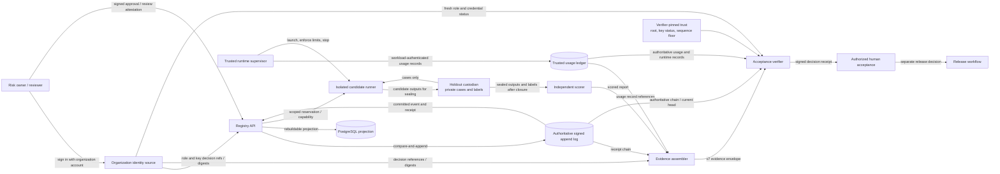
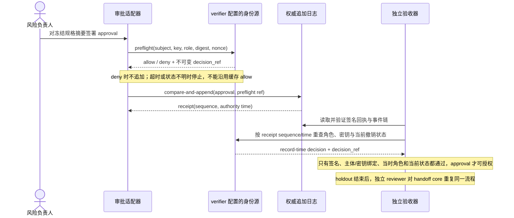
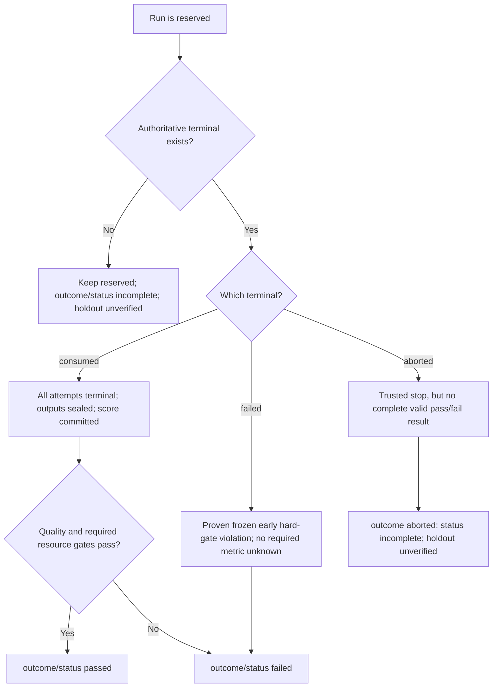

# Stage 5 registry audit integrity

**Status:** documentation/design phase. The reference signature profile and wire contracts are specified, but no external registry or transparency service has been deployed or tested. This phase is limited to documents and declarative schemas; signer authentication, IdP integration, and production acceptance wiring are deferred. These remain future prerequisites for any official governance approval claim.

> **先用白话说明**：这里的“盲测登记服务”是一个独立后台，负责在隐藏测试开始前登记候选版本和测试规则，测试结束后按顺序追加记录“谁在何时运行了哪一版、结果是什么”。它让事后改写或补造记录更容易被发现；它本身不会证明模型真的按记录运行，也不会自动批准发布。下文的 `registry` 指这套记录服务，`append log` 指只允许追加的事件账本。

> **审批身份也用白话说明**：将来若要把这套流程用于正式发布，不能只看表单里填了“我是负责人”，也不能只看一把自报的公钥。审批人应先通过组织现有的登录系统证明“我是某个账号”，然后由受信任的身份目录确认“这个账号在审批发生时确实有风险负责人/独立审核员权限”。本轮只把这个验证边界和数据格式写清楚，不接登录系统、不收集账号密码或登录令牌，也不要求现在选择某一家身份平台。个人公钥 pin 只用于本地原型，不能算正式身份认证。
>
> **文档导航**：核心架构与操作约束见本规格；按主题查找每份 JSON Schema、向量、离线测试和后续实施计划，见[Stage 5 设计索引](./stage5-registry-audit-integrity-index.md)。

## Problem

The Stage 5 protocol calls the external holdout registry append-only. A PostgreSQL table with `UPDATE`/`DELETE` revoked from the application role is only append-only against that role. A database owner, migration role, compromised administrator, backup restore, or coordinated storage operator can still rewrite or remove rows and recompute an event chain. Hashes and `previous_event_id` detect accidental inconsistencies; without an independent anchor, they do not prove that an administrator did not rewrite the whole history.

The system must distinguish three claims:

1. **Application append-only:** ordinary registry API calls cannot edit or delete committed events.
2. **Tamper-evident after anchoring:** an auditor can detect edits or deletion after an event digest has been durably committed outside the registry's administrative boundary.
3. **Truth of event claims:** the event actor, runtime-stop assertion, usage, and score came from the claimed trusted source. An anchor proves only that specific bytes were committed by a particular service at a particular point; it does not make those claims true. Identity and source verification remain separate gates.

Do not describe levels 1 or 2 as proof of level 3.

## Architecture at a glance

The diagram shows the intended trust boundaries and evidence flow. It is a design view, not a claim that these services are deployed. The registry records the ordered history; the holdout data plane keeps test cases and labels; the verifier joins evidence with independently configured trust inputs. The last step is still a human decision.



Three boundaries are intentional: the runner never receives labels, the candidate cannot certify its own usage or stop state, and the verifier never trusts trust roots or service URLs supplied by the envelope. A trusted runtime supervisor writes usage records through its own workload identity; the verifier checks their authoritative source independently. A verifier result never triggers release by itself. PostgreSQL is a query projection that can be rebuilt from the append log; it is not a second authority. The candidate/runtime, runtime supervisor, evidence assembler, verifier, and release workflow must not be collapsed into one component merely because a local prototype runs in one process.

### Candidate source-to-image provenance

A source commit and an OCI digest identify two objects; their co-occurrence in an unsigned candidate manifest does not prove the image was built from that commit. The local `release_candidate.py` accepts an operator-supplied digest and emits `publishable: false`, unsigned inventory data. Its self-hash detects accidental mutation but does not authenticate the builder or establish source-to-image provenance. The candidate manifest and six drill reports therefore cannot satisfy the official build-provenance gate by themselves.

Before an official holdout reservation, an independently trusted build service must issue a signed provenance statement binding at least: repository identity and full commit/tree digest; the complete material manifest digest (including submodules and generated inputs); build recipe and invocation digest; pinned builder/toolchain image digest; target platform; resulting OCI index digest and selected platform-manifest digest; and build identity/time. The strict envelope shape is [`p5-build-provenance-v1.schema.json`](./p5-build-provenance-v1.schema.json). `source_tree_sha256` is SHA-256 over JCS of `{repository_id, source_commit, source_materials}`, where `source_materials` is the URI-sorted subset with `kind` `source-file` or `submodule`. `materials` is the complete transitive input closure sorted by unique normalized ASCII URI and includes all source materials plus generated inputs, dependencies, builder image, and base images; `materials_sha256` is SHA-256 over JCS of the complete ordered array. Build recipe and sanitized invocation parameters are hashed separately, with secrets and ambient credentials excluded. The signature covers the JCS bytes of `statement`, including the profile and key id, and is detached in the envelope. The verifier obtains the builder trust root and current key status from pinned configuration, validates the signature and policy, and checks exact equality with the frozen candidate and holdout spec. The builder must use an immutable source checkout and fail if the source/material closure differs from the statement. The runtime supervisor must record the digest actually resolved by the execution platform; for a multi-platform OCI index it records both the frozen index and the selected child manifest digest. Any missing attestation, untrusted/expired builder key, incomplete material closure, digest mismatch, invalid build time ordering, duplicate or unsorted URI, or runtime resolution mismatch keeps the official gate `unverified` and prevents hidden-data capability issuance. Rebuilding the same source creates a new attestation and is allowed only before authorization; after authorization, changing either image identity requires a new frozen spec and run id.

This profile deliberately leaves CI vendor and identity root to the deployment owner. The requirement is independent of the deferred human identity/IdP implementation: it authenticates the build workload under a separately pinned machine trust policy and does not claim that any human signer is authorized.

The image is resolved before any hidden-data capability is issued. The trusted runtime supervisor creates a fresh `preflight_request_id`, pulls by the frozen OCI index digest, resolves the selected platform manifest, and produces a signed admission statement bound to that request id, planned run id, candidate hash, frozen spec digest, exact signed build-provenance envelope digest, runtime identity, target platform, index digest, and selected child-manifest digest. Its strict envelope shape is [`p5-runtime-image-admission-v1.schema.json`](./p5-runtime-image-admission-v1.schema.json). Before image resolution, the registry lifecycle authority issues a cryptographically random nonce with at least 128 bits of entropy, bound to `(preflight_request_id, run_id, frozen_spec_sha256, candidate_hash, runtime_id)` and a short policy-defined expiry; it durably records `pending` state. Repeating the same preflight request id and scope returns the same nonce, while reuse of that id with any changed scope conflicts. There may be only one active preflight nonce per run; after it expires or is explicitly invalidated before reservation, the supervisor must use a new preflight request id and the registry may issue a new nonce. It must reject an older nonce or admission after replacement. The registry lifecycle authority validates the supervisor's admission against the verified build provenance, runtime policy, nonce scope, and trusted time before atomically consuming the nonce, appending the reservation, and minting a one-time capability scoped to that admission/runtime. The nonce has durable `pending/consumed/expired` state; an expired or consumed nonce cannot authorize another admission. Exact retries of a committed reserve resolve only to the same reservation status; changed run, candidate, spec, runtime, or digest under a consumed nonce conflicts. The capability is disclosed only in the first successful reservation response and is never returned or reissued by a reconciliation lookup. The custodian/data plane only validates and redeems the registry-issued capability once to establish a session; it cannot mint a replacement. If the reservation response is lost, the candidate must not start; recovery proves the candidate never started, asks the custodian to revoke/confirm the capability, and consumes the run as aborted. If start or revocation state is unknown, the run stays reserved for reconciliation. The launcher then starts by the selected immutable child-manifest digest, not by a tag or mutable index reference; the supervisor records the same resolved digest in the runtime ledger at process start. Admission signature and current workload-key status, nonce lifecycle, trusted time window, index-to-platform mapping, exact provenance digest, and subsequent launch digest are semantic checks; JSON Schema only constrains the statement shape. A mismatch or inability to verify the admission blocks capability issuance. A mismatch discovered after process start is an integrity incident: revoke the session, terminate the runtime, retain the reservation as unresolved until trusted stop/revocation evidence is reconciled, and never report a successful holdout result. The candidate process cannot provide or sign its own image identity.

#### Preflight nonce and holdout-capability lifecycle

The nonce and the holdout capability are different credentials with different authorities and purposes. The nonce is a short-lived challenge issued by the registry to bind one runtime image-admission attempt; it grants no dataset access. The capability is a high-entropy bearer secret issued by the registry only after valid admission and reservation; it allows one named runtime to redeem one scoped holdout session. Neither credential is a human approval credential, and neither can be supplied by the candidate or chosen by the evidence package.

The v1 capability is exactly 32 cryptographically random bytes encoded as 43-character canonical unpadded base64url. Its public `capability_id` is a separate non-secret identifier. The registry persists the id, `SHA-256` of the decoded 32-byte token, issuance and expiry times, and a digest of the immutable scope; it never persists the recoverable bearer token. It also issues a detached Ed25519-signed capability grant containing `token_sha256` and every scoped claim, using profile `ed25519-jcs-p5-holdout-capability-grant-v1`; the strict envelope shape is [`p5-holdout-capability-grant-v1.schema.json`](./p5-holdout-capability-grant-v1.schema.json). The grant signature covers the JCS bytes of the complete `grant` object, including `signature_profile` and `signing_key_id`; the token itself is not in the signed object. The grant-signing key is a pinned machine credential, distinct from human-attestation and runtime-supervisor keys, and is scoped to this profile and deployment audience. The grant is not appended to registry events and does not independently open a session. The capability token and grant are returned together only in the initial successful reservation response, and neither is returned by reconciliation.

The scope binds the run, reservation event, frozen spec, candidate hash, signed build-provenance digest, runtime-admission digest, selected platform manifest digest, runtime workload identity, custodian audience, dataset version, frozen attempt limit, allowed operation (`read_next_attempt`), capability expiry, and session policy. `scope_sha256` is SHA-256 over RFC 8785 JCS bytes of exactly `{run_id, reservation_event_id, frozen_spec_sha256, candidate_hash, build_provenance_sha256, runtime_admission_sha256, platform_manifest_digest, runtime_id, runtime_subject, custodian_audience, dataset_sha256, session_policy_sha256, capability_expires_at_utc, max_attempts, operation}`; it excludes the token, `capability_id`, `redeem_request_id`, and `scope_sha256` itself. The custodian verifies the grant against a verifier-pinned registry capability-signing key and current key status, computes SHA-256 over the decoded token bytes and compares it with `token_sha256`, recomputes the scope digest, and checks every repeated request field against the signed grant and its own frozen run configuration. It also authenticates the caller as the exact bound runtime workload identity; a token match or body field alone is insufficient. Missing, revoked/unknown, or stale signing-key status, signature failure, token mismatch, unknown or expired capability, or inability to fetch the frozen run policy fails closed without creating a session. The strict redemption request shape is [`p5-holdout-session-open-request-v1.schema.json`](./p5-holdout-session-open-request-v1.schema.json). The capability cannot enumerate cases, read labels, score outputs, access another run, or authorize a second session. Its expiry must be no later than the frozen run deadline and the custodian's maximum session lifetime. Redemption creates a server-side session whose authority is no broader or longer-lived than the capability; every attempt read is checked against that session's remaining attempt budget.

Registry capability issuance is a durable state transition coupled atomically with nonce consumption and reservation append: `absent → issued`. The registry commits `capability_id`, token verifier, scope digest, expiry, and reservation/event id in the same transaction/conditional append outcome. If that transaction's outcome is unknown, the registry must reconcile by the original `(run_id, preflight_request_id, idempotency_key)` and may return reservation status but never disclose the token again. The original successful response is the sole disclosure point. A client that did not receive the secret cannot start the candidate; recovery may proceed only after the trusted supervisor proves no process started and the custodian confirms revocation or expiry.

The custodian keeps an independent durable redemption record with states `issued → redeemed | revoked | expired`; redemption is a compare-and-set, not a read-then-write check. A successful redemption binds `capability_id`, the exact scope digest, runtime identity, one `redeem_request_id`, and one `session_id`. To recover a lost response, an exact retry with the same `redeem_request_id`, caller identity, and scope returns the same session identity/status and cannot create a second session. Reuse with a different request id or changed scope is rejected. This idempotent response is not a second redemption and must not return or persist the bearer token. A point-in-time `issued` / `not-redeemed` read is not proof that redemption cannot happen later and never authorizes `aborted`; recovery must either continue with the same redemption id or atomically revoke the still-unredeemed capability.

`revoke_capability(capability_id, reservation_event_id, scope_sha256, revocation_request_id, reason_code)` is a custodian compare-and-set against redemption. Only the mutually authenticated registry-lifecycle workload identity may call it; the custodian checks the capability/run/reservation/scope against the frozen run configuration and records a revocation tombstone even if it has never received the bearer token or grant. This lets a lost reserve response be safely revoked without reissuing either credential and remains available if the grant-signing key is later revoked. If revocation wins while state is `issued`, it commits `revoked` and permanently prevents session creation. If redemption already won, the same operation revokes the bound session and denies future attempt reads; it must not claim that the candidate process stopped or that an in-flight read/provider operation was cancelled. If already revoked/expired, an exact retry returns the existing terminal state; reuse of the request id with changed scope or reason conflicts. A dropped response is reconciled by retrying the same revocation id or querying the authoritative custodian state. A confirmed pre-redemption revocation plus trusted supervisor proof of no process start permits `aborted`; after redemption, terminal `aborted`/`failed` still requires runtime-stop proof and terminal disposition of every in-flight operation. Unknown revoke/session state keeps the registry `reserved`.

Revocation and expiry are monotonic; neither a second session nor an alternate capability may be created for the same reservation. The custodian records `capability-redeemed`, pre-redemption `capability-revoked`, `capability-expired`, post-redemption `session-revoked`, and normal `session-closed` transitions as signed events with strict shape [`p5-holdout-custodian-event-v1.schema.json`](./p5-holdout-custodian-event-v1.schema.json). Each event binds capability/grant/scope/run/reservation/runtime, uses a per-capability monotonic sequence and predecessor digest (64 zeroes for the first event), and is signed with a verifier-pinned custodian machine key under `ed25519-jcs-p5-holdout-custodian-event-v1`. The custodian event-signing key is distinct from the registry grant key and human keys; current key status is checked before any official decision.

The custodian's `get_capability_state(capability_id, expected_scope_sha256)` source returns the complete signed per-capability event chain and the current head it observed over an authenticated, cache-bypassing service connection. The verifier checks every event signature and transition, exact grant/scope/run/reservation binding, sequence continuity, predecessor digest, current key status, and freshness against its independently configured custodian identity and TTL. An absent lifecycle event may be reported as `not-redeemed` for diagnosis, but it is only a point-in-time read; it does not fence later redemption and cannot support a terminal registry event. Only an appended `capability-revoked` event that won the same CAS as redemption proves that the bearer can never create a session. A signed `session-revoked` event proves only that custodian reads are fenced; a terminal abort still needs supervisor proof of process termination and terminal disposition of in-flight operations. A `session-closed` event carries a stable `close_request_id`; retries with that id and identical scope/reason return the same event, while changed bytes conflict. This event is committed before sealing and never embeds the seal digest, avoiding a circular receipt dependency. Source outage, stale head, key-status uncertainty, or incomplete chain leaves the run reserved/unverified. A caller-supplied status, cached response, or client timestamp is not a custodian receipt.

| Boundary / outcome                            | Required durable behavior                                                                                                      | Caller-visible recovery                                                                                                                                                                 |
| --------------------------------------------- | ------------------------------------------------------------------------------------------------------------------------------ | --------------------------------------------------------------------------------------------------------------------------------------------------------------------------------------- |
| Concurrent reservation or exact retry         | One nonce consumption, reservation, and capability issuance for the scoped request; preserve the original idempotency binding  | At most the first successful response contains the token; later calls return status only                                                                                                |
| Reservation commit outcome unknown            | Query authoritative registry state by original request/idempotency key; do not create a new run or nonce under the same intent | `committed`, authoritative `not-found`, or `unknown`; only a separately proven no-start plus confirmed revoke/expiry can lead to `aborted`                                              |
| Concurrent capability redemption              | Custodian atomically permits one session for the capability id                                                                 | Exact same redemption request may recover that session; changed request or identity conflicts                                                                                           |
| Custodian redemption response lost            | Query/retry the same redemption identity and scope; never retry with a new id to seek a second session                         | Return the same session status, point-in-time `not-redeemed`, or `unknown`; `not-redeemed` permits only same-id retry or atomic revoke, while `unknown` keeps the run reserved          |
| Custodian revoke races with redemption        | Race `revoke_capability` against `open_session`; drop the revoke response and retry with the same id, then try a changed scope | Exactly one CAS outcome wins: either no session can ever open, or the one existing session is revoked; exact retry returns the committed outcome and never starts a replacement session |
| Capability expires or is revoked              | Mark it unusable at the custodian and stop/deny all future attempt reads                                                       | No reissue; a new holdout run and authorization are required                                                                                                                            |
| Candidate or selected image identity mismatch | Revoke the session, terminate the runtime, retain all receipts and incident evidence                                           | Keep the run unresolved until trusted stop, revocation, and in-flight-operation evidence are reconciled                                                                                 |

The secret and signed grant are prohibited from append events, receipts, logs, traces, crash dumps, command-line arguments, environment variables visible to the candidate, and scorer inputs. The runtime supervisor transfers both only over an authenticated protected control channel and keeps them outside the candidate process boundary. Error handling must discard raw transport exceptions and response bodies before they can reach logs or reports. Schemas constrain the token, grant, and request shapes, but cannot prove randomness, signature/key status, token-to-grant equality, one-time issuance, durable compare-and-set, runtime identity, secret non-disclosure, or recovery semantics; those require service-level conformance tests.

Build-provenance evaluation separates contradictions from missing trust evidence. A known bad signature, a builder explicitly disallowed by the pinned policy, an attested source/material/build/image value that contradicts the frozen spec, or a signed runtime admission naming a different image is `invalid-report` and must stop before capability issuance. An absent attestation, unknown builder key, unavailable or stale key-status service, unverifiable OCI registry response, incomplete runtime admission, or unavailable runtime identity source is `unverified`; it also blocks capability issuance. A valid statement requires semantic recomputation of both material digests, uniqueness and ordering of normalized ASCII URIs, inclusion of all required source/submodule/build inputs, trusted timestamp ordering, exact builder policy, and OCI index-to-platform mapping. JSON Schema establishes only the envelope's shape. The builder trust policy is the authority for the completeness claim: the verifier cannot infer from a signed list alone that a compromised or untrusted builder disclosed every input.

| Provenance/admission condition                                                                                                             | Derived gate result                           | Required behavior                                                                                                                            |
| ------------------------------------------------------------------------------------------------------------------------------------------ | --------------------------------------------- | -------------------------------------------------------------------------------------------------------------------------------------------- |
| Valid signature and trusted current builder key; all source, material, recipe, toolchain, platform and image bindings match frozen spec    | `passed`                                      | Continue to runtime image admission; this alone does not reserve the holdout or issue a capability.                                          |
| Known invalid signature, disallowed builder, digest mismatch, malformed material closure, or trusted runtime statement names another image | `invalid-report`                              | Stop; do not reserve, issue, or consume a hidden-data capability.                                                                            |
| Missing statement, unknown key, stale/unavailable trust status, OCI lookup uncertainty, or missing runtime admission                       | `unverified`                                  | Fail closed before capability issuance; resolve the missing trust evidence and retry only under a new preflight request identity.            |
| Image admission is valid, but later runtime-start evidence reports a different digest or cannot prove the admitted image launched          | `invalid-report` or `unverified` respectively | Revoke the session and terminate when mismatch is known; otherwise hold the reservation open and reconcile trusted stop/revocation evidence. |

The human approval/review attestation is signed by the authorized person. The identity source's decision record is different: its `decision_sha256` is an integrity checksum, not a source signature; trust in that record comes from the verifier querying the pinned, authenticated source and matching the immutable reference and digest. The diagram therefore labels these as decision references/digests, not signed identity decisions. A future offline-verifiable source assertion would require a separately versioned signature contract.

## Proposed authority model

The ordered, conditional append log is authoritative for registry history. PostgreSQL may serve as the query projection and operational index, but it is rebuildable and is not the sole audit authority. The append authority must provide a per-run compare-and-append operation keyed by `(run_id, expected_previous_event_hash, idempotency_key)`, durably reject a stale head, and return the complete committed envelope plus a signed receipt. Its administration and signing key must be separate from registry database administration. The storage backend must retain committed receipts under an independently controlled retention policy.

### Runtime usage evidence source contract

A valid registry receipt proves that the append authority recorded a usage claim; it does not prove the candidate reported its usage honestly or completely. Official usage evidence therefore comes from a separately authenticated runtime supervisor and ledger, not from candidate output or a caller-populated report field. The supervisor owns the workload identity allowed to write the ledger; the candidate process receives neither that identity nor ledger write credentials.

The supervisor must mediate every candidate provider/network call that contributes to the frozen usage or cost limits. Runtime egress policy denies direct provider access and unapproved network paths. For each admitted call, the supervisor records a unique `provider_call_id`, frozen run/reservation/candidate/image bindings, attempt id, provider response usage when present, monotonic start/end measurements, response status, and provenance. It stores hashes/references rather than prompts, full provider bodies, credentials, hidden labels, or raw candidate output. If an outbound path can bypass the supervisor, the ledger cannot claim completeness and usage remains `unverified`.

The stop point is a signed [`p5-runtime-stop-record-v1.schema.json`](./p5-runtime-stop-record-v1.schema.json) receipt from the trusted runtime supervisor. It binds the exact admitted run scope, supervisor/runtime workload identities, process-inventory digest and counts, egress-policy digest, confirmed termination, egress-fenced state, the usage-ledger head observed at the fence, and a complete provider-call inventory containing each call id, last state, and last entry digest. An authoritative control-plane adapter must corroborate that the recorded process set is complete and terminated and that the egress fence is active; `termination_status=confirmed` or `egress_status=fenced` in a self-asserted document is not sufficient. The semantic verifier requires `observed_process_count == terminated_process_count`, exact equality between the inventory and all provider call ids in the chain at the recorded head, unique sorted call ids, and a matching sequence/head digest. The stop record is immutable and idempotent by `stop_request_id`; changed inventory or scope conflicts. If process termination or egress fencing cannot be authoritatively confirmed, no valid stop record exists, usage closure and output seal are prohibited, and the registry remains `reserved` for recovery.

The logical service contract has three operations:

| Operation                                                                            | Required behavior                                                                                                                                                                                                                                                                                                                                                                                                                                                                                                                                                                                                                                                                                                                                                                                                                                                                                                                                                                |
| ------------------------------------------------------------------------------------ | -------------------------------------------------------------------------------------------------------------------------------------------------------------------------------------------------------------------------------------------------------------------------------------------------------------------------------------------------------------------------------------------------------------------------------------------------------------------------------------------------------------------------------------------------------------------------------------------------------------------------------------------------------------------------------------------------------------------------------------------------------------------------------------------------------------------------------------------------------------------------------------------------------------------------------------------------------------------------------- |
| `append_usage(entry)`                                                                | Accept only an authenticated supervisor workload identity; derive run/reservation/spec/candidate/admission/image/dataset/runtime scope from the frozen registry record; assign ledger sequence and commit time; append an immutable record or return the identical record for the same idempotency key. Same key with changed bytes is a conflict. Before runtime stop, accept only new calls in `prepared` before dispatch and legal transitions. After a trusted stop record fences the runtime, reject every new call and ordinary write; accept only terminalization of provider calls already present in the stop inventory: `unknown` calls may be reconciled against authoritative provider evidence, and `prepared` calls may become `cancelled` only with proof they were never sent. Every post-stop entry binds the same stop-record digest.                                                                                                                          |
| `close_usage_window(closure_id, run_id, reservation_id, runtime_stop_record_sha256)` | Atomically seal the ledger only after the trusted supervisor proves the candidate/runtime has stopped, outbound egress is fenced, and every provider operation is terminal. The closure state is always `all-terminal`; if any call remains `prepared`, `sent`, or `unknown`, return `PENDING_RECONCILIATION` without creating a closure receipt or advancing the head; keep the registry reservation open and allow only the constrained reconciliation append above. The service retains the request fingerprint for that `closure_id`: once all calls are terminal, an exact retry with the unchanged scope/stop-record payload may commit against the then-current head, while changed bytes conflict. It serializes appends against final closure: each append is either included before the closed head or rejected after it. A lost response is reconciled with the same `closure_id` and identical payload; changed bytes conflict. It must not run the candidate again. |
| `read_usage(run_id, reservation_id, through_sequence?)`                              | For an authenticated read-only verifier identity, return the complete ordered ledger records, closure record, scope, and authoritative current head. After closure, the runtime ledger head must remain exactly the closed head; any policy-required provider-billing supplement is separately sourced and bound to that immutable closure. Distinguish `NOT_FOUND`, `FORBIDDEN`, `UNAVAILABLE`, and `OUTCOME_UNKNOWN`; only an authoritative completed read may prove absence. No caller-supplied report copy can substitute for this read.                                                                                                                                                                                                                                                                                                                                                                                                                                     |

Records are append-only. Before closure, a discovered correction is a new record referring to the superseded record and reason; it never rewrites a prior usage entry. After closure, the runtime ledger snapshot is immutable. A later provider invoice is a separately authenticated billing supplement bound to the closed ledger digest; it cannot change recorded token usage or runtime duration. If the frozen policy requires settled cost and no verified supplement exists, cost remains `unknown`. A material correction discovered after a decision requires a new versioned evidence envelope and verifier decision; retain the prior envelope and receipt for audit. If release already occurred, the separate release workflow handles any suspend/rollback decision. Provider-reported token usage, supervisor-measured duration, and provider-billed cost are separate measures with explicit provenance. A provider response's cost estimate is not a final invoice, and missing usage/cost is `unknown`, never zero. Before authorization, the frozen spec must declare each resource measure's unit, authoritative source, limit (if any), and whether it is an acceptance gate. Any metric that enforces a frozen budget/limit is a required gate; the run cannot pass when that metric is unknown, even if a separate quality score can be computed. In the current frozen-spec/evidence-envelope v7 contract ([schema](./official-blind-holdout-evidence-envelope-v7.schema.json), [reference acceptance implementation](../../../examples/capstone-acceptance/acceptance.py)), `max_budget_usd` is such a required gate: `passed`/`failed` require verified known `actual_usd`, while unknown cost is represented as `outcome=aborted`, top-level `status=incomplete`, and `holdout_outcome=unverified`. If the authenticated ledger correctly establishes that cost is unknown and the rest of the evidence chain is valid, `evidence_integrity` may still be `valid`; a missing, stale, or unauthenticated ledger source makes it `unverified`. Optional observational metrics may remain unknown without changing quality eligibility, but the report must preserve that unknown state. Do not decide a metric's gate status after seeing the result. The verifier checks record sequence/receipt, current source identity and freshness, scope against the frozen spec and registry reservation, complete attempt coverage, and exact binding to the runtime stop record. Source outage, stale head, incomplete attempt set, bypassable egress, or ambiguous finalization leaves the affected usage claim `unverified`; an impossible binding or tampered record is `invalid`.

Each provider call must be durably written as `prepared` before network dispatch, then advance to `sent` before bytes may leave the supervisor. `prepared` means the supervisor can prove the call has not been sent; it may be cancelled only under that proof. Once `sent` is committed, a timeout, process crash, or lost response becomes `unknown`, not a retry signal. The supervisor may reconcile the same `provider_call_id` against an authoritative provider operation lookup or a durable captured response; only then may it append `responded` with usage evidence. If authoritative provider evidence proves that no operation executed, append `confirmed-not-executed` with its response digest and link to the prior unknown entry. Every terminalization entry identifies `pre-stop` or `post-stop`; post-stop entries require the signed stop-record digest, and semantic verification must match it to the exact runtime-stop record and stop inventory. These entries cannot create or dispatch a new call. Without authoritative reconciliation the operation remains `unknown`, is never resent, and its usage/cost stays unknown. Valid transitions are `prepared → sent → responded|unknown` and `prepared → cancelled`; `unknown → responded|confirmed-not-executed` is allowed only through authoritative reconciliation, and `unknown → sent` or a second provider dispatch for the same id is forbidden.

Closing the usage window and sealing candidate outputs are separate operations on separate authorities. The supervisor first fences egress, terminates the candidate and child processes, inventories each provider call's last ledger state, and obtains a trusted signed runtime-stop record. Any provider call in a nonterminal state (`prepared`, `sent`, or `unknown`) keeps the run `reserved` until it is terminalized. After stop, the supervisor may only reconcile existing `unknown` calls against authoritative provider evidence or cancel listed `prepared` calls with proof of non-send, attaching the stop-record digest; it may not dispatch another call. Once all calls are terminal, it closes the usage ledger at the resulting head using a stable `closure_id`. This ordering keeps the ledger appendable for narrowly scoped reconciliation while preventing new candidate work, then makes the final closed head immutable. The holdout custodian then closes/revokes the data session using an idempotent `close_request_id`, commits the resulting `session-closed` lifecycle event, and creates the **output seal** defined by [`p5-holdout-output-seal-v1.schema.json`](./p5-holdout-output-seal-v1.schema.json). The signed seal binds the exact run/reservation, `frozen_spec_sha256`, candidate, `runtime_admission_sha256`, runtime image, dataset, capability scope, `output_manifest_sha256`, the digest of the complete signed `session-closed` event envelope, `runtime_stop_record_sha256`, and the complete signed usage-closure envelope digest plus `(usage_ledger_id, usage_ledger_closed_sequence, usage_ledger_closed_head_sha256)`; it also fixes the attempt count and seal identity. Seal creation has its own stable `close_request_id` idempotency key: a retry returns the original event and seal, and a payload mismatch conflicts. Event append and seal creation are not one cross-service atomic action; if the second step fails, the closed event remains durable and the custodian reconciles or completes the seal for that same request without reopening the session or rerunning the candidate. The scorer receives labels only after it verifies the seal signature/current key status, the referenced event-chain head and all frozen scope digests, the exact manifest and attempt coverage, the usage-ledger closure and supervisor stop proof, the frozen scorer identity, and evidence that every provider call is terminal (`responded`, `cancelled`, or `confirmed-not-executed`; `responded` may carry `usage=unknown`). If any provider call remains `prepared`, `sent`, or `unknown`, do not release labels or append a terminal event; keep the run `reserved` and reconcile or escalate. The registry terminal event references the runtime-stop record, closed usage head, output seal, and persistent score (when scoring completed). These are distinct receipts; no service may claim another service's operation is atomic with its own.

If response loss or a cross-service failure leaves either the usage closure or output seal uncertain, query/reconcile that exact closure or seal identity. Do not repeat candidate execution or release labels. A terminal `aborted`/`failed` event requires confirmed process termination, capability/session revocation, and proof that all sent outbound operations are terminal; an unresolved provider call remains `unknown` and keeps the run `reserved` even when no output seal exists. If all calls are terminal but some usage/cost fields cannot be recovered, report those measures as `unknown`. Preserve a separately committed scorer result if one exists, but do not promote the run to passed/failed while a required frozen metric is unknown; under evidence-envelope v7, unknown required cost follows `outcome=aborted`, `status=incomplete`, and `holdout_outcome=unverified`; `evidence_integrity` remains valid when the authenticated source truthfully reports unknown, and becomes unverified only when that source cannot be trusted or reached. Never infer zero or a successful terminal. An output seal alone proves only the exact output bytes and attempt set observed by the custodian, not that the runtime is inactive or usage is complete.

The ledger uses its own pinned signing key/root, separate from the registry append authority and human-attestation keys. [`p5-runtime-usage-entry-v1.schema.json`](./p5-runtime-usage-entry-v1.schema.json) defines signed immutable per-call state entries; [`p5-runtime-usage-closure-v1.schema.json`](./p5-runtime-usage-closure-v1.schema.json) defines the separate signed closure receipt. Each entry binds the domain-separated profile, ledger/environment/run/reservation/spec/candidate/admission/image/dataset/runtime scope, provider call and attempt IDs, state transition, sequence, predecessor digest, supervisor-assigned commit time, and key id. It carries only request/response digests, exact decimal-string usage counters, and monotonic durations; it excludes prompts, bodies, credentials, labels, and candidate output. The closure receipt binds a stable idempotency key, provider-operation terminality/counts, final sequence/head, and runtime-stop-record digest. `all-terminal` means no provider operation can still complete; it does not mean every usage or cost measure is known. The custodian's separate output-seal receipt binds both the complete signed closure envelope digest and its closed ledger head, plus the output-manifest digest. The verifier must recompute call counts and transitions from the full chain, validate counter relationships, scope and stop-record bindings, current key status, fresh authoritative head, and a durable per-ledger sequence floor on every decision. A schema-valid receipt with inconsistent counts or sequence/head still fails semantic verification. If the deployment cannot supply authenticated latest-head reads and anti-rollback state, usage stays `unverified`; if ledger-administrator compromise is in scope, the ledger head also needs an independent witness. These schemas define wire shapes, not a runtime ledger, signing service, source identity, or proof that egress is complete.

This contract is normative for the future deployment but has no external service or production adapter in the current documentation-only phase. Local runtime counters and fake ledger adapters may test call ordering; they cannot establish source identity, egress completeness, durable retention, or authoritative latestness.

### Normative usage-ledger verification order

The reference verifier applies these checks in order and does not collapse “missing evidence” into “invalid evidence”:

1. **Obtain current sources.** Through pinned, authenticated, cache-bypassing connections, fetch the complete ordered usage chain, authoritative latest head, signed stop record when present, closure receipt when present, ledger trust bundle, and current key-status snapshot. Enforce the configured freshness window and durable anti-rollback floors before using any source. A timeout, unknown commit outcome, stale source, or unavailable status is `unverified`; do not fall back to the submitted artifact or a cached snapshot.
2. **Verify strict wire and signatures.** Reject duplicate JSON keys, invalid Unicode, non-finite numbers, and unknown schema fields. Recompute JCS bytes/digests and verify the root-signed usage trust bundle, ledger signatures, key validity at authoritative commit times, current revocation state, scope, and signing profiles. A bad signature, digest, signer, or impossible encoding is `invalid`; schema validation alone is never a signature check.
3. **Verify the append chain.** Require sequence 1 with the 64-zero genesis predecessor; every next record increments by one and names the prior complete signed envelope digest. Entry ids and idempotency keys are unique, except an exact retry that returns the original receipt without allocating another sequence. Authority commit times do not move backwards. The observed current head must equal the last verified entry; after final closure it must remain exactly the closure head.
4. **Verify frozen scope.** Every entry, stop record, closure, and output seal must match one frozen environment/ledger/run/reservation/spec/candidate/build admission/image/dataset/runtime scope. Derive that scope from the authenticated frozen registry record; reject caller-supplied substitutions. Supervisor workload identity must be authorized for append and verifier identity must be read-only.
5. **Recompute each provider-call history.** Group entries by `provider_call_id`; require one immutable request hash, attempt, provider/model, and scope; exactly one initial `prepared`; only allowed state transitions; and no transition after a terminal state. A committed `sent` can never be retried. Recompute the distinct call count, terminal count, unresolved count, and any token/duration aggregates from entries rather than trusting closure counters. Require same-clock monotonic `end >= start`; if a measure is absent, preserve `unknown` rather than zero.
6. **Verify the runtime-stop boundary.** Validate supervisor identity/key status and corroborate process/egress facts with the trusted control plane. The stop record's ledger sequence/head must identify an exact prefix; its unique sorted call inventory must equal all call ids and their latest entry digests/states at that prefix. Check observed and terminated process counts, process inventory digest, egress policy and active fence. A contradiction is `invalid`; inability to query the control plane or prove completeness is `unverified` and prohibits closure/sealing.
7. **Verify post-stop terminalization.** After the stop prefix, reject every new provider-call id and ordinary state write. The only allowed suffix is (a) `unknown → responded|confirmed-not-executed` using authoritative provider evidence or (b) `prepared → cancelled` with proof that it was never sent. Each such record must be marked `post-stop` and carry the exact stop-record digest; its call id must occur in the stop inventory. `sent` remains unresolved until authoritative reconciliation; if any call is still unresolved, return `PENDING_RECONCILIATION`, keep registry `reserved`, and withhold labels and output seal.
8. **Verify final closure.** A valid closure is `all-terminal` only: `provider_call_count` equals the recomputed distinct calls, `terminal_provider_call_count` equals calls ending in `responded`, `cancelled`, or `confirmed-not-executed`, and unresolved count is zero. Its sequence/head must equal the complete chain after all allowed reconciliation; its runtime-stop digest and scope must match. Concurrent append/close operations must linearize so each append is either before the closed head or rejected. Same `closure_id` and bytes returns the same closure; changed bytes conflict. An incomplete closure is not a valid final receipt.
9. **Verify output seal before label release.** Recompute the digest of the complete signed closure envelope and session-closed envelope. Require the custodian seal to name those exact digests, the exact frozen scope, stop record, output manifest and attempt set. Only then may the independent scorer read labels. The scorer's own identity and persistent result are separately verified; neither usage closure nor output seal alone proves the other source's claims.
10. **Derive claim states.** Any contradiction between authenticated sources is `invalid`. Missing or stale sources and unresolvable provider calls are `unverified`/pending and cannot produce a successful terminal event. `holdout_outcome=passed` requires both a passing verified quality result and every frozen resource gate satisfied; a measured limit violation is `failed`, and a required unknown measure is `unverified`. A separately computed quality score may remain valid when a non-gating metric is unknown, but that unknown must remain visible and cannot be used to satisfy any limit. If a required metric is unknown, retain any separately committed score for audit but keep the official holdout outcome unverified; the v7 `aborted` outcome does not become a quality pass merely because scoring completed. Never turn unknown usage, cost, latency, or process state into zero or success.

### Canonical JSON and wire profile

This protocol pins `jcs-rfc8785-v1` to the behavior in [RFC 8785 §§3.1–3.2](https://www.rfc-editor.org/rfc/rfc8785.html#section-3.1), including its I-JSON input constraints and ECMAScript-compatible primitive serialization. RFC 8785 is published as an Informational RFC, so this project profile is the binding interoperability contract; an implementation must not substitute a library's generic “sorted JSON” mode or silently upgrade canonicalization behavior.

- Parse one strict UTF-8 JSON value and reject duplicate object property names before converting them to a map/object. Reject invalid Unicode, including lone surrogates; preserve valid string data exactly, with no NFC/NFD normalization, trimming, case folding, date coercion, or application-level rewriting before hashing.
- Recursively sort object property names by their decoded UTF-16 code units, independent of locale. Preserve array order. Emit no insignificant whitespace and hash/sign the canonical UTF-8 bytes, not the received JSON formatting.
- JCS numbers must be representable as IEEE 754 binary64 values. This project narrows JSON integer fields further to the exact safe range `-(2^53 - 1)` through `2^53 - 1`; every versioned wire schema must encode the positive upper bound as `maximum: 9007199254740991`. A conventional parser such as `JSON.parse` rounds numeric tokens before JSON Schema sees them: for example, `9007199254740991.1` becomes the in-range number `9007199254740991`, so a schema maximum cannot detect the original out-of-range value. Stage 5/P5 v1 has no floating-point JSON fields, so verifier preflight can apply one unambiguous rule to **every** raw number token: parse its decimal coefficient and exponent without binary64 conversion, require an exact integral value within the safe range, then materialize it as a binary64 integer and run the strict schema validator. Exact exponent notation is allowed when the mathematical value is an integer (for example, `1e3`); fractional values and values outside the safe range are rejected before conversion. A standard parse followed by Ajv is insufficient for this boundary. The boundary cases are fixed in [`stage5-jcs-number-token-vectors-v1.json`](./stage5-jcs-number-token-vectors-v1.json); production parser implementations must consume the same vectors. Larger identifiers, counts, or exact quantities must use schema-defined decimal strings. Monetary quantities are decimal strings, never JSON floating-point numbers. Reject NaN and infinities before canonicalization. RFC 8785 recommends strings for values whose precision or integer length exceeds binary64's interoperable range; see [Appendix D](https://www.rfc-editor.org/rfc/rfc8785.html#appendix-D).
- Stage 5/P5 v1 wire schemas currently contain no floating-point `number` fields: all JSON numeric values are exact bounded integers; rates use basis-point integers and exact decimal/money values use schema-constrained strings. A future non-integral numeric field requires a new explicit profile and cross-language vectors; it must not be introduced as an unconstrained JSON `number` into signed v1 payloads.
- `SHA-256(JCS(value))` means SHA-256 over the exact canonical UTF-8 byte sequence. For Ed25519, sign those bytes using the pinned pure Ed25519 profile; remove only the named detached-signature field from that object before canonicalization. Do not hash a hexadecimal digest string and then sign it unless the profile explicitly says so.

The conformance corpus must include nested object sorting, UTF-16 property ordering, arrays whose order is significant, equivalent input objects with different source key order, decomposed versus precomposed Unicode strings (which remain distinct), duplicate keys, lone surrogates, negative zero, non-finite numbers, and integers immediately inside/outside the project safe range. These are protocol vectors, not optional serializer preferences.

##### Parser resource limits

Strict parsing must also be resource-bounded before canonicalization. The verifier pins a deployment-selected [`stage5-verifier-input-limits-v1`](./stage5-verifier-input-limits-v1.schema.json) profile by digest in its verifier configuration and the risk-owner-approved frozen release materials; the v7 `frozen_spec.verifier_input_limits_sha256` explicitly binds its JCS digest, and the verifier compares it with the independently pinned profile. The evidence artifact cannot raise these limits. The profile caps compressed and decompressed bytes separately, JSON nesting depth, total parser tokens, object members, array items, decoded UTF-8 bytes per string, raw number-token bytes, canonical output bytes, per-request wall-clock and CPU time, per-job parser memory, total parser memory across the verifier pool, concurrent verification jobs, and queued jobs. V1 permits configured maximum depth up to 128 and number tokens up to 256 bytes; deployments choose tighter limits based on their frozen evidence size and infrastructure, record the rationale, and prove the selected values before release. Time, concurrency and memory caps are mandatory parts of the same digest-bound profile, with units and scope fixed below; they are hardware-specific deployment values, not unbound infrastructure defaults. No default profile means official verification is `unverified`.

Limits have these fixed counting rules so implementations agree at the boundary: the root object/array has depth 1, each nested object/array adds one, and a scalar value adds no container depth; each object member and each array element counts once against its own per-container cap; `max_total_tokens` counts every JSON value (including container values) plus every decoded object property name, but excludes punctuation, whitespace and encoding bytes; decoded string length counts UTF-8 bytes after escape processing and applies to property names and string values; number-token length counts original ASCII token bytes including sign, fraction and exponent; input byte counts are measured on the received content-coded body and again after decompression; canonical output bytes cover the complete JCS byte sequence being hashed or signed; `max_parse_wall_ms` is elapsed monotonic wall time for one request from admission through body receipt, parsing, schema validation and canonicalization; `max_parse_cpu_ms` is CPU consumed by that job; `max_parser_memory_bytes` is the hard memory ceiling per isolated worker; `max_total_parser_memory_bytes` is the aggregate hard memory budget across all verifier replicas; `max_concurrent_verification_jobs` is the service-wide active-worker cap; and `max_queued_verification_jobs` is the service-wide cap on waiting request metadata; the corresponding `*_per_principal` fields cap active and queued work for one authenticated workload principal. Profile activation also requires `max_concurrent_verification_jobs × max_parser_memory_bytes ≤ max_total_parser_memory_bytes`, `max_concurrent_jobs_per_principal ≤ max_concurrent_verification_jobs` and `max_queued_jobs_per_principal ≤ max_queued_verification_jobs`; compute the product with checked exact-integer arithmetic. Admission atomically reserves one worker slot and its full `max_parser_memory_bytes` budget from the service-wide semaphore before consuming the request body, and releases both only after the isolated worker has exited. If no reservation is available, the request remains metadata-only in the bounded fair queue; inability to obtain the global reservation is capacity exhaustion, never permission to exceed the aggregate budget. This invariant must continue to hold across replicas and autoscaling. The scheduler enforces a principal identity established by the authenticated connection, never a body/header value chosen by the caller, and dispatches queued work fairly across principals (round-robin between nonempty principal queues, FIFO within each principal). The ingress reserves a worker slot before consuming a request body, applies backpressure while a metadata-only request is queued, and rejects immediately with `capacity-exhausted` when either the global or per-principal queue is full. Ingress proxies must disable request-body buffering before this gate or set an independent strict body-buffer cap included in the ingress memory budget; autoscaling cannot bypass the service-wide worker/memory semaphore. The profile's `accepted_content_encodings` is an exact allowlist; v1 supports only `identity` and `gzip`, with identity required. Unknown, stacked, or unlisted content encodings are rejected before decompression.

The parser enforces the compressed-byte cap while receiving data and the decompressed cap while streaming decompression, before allocating an unbounded body. It counts structural tokens and decoded string bytes during tokenization, rejects a depth/token/member/item/string/number limit before building a full object graph, and enforces the canonical-output cap while serializing. Duplicate-key detection and exact-number preflight happen in this same bounded token stream. Each verification job runs in a sandbox with the profile's wall-clock, CPU and memory ceilings; a wall deadline, CPU ceiling, or per-worker hard memory stop returns `input-limit-exceeded` with respectively `parse-deadline`, `parse-cpu`, or `sandbox-memory`, and is never interpreted as a semantic report result. An aggregate-memory reservation failure or full global/per-principal queue returns `capacity-exhausted` with `retryable=true` and `retry_after_seconds` in the fixed 1–60 second range; all request-bound limit errors remain nonretryable. If the verifier cannot load and independently match the frozen resource profile to its external pin, it returns `verifier-not-ready` with the bounded retry fields; this is server configuration failure, not an artifact's `unsupported-profile`, and never produces an official decision. A parse/profile failure returns only the strict [`stage5-verifier-protocol-error-v1`](./stage5-verifier-protocol-error-v1.schema.json) shape: server-generated request id, fixed error code, a limit dimension only for `input-limit-exceeded`, and the conditional retry fields for `capacity-exhausted` or `verifier-not-ready`. Map unknown/unlisted content encodings to `unsupported-content-encoding`; malformed compression streams, invalid UTF-8/Unicode, duplicate keys or invalid JSON grammar to `malformed-input`; an artifact's unknown hash/schema versions to `unsupported-profile`; and a parsed document that fails the selected v7 allowlist schema to `invalid-evidence-shape`. The trusted ingress generates the request id before reading the body, and reverse proxies/gateways that enforce byte caps must return the same error schema instead of a vendor-specific body. Every response body is at most 1 KiB, contains no body fragment, schema details, threshold values, identity claims, or parser exception text, and does not include a decision receipt because no trusted evidence envelope was established. An exceeded limit cannot be converted to a negative quality result or `ready`, and it never triggers registry append, acceptance, release, or deployment side effects. The service may still advance an anti-rollback floor only from a separately authenticated fresh status statement; artifact contents cannot advance that floor.

For the HTTP binding, use `400` for `malformed-input` and artifact `unsupported-profile`, `413` for `input-limit-exceeded`, `415` for `unsupported-content-encoding`, `422` for `invalid-evidence-shape`, and `503` for `capacity-exhausted` or `verifier-not-ready`. For either `503`, the `Retry-After` header is the same integer number of seconds as `retry_after_seconds`; non-retryable errors omit it. Every protocol-error response uses `Content-Type: application/json` and `Cache-Control: no-store`, and proxies preserve the ingress-generated request id and exact bounded body contract. A client must not retry a non-retryable response; a retryable response permits a bounded retry of the identical immutable evidence only after the indicated delay, and never constitutes a decision. If a retry succeeds, the verifier returns its ordinary decision for that request; if the retry budget expires without a successful verification response, or the last response is still `verifier-not-ready`, the official result remains unverified.

The limits schema is an allowlisted shape, not proof that a parser enforces streaming bounds. Service conformance must submit a compressed expansion bomb, exact-at-limit and one-over-limit payloads for every counter (including distinct wall-time, CPU-time, and per-worker-memory outcomes), deeply nested but otherwise valid JSON, huge strings/number tokens, canonical output expansion cases, and a concurrency burst that saturates active workers and the queue. It must demonstrate the profile's checked aggregate-memory inequality, enforceable cross-replica reservation, bounded memory/CPU, metadata-only queueing, exact `capacity-exhausted` retry behavior, no partial acceptance state, and only the declared error result. A full-from-genesis history that exceeds the pinned limits is not partially accepted; the service must remain unavailable for official decisions until an independently specified checkpoint/range-proof version is approved.

Each event is canonicalized with the frozen `hash_profile` and chained as:

```text
event_hash = SHA256(JCS({
  schema,
  hash_profile,
  run_id,
  sequence,
  event_id,
  previous_event_hash,
  event_type,
  actor_subject_id,
  actor_role,
  registry_recorded_at,
  actor_asserted_at,
  payload_sha256
}))
```

`payload_sha256` covers only the allowlisted public event payload. No capability, prompt, hidden input, answer label, raw candidate output, or provider credential may enter the event or the append receipt. The v1 genesis predecessor is exactly 64 lowercase zero hex characters. `actor_asserted_at` is always present in the committed event hash preimage: it is either a strict UTC timestamp string supplied by the caller or JSON `null` when absent; it never establishes authoritative order. The registry sends an event intent containing the allowlisted payload, expected predecessor, and idempotency key; it must not invent `sequence` or `registry_recorded_at`. The append authority atomically accepts only the current predecessor, assigns the next sequence and its own UTC `registry_recorded_at`, strictly canonicalizes the completed envelope, computes its payload/event hashes, persists it, and signs the receipt. Event ordering is proved by the log sequence and predecessor hashes, not client clocks. The authority strictly parses one UTF-8 JSON value, rejecting duplicate keys, invalid Unicode, non-finite numbers, and out-of-profile integers before canonicalization. The detached signature covers the canonical receipt object excluding only its `signature` member; it includes a versioned schema, domain/log identifier, environment, sequence, event id/hash, predecessor hash, authority commit time, and key id, and it does not sign an unscoped raw digest. Receipt bytes and signature profile are versioned; verification keys and revocation/rotation history are published to the independent auditor before a run starts.

The shared Python/Node JCS vectors include the event payload, complete event-hash preimage, and detached-receipt signing preimage. The golden event hash and signature are asserted by `test_registry_receipt_vectors.mjs`; both canonical bytes and SHA-256 are checked against the same JSON vectors by the Python canonicalization suite and Node RFC 8785 suite. This pins the wire-level calculation, but it does not validate a registry implementation or evidence-envelope v6 acceptance gate.

`registry-receipt-chain-verifier.mjs` composes the trust-bundle and fresh status verifiers, then accepts only a complete ordered chain from the v1 genesis hash. For every `{event, receipt}` pair it rejects unknown/missing fields, recomputes the allowlisted payload digest and event preimage hash, checks receipt scope and identity, verifies the Ed25519 signature with the one signer id frozen for the run, checks key validity/revocation, and requires contiguous sequence/predecessor links with nondecreasing authority time. Six Node tests cover one- and two-event valid chains plus payload/hash/signature tampering, scope/identity, signer substitution, revocation, expiration, predecessor and sequence errors. It deliberately does not validate event-type state transitions or event-specific payload schemas; those remain acceptance-domain rules. It also requires strict duplicate-key rejection in the JSON parser before parsing and is not wired into Python acceptance v5/v6.

### Append and projection sequence

1. Registry validates the authenticated actor, allowed state transition, event schema, frozen run identity, allowlisted payload, and caller's idempotency key.
2. Registry submits the event intent, authenticated writer service identity, expected prior hash, and idempotency key to the append authority. The authority atomically accepts one successor, assigns its sequence/time, computes and signs the committed envelope, or returns the already committed identical receipt. Same key with a different intent, stale head, or competing terminal event is rejected.
3. Registry writes the returned committed envelope and receipt into PostgreSQL in one transaction, advancing its projection only if the previous hash still matches.
4. If the process fails between steps 2 and 3, the API reports an unknown outcome. `reconcile(run_id)` reads the append authority and repairs the projection; it does not create a new event or re-run a candidate.
5. If the projection update conflicts after the append authority accepted the event, the durable log wins. The run stays unavailable for further actions until reconciliation restores the projection.

Because the external append is the linearization point, a terminal result is not eligible for `ready-for-human-acceptance` until the registry can retrieve and verify its signed append receipt. A missing or unavailable receipt keeps the gate `unverified`; it is never replaced with a locally recomputed signature or a caller-supplied hash.

### Transport-neutral append contract

The public API may use HTTPS/JSON or another transport, but it must preserve these operations and response distinctions. Authentication comes from a workload identity on the connection; the caller must not choose its `writer_service_id` in the body.

This v1 wire contract is a new external-service boundary. The current Python `RegistryEventSnapshot` is a local test adapter and has a different shape; `RegistryAdapter` must map it explicitly rather than treating the local dataclass as the network schema.

`compare_and_append(intent)` accepts this logical request:

```json
{
  "schema": "stage5-registry-event-intent-v1",
  "hash_profile": "jcs-rfc8785-v1",
  "environment_id": "prod-eval",
  "log_id": "official-holdout-v1",
  "run_id": "run-2026-10-23-001",
  "event_id": "evt-019ab",
  "idempotency_key": "op-019ab",
  "expected_previous_event_hash": "<64 lowercase hex chars>",
  "event_type": "reserved",
  "actor": { "subject_id": "executor-42", "role": "executor" },
  "actor_asserted_at": "2026-10-23T10:22:31Z",
  "payload": { "frozen_spec_sha256": "<64 lowercase hex chars>" }
}
```

The JSON body is illustrative; production payload schemas are strict per `event_type`. The service rejects unknown fields, duplicate keys, invalid Unicode, noncanonical or unsupported hash profiles, caller-supplied sequence/recorded-time/hash/signature fields, and private material. The first event must use the documented genesis hash. On success, the response returns the exact committed event envelope, its `event_hash`, and the signed receipt. The service's idempotency record binds authenticated writer identity, idempotency key, and canonical intent digest. Exact replay returns the original envelope and receipt; reusing the key or `event_id` with different content is a conflict. Neither the receipt nor lookup APIs can return capabilities or hidden evaluation data.

The signed receipt has this versioned logical form; the signature covers canonical JSON bytes for every field except `signature` itself:

```json
{
  "schema": "stage5-append-receipt-v1",
  "hash_profile": "jcs-rfc8785-v1",
  "environment_id": "prod-eval",
  "log_id": "official-holdout-v1",
  "run_id": "run-2026-10-23-001",
  "sequence": 2,
  "event_id": "evt-019ab",
  "previous_event_hash": "<64 lowercase hex chars>",
  "event_hash": "<64 lowercase hex chars>",
  "registry_recorded_at": "2026-10-23T10:22:31.123456Z",
  "signature_profile": "ed25519-jcs-receipt-v1",
  "signature_algorithm": "Ed25519",
  "key_id": "audit-key-2026-02",
  "signature": "<86-character unpadded base64url encoding of 64 bytes>"
}
```

The reference profile is **Ed25519 over JCS canonical receipt bytes**, named `ed25519-jcs-receipt-v1`. Use the pure Ed25519 mode from RFC 8032 (not Ed25519ph or Ed25519ctx); encode the 64-byte signature as unpadded base64url, and the raw 32-byte public key the same way. NIST FIPS 186-5 includes EdDSA, while the deployment must separately satisfy any cryptographic-module validation requirement; selecting this algorithm alone does not establish module compliance. The signature algorithm/profile are not caller-selectable and are pinned by trust configuration. The Ed25519 public key must come from the append authority's separately controlled signing domain. An independent verifier recomputes the payload hash and event hash from the returned committed envelope, checks sequence/predecessor continuity, then verifies the receipt signature and key binding for the stated environment/log. A key unknown, revoked, or valid for another environment/log makes the event unverified. The official evidence envelope must carry each event's committed envelope and receipt, or a content-addressed receipt bundle plus its digest. Bumping the evidence envelope to v6 and adding these cryptographic checks to the acceptance gate is a precondition to using this protocol for official results; envelope v5 remains structural-only and is not sufficient.

#### Governance event payloads and state ordering

Governance signatures are first-class events in the same append log; they are not free-floating claims attached after the fact. Add `assurance-approved` and `handoff-reviewed` as non-state-transition event types with strict schemas. They append to the run history while leaving the evaluation state unchanged. The existing reservation state machine remains `authorized → reserved → consumed | aborted | failed`; the governance records are evidence gates layered around those transitions.

| Event type                       | Required payload                                                                                                                                                                                                                                                                                      | Ordering / semantic checks                                                                                                                                                                                                                             |
| -------------------------------- | ----------------------------------------------------------------------------------------------------------------------------------------------------------------------------------------------------------------------------------------------------------------------------------------------------- | ------------------------------------------------------------------------------------------------------------------------------------------------------------------------------------------------------------------------------------------------------ |
| `assurance-approved`             | `attestation_id`, `attestation_sha256`, `subject_id`, `required_role`, `decision`, `frozen_spec_sha256`, `assurance_profile`, `approval_policy_id`, `identity_preflight_ref`, `identity_preflight_sha256`, `trust_domains_sha256`, `compromise_in_scope`, and conditional witness id/root fingerprint | Exactly one accepted approval for a given frozen-spec digest before `authorized`; signer resolves to the frozen risk owner and holds the configured role at the authority-assigned record time; all profile/threat/domain values equal the frozen spec |
| `handoff-reviewed`               | `attestation_id`, `attestation_sha256`, `subject_id`, `required_role`, `decision`, `frozen_spec_sha256`, `handoff_core_sha256`, `terminal_event_id`, `terminal_event_hash`, `approval_policy_id`, `identity_preflight_ref`, and `identity_preflight_sha256`                                           | Must follow the exact terminal event named in the payload; signer resolves to the designated independent reviewer; handoff core and terminal event digests must match the report; review cannot alter the run state                                    |
| `governance-attestation-revoked` | `revocation_id`, `target_kind` (`assurance-approval` or `handoff-review`), `target_attestation_id`, `target_attestation_sha256`, `subject_id`, `required_role`, `reason_code`, `approval_policy_id`, `identity_preflight_ref`, and `identity_preflight_sha256`                                        | Must target one prior attestation in the same run; revoker must be that attestation's signer or a policy-authorized governance administrator; revocation is append-only and cannot be removed by a later contradictory event                           |

The append request's connection identity authenticates the writer service; it does not by itself authenticate the human signer. Before append, the registry's governance policy adapter verifies the attestation signature, calls `preflight_signer`, checks conflict rules, and authorizes the attempted event. It submits the original attestation digest and immutable preflight decision reference/digest to the append authority using its authenticated workload identity. After commit, the verifier obtains the authority-assigned sequence/time and calls `verify_committed_signer`; the independent acceptance verifier repeats signature, role-at-record-time, scope, chronology, and current-status checks at every decision. A service's `authorized: true` response or preflight token is not final evidence. A preflight `decision=deny`, unknown role, stale source, or unresolved conflict prevents append and must not create a governance event; retry is allowed only with a fresh nonce and current policy/source result. After commit, a record-time `decision=deny` or a positively established role/conflict-policy violation proves that an unauthorized governance event was committed: retain the immutable log entry, set `governance_authorization=unverified` and internal `governance_error=invalid`, and return readiness=`invalid-report`. A timeout, unavailable source, ambiguous history, or unresolved conflict status is uncertainty rather than proof of an invalid event and remains `unverified` without `governance_error`. A signed `rejected` decision may be retained as a governance event, but can never satisfy the acceptance gate.

Machine-readable draft contracts are [`stage5-governance-attestation-v1.schema.json`](./stage5-governance-attestation-v1.schema.json), [`stage5-governance-event-payloads-v1.schema.json`](./stage5-governance-event-payloads-v1.schema.json), and [`stage5-acceptance-decision-v1.schema.json`](./stage5-acceptance-decision-v1.schema.json). Run their structural checks with `node --test docs/superpowers/specs/test-governance-schemas.mjs`. They reject unknown fields and lock the stable shape; semantic verification, schema-specific event routing, and sequence/state checks remain acceptance-verifier responsibilities.

Approval and review use **strict sequence comparisons**, not only timestamp comparisons: `assurance-approved.sequence < authorized.sequence`; `terminal.sequence < handoff-reviewed.sequence`. The authority timestamp remains an independently checked consistency signal. Missing, duplicated, conflicting, or incomparable governance events leave `governance_authorization: unverified`; a signed rejection produces `rejected`, and a valid later withdrawal produces `revoked`. A changed frozen spec requires a new approval under a new run identity, and a changed handoff core requires a new review event. Reusing the same `attestation_id` or idempotency key with different canonical bytes is a conflict.

#### Governance withdrawal and revocation lifecycle

An identity/key revocation and a signer withdrawing a specific decision are different events. The former comes from the identity source and may affect every signature by that key; the latter is a signed, scoped `governance-attestation-revoked` event targeting one approval or review. The verifier checks both the source's current status and the append-only event history. A later `accepted` attestation cannot erase an earlier revocation for the same frozen spec or handoff core.

- If approval is revoked before `authorized`, the registry rejects authorization. Recovery requires a new run identity and a newly frozen/approved spec; the old run remains ineligible.
- If approval is revoked after `authorized` or `reserved`, the revocation blocks readiness immediately and requires the run controller to stop new attempts, revoke the session capability, and reconcile runtime state. Do not append a terminal `aborted` event until trusted runtime evidence proves execution stopped; while that is unknown, keep the run `reserved` and readiness `unverified`.
- If a review is revoked before acceptance, the current handoff core is no longer reviewable. A new handoff-core revision and new independent review are required; the revoked review cannot be replaced in-place for the same core digest.
- If a governance attestation is revoked after release, this holdout protocol records the revocation and marks its historical acceptance as challenged; a separate incident/release process decides whether to suspend or roll back deployment. The registry must not rewrite the prior acceptance or imply that withdrawal itself proves a deployed system was rolled back.

Revocation is monotonic: at most one effective revocation event is accepted per target digest, retries are idempotent, and conflicting targets/actors fail closed. The verifier derives the latest governance state by replaying all relevant events, not by selecting the newest self-asserted status field from the handoff.

The finite-state rules for one frozen run are:

| Record                                       | Allowed transitions                                                | Terminal behavior                                                                                                                 |
| -------------------------------------------- | ------------------------------------------------------------------ | --------------------------------------------------------------------------------------------------------------------------------- |
| Assurance approval                           | `absent → accepted` or `absent → rejected`; `accepted → revoked`   | `rejected` and `revoked` cannot be replaced for that frozen-spec/run identity; create a new run and freeze/approve again          |
| Handoff review for one `handoff_core_sha256` | `pending → accepted` or `pending → rejected`; `accepted → revoked` | `rejected` and `revoked` invalidate that core permanently; create a new handoff-core revision and obtain a new independent review |

Only one decision event is allowed for a given `(run_id, frozen_spec_sha256)` approval key and one for each `(run_id, handoff_core_sha256)` review key, followed optionally by its single revocation. A rejected or revoked record cannot be “repaired” by appending another acceptance with the same binding. The identity source must report role membership at the authority record time; a role removal after that time does not retroactively erase an authorized historical action unless the frozen approval policy explicitly requires continued membership. Key compromise is different: if the signer key's compromise boundary may precede the trusted event time, the decision is invalid or unverified under the same historical-signature and independent-anchor rules used for receipt keys. An explicit signed withdrawal always remains effective regardless of later role changes.

#### Signer identity-source contract

`SignerIdentitySource` is a verifier-owned dependency, not an endpoint named by the evidence. Its transport origin, server identity, client identity, and trust roots are pinned in verifier configuration. It has two distinct operations because the final authority sequence/time do not exist before append:

1. `preflight_signer` accepts `{environment_id, log_id, run_id, attestation_sha256, subject_id, signing_key_id, required_role, approval_policy_id, challenge_nonce}` and returns a `stage5-identity-preflight-decision-v1` record. It echoes the full scope and includes `source_id`, immutable `decision_ref`, `verified_subject_id`, `key_fingerprint_sha256`, `role_grant_id`, `role_valid_now`, `credential_state_now`, `revocation_sequence`, `decision` (`allow|deny`), `policy_version`, `issued_at_utc`, and `valid_until_utc`. The nonce is generated by the registry adapter, is single-use, and must be at least 128 random bits; the response is short-lived and bound to the exact attestation digest. The append event stores the decision reference/digest. This preflight prevents obviously unauthorized appends but is not final proof of role at commit time.
2. `verify_committed_signer` accepts the same immutable signer scope plus the verified receipt's `authority_sequence` and `authority_recorded_at`, and returns a `stage5-identity-record-time-decision-v1` record. It echoes the scope and includes `source_id`, `decision_ref`, `verified_subject_id`, `key_fingerprint_sha256`, `role_grant_id`, `role_valid_at_record_time`, `credential_state_now`, `revocation_sequence`, `decision`, `policy_version`, and `evaluated_at_utc`. Sequence/time come only from a verified append receipt. The independent acceptance verifier must call this operation after append and at every later verification; only this result can establish governance authorization.

Both decision records use the strict shape in [`stage5-identity-decision-v1.schema.json`](./stage5-identity-decision-v1.schema.json). `decision_sha256` is `SHA-256(JCS(decision record with only decision_sha256 omitted))`; every other field, including `decision_ref`, echoed scope, decision, policy version, and phase-specific nonce/time fields, is included. The source must preserve the exact record immutably at `decision_ref`; the verifier recomputes this digest when resolving the reference. The event's preflight reference and digest must equal the preflight record fields, while the envelope's record-time reference and digest must equal the fresh post-commit source result. This checksum makes the record retrievable and tamper-evident against the digest; it does not authenticate a source outside the verifier-pinned transport/source identity.

##### 审批身份如何被确认

一次审批必须同时证明两件不同的事：**这条审批确实由某个主体签署**，以及**该主体在规定时间有权作出这类决定**。登录成功只证明账号通过了登录流程；签名有效只证明对应私钥签过这些字节；两者都不能单独证明账号当时拥有风险负责人或独立审阅员角色。身份源与组织登录产品仍由部署负责人选择，本图描述的是协议顺序，不表示本项目已接入任何身份服务。



签署人必须签精确的 attestation digest；追加服务回执提供可信的提交序号与时间；验收器再用这两个权威值查询身份源的历史角色状态，并检查当前撤销状态。缺少任何一环都不能由另一环补足：登录令牌不能代替签名，签名不能代替角色查询，schema 合法也不能代替服务身份与新鲜度验证。preflight 明确拒绝时不追加；提交后的 record-time 查询若证明当时无权，报告为治理矛盾并阻止验收；若身份源不可用、历史记录缺失或无法判断，则结果为 `unverified`。这段流程是文档合同，当前阶段不实现登录、密钥注册、身份源 adapter 或认证服务。

##### Subject identifier and privacy boundary

`subject_id` and `verified_subject_id` are opaque, scope-bound pseudonymous identifiers, not display names or contact details. The identity source must return the same alias for one person throughout a given `(environment_id, log_id)` so the verifier can check approval/review distinctness, role history, revocation, and conflict rules; it should issue pairwise aliases across different environments/logs so registry and evidence readers cannot correlate a person globally. Do not put email addresses, phone numbers, employee numbers, raw directory usernames, bearer tokens, full identity-provider claims, or identity-source URLs into event payloads, handoff cores, or exported evidence. The sample `executor-42` is illustrative only; production identifiers are generated and collision-checked by the configured identity source.

The identity source retains the protected alias-to-person mapping and historical role/key decisions under its own access controls and retention policy. The signed event log retains only the scoped alias, required role, decision, and immutable decision reference/digest. An authorized human reviewer can resolve a pseudonymous alias through the separately authenticated identity source when needed; the registry does not become an employee directory. Pseudonymization reduces linkability but is not anonymization: the mapping service and its access/audit records remain sensitive personal data and must be protected accordingly. If the source cannot guarantee stable aliases within a log, scope separation across logs, or non-collision, identity authorization stays `unverified`.

The complete history package is a high-privilege security record because it includes role/key changes for unrelated subjects. `read_role_history` must require verifier-service workload authentication with exact environment/log scope; it is not available to candidates, browser clients, ordinary operators, or arbitrary application services. Human reviewers receive only the derived decision and the minimum decision reference needed for review, not the full package by default. The source records each history read in a separate access-audit stream with caller service identity, scope, query digest, returned head digest, request id, timestamp, and outcome, without copying event payloads or alias mappings into access logs. Transit and stored history are encrypted under separately controlled keys; caches and application logs must not retain the full response. If the source cannot enforce and audit this least-privilege boundary, official governance remains `unverified`.

The source must preserve immutable decision references and auditable historical role/key status. If it cannot answer whether the role and signing key were valid at the authority-assigned commit instant (including an explicit uncertainty interval for clock precision), the result is `unverified`; it must not substitute the preflight decision. A governance event committed after the preflight token expires, outside the permitted commit-time skew, or with a different digest/nonce is not accepted. Concurrent revocation is resolved against the authority timestamp and source's monotonic revocation history; if the source cannot order the two events, acceptance fails closed.

##### Identity-role administration and audit integrity

The identity source is itself a trust authority: a correct current `role_valid_now=true` response is insufficient if an administrator can silently grant themselves a governance role or rewrite the historical role record. Before official use, the deployment must define who can administer `stage5_risk_owner`, `stage5_independent_reviewer`, `stage5_acceptance_authority`, and `stage5_release_authority`, and preserve immutable role/key-change history with the actor, affected subject alias, role or key, scope, action, effective time, reason, and approval evidence. Every privileged role grant/revocation and human signing-key bind/revocation requires two-person control. A verifier-pinned, content-addressed role-change policy must map scope/action/target role to eligible actor and approver roles, define bootstrap authority, and prohibit actor/approver/target conflicts. Each approval binds the policy id and digest; a source-provided policy is never authoritative by itself. The approver signs a digest of the exact proposed change, including its expected sequence and predecessor head, before the source commits it; the source accepts it only if that head is still current. Policy changes require approval under the currently pinned policy plus an explicit verifier trust-pin update; an identity administrator cannot replace the policy and its pin in one self-authorized operation. The event's `approver_subject_id` must match the signed approval, and the verifier must validate the approver's key-to-subject binding and key status at approval time. An administrator cannot approve or enact a change to their own subject or alter their own subject-to-key binding. A bare approver ID, approval URL, or source-generated approval reference is not proof of consent. An independent witness or equivalent tamper-evident audit boundary is required if identity-administrator compromise is in the selected threat model. If that history is mutable, unavailable, or cannot be independently checked when required, governance remains `unverified`; the deployment may not claim protection against identity-administrator compromise. The risk owner must explicitly include or exclude this compromise class in `compromise_in_scope` and disclose any exclusion as a residual risk.

The normalized event is [`stage5-identity-role-change-v1.schema.json`](./stage5-identity-role-change-v1.schema.json). Each event embeds an approver-signed `approval` over `approved_change_sha256`; the digest covers the proposed source/scope, role-change id, expected sequence and predecessor, action/target, role or key binding, actor/approver, pinned role-change policy id/digest, effective time, and reason. The approver signature binds its subject, key id, exact intent digest, policy id/digest/revision, approval id, and signed time. The source event then binds that approval in its own record digest and source signature. This prevents an administrator from substituting a different target/action after approval, while the expected predecessor prevents replay after a competing change; approval must be renewed after a head conflict. The verifier independently resolves the approval key to the approver subject at signed time and checks current status and eligible role under the pinned policy. Schema validation checks only the approval's field shapes; digest recomputation, policy-pin resolution, signature verification, subject/key binding, and equality between the duplicated approver ids are semantic checks. Golden JCS/SHA-256/Ed25519 preimages and signatures for the identity profiles are published in [`stage5-identity-signature-vectors-v1.json`](./stage5-identity-signature-vectors-v1.json); the fixed RFC 8032 test key is public and test-only, and does not validate any production identity or key binding.

The policy payload shape is [`stage5-identity-role-change-policy-v1.schema.json`](./stage5-identity-role-change-policy-v1.schema.json). It is scoped to one environment/log and contains the allowed actor/approver role sets for each action/target-role pair, mandatory separation controls, and a bootstrap approval reference. Bootstrap has a separate root-of-trust ceremony because ordinary policy rules cannot grant the first governance administrator and approver without already having those roles. `bootstrap.initial_role_changes` is an ordered, policy-digest-bound list of genesis grants and key bindings. The root authority identified by the bootstrap record signs the complete policy digest with its key independently pinned by the verifier; that signature authorizes this list and no later changes. The identity source's first N records must start at sequence 1 and match each list entry exactly by sequence, id, action, target, role/key and scope. Each event carries a root-key-signed approval over its exact event intent; the verifier accepts this bootstrap exception only for those exact listed events and only when the root subject/key and policy digest match the pinned bootstrap. No source-supplied role or self-asserted approver can substitute for the root signature. Semantic replay must confirm that at least one governance-administrator subject exists, that a distinct risk-owner subject has an active key bound to the identity of the approving person, and that the policy has a nonempty eligible actor/approver path; a structurally present but unrelated key binding does not bootstrap approval. Only after those events replay to this usable state do ordinary actor/approver policy rules apply. A missing, reordered, substituted, or unapproved genesis event leaves history `unverified`; a policy signature alone does not excuse a missing history event. Policy transitions preserve the original bootstrap list byte-for-byte as part of the pinned policy history and cannot replace genesis authority or rewrite genesis state. To avoid a circular digest, the verifier constructs `policy_core` by omitting only `bootstrap.approval_sha256` and `transition_approval_sha256`, then computes `policy_sha256 = SHA-256(JCS(policy_core))`; all policy rules, the ordered bootstrap entries, bootstrap identity, and transition scope remain covered. The verifier pins that digest in configuration; a policy document returned by the identity source cannot install or replace its own trust pin. Semantic validation requires exactly one rule for every supported role-grant/revoke pair and one for each key-bind/revoke action, rejects missing/duplicate rules and transitions that remove the last eligible actor/approver path, and checks each changed subject against the rule selected by action and scope. Version 1 requires an out-of-band root approval over this digest whose subject/key are separately pinned. A later version must retain the same policy id and environment/log scope, increment the version by exactly one, reference the currently pinned previous policy digest, and include an immutable transition approval over the new policy digest signed by an approver eligible under the previous policy; the verifier then receives a separately authorized monotonic pin update. The normalized transition statement is [`stage5-identity-role-change-policy-transition-v1.schema.json`](./stage5-identity-role-change-policy-transition-v1.schema.json): it binds old/new policy digests and versions, the expected verifier-pin revision, the prior-policy approval, and a pin-update statement signed by the separately pinned verifier configuration authority. The policy's `transition_record_id` and `transition_approval_sha256` must resolve to this exact statement and embedded approval. A scope or policy-id change starts a separately bootstrapped policy, never an implicit edit; downgrade, version skip, stale predecessor, or replayed transition is rejected. If the previous policy, transition approval, or new pin cannot be verified, policy change is not accepted and governance remains `unverified`. The schema only checks wire shape; it cannot prove bootstrap legitimacy, policy completeness, signatures, eligibility, or pin provenance.

##### Bootstrap trust-root lifecycle

The bootstrap authority's subject and public-key fingerprint are verifier configuration, installed before the first identity-history read through the deployment's independent trust ceremony; a policy or identity-source response cannot introduce or replace them. The policy transition record above rotates the role-change policy digest only: it is not evidence to rotate the bootstrap root key. A planned root-key rollover therefore uses a separately versioned verifier pin-update statement. Its `approved_intent_sha256` is SHA-256(JCS({schema, update_id, update_kind, environment_id, previous_scope, next_scope, previous_history_anchor, previous_root_pin_revision, next_root_pin_revision, previous_root_pin, next_root_pin, policy_transition})). The old root signs this intent, the next root signs proof of possession over the same intent, and the independently pinned verifier configuration authority signs the resulting record digest. The root-pin revision is its own monotonic namespace, distinct from the policy-pin revision; the statement also binds a separately witnessed anchor reference for the exact previous identity-history head. The verifier applies the root-pin and policy-pin advances as one atomic compare-and-advance configuration transaction or rejects the whole update. A planned rollover preserves environment/log identity and the complete role history head, increments the role-policy version by one, changes its bootstrap root pin, and uses the existing old-policy transition approval for the policy digest change. The root-pin statement must reference the exact policy-transition record id and digest; the verifier checks that transition resolves to the same next policy digest and scope. The durable commit receipt is [`stage5-verifier-pin-bundle-commit-v1.schema.json`](./stage5-verifier-pin-bundle-commit-v1.schema.json). It binds both before/after policy and root pins, separate policy-pin and root-pin revisions, the configuration revision and before/after bundle-state digests, plus the exact root-update and policy-transition record references. Its idempotency key supports exact reconciliation after a lost response. The config authority applies all state changes as one atomic compare-and-advance bundle; a partial update or any stale revision leaves both old pins active. The verifier must then read a fresh authenticated configuration head and recompute the bundle-state digest; a signed commit receipt alone is not a proof of current state. Policy-pin revision, root-pin revision, and overall configuration revision each advance exactly one; the transaction checks all three expected revisions and the previous bundle digest before writing the new digest. If configuration-store rollback is in scope, each committed bundle must also enter a separately administered, append-only witness history before the configuration becomes eligible for governance decisions. `PinBundleWitnessSource` is verifier-owned: its service identity, origin and head-signing key/status history are pinned outside the evidence package. It accepts an entry only after independently verifying the signed pin-bundle commit receipt and re-reading the authenticated current configuration head; it cannot trust an operator-supplied state snapshot or write to the configuration authority. Each entry binds the commit receipt digest, bundle id, prior/next bundle-state digest and all three revision pairs, then extends a monotonic chain from the zero genesis hash. `read_pin_bundle_history(environment_id, challenge_nonce)` returns [`stage5-verifier-pin-bundle-history-package-v1.schema.json`](./stage5-verifier-pin-bundle-history-package-v1.schema.json): V1 returns the complete chain, or a signed empty genesis (`sequence=0`, zero digest), never a filtered page or unverified checkpoint. The verifier generates a fresh 32-byte CSPRNG nonce, checks the nonce-bound query digest and witness head signature, replays every entry and referenced bundle receipt, enforces freshness, and compares the final state digest/revisions with a fresh authenticated configuration read. Cache or stale success is not a fallback. If the config authority committed but witness acknowledgement is lost, the state remains pending and governance is `unverified` until exact reconciliation by the original bundle id; do not roll back or submit a new bundle. If the witness itself can roll back in the threat model, its head must be anchored by a third independently administered monotonic authority; otherwise state that compromise as excluded residual risk. Emergency recovery instead binds an empty new history head and new policy/log scope, requires the previous head to resolve to an independently verified anchor, and does not claim continuity of old role grants. The verifier preserves the complete root-pin history and checks genesis signatures against the key pinned when that genesis was established; it never rewrites old genesis approvals to the new key. Exact retry resolves the same update id and bytes; changed bytes under that id conflict.

If the current root is unavailable, suspected compromised, or its custody cannot be proven, ordinary policy transitions and identity-source claims cannot repair that trust break. A recovery update has no `policy_transition` reference: the recovery quorum and config authority pin the new root and new empty log together, after which the new root signs the separately pinned new policy and its initial events. The verifier stops authorizing changes and returns `unverified`. Recovery requires two of three pre-provisioned offline recovery keys, held in a separate administrative domain, plus the independent verifier configuration authority to authorize a new root pin and a fresh policy/log scope; the new root proves possession. The old scope is frozen at its last independently anchored head and is not merged or re-genesis'd. The new log starts from its own genesis, so old signed decisions are not silently inherited; any required migration must be separately reviewed against the archived old history and re-authorized under new identities. If no recovery quorum was provisioned, there is no automatic recovery path: a new deployment trust ceremony is required and prior evidence remains unverifiable where no independent pre-compromise anchor exists. The production conformance gate must test planned rollover with matching policy-transition id/digest, missing/mismatched previous-history anchor, partial pin-bundle failure, wrong before/after state digest, configuration-store rollback, lost update response with exact reconciliation, stale/replayed root-pin revision, old-key revocation, compromised-root recovery, and attempted in-place history rewrite. The strict wire shape is now [`stage5-identity-bootstrap-root-pin-update-v1.schema.json`](./stage5-identity-bootstrap-root-pin-update-v1.schema.json): planned rollover requires the prior root approval, while emergency recovery requires at least two approval records and explicitly forbids the compromised/lost old root from authorizing its own replacement. The v1 deployment profile fixes those records to a 2-of-3 recovery set whose three keys are independently pinned before an incident. The schema binds old/new trust scopes, root key fingerprints, a monotonic root-pin revision separate from the policy-pin revision, next-root proof of possession, and a record signature from the independently pinned verifier configuration authority. Schema shape still cannot prove 2-of-3 membership or distinct custodians, pin continuity, exact policy/log transition semantics, signatures, digest correctness, key status, or independent custody; those remain semantic verifier and deployment tests.

##### Pin bundle commit and witness state machine

`active` is a verifier-derived status, not a mutable flag in the config service. The pin update sequence is serialized per environment whenever a rollback witness is required; a second bundle cannot commit while the preceding committed bundle is not witnessed. This prevents operators from creating a queue of config states whose witness ordering or current authority is ambiguous.

| State                   | Entry condition                                                                                                                                            | Required behavior                                                                                                                                                                                             |
| ----------------------- | ---------------------------------------------------------------------------------------------------------------------------------------------------------- | ------------------------------------------------------------------------------------------------------------------------------------------------------------------------------------------------------------- |
| `rejected`              | Config compare-and-advance proves a stale expected revision or prior digest                                                                                | No state changes; refresh all authenticated heads, then create a newly approved bundle with new IDs and signatures.                                                                                           |
| `commit-unknown`        | Config commit request times out or the receipt is lost before the caller can establish whether CAS committed                                               | Stop identity-governance decisions; query by the original `bundle_id` and idempotency key. Never retry changed bytes or submit another bundle until an authoritative result is known.                         |
| `committed-unwitnessed` | Config CAS committed, but the required witness entry/ack is absent or unknown                                                                              | Config state has advanced, but no verifier may use either a cached old state or the unwitnessed new state. Reconcile the same receipt with the witness. Block subsequent bundle commits for that environment. |
| `active`                | Fresh authenticated config read, verified commit receipt and complete fresh witness history agree on the same bundle, all revisions, and next state digest | Verifier may use the current policy/root pins. This status is recomputed for each decision from authoritative heads; it is never trusted from the evidence package.                                           |
| `quarantined`           | Witness/config disagreement, broken history, stale/replayed nonce, invalid signature, or a committed state that cannot be reconciled                       | Return `unverified` and block governance decisions. Preserve both histories; repair requires an independently authorized forward pin update, never truncation or silent rollback.                             |

The history-package schema bounds every numeric sequence/revision to `0..9007199254740991`, matching the exact-integer limit of `jcs-rfc8785-v1`; implementations reject larger values before canonicalization instead of allowing binary64 rounding to alter signed bytes. The verifier also checks semantics JSON Schema cannot express: the head sequence equals the number of entries, the empty chain uses the zero digest, entry sequences are contiguous from one, each previous digest equals the verified predecessor, and each configuration/policy/root revision advances by exactly one from the preceding entry. A structurally valid package that violates any relation is `unverified` (or `invalid-report` when a signed claim contradicts its own verified history), never partially accepted.

The config API must make the idempotency tuple `(environment_id, bundle_id, idempotency_key, canonical_request_sha256)` durable. Same bytes return the same commit receipt; changed bytes under either identifier conflict. `PinBundleWitnessSource.append_bundle_receipt(bundle_id, commit_receipt, expected_witness_sequence, expected_witness_head_sha256)` authenticates the config authority receipt, independently reads the current config head, and appends with a witness-head CAS; an exact retry returns the same entry. A lost witness response is resolved by reading the same bundle id and full witness history, not by issuing a second event. After acknowledgment, the verifier performs a new nonce-bound full-history read and a separate current-config read before deriving `active`. If the witness is unavailable, uncertain, or cannot prove that its own head is current, the state remains pending/unverified. When witness rollback is in scope, its monotonic head must also be externally anchored as stated above.

The approval's `approval_policy_revision` is the monotonically increasing verifier-pin revision, distinct from the policy document's own version number. The complete role-change history package and the pinned configuration authority must expose enough immutable policy-transition history to resolve every event's `(policy_id, policy_sha256, approval_policy_revision)` tuple; the verifier never fetches an arbitrary historical policy from the identity source and trusts it solely because the event names it. At commit, the source checks the current pin revision; if the pin changes after the read but before append, the deployment must either serialize both operations through a shared fencing/CAS boundary or explicitly use the configured bounded-snapshot profile, TTL and maximum skew with the residual race recorded for risk-owner approval. A consumer that cannot establish which policy revision applied at the event's authority time remains `unverified`.

The identity-source adapter also needs an idempotent write contract; a signed event schema alone does not make two-person control enforceable. Define `commit_role_change(role_change_id, expected_sequence, expected_head_sha256, proposed_change, approval)`: the service authenticates the actor independently of caller-supplied fields, loads only the verifier-approved policy and current pin revision for the exact scope, requires the approval policy digest/revision to match that current pin, checks actor authorization at commit time and approver authorization both at `approval.signed_at_utc` and commit time, verifies the approval's exact intent digest/signature/key binding, applies target-conflict and no-lockout rules, then atomically compares the expected head and appends the signed event. The successful event uses the same `role_change_id`, action, scope, target, policy digest, and approval as the request. A response-lost exact retry with the same id and bytes returns the same committed event; reuse of the id with changed bytes conflicts. A stale expected head returns a conflict without appending, and the old approval cannot be retargeted or rebased: the caller must obtain a new approver signature over a new id and head. If the result is unknown, callers reconcile by the original id and exact intent; they do not mint a replacement id until an authoritative no-commit result is established. The append log's unique id and immutable event history provide durable deduplication; if the source cannot prove its idempotency state after restart, it must report `unknown` and keep governance `unverified`.

`SignerIdentitySource.read_role_history(environment_id, log_id, subject_id, role, signing_key_id, challenge_nonce)` returns the strict [`stage5-identity-role-history-package-v1.schema.json`](./stage5-identity-role-history-package-v1.schema.json) shape, not just matching rows or a current boolean. V1 intentionally supports only `complete-from-genesis-v1`: the package contains every role/key-change event for the exact source/environment/log, including unrelated subjects, from sequence 1 through the signed current head. It cannot filter, paginate, or substitute a checkpoint snapshot; if the full log cannot be returned, verification is `unverified`. An empty history uses sequence 0 and the 64-zero genesis digest. The verifier supplies a fresh 32-byte CSPRNG `challenge_nonce` for each logical read; the package binds the full query tuple including that nonce in `query_sha256`, and the pinned identity-audit key signs the scope, query digest, head sequence/digest, and observation time. Exact retries reuse the same nonce/query and return the same snapshot; changing the query under an existing nonce conflicts. The verifier checks each event's source/scope, contiguous sequence and predecessor, record digest and signature, then checks the final event against the signed head and enforces a configured freshness TTL. It replays role and key state at the registry authority sequence/time from the complete history. Checkpoint/range proofs may be added only in a future schema version with an independently verifiable checkpoint state and inclusion/completeness rules; V1 must not accept ad hoc partial ranges. If source-signing-domain compromise is in scope, the current head must also match an independently witnessed/anchored checkpoint. Any omission, reordering, stale/regressed head, unknown checkpoint, invalid signature, or mismatching query hash makes governance `unverified`.

The verifier pins the identity-audit signing key and its status/rotation history outside the returned package; it is separate from human signer keys. The signer's `role_grant_id` must equal the `role_change_id` of the matching `role-granted` record, whose scope, subject, and role must equal the identity-decision request. The verifier derives validity at registry authority time by replaying role changes and key bindings, and checks current credential/revocation state separately. The actor and approver must differ from one another and from the target subject. A role grant or key binding cannot have an effective time earlier than its source-recorded time. A backdated revocation or key revocation is retained as an immutable correction and requires re-evaluating or challenging every affected decision; it cannot silently rewrite earlier history. Providers without an exportable audit stream may use a verifier-pinned adapter that normalizes their native records, but the adapter cannot invent missing administrators, approvals, timestamps, history, or completeness proofs. The normalized record signature authenticates the source's statement; it does not independently defeat a compromised source signing domain, which is why that domain must be covered by the selected witness/threat policy.

The acceptance verifier enforces these semantics:

- `verified_subject_id` and `key_fingerprint` must resolve to the signed subject and key id; role must match verifier policy and be active for that subject at the authority record time.
- `credential_state_now` must be active, or have a policy-defined historical state that permits the signed record. Key compromise revocation is checked separately from ordinary role removal; the verifier cannot assume that a past role grant remains acceptable after every revocation.
- The status response must be from the pinned source, match the entire requested scope, and be a fresh authoritative read. `evaluated_at_utc` is measured/attested by the identity source; verifier receipt time is also recorded. Redirect, stale cache, timeout, source identity change, scope mismatch, unknown role history, ambiguous revocation, or unsupported status version maps to `unverified` and must never fall back to a previously cached success.
- The response must include an immutable `decision_ref` and canonical digest. The governance event stores both so auditors can retrieve the historical decision; the acceptance verifier still queries current status on every evaluation. If the source cannot provide auditable historical role and key status, it is not a production `SignerIdentitySource`.

This shape leaves the identity vendor open while fixing the security properties. It does **not** permit accepting arbitrary OIDC claims from the evidence package: the configured source must validate issuer, audience, subject, signing key, token lifetime, role grant history, and revocation under a policy pinned by the verifier. Exact protocol (OIDC token exchange, workload identity, mTLS, signed role assertions, or a combination) is a deployment binding decision and must be represented by a versioned adapter profile. Conformance must include wrong issuer/audience, subject substitution, role granted only after event time, role removed before event time, key revoked for compromise, stale/cache response, status-source outage, scope confusion, and concurrent revocation update.

#### Handoff digest and circularity rule

The review signature must bind the handoff while the handoff must retain the review evidence. Avoid a self-referential digest by dividing the package into a content object and evidence references:

- `handoff_core` contains the frozen spec digest, selected assurance profile, trust-domain statements, deployment facts, terminal event identity/hash, residual risks, and required operator/reviewer subject ids. Its digest is `SHA-256(JCS(handoff_core))`.
- The review attestation signs `handoff_core_sha256`. It does not sign a containing package that embeds the attestation or its registry receipt.
- `handoff_evidence` is the v7 `governance` object: it contains the `handoff_core`, its digest, approval/review attestations, their event-id references, revocation event-id references, and identity-source decision references. The names are aliases for the same object, not two serialized copies. It does not duplicate registry event envelopes or receipts: in v7 those have exactly one copy in `registry.receipt_chain`. It is not itself the object whose digest the reviewer signs.

The machine-readable handoff and governance contracts are [`stage5-handoff-core-v1.schema.json`](./stage5-handoff-core-v1.schema.json) and [`stage5-governance-object-v1.schema.json`](./stage5-governance-object-v1.schema.json); the strict outer envelope is separately defined in [`official-blind-holdout-evidence-envelope-v7.schema.json`](./official-blind-holdout-evidence-envelope-v7.schema.json). The core requires evidence references for six review topics: deployment layout, identity ownership, registry operation, rollback, data retention, and incident response. These references identify evidence for a human/verifier to resolve under policy; they are not URLs and do not prove the evidence is true. The governance schema checks the attestation shapes, event references, and identity-decision entry shapes, but exact event coverage, two decisions per event, order by verified registry sequence, digest equality, and evidence authenticity require semantic verifier checks.

The official envelope binds `handoff_core_sha256` and the canonical `handoff_evidence` object. The verifier computes `handoff_core_sha256 = SHA-256(JCS(handoff_core))` and `handoff_evidence_sha256 = SHA-256(JCS(envelope.governance))`; the evidence object contains references, not copied chain events. It checks the review attestation against the core digest and resolves the event ids only in the verified receipt chain. Any change to core content invalidates review; adding an identity decision may change the handoff-evidence and outer-envelope digest without requiring a new reviewer signature, provided the signed decision itself and core remain unchanged. Appending or replacing a registry receipt changes the outer-envelope digest, but not the handoff-evidence digest because the receipt is stored only in `registry.receipt_chain`. The handoff v3 record currently mixes core fields and evidence references; a future schema version must make this boundary explicit before production use.

### Official evidence envelope v6 boundary

The v6 artifact is the evidence being checked; it is not allowed to configure the checker that decides whether it is trustworthy. Keep these inputs separate:

| Input                                            | Source                                                                    | May the artifact choose it?                                                                                                                   |
| ------------------------------------------------ | ------------------------------------------------------------------------- | --------------------------------------------------------------------------------------------------------------------------------------------- |
| Committed event envelopes and detached receipts  | Registry export, bound to the run and report                              | Yes; every event is rehashed and signature-checked                                                                                            |
| Signed trust-bundle payload and root signature   | Release package, with the expected bundle digest frozen in the run spec   | It may carry a copy for audit, but the verifier must compare it with the release-pinned digest and verify it under the externally pinned root |
| Offline root public key and expected fingerprint | Verifier/release configuration distributed outside the evidence directory | No                                                                                                                                            |
| Current key-status snapshot                      | Authenticated status service queried during verification                  | No; a snapshot copied into the artifact is historical evidence only                                                                           |
| Highest previously accepted status sequence      | Durable verifier state outside the artifact                               | No                                                                                                                                            |
| Current verification time and freshness policy   | Trusted verifier configuration/clock                                      | No                                                                                                                                            |

Use the schema id `official-blind-holdout-evidence-envelope-v6`. Keep the v5 `registry.events` domain summaries so existing holdout state-machine checks remain readable, and add a contiguous `registry.receipt_chain` array of `{ "event": <stage5-registry-event-envelope-v1>, "receipt": <stage5-append-receipt-v1> }`. Each signed event payload must equal its corresponding domain summary after canonicalization; event id, type, actor, role, and recorded-time fields must also match the summary. Include `trust_bundle`, its detached root signature, and `trust_bundle_sha256`. The frozen spec binds that digest, environment id, log id, one permitted signer key id, receipt/hash profiles, and maximum status age/clock-skew policy. The v6 report digest normalizes its schema id to v5 and excludes registry and trust-bundle copies; the trust-bundle digest is bound by the frozen spec and independently verified under the release-pinned root, while the receipt chain signs the domain summaries. Do not put the root private key, an artifact-selected trusted root, caller-provided current time, or artifact-selected sequence floor in the envelope. The checker receives those verifier inputs independently. If a portability package repeats the latest signed status snapshot, preserve it for audit but still query the authenticated status source at verification time; the repeated copy cannot establish freshness or latestness.

Validation order is fail-closed: parse strict UTF-8 JSON (duplicate keys rejected); validate the v6 envelope and all v5 domain invariants; recompute the frozen-spec, report, event-payload, and event hashes; verify the trust bundle against the release-pinned root and frozen digest/scope; fetch and verify a fresh root-signed key-status statement against the externally persisted sequence floor; then verify each receipt's exact schema, scope, identity, key id, signature, event hash, contiguous sequence/predecessor and authority timestamp. Only after both the domain checks and all cryptographic checks pass can the holdout gate count as `passed` or `failed`. Missing verifier configuration, unavailable/stale status, unknown signer, revoked key without an accepted independent anchor, or v5 input remains `unverified`; malformed or contradictory event data and invalid signatures are `invalid-report`. A valid signed receipt establishes that the append authority committed those bytes, not that the actor's claim, runtime stop, usage ledger, or score is true; those source-authentication gates remain independently required.

#### Official governance evidence envelope v7

Envelope v6 remains the signed-registry evidence contract and must not be silently extended with governance assertions. Official governance acceptance requires `official-blind-holdout-evidence-envelope-v7`, which retains the v6 receipt-chain/trust-bundle formats and adds governance evidence. In v7, `registry.events` legacy summaries are removed: `registry.receipt_chain` is the only serialized copy of each committed event and receipt, and verifier state is rebuilt from that chain. This avoids keeping a second event representation that could diverge. The v7 envelope has a strict allowlist schema; semantic equality, signatures, chronology, digest values, and state transitions remain verifier checks.

- `governance.approval_attestation` and `governance.approval_event_id` for the `assurance-approved` entry;
- `governance.review_attestation` and `governance.review_event_id` for the `handoff-reviewed` entry;
- `governance.revocation_event_ids` for any `governance-attestation-revoked` entries;
- `governance.handoff_core` and its recomputed `handoff_core_sha256`;
- `governance.identity_decisions`, containing immutable preflight and post-commit record-time decision references/digests for every governance event (audit material, not a substitute for the live current-status query);

The strict v7 wire shape is defined in [`official-blind-holdout-evidence-envelope-v7.schema.json`](./official-blind-holdout-evidence-envelope-v7.schema.json). It closes unknown root, registry, trust-bundle, receipt, event-payload, and governance fields; its `oneOf` routing requires each receipt event type to agree with the type in the signed payload. JSON Schema still cannot verify event-envelope equality, payload/event hashes, signature validity, cross-field bindings, sequence order, or state transitions.

Each `identity_decisions` entry has exactly `{event_id, phase, source_id, decision_ref, decision_sha256}`, where `phase` is `preflight` or `record-time`. There is one entry for each phase for each approval, review, or revocation event referenced by `governance`; entries are sorted by the referenced event's verified registry sequence, then `preflight` before `record-time`. The verifier resolves every `event_id` in the unique receipt chain, checks the preflight reference/digest against that event's signed payload, and checks the record-time reference against the configured `SignerIdentitySource` result for its authority sequence/time. These copied references make the package auditable; the verifier still queries current identity and revocation state during every evaluation. Raw tokens, credentials, authorization assertions, or private identity data are forbidden in this list.

[`stage5-governance-conformance.mjs`](./stage5-governance-conformance.mjs) is a reference check for this part of the contract. It assumes the caller has already verified the cryptographic receipt chain, fetched and schema-checked each fresh record-time decision, and recomputed its JCS digest. It then checks event type and id resolution, exact preflight/record-time coverage, ordering, signed preflight binding, record-time source/ref/digest binding, and authority sequence/time equality. Its tests include missing, duplicate, orphaned, unsorted, and mismatched references. This helper is a conformance aid, not the production acceptance verifier.

The submitted envelope must **not** contain derived result fields such as `evidence_integrity`, `governance_authorization`, `holdout_outcome`, or `acceptance_readiness`; an evidence producer cannot attest to the verifier's own conclusions. The verifier returns those separately.

Digest inputs are fixed as follows. `report_sha256` is computed from the v6-normalized report body: normalize `schema` to `official-blind-holdout-evidence-envelope-v5`, then remove the envelope wrapper fields (`gate_id`, `kind`, `status`, `release_id`, `blind`), the whole `registry` object, `report_sha256`, the root-signed trust-bundle fields, and the whole `governance` object before hashing the remaining report fields with JCS/SHA-256. This deliberately keeps the holdout report meaning stable across v6/v7 and avoids receipt or attestation self-reference. `handoff_core_sha256` hashes `governance.handoff_core`; `handoff_evidence_sha256` hashes the entire `governance` object; neither digest is embedded in the object it hashes. `evidence_envelope_sha256` is `SHA-256(JCS(the complete v7 envelope))`, including `report_sha256`, `registry.receipt_chain`, trust-bundle copies, and `governance`, but excluding the detached verifier decision receipt because that receipt is returned separately. The envelope has no self-hash field. The detached decision receipt binds this outer digest, so a change to any envelope member invalidates the receipt. Unknown envelope fields are rejected before any of these digests are accepted.

The complete v7 `registry.receipt_chain` is the sole copy of every event and receipt, including governance events; the governance object carries only event-id references. The verifier resolves those ids in the chain and recomputes each payload digest against the attestation and identity-preflight references. The shorthand v7 grammar is `assurance-approved → authorized → reserved → terminal → handoff-reviewed`, with a targeted revocation event allowed only after its target. Normatively, `terminal` is exactly one of `consumed`, `aborted`, or `failed`; `reserved` may have no terminal only when the run is explicitly reported as incomplete and cannot become acceptance-ready. Interpret terminal state independently from report `outcome` and scorer `quality_decision`:

| Registry terminal             | Meaning                                                                                                                                                                                                                                                                                                                                                                                                                                                                                                                                                                                                                                                               | Report fields                                                                                                                                                                                                                                                                                                            | Derived holdout interpretation                                                                                                                                                                        |
| ----------------------------- | --------------------------------------------------------------------------------------------------------------------------------------------------------------------------------------------------------------------------------------------------------------------------------------------------------------------------------------------------------------------------------------------------------------------------------------------------------------------------------------------------------------------------------------------------------------------------------------------------------------------------------------------------------------------- | ------------------------------------------------------------------------------------------------------------------------------------------------------------------------------------------------------------------------------------------------------------------------------------------------------------------------ | ----------------------------------------------------------------------------------------------------------------------------------------------------------------------------------------------------- |
| `consumed`                    | The frozen attempt set completed, all provider operations are terminal, outputs are sealed, and the scorer committed a final result. This describes consumption, not quality.                                                                                                                                                                                                                                                                                                                                                                                                                                                                                         | `outcome=passed` and `status=passed` only when all required quality/resource gates pass; otherwise `outcome=failed` and `status=failed`. `quality_decision` records the scorer result independently.                                                                                                                     | `passed` or `failed` from the recomputed scorer and frozen resource gates. A score below threshold is still `consumed`; it is not a registry execution failure.                                       |
| `failed`                      | Before the frozen attempt set and scorer complete, a trusted frozen hard gate was conclusively violated and the frozen policy explicitly permits that evidence to determine the overall failed result early, without leaving any required acceptance metric unresolved. Under the current stop-record contract, the candidate failure classes are limited to proved `budget` or `deadline` violations; reaching a stop limit without proving that the bound was exceeded is insufficient. If the run completed scoring, use `consumed` instead, regardless of score. It is not a synonym for a below-threshold completed score or an unauthenticated candidate crash. | `outcome=failed`, `status=failed`; `quality_decision` may be `unverified`/null only when the frozen early-failure policy makes scoring unnecessary to determine the result. Bind the exact failed frozen gate and all authenticated evidence required by that gate; no required acceptance metric may remain unresolved. | `failed` only when the verifier recomputes the budget/deadline violation from authenticated ledger/stop evidence and frozen bounds; an integrity contradiction is `invalid`, not an ordinary failure. |
| `aborted`                     | Trusted stop is established, but no policy-valid complete pass/fail result can be derived, including when a required metric such as `actual_usd` remains unknown.                                                                                                                                                                                                                                                                                                                                                                                                                                                                                                     | `outcome=aborted`, `status=incomplete`; any separately committed scorer result remains an audit reference and cannot promote the run.                                                                                                                                                                                    | `unverified`; do not infer failure or success from the fact that execution stopped.                                                                                                                   |
| No terminal; still `reserved` | Execution or reconciliation state is not yet authoritative/complete.                                                                                                                                                                                                                                                                                                                                                                                                                                                                                                                                                                                                  | `outcome=incomplete`, `status=incomplete`.                                                                                                                                                                                                                                                                               | `unverified`; the run remains open and cannot be acceptance-ready.                                                                                                                                    |

Read the lifecycle from the registry terminal first; then derive the report result. The quality score is independent from whether the registry says the run was consumed, stopped early, or still unresolved. `evidence_integrity` is a separate axis: a trusted ledger can validly establish that a required measure is unknown, while the holdout remains unqualified.



The diagram omits `evidence_integrity` and governance on purpose: they are independently derived dimensions and can still prevent readiness when this lifecycle result is otherwise valid.

The v7 frozen spec binds `early_failure_policy` as an object with exactly `budget_violation` and `deadline_violation`, each set to either `disabled` or `fail-before-scoring`. A `failed` terminal event binds `report_sha256`, the exact `early_failure_gate`, runtime-audit and runtime-stop-record digests, and the closed usage-ledger digest/sequence/head. The verifier cross-checks those values against the report and freshly authenticated runtime/ledger sources before it recomputes the bound violation. These are wire and derivation requirements; the local conformance helper assumes the source evidence has already been verified.

A terminal `failed` event therefore requires a frozen failure mapping, conclusive evidence for the named hard gate, and known values for every required metric; if the policy does not explicitly permit early failure derivation or any required value remains unknown, use `aborted`/`unverified`. For the current contract, recompute a budget violation from verified `actual_usd > authorized_max_usd`; recompute a deadline violation from the trusted stop time being later than the frozen deadline. The stop reason alone is not proof of a violation. A known integrity violation is `invalid`, not `failed`, even if the runtime was safely stopped. A successful run has exactly one `authorized`, one `reserved`, one terminal, one accepted pre-run approval, and one independent post-terminal review. A signed rejected approval is a valid governance rejection but must not be followed by `authorized` under that run id. A run with terminal `aborted` or `failed` still requires a review to be governance-complete. There may be no second reservation or second terminal under the same run id. The review must reference the actual terminal event id and hash. Revoking approval before `authorized` blocks authorization; if an `authorized` event nevertheless follows that revocation, the sequence is contradictory and invalid. Revoking approval after authorization but before terminal invokes the stop/reconcile rule, and acceptance remains `unverified` until the authoritative registry records a terminal result consistent with that rule. Revocations after terminal keep run history immutable and affect derived readiness. Revoking an approval or review does not erase the original decision; a later positive record cannot cancel a revocation in the same run. Governance events after a terminal do not reopen or mutate the run state. v6 acceptance must not be reused unchanged because its terminal event grammar does not include these post-terminal records. The holdout result digest is unchanged in meaning: it covers only the result body and excludes the registry, governance package, trust bundle, and derived decision fields. The outer evidence-envelope digest binds all those excluded objects after verification. This avoids a cycle in which the terminal event signs a report containing its own receipt or the reviewer signs evidence containing the review receipt.

The v7 top-level `status` and `outcome` are separate fields and must be derived consistently: `outcome=passed` maps to `status=passed`, and `outcome=failed` maps to `status=failed`. Both `outcome=aborted` and `outcome=incomplete` map to `status=incomplete`, but they describe different lifecycle facts. `aborted` means a trusted terminal event confirms execution stopped without a complete valid evaluation (for example, required `actual_usd` is unknown); `incomplete` means no authoritative terminal is established yet, so the run may still be reserved or awaiting reconciliation. The verifier must not infer termination from `status=incomplete`; it must use the registry state and terminal evidence. A terminal `aborted` report has `holdout_outcome=unverified` when a required metric is unknown; `evidence_integrity` is still `valid` if authenticated evidence correctly establishes unknown, but is `unverified` when the source is missing/stale. A contradictory or forged terminal is `invalid`.

The verifier evaluates this grammar in two passes. First it validates the append chain and registry state transitions without looking at producer-supplied governance summaries. Then it resolves the governance event references and applies the authorization rules above. Unknown event types, duplicate role events, events attached to another run, a review before the exact terminal event, or an event after terminal that attempts a run-state transition are `invalid-report`; absent required evidence or a missing terminal is `unverified`, not a synthetic failure. A signed rejection or valid revocation is a governance outcome, not a malformed chain. This distinction prevents operational incompleteness from being mislabeled as cryptographic corruption while still ensuring that neither state can reach `ready-for-human-acceptance`.

Validation order for v7 is: parse strict JSON and enforce the v7 schema first (a missing required `governance` object is a protocol-level malformed-input error with no decision receipt); then perform all v6 domain/receipt/status/anchor/floor checks; verify `handoff_core` and its digest; verify any supplied human attestation signatures and bindings; resolve subjects, roles, conflicts, and current credential status through verifier-configured identity sources; verify governance event receipts and strict sequence ordering; then derive the decision dimensions. In a structurally valid envelope, absent required attestation/event evidence, an unsupported identity source, unavailable/current-status ambiguity, missing record-time role history, or chronology that cannot be established yields `governance_authorization: unverified`. A known invalid human attestation signature, attestation-digest mismatch, contradictory role/subject, or impossible governance sequence is a semantic contradiction: keep `governance_authorization: unverified` (the receipt schema has no `invalid` governance value), set internal `governance_error=invalid`, and make readiness `invalid-report`. Invalid registry event/receipt signatures instead set `evidence_integrity=invalid`. A valid signed `rejected` decision yields `governance_authorization: rejected`; a valid withdrawal of a previously accepted record yields `revoked`. v6 may still report cryptographic holdout evidence status, but it cannot claim that a person with authority approved the profile or independently reviewed the handoff.

The envelope carries evidence and inputs, not trusted decisions. `evidence_integrity`, `governance_authorization`, `holdout_outcome`, and `acceptance_readiness` are recomputed by the verifier and any submitted copies are ignored. Derive them independently:

| Condition                                                                                                                     | `evidence_integrity`                                                | `governance_authorization`                                        | `holdout_outcome`                                                              | `acceptance_readiness`                           |
| ----------------------------------------------------------------------------------------------------------------------------- | ------------------------------------------------------------------- | ----------------------------------------------------------------- | ------------------------------------------------------------------------------ | ------------------------------------------------ |
| Strict JSON, v7 schema, or required envelope bindings are malformed                                                           | No decision receipt; return a protocol-level `invalid-report` error | Not derived                                                       | Not derived                                                                    | `invalid-report` error                           |
| Structurally valid envelope whose holdout result/provenance contradicts the frozen contract                                   | `invalid`                                                           | Independently derived if the governance record remains verifiable | `invalid`                                                                      | `invalid-report`                                 |
| Receipt signature, digest, scope, or chain is invalid; holdout result can still be checked from an independent trusted source | `invalid`                                                           | Independently derived if possible                                 | Independently derived as `passed`, `failed`, `invalid`, or `unverified`        | `invalid-report`                                 |
| Receipt chain is valid, but holdout result/provenance contradicts its frozen contract                                         | `valid`                                                             | Independently derived                                             | `invalid`                                                                      | `invalid-report`                                 |
| Holdout/evidence trust source is absent, stale, unavailable, or cannot establish evidence integrity                           | `unverified`                                                        | `unverified` when governance depends on the missing source        | `unverified` when the missing source is needed to establish the holdout result | `unverified`                                     |
| Identity source cannot establish signer role/currentness, while holdout evidence is independently valid                       | `valid`                                                             | `unverified`                                                      | Independently derived as `passed` or `failed`                                  | `unverified`                                     |
| Human attestation signature or binding is known invalid while registry and holdout evidence remain valid                      | `valid`                                                             | `unverified`                                                      | Independently derived as `passed` or `failed`                                  | `invalid-report` via internal `governance_error` |
| Approval is revoked while execution/terminal state is still being reconciled                                                  | `valid`                                                             | `revoked`                                                         | `unverified`                                                                   | `unverified`                                     |
| Risk-owner approval is validly rejected before authorization; the run never starts                                            | `valid`                                                             | `rejected`                                                        | `unverified`                                                                   | `unverified`                                     |
| Previously accepted approval is validly revoked before authorization; the run never starts                                    | `valid`                                                             | `revoked`                                                         | `unverified`                                                                   | `unverified`                                     |
| Evidence is valid; a complete consumed run misses the quality/resource threshold                                              | `valid`                                                             | `approved`                                                        | `failed`                                                                       | `not-eligible`                                   |
| Evidence is valid; a frozen early hard-gate failure is proven before scoring completes                                        | `valid`                                                             | `approved`                                                        | `failed`                                                                       | `not-eligible`                                   |
| Authenticated evidence establishes a required metric is unknown; the evidence chain itself is valid                           | `valid`                                                             | Independently derived if possible                                 | `unverified`                                                                   | `unverified`                                     |
| Only the local-reference assurance profile is available, with no contradiction                                                | Locally derived                                                     | `unverified` for official governance                              | Independently derived as `passed` or `failed`                                  | `unverified`                                     |
| Evidence is valid; signed risk owner or reviewer explicitly rejects                                                           | `valid`                                                             | `rejected`                                                        | Independently derived as `passed` or `failed`                                  | `not-eligible`                                   |
| Evidence is valid; an accepted approval or review is later explicitly revoked                                                 | `valid`                                                             | `revoked`                                                         | Independently derived as `passed` or `failed`                                  | `not-eligible`                                   |
| Evidence is valid; holdout criteria pass; both governance attestations are authorized and current                             | `valid`                                                             | `approved`                                                        | `passed`                                                                       | `ready-for-human-acceptance`                     |

`ready-for-human-acceptance` means only that the evidence package is ready for a separate authorized human to inspect. It does not mean accepted, published, or safe to deploy. Release approval remains an independent action with its own identity, policy, and rollback owner. If multiple conditions apply, invalid evidence takes precedence over every other result; otherwise unresolved verification takes precedence over quality/governance conclusions. A signed rejection is preserved as a governance decision and cannot be overwritten by a later positive statement in the same run; reconsideration requires a new frozen-spec/run identity and a new approval chain.

The decision matrix and signed `stage5-acceptance-decision-v1` apply only after strict JSON parsing, v7 structural validation, and required binding-field checks succeed. A malformed request returns a protocol-level `invalid-report` error without a signed decision receipt, because the required envelope, report, or trust digests may be absent or unbindable. A structurally valid package with a semantic contradiction does receive a decision receipt whose derived dimensions explain the failure.

`rejected` and `revoked` are separate governance outcomes: `rejected` is the signer's original signed decision, while `revoked` means an accepted decision has a valid later revocation event. Both block readiness, but consumers must preserve the distinction for audit and incident handling. A later key-status revocation is not automatically an attestation withdrawal; if it changes the signature's validity, the affected decision becomes `unverified` or `invalid-report` under the key-compromise rules instead.

A valid pre-authorization rejection or withdrawal is a complete **no-start governance outcome**, not a malformed lifecycle. It must not be forced to append `authorized`, `reserved`, or a synthetic `aborted` event just to satisfy the run grammar. The verifier reports the decision as `rejected` or `revoked`, reports `holdout_outcome=unverified` because no holdout result exists, and therefore reports readiness as `unverified`. If an `authorized` event appears after either decision, the chain is contradictory and readiness is `invalid-report`. This differs from a rejection or revocation after a measured run: there the holdout outcome can remain independently `passed` or `failed`, while the governance outcome blocks eligibility.

The v7 verifier should implement the following decision procedure rather than infer readiness from a single `passed` flag:

```text
parse_and_validate_structure(envelope)
if malformed, unsupported schema, or producer-supplied derived field:
    return protocol_error(invalid-report)  # no v1 decision receipt: required inputs may be absent/unbindable

evidence = verify_v6_domain_receipts_status_anchors_and_sequence_floor(envelope)
if evidence is contradictory or cryptographically invalid:
    evidence_integrity=invalid
elif evidence depends on missing/stale/unavailable trust inputs:
    evidence_integrity=unverified
else:
    evidence_integrity=valid

governance_facts = verify_present_attestations_and_identity_status(envelope)
if governance_facts contains a known human-attestation signature/binding/policy contradiction:
    governance_error=invalid
    governance_facts.decision=unverified
else:
    governance_error=none
state = replay_authority_and_governance_events_in_sequence(envelope)
state_error=none
if state contains impossible or contradictory transitions:
    state_error=invalid
    governance_authorization=unverified
elif state is a valid pre-authorization rejection or approval withdrawal:
    governance_authorization = governance_facts.decision  # rejected | revoked, only if verified
    # No run transitions or terminal event are expected on this no-start path.
elif required events are absent or state is incomplete:
    governance_authorization = governance_facts.decision \
        if governance_facts.decision in {rejected, revoked} else unverified
else:
    governance_authorization = governance_facts.decision  # approved | rejected | revoked | unverified

holdout_outcome = independently_derive_from_verified_holdout_sources()
if evidence_integrity == invalid or state_error == invalid or governance_error == invalid \
     or holdout_outcome == invalid:
    readiness=invalid-report
elif evidence_integrity == unverified or governance_authorization == unverified \
     or holdout_outcome == unverified:
    readiness=unverified
elif assurance_profile == local-reference:
    readiness=unverified  # local fixtures cannot establish official readiness or ineligibility
elif holdout_outcome == failed or governance_authorization in {rejected, revoked}:
    readiness=not-eligible
else:
    readiness=ready-for-human-acceptance
```

The pseudocode uses internal `state_error` and `governance_error` flags for contradictions that do not have a dedicated output enum: after computing all dimensions supported by independent evidence, either flag set to `invalid` forces `readiness=invalid-report`. In particular, a cryptographically invalid human attestation leaves the public governance enum at `unverified`; consumers must inspect the signed readiness and must not interpret that enum alone as a statement that the report is merely incomplete. `holdout_outcome=invalid` means the result or its provenance contradicts the frozen contract; `failed` means a validly measured result missed its quality threshold. This distinction keeps a bad run from being mislabeled as an ordinary quality failure. The implementation must still compute unaffected dimensions when another dimension is unresolved: for example, a valid holdout score can remain `passed` while identity lookup is unavailable and governance is `unverified`; an invalid receipt chain must not erase a separately verifiable governance rejection. A valid no-start rejection/withdrawal is the explicit exception to the incomplete-run governance rule: preserve `rejected`/`revoked` while the absent holdout remains `unverified`. Only final readiness uses the precedence shown above. A decision receipt may record `unverified` outcomes for audit, but its validity window must not imply that an unavailable source was checked successfully.

`assurance_profile=local-reference` is deliberately non-production: it may report locally verified integrity and a measured `passed|failed` result, but it cannot produce official `ready-for-human-acceptance` or `not-eligible` readiness. Unless a contradiction makes the report `invalid-report`, the final readiness is `unverified`; this prevents local fixture signatures from being mistaken for either official authorization or official rejection.

##### Signed verifier decision receipt

The verifier returns a separate signed `stage5-acceptance-decision-v1` receipt, shaped by [`stage5-acceptance-decision-v1.schema.json`](./stage5-acceptance-decision-v1.schema.json). It is not embedded in the v7 evidence envelope and is not a substitute for the source evidence. The receipt binds `decision_id`, `evidence_envelope_sha256`, `report_sha256`, `run_id`, `frozen_spec_sha256`, the four derived decision dimensions, registry `trust_bundle_sha256`/`key_status_sequence`, runtime-usage `usage_trust_bundle_sha256`/`usage_key_status_sequence`/`usage_ledger_closed_sequence`/`usage_ledger_closed_head_sha256`, `identity_decisions_sha256`, `verifier_policy_id`, `verifier_build_sha256`, `verified_at_utc`, and `valid_until_utc`. The usage fields are independently sourced and must not reuse the registry status sequence or root. `verifier_key_id` and fixed profile `ed25519-jcs-stage5-decision-v1` are part of the signed payload; the Ed25519 signature covers its JCS canonical UTF-8 bytes except the `signature` field. The verifier signing key is pinned by the downstream human-acceptance/release workflow outside the receipt. For an audit receipt whose live registry or usage trust source could not be read, the corresponding sequence/head fields are explicitly `null`; under `dual-witness-v1`, `witness_head_sha256` is omitted if no current authority witness head was obtained. A `ready-for-human-acceptance` or `not-eligible` result requires both live trust sequences and the closed runtime usage head, and for dual-witness the verified authority witness head. Hashing the empty identity-decision set is valid; the digest is always present so absence of a live decision is distinguishable from an unbound receipt. A `local-reference` receipt is constrained to `unverified` or `invalid-report` readiness.

`valid_until_utc` is no later than the earliest expiry of the registry key-status, usage-ledger key-status, identity-source, witness, billing supplement, scorer, or policy evidence used for that decision. If an input has no defensible freshness bound, the verifier may issue an audit receipt for `unverified`, but it cannot issue `ready-for-human-acceptance`. The consumer verifies the signature, exact run/report/spec/envelope digests, policy/build allowlist, and decision freshness before displaying or recording the result. Expiry, identity-status change, a later governance revocation, or newer relevant trust status requires fresh verification; an old valid signature does not prove the decision is still current. This receipt proves only that the pinned verifier produced these outputs for these inputs at the recorded time. A human must still perform the acceptance decision, and release/deploy requires its own signed authorization.

`ready-for-human-acceptance` is a verifier result, not the human acceptance itself. The downstream workflow must, in order: (1) verify the verifier-key pin and exact envelope/report/spec bindings; (2) require readiness=`ready-for-human-acceptance`, an unexpired receipt, and fresh authoritative reads of registry, usage-ledger, identity, witness, and governance heads; (3) if any source advanced, became unavailable, or crossed its freshness limit, rerun verification before the human records a decision; (4) resolve the actor's `stage5_acceptance_authority` role independently and write a separate signed acceptance record; (5) only after an `accepted` record, resolve a distinct `stage5_release_authority`, recheck that the acceptance is not challenged, and write a signed release record bound to the acceptance digest and exact artifact/image digest. Acceptance and release subjects must be distinct from the candidate implementer, executor, risk owner, and handoff reviewer; the release authority must also be distinct from the acceptance authority. An approval or review signature cannot be reused as final acceptance. The acceptance record binds the exact source-head digests/sequences it reviewed and a policy-defined maximum skew among those reads; it defines the human decision as of that verified snapshot, not as a claim that multiple independent services changed atomically. A source update observed after the snapshot challenges the acceptance and blocks release pending fresh verification and human review. These records must include their trusted append sequence/time and an idempotency key so a lost response is reconciled without a second decision. A post-acceptance revocation or newly observed source status does not rewrite the record; it marks the decision challenged and enters the release incident/suspend/rollback process. Neither action may mutate the holdout terminal event or rewrite the verifier receipt.

| Record                            | Required signed bindings                                                                                                                                                                                                                                                                                                                                        | Effect                                                                                                                                                                                                 |
| --------------------------------- | --------------------------------------------------------------------------------------------------------------------------------------------------------------------------------------------------------------------------------------------------------------------------------------------------------------------------------------------------------------- | ------------------------------------------------------------------------------------------------------------------------------------------------------------------------------------------------------ |
| `stage5-human-acceptance-v1`      | Acceptance id; `accepted / rejected`; exact verifier `decision_id` and receipt digest; envelope/report/frozen-spec digests; accepting subject and role; acceptance policy id/digest; `bounded-snapshot-v1`; digests/sequences and observation times of all reviewed source heads; maximum snapshot skew; trusted record sequence/time; signature profile/key id | Records a separate human decision as of the bound source snapshot. `rejected` blocks release; it does not rewrite the verifier's derived outcomes.                                                     |
| `stage5-release-authorization-v1` | Release id; one deployment operation id; exact accepted-record digest; verifier decision and evidence digests; target environment; artifact/image digest; release policy id/digest; `bounded-snapshot-v1`; release-authority subject and role; trusted record sequence/time; signature profile/key id                                                           | Authorizes one logical deployment operation for that exact artifact in that target, provided acceptance is current and unchallenged. It is not implied by holdout readiness or human acceptance alone. |

Release authorization is one-shot by design. `deployment_operation_id` is allocated before signing and included in `authorization_intent_sha256`. The deployment controller exposes an authenticated `start_once(release_id, release_record_sha256, deployment_operation_id, target_environment_id, artifact_sha256, image_digest)` operation. It atomically claims the exact release/operation pair before starting side effects and deduplicates retries by that pair. An exact retry returns the existing operation and status; changed release, operation id, target, or artifact conflicts. If the response is lost, the caller queries `get_operation(deployment_operation_id)` or retries the identical `start_once` request. `NOT_FOUND` is authoritative only when the controller can prove that no claim or side effect exists; `UNAVAILABLE` or `OUTCOME_UNKNOWN` leaves the operation unresolved and must never authorize a new id. A crash after durable claim resumes/reconciles the same operation id.

`claimed` proves only that the controller durably consumed the one-shot authorization; it does **not** prove that no downstream side effect started. The controller must pass the same `deployment_operation_id` as the target platform's idempotency key and persist the exact canonical downstream request and its digest before dispatch. The key namespace is scoped to the target environment, and the target must reject reuse with a different request digest. Its deduplication record or permanent tombstone must outlive the maximum authorization/recovery window; if that window is unbounded, the target must retain the key indefinitely. On recovery from `claimed`, it queries the authoritative target operation by that id. If the target confirms `NOT_FOUND` and guarantees lookup covers all accepted requests, the controller may resend the exact request with the same id; if the target returns an existing operation, the controller records/reconciles that operation without issuing a second logical deployment. A lost target response, unavailable lookup, or target without durable idempotency/reconciliation support leaves the operation `unknown` and blocks progress. The controller must not infer safety from its own `claimed` record, create a replacement id, or retry against a target that cannot deduplicate the original request. Integrations lacking those target guarantees cannot support official release through this protocol.

The controller provides append-only signed operation statements binding release digest, operation id, target, artifact/image, controller identity, and trusted observation time. `started` means the target platform has authoritatively accepted the idempotent operation; local dispatch or a possibly lost response is insufficient. Lifecycle states are `claimed → started → succeeded|failed|cancelled`; `unknown` is a nonterminal observation returned when the controller cannot currently establish state, not a terminal record. The operation stream has exactly one `claimed` first statement, then at most one `started`, then one terminal (`succeeded`, `failed`, or `cancelled`); each later statement names the exact prior statement digest. `unknown` is a nonterminal lookup result and is never appended as a terminal state. A correction is a distinct signed `correction` statement with `correction_of_sha256`, `corrected_state`, reason, and evidence digest; it does not remove the erroneous statement. The reducer only applies a correction when it references the current chain head and its evidence is verified. If a correction revises a terminal observation back to `started`, the controller reconciles the same operation id and must never start a second operation. The strict operation statement/receipt shape is defined in [`stage5-deployment-operation-v1.schema.json`](./stage5-deployment-operation-v1.schema.json); the verifier still checks release digest and fields against the exact authorization, controller key/source pin, append receipt chain, predecessor, state transition, idempotency replay, and trusted observation ordering. Before starting side effects the controller rereads the authoritative decision-log head and refuses to start if the release or its parent acceptance is challenged; a challenge committed after start requires the separate incident path. This check narrows but does not eliminate a cross-service race. The authorization record proves permission, not deployment success; current deployment state and any rollback require separate authenticated controller evidence. Rollback is a new operation bound to the deployed operation id and target, never an edit to its success statement. If operators need a second deployment attempt, issue a new release authorization after fresh acceptance and status checks.

The declaration-only record shapes are [`stage5-human-acceptance-v1.schema.json`](./stage5-human-acceptance-v1.schema.json) and [`stage5-release-authorization-v1.schema.json`](./stage5-release-authorization-v1.schema.json), with shared source-snapshot and append-receipt types in [`stage5-decision-consumption-common-v1.schema.json`](./stage5-decision-consumption-common-v1.schema.json). The snapshot's `environment_id` is the Stage 5 governance/decision-log scope; the release attestation's `target_environment_id` is the deployment destination and is a separate binding. The scoped positive identity-source response shape is [`stage5-decision-consumer-identity-decision-v1.schema.json`](./stage5-decision-consumer-identity-decision-v1.schema.json). Each snapshot records separate registry, runtime-usage, governance-log, identity-source, and optional witness heads with observation times; omitting the governance head would allow an approval revocation to go unnoticed between verifier decision and acceptance. The identity source carries a list of scoped `allow` decisions, each bound to a pseudonymous subject, required role, policy version, revocation sequence, authorization-intent digest, decision reference/digest and observation time; consumer policy must require an exact expected set and reject missing, duplicate, extra, stale, or scope-mismatched decisions. The response schema is a positive allow shape; deny, expired, revoked, or unavailable responses prevent the append and are handled as explicit fail-closed outcomes rather than encoded as an accepted record. The consumer also compares the authorized signer subject against the frozen implementer/executor/risk-owner/reviewer subjects and, for release, the acceptance-authority subject. Ajv tests cover valid shapes and reject unknown fields, wrong roles, mismatched record types, empty identity-decision sets, and malformed artifact digests. These schemas do not authenticate a signer, verify signatures or record hashes, establish actor-role/independence, prove snapshot freshness/skew, or enforce the acceptance-to-release state machine; those remain semantic consumer and identity-source contracts. Until those checks and a trusted append service are implemented and tested, the system can only claim “ready for a human to review”; it cannot claim final human acceptance, publication, or deployment authorization. These are downstream decision-consumption records, not v7 envelope fields. If they are later copied into the evaluation registry, that requires a new envelope/event contract version rather than smuggling them into v7.

The future wire verifier must use `jcs-rfc8785-v1` throughout. An attestation signature covers JCS canonical UTF-8 bytes of its `attestation` object with only `signature` removed. `append_receipt.record_sha256` is SHA-256 over JCS bytes of the complete signed `attestation` object, including its signature; the append-receipt signature covers the receipt object with only its own `signature` removed. This avoids self-reference while making the receipt commit to the signer’s exact acceptance/release attestation. The receipt's sequence and `recorded_at_utc` are authoritative append-log facts; `signed_at_utc` is signer-asserted and cannot establish ordering or freshness. Consumers must check the recomputed record digest, exact record type/id, signer/key profile, decision-log scope, predecessor/head integrity, sequence and trusted time against the authoritative log.

The identity authorization must be bound to the human's exact proposed action without creating a hash cycle through the identity-source references embedded in that action. Define `authorization_intent_sha256` as SHA-256 of JCS bytes of the complete attestation after removing `signature` and `authorization_intent_sha256`, then replacing `source_snapshot.identity_source` with exactly `{ "source_id": <pinned source id> }`. Thus the intent covers the record id/type, signer subject/key/role, policy id/digest and consistency profile, verifier/evidence/spec bindings, artifact/target where applicable, idempotency key, and all non-identity source heads, but excludes identity decision references and their observation timestamps. The identity source returns a nonce-bound `stage5-decision-consumer-identity-decision-v1` record for this digest and exact `(environment_id, decision_log_id, record_type, record_id, subject_id, signing_key_id, required_role)` scope. The caller inserts its immutable reference/digest and observation time into `source_snapshot.identity_source`, copies `authorization_intent_sha256` into the signed attestation, and signs the completed attestation. The source decision's `decision_sha256` is recomputed over JCS of that source record with only `decision_sha256` removed. The verifier recomputes both hashes and rejects any mismatch. This construction lets a reviewer recompute the final signature and digest while the identity decision is bound to the intended record contents.

Nonce lifecycle is part of the identity-source contract, not a JSON Schema property. The caller creates a cryptographically random nonce with at least 128 bits of entropy and a short expiry, then records the nonce, intent digest, exact scope tuple, signer subject/key, and expiry in a durable pending operation before contacting the source. The source atomically consumes `(source_id, nonce)` for exactly one tuple and intent. An exact retry returns the byte-identical original decision reference and decision bytes; reuse with any different scope or intent is a conflict, and expired, unknown, or already-consumed nonces cannot mint a second decision. The caller reconciles a lost response by querying the same source with the same nonce and scope; it must not generate a replacement nonce until it has established that no decision was created or the pending operation is explicitly abandoned. The source's response binds the nonce and expiry, and the consumer checks both against its pending operation and trusted current time before append. These same guarantees apply to governance approval/review preflight challenges; their scopes additionally bind `run_id`, `attestation_sha256`, and approval policy.

Identity authorization and decision-log append are two separate durable operations. If a decision expires, is revoked, or otherwise becomes unusable before append, abandon that immutable proposed record and start a new record operation with a new record id, idempotency key, nonce, current source snapshot, and recomputed intent/signature. Do not replace the identity reference under the old signed intent. If the append outcome is unknown, first reconcile the original exact attestation bytes using its existing idempotency key; do not refresh the identity decision and retry changed bytes under that key. Only an authoritative `NOT_FOUND` and a policy-valid new operation permits a replacement record. This rule avoids both replay and an ambiguous “same approval, different bytes” overwrite. If the source cannot provide durable single-use semantics and authoritative lookup, this flow is `unverified`; a caller-side random nonce alone does not prevent replay. The schema's string-shape check does not prove entropy or replay protection.

Acceptance and release records share one append-only decision log so its trusted sequence provides their order. A release record must reference the exact accepted record digest and have a later sequence in that same log. The idempotency key is unique within `(decision_log_id, record_type, subject_id)`; exact retry returns the original signed record and append receipt byte-for-byte, while key reuse with changed canonical attestation bytes conflicts. After response loss, callers query by this scoped key. Only an authoritative `NOT_FOUND` plus a still-valid predecessor/head permits resubmitting identical bytes; `UNAVAILABLE`, `FORBIDDEN`, or `OUTCOME_UNKNOWN` means stop and reconcile, never mint a second decision. At commit, the service checks that attestation subject, role decision, key, and snapshot are still valid; identity preflight alone is not commit authorization.

`challenged` is a derived state backed by append-only evidence, not a mutable flag on the acceptance record. A decision-log `decision-challenged` event must bind the exact acceptance/release record type, id, and digest; the source or policy that raised the challenge; the observed source id/head/sequence and trusted observation time (or a fixed policy-violation code when no source head applies); the reason code; its initiator; and a unique idempotency key. A service initiator must match a verifier-pinned workload identity; a human initiator must have an identity-source allow decision for `stage5_decision_challenger`. The append receipt binds `record_sha256 = SHA-256(JCS({schema, event, idempotency_key}))`; the receipt itself is excluded to avoid self-reference. Receipt record type must match event type, and receipt record id must equal `challenge_id` or `resolution_id`. The event is append-only and cannot rewrite or delete the challenged record. Consumers derive challenge state per exact target tuple `(record_type, record_id, record_sha256)`: each challenge is independently active until exactly one valid resolution references its digest; resolving one challenge never clears another, and the target remains challenged while any challenge is active or the triggering condition is still present. A resolution must follow its challenge in trusted log sequence, bind the same target tuple and a fresh verifier decision, and prove the trigger is cleared against current source heads. Duplicate resolution, resolution of an unknown challenge, or a resolution whose trigger remains true is invalid; repeated delivery of the same resolution idempotency key returns the original receipt. An artifact-carried `challenged=false` is never authoritative. If resolution is impossible or its source is unavailable, status remains challenged/unverified and no new release authorization may be issued. Exact retry returns the original receipt; changed bytes under the same `(decision_log_id, event_type, initiator, idempotency_key)` conflict. Unknown append outcome must be reconciled with the original key and bytes before any replacement attempt.

The strict v1 challenge records are defined in [`stage5-decision-challenge-events-v1.schema.json`](./stage5-decision-challenge-events-v1.schema.json) and remain a compatibility fixture. Official challenge events use [`stage5-decision-challenge-events-v2.schema.json`](./stage5-decision-challenge-events-v2.schema.json), which requires `trigger_evidence_sha256` so the signed append record commits to immutable evidence for the trigger. The digest is SHA-256 over JCS canonical UTF-8 bytes of the complete signed evidence object; a source-state trigger references the authenticated source snapshot, while a policy trigger references the signed policy/source observation that establishes the rule. The verifier resolves that digest through pinned authenticated evidence sources, not a mutable artifact path. Each challenge/resolution record also contains an idempotency key and receipt from the same decision log; the verifier must require receipt `record_type` to equal `event_type`, receipt `record_id` to equal `challenge_id` or `resolution_id`, verify the receipt chain and signature, and check the event-to-target digest and trigger-evidence bindings. Schema validation does not prove event signature, chronology, target existence, authorization, current source state, or challenge resolution eligibility.

The derived-state reducer replays only a fully verified decision-log prefix in receipt-sequence order. It indexes challenge events by `(decision_log_id, challenge_id)` and resolution events by `(decision_log_id, resolution_id)`, while binding each entry to its verified `record_sha256`. It rejects a duplicate id with different bytes, a resolution that precedes its challenge, a second resolution for the same challenge, or any resolution whose challenge digest or target tuple differs. For each challenge, it then checks the referenced trigger against the current authoritative source/policy state: a verified matching resolution plus a cleared trigger marks that challenge resolved; a valid unresolved challenge, a still-true trigger, or an unavailable/ambiguous source keeps the target blocked (`challenged` or `unverified` respectively). A source advance alone never silently clears an existing challenge; it must be represented by the matching resolution event and fresh verifier receipt. The target is releasable only when every challenge attached to its exact record digest is resolved and all relevant sources are currently fresh. A new source change after resolution creates a new challenge and does not rewrite the old pair. This reducer is deterministic for a fixed verified log prefix and fixed source snapshots; it does not claim atomicity across those sources.

#### Source-change to challenge-event producer contract

The append-only event model needs a producer that materializes relevant post-decision changes; a reducer cannot discover an event that was never appended. Every accepted or released record therefore retains the exact source/policy baseline and trigger set it consumed. A verifier-pinned challenge-monitor workload (or an explicitly authorized human challenger) watches those source scopes and, on detecting a policy-defined head advance, revocation, expiry, or invariant violation, appends one `decision-challenged` event per affected target and trigger. The event references the baseline and newly observed source head or the fixed policy-violation code, records trusted observation time and a stable reason, and is authorized under the frozen challenge policy. The monitor cannot amend the target record or clear another challenge.

For retry safety, the monitor persists its pending operation before append and uses a stable idempotency key scoped to `(decision_log_id, target tuple, trigger id, observed source head or violation id)`. It appends with expected-head compare-and-append, and reconciles timeout/unknown outcomes using the same key and canonical bytes. A changed observation is a new trigger operation; it must not overwrite an earlier event. If the monitor crashes or the event append result is unknown, consumers must compare the target's recorded baseline with a fresh authoritative source read: a known relevant mismatch without a verified matching challenge receipt is `unverified` and blocks positive acceptance/release actions until the event is reconciled. Once the challenge receipt is verified, the derived state is `blocked` while the trigger remains true; source unavailability remains `unverified`. This prevents the asynchronous event producer from creating a window in which an observed source change is mistaken for an unchallenged decision.

The monitor is not a cross-source transaction and cannot guarantee zero detection delay. A change after the consumer's final bounded snapshot but before decision-log append is residual risk under `bounded-snapshot-v1`; the service must disclose its polling/event-delivery bound and detection window in the frozen policy and alerting/runbook. If the source provides authenticated change notifications, the monitor still confirms the authoritative current head before appending. Loss of notifications must be covered by periodic full reconciliation. An implementation that cannot establish complete watch coverage, recover pending appends, or reconcile source heads must leave affected decisions `unverified`; it must not claim that absence of a challenge event means no source change occurred.

Watch coverage is itself durable state. The monitor stores a cursor per authenticated source scope and advances it only after it has reconciled the source head and all affected decision targets through that cursor. If a notification cursor is missing, regresses, skips a sequence, changes source identity, or cannot be reconciled to an authoritative current head, the monitor marks the scope `coverage-unknown` and triggers a full rescan from the verifier-checked decision-log prefix; it cannot resume from a guessed offset. The target inventory is rebuilt from the verified decision log after restart, not trusted from a mutable projection, and target-to-source subscriptions must be complete for every still-actionable acceptance/release record. If the service cannot enumerate all affected targets or establish the source's complete current head, it cannot assert “unchallenged” for that scope. Cursor advancement, event append, and pending-operation recovery need crash-consistent persistence; a cursor must never advance past an unmaterialized challenge event.

The monitor may use the following internal states; they are operational states, not new protocol event values:

| Internal state     | Meaning                                                                                                    | Permitted next action                                                                            |
| ------------------ | ---------------------------------------------------------------------------------------------------------- | ------------------------------------------------------------------------------------------------ |
| `covered`          | Cursor is authenticated and reconciled; all affected targets through it are accounted for.                 | Wait for notification or scheduled full reconciliation.                                          |
| `dirty`            | A notification or fresh head read indicates a possible relevant change.                                    | Authenticate a current source snapshot and enumerate all affected targets.                       |
| `append-pending`   | Exact challenge event bytes and idempotency key are durable locally; append may or may not have committed. | Retry/reconcile only the exact same operation. Do not advance the cursor.                        |
| `coverage-unknown` | Cursor gap, source identity/head ambiguity, incomplete inventory, or unreconciled append exists.           | Block positive actions for affected scope and run full reconciliation from verified log history. |

`covered → dirty → append-pending → covered` is allowed only after each affected target's challenge receipt has been verified and the source cursor through the observation is durably advanced. `append-pending → coverage-unknown` is required when exact outcome cannot be established; recovery may return to `append-pending` or `covered` only after authoritative reconciliation. A full rescan clears `coverage-unknown` only when it proves the source head, complete target set, all trigger evaluations, and all challenge append outcomes. These states must not be collapsed into a mutable `healthy` flag, and a monitor restart must reconstruct them from authenticated source cursors, pending operation records, and the verified decision log.

#### Acceptance/release consumer integration contract

The service that consumes the reducer must use this order for both acceptance and release. It must not let the reducer validate its own inputs or turn a challenge-only result into an overall readiness result:

1. Load the complete decision-log prefix and verify genesis, contiguous sequence, predecessor links, record digests, signatures, scope, key status, trusted recorded times, and the authoritative current head. A known contradiction is `invalid`; an unavailable, stale, truncated, or unauthenticated prefix is `unverified`. Neither case may be passed to the reducer as if it were verified.
2. Load the exact target record by `(record_type, record_id, record_sha256)` and fetch every challenge-relevant source and policy snapshot from verifier-pinned sources. Check source identity, scope, freshness, observation interval, and maximum skew against the frozen policy. Do not substitute artifact-carried snapshots for live reads.
3. Replay the verified prefix and reduce challenges for that exact target tuple. Preserve per-challenge results for audit; derive the target projection as `blocked` if any challenge is active or any trigger remains true, `unverified` if a needed source or status is unavailable/ambiguous, and `clear` only if every challenge is resolved and every relevant trigger is freshly false. A challenge-log contradiction is `invalid`, not `clear`.
4. Evaluate all other acceptance/release requirements independently. `clear` contributes only the challenge dimension; it cannot override a failed or unverified evidence, governance, provenance, quality, budget, or deployment-precondition gate. `blocked` prevents a new release authorization; `unverified` prevents both acceptance and release from reaching a positive terminal readiness state.
5. Build and sign the proposed decision over the exact target digest, policy digest, source-head set, challenge-log head, and operation intent. Before append, re-read the authoritative decision-log head and required freshness inputs. Append using expected-head compare-and-append. If the head changed, discard the stale proposal, reload, and recompute from step 1; do not retry stale signed bytes under a new idempotency key.
6. On an unknown append outcome, reconcile the same record id, idempotency key, and canonical bytes. Do not mint a replacement decision or deployment operation while the original append may have committed. A challenge that wins the same-log head race blocks release; a release that wins first is immutable and any later challenge enters post-release incident handling.
7. Before a controller performs a deployment side effect, it independently re-reads the current decision-log head and challenge state and claims the already-authorized `deployment_operation_id`. A challenge or source change after authorization but before platform acceptance blocks the side effect when observed; if platform acceptance is uncertain, reconcile that same operation id and record the uncertainty. Challenge resolution never resumes or rolls back deployment automatically.

The consumer must preserve four externally distinguishable outcomes: `invalid` for a known contradictory chain or record; `unverified` for missing, stale, or unavailable evidence; `blocked` for a valid active challenge; and `clear` for the challenge dimension only. The first two are evidence/readiness dimensions, while the latter two are challenge projection values; adapters may encode them in different fields but must not collapse them into a single boolean. The local Python reducer covers only step 3 after its caller supplies verified inputs. It now accepts only `stage5-decision-challenge-v2` challenge and resolution records. Before reduction, the caller must resolve and verify each challenge's signed trigger-evidence object and pass a `verified_trigger_evidence_digests` map containing exactly one digest per challenge; missing, extra, malformed, or mismatched digests fail closed. For a source-outage trigger, that upstream verifier must authenticate the pinned monitor workload and current key status, verify the episode signature and exact JCS digest, check source/policy/rule binding, reconcile the complete ordered probe range against a fresh authenticated journal head, and validate timeout, cadence, and threshold arithmetic. The reducer also requires an exact `verified_resolution_evidence_digests` map keyed by `resolution_id`; a resolution cannot clear its challenge when its referenced signed evidence is missing, extra, malformed, or mismatched. The local reducer checks both one-to-one digest bindings but does not perform those cryptographic or service checks. Each fresh trigger snapshot also declares its trigger binding: source-state snapshots must match the challenged `source_id`, and policy snapshots must match the exact `policy_id` plus `rule_id`; cross-trigger or cross-policy snapshots are rejected before deriving state. Every snapshot is also bound to the expected `environment_id` and `decision_log_id`; same-named sources or policies from another environment/log cannot satisfy the resolution. The preceding verification, steps 2 and 4–7, authenticated source reads, append service, and controller recheck remain integration and service-conformance work.

The lifecycle is therefore: verifier-ready → accepted or rejected → (accepted and currently unchallenged) release-authorized → optionally challenged → optionally challenge-resolved after fresh verification. `rejected` is terminal for that acceptance record; reversal requires a new verifier decision and new acceptance id, not mutation. A challenge before release blocks release authorization. An active challenge discovered after release authorization blocks an operation that has not reached the target platform; if target acceptance may already have occurred, the controller reconciles the same operation id and opens the incident path rather than allocating a replacement id. Clearing all challenges does not automatically dispatch, resume, suspend, or roll back anything: an authorized human/operator must make a separate incident decision, and any deployment action needs its own evidence. A challenge after release does not prove the deployment was suspended or rolled back and does not silently revoke provider/deployment state; it opens a separately logged release-incident decision. Deployment status and performed suspend/rollback actions need their own authoritative deployment evidence. Runtime append, signature, derived-state and release-gate behavior for these events remains future work.

The append log starts at sequence `1` with `previous_record_sha256` equal to 64 lowercase zeroes. Each successful append atomically compares the caller's expected predecessor with the current head, allocates the next sequence and trusted UTC record time, signs one receipt, and advances the head to that entry's `record_sha256` (the SHA-256 of its complete signed attestation). There can be only one receipt for a given `(decision_log_id, sequence)` and one record id per log; duplicate ids with different bytes conflict. Trusted `recorded_at_utc` must not move backwards as sequence increases, but sequence—not timestamps—is the ordering authority. A retry never re-runs the append side effect: the service first resolves the idempotency key and returns the original result when the exact payload matches.

An identity-source decision entry is only a reference plus digest in the signed human record; neither the digest nor the human's signature authenticates the identity source. The consumer obtains the referenced decision from the verifier-pinned, authenticated identity source, recomputes its digest, and checks source id, subject alias, required role, policy version, decision time, revocation sequence and current status. It also queries current actor status at commit. Any mismatch, stale or unavailable source, missing expected decision, or revocation race prevents append. Production subject aliases and identity lookup must remain scoped to the configured environment/log, consistent with the privacy boundary above.

For each source snapshot, the consumer checks that every observation falls between `snapshot_started_at_utc` and `snapshot_completed_at_utc`, that the interval from earliest to latest observation does not exceed `maximum_snapshot_skew_seconds`, and that each source's age is within the stricter of its own TTL and policy TTL at the trusted append time. The value is a bounded multi-source observation, not a distributed transaction. A changed or unavailable relevant head before acceptance requires a fresh verifier decision. A relevant head advancing or a signer/policy becoming invalid after acceptance marks that immutable acceptance `challenged`; it blocks any new release authorization. After release, it triggers the separate incident, suspend, and rollback process. A release record repeats the current source snapshot and must establish the exact acceptance is still unchallenged immediately before its own append. These checks are semantic and must be exercised against the real sources and decision log; JSON Schema validation alone cannot perform them.

The same-decision-log race has a precise serialization rule: challenge and release appends use expected-head compare-and-append. If the challenge commits first, the release append loses the head race, reloads the chain, sees the challenge and must stop. If release commits first, the later challenge is post-release and opens the incident path; it cannot retroactively make the append not happen. This does **not** close a race with an external identity, registry, usage, or witness source changing after its last read but before the decision-log append. Version 1 therefore gives a bounded, snapshot-based authorization claim: the record is authorized against the verified heads observed within policy TTL/skew, and any later-observed change challenges it. It does not promise globally atomic “no release after any external revocation” semantics. A deployment requiring that stronger property must add a versioned fencing/lease protocol whose source changes and release consume share a serialized authority, or explicitly accept the bounded detection window and its risk owner. A lease that is merely returned by each of several independent sources still does not create a cross-source transaction. This limitation must be surfaced in the risk-owner-approved frozen release policy and operator UI, not hidden behind the word `current`.

The decision-consumption policy is the strict object defined by [`stage5-decision-consumption-policy-v1.schema.json`](./stage5-decision-consumption-policy-v1.schema.json), with monitor-specific extensions in v2. `acceptance_policy_sha256` and `release_policy_sha256` are SHA-256 over JCS canonical UTF-8 bytes of the complete policy object (the detached acceptance/release record signature is not part of that object). The exact policy objects and digests must be included in the frozen release materials covered by the risk-owner-approved `frozen_spec_sha256`; the verifier independently pins that approved digest. A matching human-record field alone is not trust. The policy binds the consistency profile, source TTLs, maximum snapshot skew, challenge triggers, challenge resolution rules, and residual-risk disclosure. V2 adds the required `source_ttl_seconds.challenge_monitor`; monitor journal head observation must be within this TTL and the global snapshot-skew bound at the decision's append time. Acceptance and release schemas require `consistency_profile=bounded-snapshot-v1`; they cannot silently claim the stronger fenced/linearizable semantics. Changing policy bytes requires a new policy digest, frozen-spec digest, and fresh authorization records.

#### Policy v2 monitoring and outage evidence requirements

The current v1 policy schema does not encode the source-change monitor's detection schedule or coverage-recovery behavior. Its free-text `residual_risk_statement` is not adequate evidence of a numeric service bound. The new strict [`stage5-decision-consumption-policy-v2.schema.json`](./stage5-decision-consumption-policy-v2.schema.json) adds a `challenge_monitoring` object containing `monitoring_mode` (`bounded-polling` or `notifications-with-periodic-reconciliation`), `notification_delivery_bound_seconds` (exactly zero for polling-only; positive for notification mode), `full_reconciliation_interval_seconds`, `full_reconciliation_duration_bound_seconds`, `target_fanout_duration_bound_seconds`, `maximum_detection_delay_seconds`, `source_probe_interval_seconds`, `source_probe_timeout_bound_seconds`, and `source_unavailability_threshold_seconds`. `source_probe_interval_seconds` bounds the maximum gap between authenticated authoritative probes, including when the source notification channel is unavailable; each probe must complete or fail within `source_probe_timeout_bound_seconds`. V2 also requires `source-unavailable` in the trigger set, because source read failure blocks positive decisions immediately and a sustained outage must eventually become an auditable event. It pins the required behaviors `source_head_confirmation=authenticated-authoritative-read`, `cursor_gap_action=full-rescan-and-unverified`, and `coverage_unknown_action=block-positive-actions`.

Policy v2 also pins `challenge_event_schema=stage5-decision-challenge-v2` and `trigger_evidence_digest_profile=sha256-jcs-signed-evidence-v1`. This prevents a policy digest from being interpreted against the evidence-free v1 event shape or an unspecified trigger-evidence preimage. The digest profile means SHA-256 over RFC 8785 JCS canonical UTF-8 bytes of the complete signed trigger-evidence object. The verifier enforces the checked exact-integer relation `maximum_detection_delay_seconds >= max(full_reconciliation_interval_seconds + full_reconciliation_duration_bound_seconds, notification_delivery_bound_seconds + target_fanout_duration_bound_seconds, source_unavailability_threshold_seconds + 2 * (source_probe_interval_seconds + source_probe_timeout_bound_seconds) + target_fanout_duration_bound_seconds)`. `full_reconciliation_duration_bound_seconds` is end-to-end through target fanout and verified append receipt; `target_fanout_duration_bound_seconds` includes evaluation, append and receipt reconciliation for the affected target set. The outage term is conservative: an outage may begin just after a probe, a probe may take its full timeout, then two failed probes must span the configured threshold with up to one further probe interval and timeout before confirmation, followed by target fanout and append reconciliation. Notifications cannot shorten this outage bound because the source or its notification path may be unavailable. If the measured worst-case service latency exceeds a frozen bound, the monitor is out of policy and affected scopes become `coverage-unknown`; the verifier does not silently widen the bound. The frozen residual-risk text must state the resulting maximum detection delay and the interval during which a source change may remain undiscovered. Official acceptance/release must use this new version; v1 remains a structural compatibility fixture and cannot claim that the monitor has a bounded detection SLA. Ajv schema tests and an offline semantic arithmetic contract now cover v2; binding measured service latency to the frozen profile remains a production conformance requirement.

`source-unavailable` is a fail-closed consumer condition immediately: while a required source cannot be authenticated or freshly read, the decision is `unverified` and no positive action is allowed. The monitor may append a durable policy-trigger challenge only after `source_unavailability_threshold_seconds` is met and it can bind a trusted observation to the exact source scope; a timeout by itself is not proof that the source's underlying state changed. Recovery of the source does not erase the outage event: a fresh verifier decision and append-only resolution are still required. This separates a transient read failure from an authenticated source-state transition while retaining the fail-closed availability behavior.

An outage episode is measured per pinned source id. The monitor classifies an authenticated successful current-head read as recovery; transport timeout, connection refusal, DNS failure, and retryable server failure as availability failure; and authentication failure, scope mismatch, bad signature, malformed response, or sequence rollback as an integrity/security failure. Integrity/security failures immediately set `coverage-unknown` and raise the configured integrity trigger; they are never downgraded to an availability timer. For an availability failure, the monitor durably records the first failed probe and requires at least two authoritative failed probes spanning `source_unavailability_threshold_seconds` with no successful read between them before appending a durable outage challenge. Each signed probe binds its per-source `probe_sequence` and trusted `started_at_utc` / `completed_at_utc`; the verifier checks contiguous sequence numbers against the authenticated monitor journal, checks that each duration is within `source_probe_timeout_bound_seconds`, starts do not overlap, and the gap from one completion to the next start is within `source_probe_interval_seconds`. `first_failure_at_utc` must equal the first failed probe's completion, and `confirmed_at_utc` must equal the last failed probe's completion. All timestamp arithmetic is performed on exact UTC integer microseconds (the wire timestamp permits at most six fractional digits); integer-second timeout, cadence, and threshold bounds are never compared through millisecond-truncated or floating-point time values. The parser also rejects impossible Gregorian dates, invalid day-of-month values, out-of-range hour/minute/second fields, leap-second `:60`, and malformed or over-precision fractions before doing arithmetic. These fields make the policy's `threshold + 2 × (probe interval + probe timeout)` bound testable against the signed episode instead of treating one vague observation timestamp as both request start and failure confirmation. A successful read before the threshold resets the pending outage episode, but decisions remain `unverified` while the source is unavailable. A success after the threshold does not erase an already committed or pending challenge; recovery requires a fresh verifier decision and append-only resolution. The wire array is capped at 256 probes; the monitor must never truncate a longer outage sequence to fit. If the full range exceeds that bound, it marks coverage unknown and blocks positive actions until a supported full-journal reconciliation path can verify the episode.

The signed episode is a compact claim, not the authoritative probe log. The verifier reads the exact `[first_probe_sequence, last_probe_sequence]` range from the verifier-pinned monitor journal using a fresh unpredictable 32-byte query nonce. Each journal entry is append-only and binds the environment, source, monitor, per-source sequence, request id, start/completion, typed outcome, previous-entry digest, and entry digest. Its digest preimage is exactly `JCS({schema:"stage5-source-probe-journal-entry-v1",environment_id,source_id,monitor_service_id,probe})`, where `probe` contains the outage-schema probe fields except `probe_record_sha256`; the `previous_probe_record_sha256` remains inside the preimage. A page follows [`stage5-source-probe-journal-page-v1.schema.json`](./stage5-source-probe-journal-page-v1.schema.json) and binds the requested inclusive sequence range, every complete probe entry in that range, query nonce, current per-source head sequence/digest, and observation time. Its signature profile is `ed25519-jcs-stage5-source-probe-journal-page-v1`; it signs the JCS bytes of the complete page with only the `signature` member omitted. The page's signed statement attests that the requested range and current head were read from one journal snapshot. The verifier requires authenticated transport and a currently valid monitor key, exact nonce/scope match, response within `source_ttl_seconds.challenge_monitor` and global snapshot-skew bounds, `entries.length == requested_to_sequence - requested_from_sequence + 1`, contiguous entries with a valid hash chain, a head not behind the requested range or the verifier's monotonic sequence floor, and exact content/digest equality between journal entries and the episode's probe list. The episode's first `previous_probe_record_sha256` must equal the authenticated journal anchor immediately preceding its range; every later probe's previous digest must equal the prior entry digest. If the requested range exceeds the 256-entry response bound, the verifier pages against one fixed signed head and rejects any page with a changed head, gap, duplicate, or reordered entry; if the deployment's parser limits cannot hold the complete range, coverage stays unknown and positive actions remain blocked. A missing or stale journal, rollback, failed signature, mismatched entry, or lost sequence floor cannot be downgraded to an availability timeout. A frozen shared golden vector now fixes the probe digest and JCS/Ed25519 page signature bytes; the Node `canonicalize@5.1.0` adapter and Python `rfc8785` implementation independently reproduce the page canonical bytes and SHA-256, and both verify the same Ed25519 signature. Offline helpers also verify digest, chain, range, and time arithmetic; none of these checks proves live monitor identity, key status, transport authentication, head freshness, or production journal completeness. Those remain service-conformance work.

The outage challenge uses a policy trigger whose `rule_id` is a frozen, unique opaque identifier mapped exactly to `source-unavailable:<pinned_source_id>` and its policy threshold; the verifier rejects an unknown or ambiguous mapping. Its v2 `trigger_evidence_sha256` references a [`stage5-source-outage-episode-v1`](./stage5-source-outage-episode-v1.schema.json) statement signed by the verifier-pinned monitor identity. That statement binds environment/log/source/policy/rule scope, monitor id, first and confirming times, configured threshold, and the ordered probe observations, while omitting response bodies and credentials. Semantic verification requires every probe in the episode to be a classified availability failure, strictly increasing and non-overlapping start/completion intervals, contiguous per-source probe sequence numbers, per-probe timeout and inter-probe gap within the pinned policy bounds, at least two probes, a completion-time span no shorter than the pinned threshold, and exact match to the frozen source/monitor/policy mapping. An authenticated-current-read observation breaks the episode and cannot be omitted from the complete signed probe sequence; production verification therefore consumes the monitor's complete authenticated probe journal range for the episode and rejects a missing, duplicate, or reordered sequence before trusting the aggregate statement. The trusted time fields are derived from a monotonic clock anchored to trusted UTC; after restart, the monitor may continue the timer only if it can reconcile the persisted episode and journal cursor against trusted time and authenticated source probes, otherwise it marks coverage unknown and starts a full rescan without shortening the configured threshold. This prevents a single transient timeout, a forged local timestamp, or a clock rollback from creating or suppressing a durable outage event.

The local Python reference now includes `SqliteSequenceFloorStore`, a scoped compare-and-advance implementation keyed by environment, log, and trust-bundle digest. It serializes writers with SQLite `BEGIN IMMEDIATE`, rejects stale expected floors and non-increasing values, and survives process/store reopening. This is a single-deployment reference for integration tests, not production-grade rollback protection: an operator who can restore or edit the database can lower the floor, and multiple independently managed verifier deployments need a shared tamper-resistant source.

The Python `acceptance.decide` path now implements the v6 join: it applies existing domain checks to normalized summaries, verifies each signed payload equals its summary, verifies the complete receipt chain using verifier-owned root/status/freshness/sequence inputs, and atomically advances the scoped sequence floor immediately after validating the signed status checkpoint. It does this before inspecting event-chain contents, so a malformed receipt artifact cannot prevent the verifier from remembering a newer accepted revocation sequence. The verifier calls a `KeyStatusSource` adapter on each decision and checks a pinned source id, requested scope, and fetch time; unavailable, stale, mismatched, or malformed responses remain `unverified`. For receipts signed by a currently revoked key it also calls a pinned `KeyAnchorSource` for the exact event/receipt digest and ignores report-carried anchor objects; unavailable, missing, or identity-mismatched anchor responses remain `unverified`. These interfaces do not authenticate their own transports or prove that adapters bypass caches: production adapters must authenticate configured services and guarantee authoritative reads. A floor race, unknown signer, or anchor at/after the compromise boundary also remains `unverified`; mismatched event/domain data or a bad signature is invalid. Full-path tests cover a valid authorized→reserved→terminal chain, sequence-floor advancement and idempotent reread, no-context fail-closed behavior, stale signed status, unavailable and stale-cache status-source responses, source identity mismatch, invalid event data while still advancing a fresh accepted revocation sequence, valid compromised-key history with exact pre-compromise anchors, repeated anchor lookup across decisions, ignored report-carried anchors, and revoked-key rejection when the anchor is missing, unavailable, or at the boundary. Production authenticated status/anchor adapters and anti-rollback persistence remain external conformance work.

The trust bundle is verifier configuration, never a trust source supplied only by the evidence artifact. Pin its digest in the frozen release materials or validate it through a separately provisioned trust root; record key id, raw public key, allowed environment/log, activation, retirement, and revocation metadata. Normal rotation keeps old public keys available for historical verification. If a key is reported compromised, do not decide validity only from the receipt's self-asserted timestamp: preserve any receipts independently anchored before the compromise, mark the unanchored interval unverified, and require a new key plus a fresh authorized run. Sequence ordering remains authoritative within the log; the signer timestamp is not an independent trusted timestamp.

### Trust-bundle profile

Use `stage5-receipt-trust-bundle-v1`. The verifier receives the trust bundle through the release/operations channel and checks its root signature against an offline root public key whose fingerprint is pinned in the frozen release materials. The artifact may repeat `trust_bundle_sha256` for binding, but it cannot supply a new trusted root or replace the verifier's pinned root.

The bundle’s signed payload has this shape:

```json
{
  "schema": "stage5-receipt-trust-bundle-v1",
  "bundle_id": "stage5-trust-2026-10-23-01",
  "hash_profile": "jcs-rfc8785-v1",
  "signature_profile": "ed25519-jcs-receipt-v1",
  "environment_id": "prod-eval",
  "log_id": "official-holdout-v1",
  "issued_at_utc": "2026-10-23T09:00:00Z",
  "keys": [
    {
      "key_id": "audit-key-2026-02",
      "algorithm": "Ed25519",
      "public_key": "<43-character unpadded base64url encoding of 32 bytes>",
      "state": "active",
      "not_before_utc": "2026-10-23T09:00:00Z",
      "not_after_utc": "2027-01-23T00:00:00Z"
    }
  ]
}
```

The machine-readable Draft 2020-12 schema is [`examples/p5-agent-delivery/evaluation/trust-bundle.schema.json`](../../../examples/p5-agent-delivery/evaluation/trust-bundle.schema.json), with positive and negative Ajv cases in `test_trust_bundle_schema.mjs` (`pnpm test:trust-bundle-schema`). The local reference verifier is `trust-bundle-verifier.mjs`, tested by `pnpm test:trust-bundle-verifier`: it validates that schema, enforces unique key ids and real UTC calendar/interval rules, checks the RFC 8785 payload digest against the frozen run digest, pins the root key id and the SHA-256 fingerprint of its raw 32-byte public key, verifies the detached Ed25519 signature, and binds the result to the frozen environment/log/permitted signer. It also checks whether a receipt key was valid at the append authority's recorded time; revoked keys fail closed. It does not fetch or validate the latest root-signed revocation status statement, integrate with the v6 acceptance gate, or establish a production trust channel. JSON parsing must reject duplicate object keys before this verifier receives the payload.

`trust_bundle_sha256` is SHA-256 over the RFC 8785 canonical UTF-8 bytes of this payload, excluding the detached `root_signature`; the frozen run spec stores this digest. The offline root signs those same bytes. `root_signature` is a detached object with schema `stage5-trust-root-signature-v1`, a `root_key_id`, profile `ed25519-jcs-trust-bundle-v1`, and the base64url signature. The root public-key fingerprint is pinned outside the bundle in release materials and is defined as lowercase hex SHA-256 of the raw 32-byte Ed25519 public key. Event-signing key ids are unique and never reused. The bundle is scoped to exactly one environment/log; no wildcard scope is allowed. `state` is one of `active`, `retired`, or `revoked`; active keys may sign/verify during their UTC interval, retired keys may only verify receipts whose authority-recorded time falls inside their declared interval, and revoked keys cannot sign or verify new evidence. A revoked key is accepted for an earlier event only when a separate independent anchor proves that exact receipt was committed before the compromise boundary. If no trustworthy boundary exists, affected receipts are unverified. `retired_at_utc` is required for retired keys; `revoked_at_utc` and a non-sensitive `revocation_id` are required for revoked keys. Unknown fields, duplicate keys, invalid timestamps, duplicate key ids, and mismatched key scope are rejected.

A run freezes its initial trust-bundle digest, but key compromise can occur later. Before acceptance, the verifier must also obtain the latest root-signed key-status/revocation statement from the separately configured, authenticated trust channel. A status statement is a complete snapshot scoped to one frozen bundle/environment/log, with monotonic `sequence`, `issued_at_utc`, `expires_at_utc`, and a list of revoked key ids with effective time and revocation id. The statement is signed under `ed25519-jcs-key-status-v1`. The verifier persists the highest accepted sequence and rejects rollback; the release/run policy sets a maximum age/validity window and permitted clock skew. An unavailable source, stale/expired/future-dated statement, signature or scope failure, sequence rollback, or an invalid revocation entry leaves evidence `unverified`. This bounds replay exposure but still depends on the independently authenticated status channel to serve the current snapshot. A revocation statement may invalidate a key; it cannot silently replace the run’s frozen key set or make a previously invalid receipt valid.

The v1 and v2 payload contracts are [`key-status.schema.json`](../../../examples/p5-agent-delivery/evaluation/key-status.schema.json) and [`key-status-v2.schema.json`](../../../examples/p5-agent-delivery/evaluation/key-status-v2.schema.json). `key-status-verifier.mjs` verifies the root signature and pinned fingerprint, bundle digest and scope, sequence floor, freshness, and revocation list against the frozen key set; for v2 it additionally exposes only a schema-validated compromise boundary with incident-review reference/hash, and rejects a boundary outside the key activation/revocation interval. `pnpm test:key-status-verifier` covers valid v1/v2 status, unknown/missing boundary and review, null/unknown boundary, expiry/staleness, future timestamps, overlong validity, signature/scope/digest/rollback errors, duplicate and unknown key ids, and invalid revocation times. This local code cannot prove that a remote service returned its latest state, preserve a trustworthy sequence floor across deployments, or independently anchor a pre-compromise receipt.

The status endpoint must be authenticated independently of the JSON signature. The caller stores the highest accepted sequence durably and supplies `minimumSequence` on every verification; a new verifier installation must receive a separately pinned minimum sequence from release/run materials. The status response should be fetched immediately before acceptance, and its `expires_at_utc - issued_at_utc` interval must not exceed the configured TTL. The offline verifier rejects missing statements, expiration, issue times older than TTL, future issue times beyond configured skew, and sequence values below the persisted floor. It does not claim to establish latestness without the authenticated fetch and durable floor.

#### Key-status source adapter contract

`KeyStatusSource` is the verifier's seam to that service; it is not itself a service or an authentication mechanism. The verifier pins both the expected service identity and its configured transport origin outside the evidence artifact. On each acceptance decision it requests exactly one scope: `{environment_id, log_id, trust_bundle_sha256}`. The adapter returns `{source_id, environment_id, log_id, trust_bundle_sha256, statement, root_signature, fetched_at_utc}`. The response scope and `source_id` must exactly match the request and verifier pins before signature or sequence state is accepted. `fetched_at_utc` is measured by the verifier-side adapter after receiving the response, using the verifier's trusted UTC clock; the service's own timestamp is not a substitute.

The production adapter must authenticate the server and the verifier client (for example, pinned HTTPS plus workload identity or mutual TLS), validate the configured origin, and avoid redirects to untrusted origins. It must issue a fresh authoritative read that bypasses intermediary and application caches, or use revalidation semantics that prove the returned revision is still the current head. A valid root signature proves who signed a statement and protects its bytes; it does not prove the service returned the latest statement. The adapter must not fall back to a copied snapshot, an untrusted mirror, or a previous successful response when the source times out. Timeout, TLS/identity failure, 5xx, cache freshness ambiguity, scope mismatch, or malformed response maps to `unverified`; it must not advance the sequence floor. The signed status sequence is committed to durable anti-rollback state only after its signature, scope and freshness validate, and before receipt-chain evaluation, so a malformed receipt artifact cannot erase a newly learned revocation.

The current Python reference accepts an adapter object and checks its pinned `source_id`, returned scope, and `fetched_at_utc`; because no transport is implemented there, this is only a caller contract. Its `StaticStatusSource` test fixture intentionally demonstrates the shape, not security. Production readiness requires service-level tests for cache bypass/current-head reads, wrong server identity, origin redirect, wrong client identity, unavailable and ambiguous outcomes, scope confusion, replayed older signed sequence, sequence-floor persistence after verifier restart, and concurrent verifiers. A service that cannot give a defensible latest-read guarantee is not an acceptable status source.

The production sequence floor is a separate state service, not a local file shared by convention. Its required operation is `advance_floor(scope, expected_sequence, new_sequence)`: atomically return the current accepted sequence, accept an equal sequence as idempotent, advance only when `new_sequence > expected_sequence` and `expected_sequence` equals the durable current value, and reject any lower value. Scope is the tuple `(environment_id, log_id, trust_bundle_sha256)`; rows cannot be reset through the acceptance API. All verifier replicas for a scope must use one strongly consistent authority, and a successful response must survive process, host, and ordinary failover restart. A pinned bootstrap minimum protects a fresh installation but does **not** detect restoration to a backup that is newer than that minimum and older than a later accepted floor. If rollback by the state-store administrator is in scope, every acknowledged advance therefore also needs an independently administered monotonic checkpoint (or equivalent quorum-backed non-rollback state) that records the scope and high-water sequence. A restored store must compare against that checkpoint and either recover forward from it or fail closed; it must never silently initialize to zero or accept a lower floor. If state-store administrators are explicitly trusted, that trust assumption must be recorded and the deployment cannot claim resistance to their rollback. Store/witness unavailability, conflict, or detected rollback leaves the decision `unverified`. The local SQLite implementation is a single-process reference and does not meet the multi-replica, administrator-resistant requirement. Production evidence must include the state service's backup/restore, checkpoint, and operator-separation design, and tests for concurrent advance, failover immediately after acknowledgement, replica restart, stale backup restore both above and below bootstrap, checkpoint outage, and bootstrap from a nonzero minimum.

### Historical receipts after key compromise

The `stage5-key-status-statement-v1` schema has no compromise-time field and therefore cannot authorize this historical exception. Every receipt made with a v1-revoked key remains `unverified`, even if its self-asserted event time predates revocation. The new `stage5-key-status-statement-v2` contract distinguishes routine revocation from `compromise_suspected` or `compromise_confirmed`. For suspected or confirmed compromise it requires `compromise_not_before_utc` (which may be `null` when unknown), plus the incident/revocation id and a reference/hash for the separately reviewed incident record. The boundary is established by the independent key custodian and incident reviewer; it is never derived from a receipt's `registry_recorded_at` or `actor_asserted_at`. If the incident cannot establish a defensible lower bound, use the earliest possible exposure (or mark the boundary unknown), which makes historical receipts unverifiable without an independent anchor. Root signing a v2 statement is an attestation that this incident review completed; it does not replace retaining the review record. `key-status-v2.schema.json` and both the Node/Python reference verifiers validate this boundary; the Python envelope v6 gate now consumes it but still depends on the caller to supply a current signed status snapshot and independently trusted anchor configuration.

A receipt signed by a compromised or revoked key can be accepted as historical evidence only when a separately administered anchor proves that the exact committed receipt existed strictly before `compromise_not_before_utc`. The anchor statement binds `environment_id`, `log_id`, `run_id`, `sequence`, `event_id`, `event_hash`, `key_id`, and the SHA-256 digest of the canonical complete `{event, receipt}` bytes; it also carries the anchor authority's recorded time, a unique anchor id, and an independently verifiable signature. The verifier checks the anchor signature against an anchor trust root pinned outside the evidence artifact, checks the bound receipt bytes exactly, and compares the anchor time with the conservative compromise boundary. Deployment evidence—not a self-asserted field or this local verifier—must establish that the anchor service is in a different administrative/security domain from the registry and event-key custodian. An event or receipt hash without a trusted anchor timestamp is insufficient. The event signer's own timestamp is never a substitute.

Anchor service conformance must demonstrate durable lookup and retention, refusal to overwrite an existing anchor id with different bytes, and an independently authenticated way to retrieve the original anchor record. If anchor evidence is absent, unavailable, inconsistent, signed by an untrusted key, or at/after the compromise boundary, that receipt remains `unverified`; do not discard the compromised interval or infer validity from sequence order. The anchor proves only that those exact bytes were presented by that time, not that the event's claims are true. If the anchor authority is itself in the compromise threat model, this exception is disabled until a second independent witness profile is designed and deployed.

#### Independent anchor service contract

The anchor authority must have its own administrator, signing-key custodian, workload identity, durable log, and retention controls, separate from the registry append authority and event-signing key custodian. Its `observe_and_anchor(environment_id, log_id, run_id, sequence, event_id)` operation authenticates the requester, reads the event and receipt directly from the authoritative append log through a separately authenticated read identity, verifies the log's committed receipt and chain position, computes the canonical `{event, receipt}` digest itself, then signs and durably records the v1 anchor with its own UTC time. It must not accept caller-provided event bytes, receipt bytes, event hash, recorded time, or compromise boundary as truth. A digest merely forwarded by the registry is not an anchor.

Exact retries for the same scope/event/digest return the original `anchor_id` and byte-identical signed statement. Reusing an idempotency key or event identity with a different digest returns a conflict and preserves the first record. `get_anchor(environment_id, log_id, run_id, sequence, event_id, receipt_sha256)` returns the original signed statement only to an authenticated audit identity; it distinguishes authoritative `NOT_FOUND` from `UNAVAILABLE`, `FORBIDDEN`, and `OUTCOME_UNKNOWN`. The verifier fetches anchors from this configured service during acceptance and compares the signed statement against the receipt bytes it is checking; a report-carried copy may be retained for audit but cannot establish latestness or authenticity. The service must preserve anchor records for at least the full receipt retention and dispute period, and cannot delete or rewrite an anchor through its normal API.

This contract makes the existing anchor signature a statement by the independent authority that it observed a committed receipt at `anchor_recorded_at_utc`; the local schema and signature verifier alone cannot establish that operational fact. Production conformance must independently inspect the service identities, network path, append-log read credentials, signing-key custody, operators, durable storage, and audit trail. Tests must cover forged caller-supplied bytes, uncommitted receipt, wrong log/scope, response loss after anchor commit, conflicting retry, unauthorized lookup, retention and restart, unavailable source, and proof that the anchor read identity cannot append or access holdout labels. If the deployment cannot prove those controls, historical compromised-key receipts remain `unverified` even when a structurally valid anchor object is present.

The machine-readable record shape is [`pre-compromise-anchor.schema.json`](../../../examples/p5-agent-delivery/evaluation/pre-compromise-anchor.schema.json). The local `registry-receipt-chain-verifier.mjs` supports this exception when the verifier is given the independently pinned anchor key and schema: it validates the Ed25519 signature, scope, exact canonical event/receipt digest, event/anchor timestamp ordering, and strict pre-compromise boundary; missing, duplicate, unused, tampered, or untrusted anchors fail closed. Eight Node chain tests include positive and negative anchor cases. The Python reference port, [`registry_receipt_verifier.py`](../../../examples/p5-agent-delivery/evaluation/registry_receipt_verifier.py), verifies the root-signed trust bundle, fresh root-signed v1/v2 key status against a supplied minimum sequence, complete Ed25519 receipt chain, and the same anchored-history exception. It is integrated into `acceptance.decide` for local envelope v6 acceptance. The current local acceptance invokes the `KeyStatusSource` on each decision, persists a validated status sequence in the SQLite reference store, and for receipts signed by currently revoked keys calls a pinned `KeyAnchorSource` using the exact scope, event identity, and canonical receipt digest. The anchor in the evidence artifact is no longer a trust input; the test fixture supplies an in-memory source. Neither source adapter implements production transport/authentication or proves latestness, durable retrieval, or administrative independence. Production anti-rollback storage and status/anchor service conformance remain open.

Before authorizing a run, the owner freezes both the trust-bundle digest and permitted signer key id in the frozen spec. A routine rotation creates a new root-signed bundle before its activation time; existing runs keep their frozen bundle and cannot silently change verification keys. If a signer key is compromised during a run, stop new appends, revoke affected sessions, preserve raw receipts, mark that run `unverified`, publish a new bundle, and authorize a new run only after investigation. Rotating the offline root requires a separately reviewed release that changes the pinned root fingerprint; the bundle cannot rotate its own trust anchor.

`get_head(environment_id, log_id, run_id)` returns either a verified head `(sequence, event_id, event_hash, state)` or `NOT_FOUND`. `read_event(environment_id, log_id, run_id, event_id)` returns the committed event and receipt or `NOT_FOUND`. `export_run(environment_id, log_id, run_id)` returns the ordered full public event chain and receipts. A timeout, permission denial, unknown log, corrupted receipt, or unavailable service must not be represented as `NOT_FOUND`.

The service exposes stable machine-readable outcomes, independent of HTTP status mapping:

| Outcome                                           | Caller action                                                                                                                    |
| ------------------------------------------------- | -------------------------------------------------------------------------------------------------------------------------------- |
| `APPENDED`                                        | Verify the returned event hash and signature, then project it locally.                                                           |
| `IDEMPOTENT_REPLAY`                               | Verify and reuse the identical prior receipt; never repeat a side effect.                                                        |
| `HEAD_MISMATCH`                                   | Reconcile the authoritative head; do not silently retry against a new head.                                                      |
| `IDEMPOTENCY_CONFLICT` / `EVENT_ID_CONFLICT`      | Stop and investigate caller state or a collision.                                                                                |
| `TERMINAL_EXISTS`                                 | Reconcile the existing terminal; never create a second terminal.                                                                 |
| `NOT_FOUND`                                       | The requested log/event does not exist, only when the service completed an authoritative lookup.                                 |
| `UNAVAILABLE` / `OUTCOME_UNKNOWN`                 | Retry only with the same idempotency key and identical intent, or query by that key; keep run state unresolved until reconciled. |
| `UNAUTHENTICATED` / `FORBIDDEN` / `INVALID_EVENT` | Fail closed; do not change local state or substitute a local receipt.                                                            |

Unknown idempotency lookup is distinct from a confirmed missing idempotency key. A caller may conclude “not committed” only after an authoritative lookup proves the key is absent and the current head still matches the expected predecessor; a network error or empty cache is not proof of absence.

## Trust-domain assumptions and residual risk

This design detects a PostgreSQL projection that diverges from the separately administered append log. It treats the append authority, its signing-key custodian, and its retention administrator as trusted authorities. A compromised or colluding append authority can sign and append false new events; a compromised signing key can forge receipts within its authority. A signature does not remove this trust assumption and does not prove the actor/runtime/usage/scoring claims are true. Those claims require the separate source-verification gates in the Stage 5 plan.

If the threat model includes compromise or collusion inside the append authority domain, add an independent witness log before calling the system tamper-evident against that threat. The witness must independently read and validate each accepted event head, maintain its own predecessor chain under a different administrator and key, and issue a receipt binding `(environment_id, log_id, run_id, sequence, event_hash)`. Official readiness then requires both receipts for the terminal event. A witness that merely signs a digest forwarded by the registry adds no independent evidence. The repository now has a local dual-witness verifier and acceptance adapter contract; it still has no deployed independent witness service.

#### Required deployment assurance profile

Every release must select and record one of these profiles before the run is authorized; “tamper-evident” without naming the profile is not an acceptable claim.

| Profile               | Trust assumption                                                                                                                     | What the evidence can establish                                                                                             | Release rule                                                                                                                                           |
| --------------------- | ------------------------------------------------------------------------------------------------------------------------------------ | --------------------------------------------------------------------------------------------------------------------------- | ------------------------------------------------------------------------------------------------------------------------------------------------------ |
| `local-reference`     | Local files, process, and SQLite operator are trusted                                                                                | Contract behavior and cryptographic consistency only                                                                        | Never counts as an official holdout or production-readiness result                                                                                     |
| `single-authority-v1` | Append authority service, signing-key custodian, status root, and their administrators are trusted not to collude or rewrite history | Receipt chain matches the log authority's committed statements; a separate database projection cannot silently replace them | Allowed only when a named, authorized risk owner signs a profile-bound approval attestation and append-authority compromise is explicitly out of scope |
| `dual-witness-v1`     | Append authority may be compromised; one independent witness authority remains trustworthy                                           | Conflicting/rewritten event history detectable when the witness independently observed and retained the prior head          | Required whenever append-authority/key-admin compromise is in scope; terminal acceptance requires both authority and witness receipts                  |

The deployment handoff must identify the selected profile, named risk owner, append-authority operator/key-custodian domains, and the residual compromise scenarios the evidence does not detect. The reviewer must reject a report whose selected profile is absent or disagrees with its verified receipts. The local v6 acceptance gate supports both single-authority and dual-witness receipt verification when verifier-owned inputs and sources are configured; this does not prove those sources are authenticated, latest, independently operated, or durably retained. No implementation may silently upgrade its assurance label because an anchor service exists, since historical receipt anchoring and ongoing log witnessing address different risks.

#### Assurance approval evidence

The handoff's `risk_owner_subject_id`, profile name, and domain labels are declarations, not proof of authorization or sign-off. The current v3 handoff schema does not contain a verifiable risk-owner signature, and JSON Schema validation cannot establish who approved a profile. Therefore a populated handoff record must not be described as a signed risk acceptance.

Before any authorization event is created, the release must have a versioned, signed `stage5-assurance-approval-v1` attestation. Its canonical payload binds the exact frozen-spec SHA-256, assurance profile, risk-owner subject ID, append-authority and key-custodian domains, compromise-in-scope decision, witness authority/root fingerprint when applicable, approval policy version, decision time, and expiry or revocation reference. The verifier must check the signature against a verifier-pinned organizational identity root or an explicitly approved identity-provider adapter, confirm that the subject held the required approver role at signing time, and confirm that the approval predates authorization and remains valid at verification time. The risk owner cannot also be the candidate implementer, executor, append-authority administrator, or signing-key custodian for the risk they are accepting; any permitted role overlap requires a documented compensating control approved by a conflict-free reviewer. A changed frozen spec, profile, trust domain, witness root, or threat decision invalidates the attestation and requires a new approval before rerun.

The independent handoff reviewer also needs a signed review attestation bound to the final handoff digest and the same frozen-spec digest; a JSON `decision: accepted` field or a self-asserted `independent_of_implementation: true` is not sufficient. The review signer must be independently authorized and cannot be the risk owner for the same approval. If either approval source is absent, invalid, stale, revoked, or cannot be checked, the governance gate stays `unverified` even when the receipt chains are valid. The current Python v6 reference path now verifies both Ed25519 signatures against verifier-owned individual signer-key pins, binds approval to the recomputed frozen-spec digest and review to the separately pinned handoff digest, checks distinct subjects and event-time ordering, and fails closed when evidence or an active pin is missing. This verifies signatures under the configured pins only: it does not prove the key-to-person mapping, organizational role authorization, or live revocation state. Its `passed` status is not a production risk-approval or release-review claim until an organizational identity-root/IdP and current signer-status source are selected and integrated.

##### Attestation wire contract and identity-verifier boundary

The two records use separate schemas (`stage5-assurance-approval-v1` and `stage5-handoff-review-v1`) but the same envelope shape. The schema validates structure and signature profile; it deliberately does not make a signer trusted. Identity and role are resolved through a verifier-owned `SignerIdentitySource`, configured outside the report and handoff. Neither an artifact field such as `role: risk_owner` nor a valid signature under an artifact-selected public key is sufficient.

The signed payloads have these required fields:

| Field                                         | Approval attestation                | Handoff-review attestation          | Verification rule                                                                                                                                                                                                |
| --------------------------------------------- | ----------------------------------- | ----------------------------------- | ---------------------------------------------------------------------------------------------------------------------------------------------------------------------------------------------------------------- |
| `schema`                                      | `stage5-assurance-approval-v1`      | `stage5-handoff-review-v1`          | Exact version; unknown versions fail closed                                                                                                                                                                      |
| `attestation_id`                              | Required                            | Required                            | Stable issuer-generated identifier; duplicate IDs with different bytes are invalid                                                                                                                               |
| `decision`                                    | `accepted` or `rejected`            | `accepted` or `rejected`            | Only `accepted` can satisfy the gate; a signed rejection is retained as evidence and blocks release                                                                                                              |
| `subject_id`                                  | Required                            | Required                            | Stable identity subject resolved by the configured identity source                                                                                                                                               |
| `required_role`                               | `stage5_risk_owner`                 | `stage5_independent_reviewer`       | Must exactly match verifier policy; role is resolved from authoritative identity state, not granted by this field                                                                                                |
| `frozen_spec_sha256`                          | Required                            | Required                            | Must equal a digest recomputed from the submitted frozen spec                                                                                                                                                    |
| `handoff_core_sha256`                         | Prohibited                          | Required                            | Must equal the recomputed digest of the final handoff core, which excludes governance attestations and receipts                                                                                                  |
| `assurance_profile`                           | Required                            | Required                            | Must equal the profile in the frozen spec and handoff                                                                                                                                                            |
| `approval_policy_id`                          | Required                            | Required                            | Policy version resolved from verifier configuration; an artifact cannot weaken the policy                                                                                                                        |
| `signed_at_utc`, `expires_at_utc`             | Required                            | Required                            | Strict UTC timestamps; `signed_at_utc` is signer-asserted only; expiry/current validity are checked independently                                                                                                |
| `trust_domains`                               | Required                            | Required                            | Exact append-authority, key-custodian, and (when applicable) witness domain identifiers; compare with frozen values                                                                                              |
| `compromise_in_scope`                         | Required                            | Required                            | Boolean must match the frozen threat decision and selected profile                                                                                                                                               |
| `witness_authority_id`, `witness_root_sha256` | Required only for `dual-witness-v1` | Required only for `dual-witness-v1` | Both omitted for single-authority profiles; both required and exact-match for dual-witness                                                                                                                       |
| `signature_profile`, `signing_key_id`         | Required                            | Required                            | Profile is `ed25519-jcs-governance-attestation-v1`; key id is part of the signed payload and is resolved by verifier-owned identity configuration                                                                |
| `signature`                                   | Required                            | Required                            | 86-character unpadded base64url Ed25519 signature over RFC 8785 canonical UTF-8 bytes of the entire payload except `signature`; the verifier fixes the profile and does not trust an artifact-selected algorithm |

The machine-readable envelope schema is [`stage5-governance-attestation-v1.schema.json`](./stage5-governance-attestation-v1.schema.json). It uses `handoff_core_sha256` (not a digest of the enclosing package) for review binding. JSON Schema checks string shapes and required fields; it cannot validate real calendar dates, signatures, identity mapping, timing, role history, digest contents, or profile equality against external frozen materials.

The signature trust check is a separate, explicit step. For each attestation the verifier asks the configured identity source to resolve `(subject_id, signing_key_id, attestation_recorded_at_utc, required_role)` and to return the verified subject, key fingerprint, role authorization at the trusted record time, current credential status, and policy version. If the source cannot resolve the key/subject, cannot answer role history, is unavailable/stale, or returns an out-of-scope response, authorization is `unverified`. A fresh, authoritative `decision=deny` at preflight means do not append; a fresh record-time `decision=deny`, a positively mismatched key-to-subject result, a signed `required_role` that differs from verifier policy, or a cryptographic signature/digest/signed-payload mismatch is a known contradiction in an already committed package: governance remains `unverified`, internal `governance_error=invalid`, and readiness is `invalid-report`. An inactive/revoked credential or absent required role at record time is a verified denial, not a source outage; if such a result is returned after commit, treat it as the same invalid committed-event case. A verified subject who simply lacks the required role is not an authorized signer; it is not a signed `rejected` decision. Current credential changes after a valid record-time authorization follow the frozen current-status and compromise policy, and must not be confused with missing historical evidence. The identity source must authenticate both sides, read current authoritative status without stale-cache fallback, and expose auditable role history. A provider-signed credential may be cached in the evidence package for audit, but current status must still be fetched from verifier configuration at decision time. The local direct-key-pin adapter may implement this interface for fixtures while explicitly reporting `identity_assurance: local-key-pin`; it must never return an organizational role claim unless that role is separately configured and verified.

##### Trusted time and ordering

`signed_at_utc` is informational and covered by the signature; it is **not a trusted clock**. A signer can put an earlier timestamp in a valid signature, so comparing that field with `authorized_at_utc` or `terminal_at_utc` cannot establish event order. For official acceptance, each attestation must be committed to the same independently verified append log as the run, or to a separately specified trusted timestamp service whose signed receipt is verifier-pinned. The append receipt's authority-assigned `registry_recorded_at` and sequence are the trusted order. The assurance-approval attestation must be committed before the `authorized` event; the review attestation must be committed after the terminal event. Identity/role status is resolved at that trusted record time, and current revocation is checked again when acceptance runs. Missing receipt, incomparable clocks across authorities, or inability to establish required ordering is `unverified`. A self-signed `signed_at_utc`, client timestamp, filesystem mtime, or handoff field never substitutes for this ordering proof.

The local acceptance prototype currently checks attestation timestamp fields and ordering but has no dedicated governance-attestation append receipts. Its ordering check is therefore a unit-test contract, not proof of authorization-before-run or review-after-run; reports using only that path must keep `governance_authorization: unverified` for official purposes. Before integrating a trust source, add explicit `assurance-approved` and `handoff-reviewed` registry event types with event payloads bound to the attestation digest, subject id, required role, frozen-spec/handoff digest, and policy id. The existing append authority supplies trusted sequence/time; it must reject duplicate id with different digest and must not accept these event types from an actor lacking the corresponding resolved role.

The gate result must expose two independent dimensions, not collapse them into one boolean:

| Dimension                  | Values                                          | Meaning                                                                                                                                |
| -------------------------- | ----------------------------------------------- | -------------------------------------------------------------------------------------------------------------------------------------- |
| `evidence_integrity`       | `valid`, `invalid`, `unverified`                | Whether the holdout report, registry event/receipt chain, trust material, digests, and their evidence bindings were verified           |
| `governance_authorization` | `approved`, `rejected`, `revoked`, `unverified` | Whether human attestation signatures bind to verified subjects/roles, decisions, timing, independence, freshness, and revocation state |

Overall official acceptance is permitted only when evidence is `valid`, governance is `approved`, and the holdout evidence gate passes. An explicit signed rejection is a negative governance decision, not an integrity error; a later valid withdrawal is reported separately as `revoked`. Missing evidence or unavailable identity status is not rejection or withdrawal; it is `unverified`. A known-invalid human attestation is not an authorized rejection: its governance enum remains `unverified`, while an internal `governance_error=invalid` makes readiness `invalid-report`. This separation prevents a bad signature from being confused with an authorized rejection and prevents cryptographic consistency of the registry from being presented as human approval.

##### Conflict-of-interest and lifecycle rules

The verifier resolves role membership and conflicts from authoritative identity/policy data, not from handoff booleans. The risk owner must be distinct from candidate implementer, executor, append-authority administrator, and signing-key custodian for the accepted threat. The reviewer must be distinct from the risk owner and candidate implementer, executor, and scorer. If policy permits a specific overlap, the approval payload must bind a named compensating-control policy and a second conflict-free approver; absent such policy, overlap fails the governance gate. Both signatures are required again after any change to frozen spec, profile, trust-domain membership, witness root, compromise assumptions, approval policy, or final handoff bytes. Revocation after signing invalidates approval unless the identity source provides a policy-defined historical-status result that explicitly covers the signing time and current validity; the verifier must not infer validity from `expires_at_utc` alone.

##### Trust-model choice for implementation

The protocol above is identity-provider-neutral. The production default should be an organization-controlled identity root/IdP with role-history and revocation lookup, because the official gate claims named people and current organizational authority. Direct per-person public-key pins are useful for local reference tests and manually controlled small prototypes, but cannot by themselves establish employment identity, role changes, or prompt revocation. A documentation-only state keeps official acceptance blocked and is appropriate until an operator can own the identity service. The schema, failure semantics, and verifier interface can be completed independently; selecting or deploying the production identity source remains an explicit deployment decision and must precede any claim of verified governance approval.

The recommended logical deployment separates four authorities even if an organization later hosts them as one product: (1) an organization OIDC/SSO provider authenticates the person for an interactive signing session; (2) a human signing client signs the exact frozen attestation with a registered key whose fingerprint the identity authority binds to that person; (3) an identity/authorization authority maintains the scoped subject alias, key binding, role history, revocations, and immutable decision references; and (4) the verifier independently queries that authority using its own pinned workload identity. OIDC login or an ID token proves only that an account authenticated to the IdP at a point in time. It is not the attestation signature, is not evidence of the required role at registry commit time, and must never be copied into the evidence artifact. Likewise, a signature proves control of a private key but not the key owner's employment identity or role. The verifier accepts governance only after it verifies the human signature, resolves the signing-key fingerprint to the same scoped subject alias, and receives fresh preflight and record-time authorization decisions for the exact attestation and authority-assigned event time.

The signing key should be individually attributable to the signer and protected by an organization-approved hardware-backed or equivalent non-exportable key service. If an organization-operated signing service holds the key, it must retain a durable, auditable human approval ceremony bound to the exact digest and authenticate the human separately; a generic service key shared by all approvers is not a substitute. The identity authority and signing client must expose no bearer credential to the candidate runtime, holdout data plane, exported evidence, or verifier logs. Verifier-to-identity-source requests use mutually authenticated service identity or an equivalent pinned workload-identity protocol; source origin, trust root, client identity, audience, and permitted environment/log scope are configured outside the evidence. The verifier bypasses untrusted caches for current status and resolves historical role/key state from the authority's immutable history. Missing history, stale status, key/subject mismatch, or any ambiguous result remains `unverified`.

This is a provider-neutral target architecture, not a decision to deploy a particular IdP, key service, or operator. A deployment owner still has to name the identity authority, decide how individual keys are provisioned and recovered, assign independent custodians, approve retention/privacy controls, and prove the service contract and failure behavior. Until those decisions and deployment tests exist, the local public-key pin and schema tests remain reference evidence only; official governance approval stays unavailable.

The local verifier exposes a dual-witness receipt-chain reference contract. For every event in the already verified authority chain, the independent witness must fetch and validate the committed event itself, then sign a `stage5-independent-witness-receipt-v1` record containing the exact authority-entry digest, environment/log/run, authority sequence/event/hash, a 1-based run-scoped witness sequence, predecessor witness-receipt digest, observation time, witness identity/key id, and versioned signature profile. The first predecessor is 64 zeroes; every later receipt points to the canonical SHA-256 of the complete prior signed witness receipt. The verifier requires one receipt per authority event, exact sequence and event binding, monotonic timestamps not earlier than the authority commit, a pinned Ed25519 key fingerprint, and witness domain labels distinct from append-authority and key-custodian labels. `acceptance.decide` invokes this verifier for `dual-witness-v1`, fetches the chain on every decision, checks the configured source identity/scope/fetch-age, and compares the terminal receipt digest with an independently supplied handoff pin. This proves local signature and chain consistency only: the caller must first verify the authority chain, and service identity, independent log reads, non-collusion, durable head retention and currentness remain deployment evidence.

#### Required witness-source contract

The production `WitnessReceiptSource` must be verifier-configured, mutually authenticated, and bound to a pinned origin/workload identity; the evidence artifact cannot choose its URL, credentials, trust root, or domain labels. On every acceptance decision it must bypass shared/untrusted caches and perform a current-head read against the authoritative append log using a read-only identity. It must independently recompute and verify the authority payload/event hashes and receipt signatures, advance its own durable witness sequence exactly once per accepted authority head, and return the complete run-scoped witness chain through the same `(environment_id, log_id, run_id, authority sequence, event hash)` head the source just observed. The response must not be accepted if it omits an authority event, reports a different head, repeats a witness sequence, or serves a cached prior head while claiming a fresh fetch time. Retries are read-only and idempotent; source outage, authentication failure, redirect/origin mismatch, stale or ambiguous head, sequence conflict, and unknown outcome all leave the gate `unverified` without falling back to an artifact-supplied chain.

The adapter's fetch timestamp is operational evidence, not a cryptographic proof of freshness. The service must enforce the current-head and cache-bypass behavior, and the deployment review must inspect its workload identity, network path, read permissions, key custody, operator groups, storage/backup controls, and retention. Distinct domain strings alone do not establish administrative independence. If the deployment needs cryptographic proof that a response is fresh even when the witness service itself may replay old responses, add a separately pinned freshness challenge/attestation profile; do not infer that protection from `fetched_at_utc`.

## Recovery and retention

The append log must support read-after-write lookup by `(run_id, event_id)` and export of the complete ordered chain. Recovery compares the PostgreSQL projection against the authoritative log, rebuilds missing projection rows, and fails closed on an event whose hash, sequence, actor, or predecessor differs. Recovery is a projection repair operation; it cannot alter the authoritative log or turn an unresolved reservation into a terminal event.

Retention must cover the full evaluation review period and any required dispute window. Deletion, retention expiry, key rotation, and legal hold are explicit administrative operations, recorded outside the registry database. An independent auditor must be able to verify receipts using a read-only identity without access to hidden data, scorer labels, or registry write credentials.

If the deployment cannot provide an independent conditional append authority, the acceptable fallback is to label the registry **application-append-only, not independently tamper-evident** and keep official holdout acceptance blocked. A PostgreSQL trigger, event hash chain, database backup, or a second table in the same administrative domain is not an equivalent substitute.

## Additional service conformance tests

| Scenario                                                    | Injection                                                                                                                                                                                                                                                        | Required evidence                                                                                                                                                                                                                                                                                                                                                                                                                                                    | Failure condition                                                                                                                                                                          |
| ----------------------------------------------------------- | ---------------------------------------------------------------------------------------------------------------------------------------------------------------------------------------------------------------------------------------------------------------- | -------------------------------------------------------------------------------------------------------------------------------------------------------------------------------------------------------------------------------------------------------------------------------------------------------------------------------------------------------------------------------------------------------------------------------------------------------------------- | ------------------------------------------------------------------------------------------------------------------------------------------------------------------------------------------ |
| Competing append                                            | Two writers append different events using the same expected prior hash                                                                                                                                                                                           | Exactly one signed successor receipt; loser observes a stale-head conflict; complete log has one next sequence                                                                                                                                                                                                                                                                                                                                                       | Two successors, sequence reuse, or a receipt without durable lookup                                                                                                                        |
| Commit response lost                                        | Drop the append response after durable commit, then retry the identical key and reconcile                                                                                                                                                                        | Retry returns the identical receipt; projection recovers from the authoritative event; no new terminal or candidate run is created                                                                                                                                                                                                                                                                                                                                   | Duplicate entry, newly minted receipt, or caller guesses commit status                                                                                                                     |
| Idempotency collision                                       | Reuse the same authenticated writer/key with a changed event payload, then query the key from a different writer identity                                                                                                                                        | Changed intent returns `IDEMPOTENCY_CONFLICT`; only the original writer can retrieve the matching receipt                                                                                                                                                                                                                                                                                                                                                            | Changed content overwrites the original event or a different principal retrieves a write receipt                                                                                           |
| Lookup uncertainty                                          | Compare an authoritative missing event, a denied read, an unknown log and a timed-out lookup                                                                                                                                                                     | Only a completed authoritative query returns `NOT_FOUND`; denial/unavailability/corrupt receipt remain distinct outcomes                                                                                                                                                                                                                                                                                                                                             | An unavailable or unauthorized lookup is interpreted as absence and caller appends a competing event                                                                                       |
| Caller clock manipulation                                   | Submit future, stale, and non-UTC actor timestamps while appending consecutive events                                                                                                                                                                            | Authority-assigned sequence and `registry_recorded_at` establish order; any actor time remains clearly marked as an untrusted claim                                                                                                                                                                                                                                                                                                                                  | Caller time changes event order or is presented as trusted commit time                                                                                                                     |
| Receipt verification                                        | Remove a receipt; alter payload, sequence, environment, log id or key id; use a revoked, unknown or wrong-environment key                                                                                                                                        | Independent verifier recomputes event/payload hashes and verifies the exact signed receipt against the pinned trust history; missing or unverifiable receipt leaves the gate `unverified`                                                                                                                                                                                                                                                                            | Structural validity alone permits the artifact to reach readiness, or a mismatched/revoked signature is accepted                                                                           |
| Trust-bundle verification                                   | Alter a public key/status/scope after signing; supply a self-signed bundle with a new root; use wildcard or mismatched environment/log scope                                                                                                                     | Root signature verifies against release-pinned root fingerprint; canonical payload digest equals the frozen trust-bundle digest; signer key is unique and scoped to the exact environment/log                                                                                                                                                                                                                                                                        | Bundle trusts its own root, digest is not bound to frozen spec, or a key from another log/environment verifies                                                                             |
| Revocation status freshness                                 | Revoke the event key after the run froze its trust bundle; make the trust-status endpoint unavailable or return an old snapshot                                                                                                                                  | Verifier loads the latest separately root-signed status statement; unavailable/stale status leaves evidence `unverified`                                                                                                                                                                                                                                                                                                                                             | Frozen bundle is treated as proof that a key has never since been revoked, or stale status allows readiness                                                                                |
| Status source authentication/latestness                     | Redirect the verifier, present a wrong server/client identity, or serve a cached older signed statement while a newer sequence exists                                                                                                                            | Configured origin and peer identities validate; source returns the current authoritative head; old/cache-ambiguous response fails closed                                                                                                                                                                                                                                                                                                                             | JSON signature or a matching `source_id` is treated as transport authentication or proof of latestness                                                                                     |
| Sequence-floor durability                                   | Run concurrent advances on separate verifier replicas, acknowledge an advance then fail over, and restore a stale backup                                                                                                                                         | One shared monotonic floor serializes updates; acknowledged values survive restart/failover; stale restore is detected against the independent checkpoint (or the deployment explicitly trusts store administrators)                                                                                                                                                                                                                                                 | Replicas accept rollback, lose an acknowledged sequence, or silently initialize an existing scope at zero                                                                                  |
| Sequence-floor administrator rollback                       | Restore a valid but stale backup whose sequence is above the initial bootstrap minimum; make the independent monotonic checkpoint unavailable                                                                                                                    | Deployment either recovers to the checkpointed high-water value or fails closed; checkpoint outage cannot lower accepted state                                                                                                                                                                                                                                                                                                                                       | A stale-but-nonzero backup passes because only the original bootstrap minimum was checked                                                                                                  |
| Independent anchor observation                              | Submit caller-fabricated bytes or an uncommitted receipt; drop the response after anchor commit and retry                                                                                                                                                        | Anchor service independently reads and verifies the authoritative committed receipt, persists one exact signed record, and retry returns that same record                                                                                                                                                                                                                                                                                                            | Service merely notarizes registry-supplied bytes, stamps caller time, creates a second anchor, or treats lookup outage as absence                                                          |
| Anchor domain and access separation                         | Inspect service workload identities and attempt append/label access from its audit read identity                                                                                                                                                                 | Independent operator/key/storage domain is evidenced; anchor identity can read committed receipts only and cannot append or read hidden labels                                                                                                                                                                                                                                                                                                                       | The registry controls anchor key/operators, or the anchor credential can mutate the log or retrieve holdout secrets                                                                        |
| Backdated assurance approval                                | Sign an approval payload whose `signed_at_utc` predates authorization, but append its governance event after `authorized`                                                                                                                                        | Verified sequence exposes contradictory chronology; classify as `invalid-report` and reject readiness                                                                                                                                                                                                                                                                                                                                                                | The self-asserted timestamp permits the run to count as pre-approved                                                                                                                       |
| Premature handoff review                                    | Append `handoff-reviewed` before terminal, then submit a terminal report referencing it                                                                                                                                                                          | Strict sequence validation classifies the contradictory chronology as `invalid-report` and rejects readiness                                                                                                                                                                                                                                                                                                                                                         | A later terminal event retroactively validates the earlier review                                                                                                                          |
| Duplicate or missing run transition                         | Duplicate `authorized`, `reserved`, or terminal; separately omit the terminal and submit a partial chain                                                                                                                                                         | Duplicate/impossible transition is `invalid-report`; missing terminal is `unverified` and cannot reach readiness                                                                                                                                                                                                                                                                                                                                                     | Duplicate transitions are collapsed, or absence is treated as a successful abort                                                                                                           |
| Rejected approval followed by execution                     | Append a valid signed `decision: rejected` approval, then append `authorized` for the same run/spec                                                                                                                                                              | Approval is retained as a valid rejection; subsequent authorization is a contradictory state transition and `invalid-report`                                                                                                                                                                                                                                                                                                                                         | Later execution overwrites or ignores the rejection                                                                                                                                        |
| Review bound to another terminal                            | Point `handoff-reviewed` at a different run's terminal id/hash                                                                                                                                                                                                   | Verifier requires exactly one terminal for this run and exact event-id/hash binding; cross-run or mismatched reference is invalid                                                                                                                                                                                                                                                                                                                                    | A matching timestamp or report summary is accepted without matching the signed event                                                                                                       |
| Run mutation after terminal                                 | Append `reserved`, `authorized`, or another terminal after a valid terminal event                                                                                                                                                                                | Append state machine rejects the transition; post-terminal governance review/revocation may be appended without changing run state                                                                                                                                                                                                                                                                                                                                   | Governance record reopens or changes the terminal state                                                                                                                                    |
| Invalid registry receipt with independent score             | Corrupt a registry receipt while an independently authenticated holdout source can still verify a passing score                                                                                                                                                  | `evidence_integrity=invalid`, `holdout_outcome=passed`, and `acceptance_readiness=invalid-report`                                                                                                                                                                                                                                                                                                                                                                    | Score is erased instead of independently reported, or the passing score permits readiness                                                                                                  |
| Holdout result classes                                      | Submit in turn a valid score below threshold, an impossible score/provenance combination, and a score source that cannot be queried                                                                                                                              | Outcomes are respectively `failed/not-eligible`, `invalid/invalid-report`, and `unverified/unverified`                                                                                                                                                                                                                                                                                                                                                               | Malformed evidence is treated as ordinary quality failure or missing data is treated as a failure                                                                                          |
| Registry terminal vs scored outcome                         | Compare a completed below-threshold run (`consumed`), an authenticated policy-defined hard failure (`failed`), an aborted run with required metric unknown, and an unresolved reservation                                                                        | `consumed` may have `quality_decision=failed` and report `outcome/status=failed`; terminal `failed` requires a recomputable hard-failure gate; `aborted` maps to `outcome=aborted`/`status=incomplete`; no terminal maps to `outcome/status=incomplete`                                                                                                                                                                                                              | `consumed` is mistaken for quality pass, `failed` terminal is inferred from a low score, or missing/unknown evidence is turned into a measured failure                                     |
| Stop reason vs bound violation                              | Submit `budget-limit` with known cost equal to or below the authorized maximum; submit `deadline` with trusted stop time at or before the frozen deadline; separately submit actual violations and an unknown required measure                                   | Stop reason is corroborating context only; `failed` requires recomputing `actual_usd > authorized_max_usd` or trusted stop time later than the deadline, with every required metric known; unknown required metrics map to aborted/unverified                                                                                                                                                                                                                        | A stop label alone proves policy failure, an equal-to-limit value is treated as over-budget, or unknown metrics produce a failed conclusion                                                |
| Top-level status vs lifecycle outcome                       | Submit a trusted terminal `aborted` report with `status=incomplete`, an open reserved run with `outcome=incomplete`, then contradictory `status=passed`/`outcome=aborted` and `status=failed`/`outcome=passed` pairs                                             | The first two remain distinct by registry terminal evidence; known mapping is `passed→passed`, `failed→failed`, and `aborted` or `incomplete` → `incomplete`; contradictions are `invalid-report`                                                                                                                                                                                                                                                                    | `status=incomplete` is taken as proof of abort, or report status overrides lifecycle/metric evidence                                                                                       |
| Governance rejection with unresolved holdout                | Provide a valid signed rejection but make the holdout result source unavailable                                                                                                                                                                                  | Preserve `governance_authorization=rejected`; readiness remains `unverified` because unresolved verification takes precedence, and the same run still cannot be repaired                                                                                                                                                                                                                                                                                             | Missing result is silently treated as pass/fail or rejection is overwritten by a later same-run approval                                                                                   |
| Invalid human attestation signature                         | Keep the v7 envelope structurally valid but corrupt the approval/review signature while the registry receipt chain and holdout result remain independently valid                                                                                                 | `evidence_integrity=valid`, `governance_authorization=unverified`, internal `governance_error=invalid`, and readiness=`invalid-report`                                                                                                                                                                                                                                                                                                                               | The invalid human signature is reported as an authorized rejection, or readiness is only `unverified`                                                                                      |
| Approval revoked during execution                           | Revoke after `reserved` while runtime outcome is unknown, then reconcile and append trusted terminal evidence                                                                                                                                                    | First report `governance_authorization=revoked`, `holdout_outcome=unverified`, readiness `unverified`; after reconciliation readiness becomes `not-eligible`                                                                                                                                                                                                                                                                                                         | Unknown execution is labeled terminal or `not-eligible` is emitted before reconciliation                                                                                                   |
| Governance role substitution                                | Use a key that resolves to a different subject than the signed `subject_id`, set a signed role that conflicts with verifier policy, or use an identity source that cannot prove the required role at record time                                                 | Subject/policy contradiction yields `governance_authorization=unverified` and readiness=`invalid-report`; unknown/unavailable role history yields governance/readiness=`unverified`; a valid signer rejection remains `rejected`                                                                                                                                                                                                                                     | Payload role strings or writer service identity are treated as human authorization, or identity-source uncertainty is mislabeled as a signed rejection                                     |
| Subject identifier privacy and scope                        | Supply an email/display name or globally reused directory id; then verify two environments for the same person and two roles in one log                                                                                                                          | PII/raw claims are absent from exported events; one source-issued alias is stable within a log, distinct across environments, and resolves only through the authenticated source; conflict checks still detect same-person role overlap                                                                                                                                                                                                                              | Evidence exposes contact details, cross-environment aliases are correlatable, same-log aliases drift, or pseudonymization is described as anonymity                                        |
| Identity-source explicit denial                             | Return `decision=deny` for preflight, then separately inject a record-time denial after append commit                                                                                                                                                            | Preflight denial prevents append; post-commit denial preserves the immutable event but yields `governance_authorization=unverified`, internal `governance_error=invalid`, and readiness=`invalid-report`; source outage remains `unverified`                                                                                                                                                                                                                         | A denied signer is appended/accepted, or an unavailable source is treated as a proven denial                                                                                               |
| Role history and revocation race                            | Grant the required role only after the event time; remove it before event time; revoke the signing key concurrently with approval append                                                                                                                         | Identity-source decision is scoped to the committed authority sequence/time, and the acceptance verifier repeats a fresh current-status query; ambiguous races fail closed                                                                                                                                                                                                                                                                                           | Current role is projected backward, stale cache wins, or unresolved revocation is accepted                                                                                                 |
| Preflight-to-commit race                                    | Delay append until the preflight lease expires; change the role/key state between preflight and authority commit; replay its nonce for another attestation                                                                                                       | The committed event is accepted only when the immutable preflight scope matches and historical role/key state is valid at the authority-assigned time; otherwise readiness is denied                                                                                                                                                                                                                                                                                 | Preflight success is treated as permanent authorization or a response is replayed across subjects/digests                                                                                  |
| Post-event role removal                                     | Remove the person's organizational role after a valid approval/review is committed, without revoking the credential or attestation                                                                                                                               | Verifier follows the frozen policy: historical authorization remains valid when role-at-record-time is sufficient, or becomes unverified when policy requires current role; the behavior is explicit and consistent                                                                                                                                                                                                                                                  | Current directory membership is silently used to rewrite historical authorization                                                                                                          |
| Governance event idempotency                                | Retry the same attestation event after response loss; then reuse its id with changed digest                                                                                                                                                                      | Exact retry returns the original receipt; changed bytes conflict; no duplicate approval/review is appended                                                                                                                                                                                                                                                                                                                                                           | Retry creates a second accepted decision or changed attestation overwrites the first                                                                                                       |
| Approval withdrawal before authorization                    | Append a valid approval, revoke it, then attempt `authorized`                                                                                                                                                                                                    | Authorization is rejected; retry requires a new run identity and fresh approved spec                                                                                                                                                                                                                                                                                                                                                                                 | Old approval is selected because its signed payload still says `accepted`                                                                                                                  |
| Valid no-start rejection/withdrawal                         | Record a valid rejected approval, or accept then revoke approval before `authorized`; do not append run transitions                                                                                                                                              | Preserve `governance_authorization` as `rejected` or `revoked`, `holdout_outcome=unverified`, and readiness=`unverified`; missing run events are expected on this path                                                                                                                                                                                                                                                                                               | A synthetic abort is required, the no-start chain is marked contradictory, or missing holdout is silently treated as a measured failure                                                    |
| Approval withdrawal during execution                        | Revoke after `reserved` while a candidate call is in flight or its outcome is unknown                                                                                                                                                                            | New attempts stop, capability revocation/runtime reconciliation starts, and run remains `reserved` until trusted stop evidence permits terminal abort                                                                                                                                                                                                                                                                                                                | Registry writes `aborted` before proving candidate/provider activity stopped, or marks readiness as approved                                                                               |
| Review withdrawal                                           | Revoke a review, then submit another `accepted` review over the same handoff-core digest                                                                                                                                                                         | The old core remains invalid for acceptance; a new core revision and independent review are required                                                                                                                                                                                                                                                                                                                                                                 | A later positive event silently cancels the earlier revocation for identical bytes                                                                                                         |
| Post-release governance withdrawal                          | Revoke a decision after a release record exists                                                                                                                                                                                                                  | Prior acceptance stays immutable but is marked challenged; separate incident/release workflow records suspend/rollback decision                                                                                                                                                                                                                                                                                                                                      | Registry edits/deletes prior acceptance or claims a rollback without deployment evidence                                                                                                   |
| Handoff digest circularity                                  | Recompute the outer package after inserting the review signature/receipt; separately mutate one `handoff_core` field                                                                                                                                             | Reviewer signature remains bound only to `handoff_core_sha256`; outer evidence digest updates; any core mutation invalidates review                                                                                                                                                                                                                                                                                                                                  | Review signs a package containing its own receipt, or core mutation is accepted with the old review                                                                                        |
| Envelope v6 used for governance                             | Submit otherwise-valid v6 holdout evidence containing handoff fields that say `accepted`                                                                                                                                                                         | v6 may establish receipt-chain integrity only; governance remains `unverified`; only v7 can derive an approval/review result                                                                                                                                                                                                                                                                                                                                         | Self-asserted v6 fields are presented as verified human sign-off                                                                                                                           |
| v7 post-terminal governance events                          | Append `handoff-reviewed` after `consumed`, then revoke it; verify both before and after revocation                                                                                                                                                              | v7 accepts only the declared sequence, preserves terminal run state, reports governance as `revoked` and readiness as `not-eligible`; v6 remains unchanged                                                                                                                                                                                                                                                                                                           | Review is forced before terminal, post-terminal events reopen the run, or revocation rewrites a prior receipt                                                                              |
| Evidence package supplies derived status                    | Add `governance_authorization: approved` or `acceptance_readiness: ready-for-human-acceptance` to a submitted v7 package                                                                                                                                         | Strict v7 schema rejects the extra fields; verifier derives statuses from evidence and live sources                                                                                                                                                                                                                                                                                                                                                                  | Producer-authored status is returned or displayed as verifier output                                                                                                                       |
| Verifier decision receipt tampering/replay                  | Change one signed status/digest, use an unknown verifier key, replay against another run, or consume after expiry                                                                                                                                                | Pinned verifier signature and all input digests/scope verify; expired or mismatched receipts are rejected and require fresh evaluation                                                                                                                                                                                                                                                                                                                               | A stale, cross-run, or artifact-selected verifier receipt authorizes human acceptance/release                                                                                              |
| Status changes before human acceptance                      | Advance registry/usage/identity/witness status or revoke governance after a valid verifier receipt but before the acceptance record is committed                                                                                                                 | Consumer detects that the receipt's source heads are no longer current, reruns verification, and accepts only a new unexpired `ready-for-human-acceptance` receipt                                                                                                                                                                                                                                                                                                   | A valid old signature is treated as proof that status is still current                                                                                                                     |
| Decision-source snapshot completeness/freshness             | Omit one required actor-role decision; duplicate a subject-role decision; set an observation outside the snapshot interval; exceed maximum skew or TTL; or omit witness under `dual-witness-v1`                                                                  | Consumer requires the policy's exact identity-decision set, checks every timestamp against snapshot bounds and per-source TTL at trusted append time, and requires a current witness head for dual-witness                                                                                                                                                                                                                                                           | Schema-valid but incomplete, stale, incoherent, or insufficiently witnessed source observations reach acceptance                                                                           |
| Acceptance/release role separation                          | Reuse risk-owner, reviewer, implementer, executor, or acceptance subject for final acceptance/release; alter the target artifact digest after acceptance                                                                                                         | Identity source proves distinct authorized subjects; acceptance binds the exact verifier receipt, and release binds the exact acceptance and artifact/image digest                                                                                                                                                                                                                                                                                                   | Reused role/signature or changed artifact inherits prior approval                                                                                                                          |
| Acceptance/release response lost                            | Drop response after durable acceptance or release commit, then retry with the same idempotency key and once with changed bytes                                                                                                                                   | Exact retry returns the original signed record; changed content conflicts; no second acceptance or deployment authorization is minted                                                                                                                                                                                                                                                                                                                                | Response loss causes a duplicate decision, changed target overwrite, or caller assumes commit status                                                                                       |
| Identity nonce response lost or replayed                    | Lose the identity-source response, retry the same nonce/scope/intent, then reuse that nonce with a changed subject, role, record, or intent                                                                                                                      | Exact retry returns the original decision bytes/reference; any scope or intent change conflicts; expired/consumed nonce cannot mint a second decision, and pending callers reconcile before creating a replacement nonce                                                                                                                                                                                                                                             | A replayed identity decision authorizes a different action, or a lost response causes a second actor decision                                                                              |
| Identity administrator self-grant or history rewrite        | Attempt to grant a governance role to the administrator's own alias, bind the administrator's key to another subject, backdate a role grant, substitute a target after approval, or rewrite/delete prior history; also try a stale/revoked audit signing key     | The approver signs the exact change intent including expected predecessor; source commits only against that head; verifier validates approval signature and key-to-subject binding, self-grant separation, immutable history, and witness/anchor when in scope; absent/stale/untrusted history is `unverified`                                                                                                                                                       | A current role boolean alone is accepted, an administrator can authorize their own approval, or a rewritten role history is treated as authoritative without its audit chain               |
| Identity role-change approval replay or policy substitution | Replay an approval after the identity head or verifier-pin revision advances, change its policy digest, use a key belonging to another subject, or submit an approver outside the pinned action/scope policy                                                     | Intent digest includes expected sequence/predecessor and pinned policy digest; changed head requires new approval; verifier resolves policy content from its own pin and checks approver identity, key status, role eligibility, signature, and exact intent                                                                                                                                                                                                         | A valid signature for one change/policy is reused to authorize a different or currently unauthorized change                                                                                |
| Verifier pin history rollback and witness lag               | Restore the config store to an older signed bundle, replay a witness package against a fresh nonce, drop the witness acknowledgement after config commit, alter one prior entry, or make the witness read a supplied stale snapshot                              | Independent witness verifies the commit receipt, reads the authenticated live config head, appends a contiguous entry, and returns a complete nonce-bound signed history; verifier compares witness/config heads, exposes only a derived active state, serializes pin bundles while pending, and blocks decisions during unknown/stale state until exact reconciliation                                                                                              | Old policy/root pins become active again, a cached witness head passes, a partial history is accepted, or a lost acknowledgement triggers a second update or silent rollback               |
| Identity role-change policy transition                      | Replay an old transition, skip/downgrade a version, alter next-policy bytes, apply a stale pin revision, or use the identity source itself as verifier pin authority                                                                                             | Transition binds the current old digest, exact next digest/version and expected pin revision; prior-policy approver and independently pinned pin authority both sign; mismatch or stale revision is rejected                                                                                                                                                                                                                                                         | A compromised identity source silently changes its own authorization policy or rolls verifier trust backward                                                                               |
| Identity policy incompleteness or lockout                   | Omit a role/action rule, duplicate one rule, try to revoke the last eligible actor/approver, bootstrap from an unpinned identity-source statement, or downgrade/skip/replay a policy version without old-policy authorization and a separate verifier pin update | Verifier requires complete unique rule coverage and a surviving authorized change path; bootstrap resolves to separately pinned root evidence; transition binds the previous policy and is installed only through an independently authorized pin update                                                                                                                                                                                                             | Policy silently widens who may grant roles, or changes strand governance without a trustworthy recovery path                                                                               |
| Identity role-change exact retry or unknown outcome         | Drop the response after an append may have committed, restart the identity source, retry the exact same id/bytes, then reuse the id with changed bytes                                                                                                           | Exact retry returns the same immutable event; changed bytes conflict; if durable idempotency cannot be resolved, return `unknown` and keep governance `unverified`                                                                                                                                                                                                                                                                                                   | Lost response creates duplicate grants, or an unknown commit is treated as no commit and retried under a new id                                                                            |
| Identity role revocation races approval commit              | Sign approval, revoke the approver or actor role before append, and race two changes against the same expected head                                                                                                                                              | Commit rechecks both subjects under the pinned policy and serializes on expected-head CAS; revoked authority or stale head cannot append, and a stale approval must be replaced                                                                                                                                                                                                                                                                                      | A formerly authorized approver remains valid after revocation, or parallel changes bypass current policy state                                                                             |
| Identity history read replay or query substitution          | Replay a previously signed history package for a new read, reuse its nonce with a different subject/role/key, or retry after nonce expiry                                                                                                                        | Verifier-generated 256-bit nonce is inside the signed query digest; exact same-scope retry returns the original snapshot, changed query conflicts, and expired/replayed response cannot satisfy a new read                                                                                                                                                                                                                                                           | A cached/stale history package is accepted as current authorization evidence                                                                                                               |
| Identity role-history truncation or rollback                | Omit an intervening role/key event, return a stale/regressed head, break a predecessor link, or provide a filtered history without a completeness proof                                                                                                          | Verifier checks complete scope history or a proof from its pinned checkpoint to the fresh head, contiguous sequence/predecessor links, source signatures, and witness alignment when configured; any missing range or unverifiable head is `unverified`                                                                                                                                                                                                              | A revoked role/key or administrator self-grant is hidden by returning only the matching current rows                                                                                       |
| Deployment terminal correction                              | Append `succeeded`, then append a correction claiming the prior terminal observation was wrong and actual state remains `started`                                                                                                                                | Correction preserves both signed statements, cites the chain-head digest and verified evidence, and resumes reconciliation using the same operation id without a second `start_once` side effect                                                                                                                                                                                                                                                                     | A correction erases history or triggers a new deployment under a replacement operation id                                                                                                  |
| Deployment-controller response loss                         | Drop `start_once` response after claim; separately drop the target platform response after it may have accepted the operation but before controller appends `started`; restart the controller in both windows                                                    | The target receives the same operation id as idempotency key; recovery queries/replays only the identical canonical request under that id, reconciles an existing target operation, and records positive acceptance before `started`; unknown remains nonterminal                                                                                                                                                                                                    | `claimed` is treated as proof no side effect occurred, a new id/request creates a second deployment, or target outage is converted into success/failure without evidence                   |
| Deployment idempotency-key retention                        | Expire or evict a target-side idempotency record, then replay the same operation id after the original request may have started                                                                                                                                  | Target retains a deduplication record/tombstone for the full recovery horizon (indefinitely if unbounded) and rejects a changed request digest for the same scoped id                                                                                                                                                                                                                                                                                                | An expired key is treated as unused and starts a second deployment                                                                                                                         |
| Challenge before deployment side effect                     | Commit a challenge after release authorization but before controller starts; race challenge append with start-time decision-log read                                                                                                                             | Controller observes the challenged head and refuses to start; if start wins the serialized decision order, later challenge opens the incident workflow; deployment outcome is separately recorded                                                                                                                                                                                                                                                                    | A release authorization is replayed after it has been challenged or registry status is treated as deployment status                                                                        |
| Deployment rollback evidence                                | Report rollback after a challenge without a controller rollback operation and authoritative status read                                                                                                                                                          | Rollback is a new operation bound to the original deployed operation and target; the signed controller statement and current status prove the action                                                                                                                                                                                                                                                                                                                 | A challenge/release revocation alone is presented as proof that the artifact was rolled back                                                                                               |
| Release authorization replay                                | Reuse one valid release authorization for a second deployment operation id; lose the first controller response after side effects may have started                                                                                                               | Controller claims and deduplicates the single bound operation id; exact retry reconciles original status; unknown status blocks another attempt; deployment outcome requires authenticated controller evidence                                                                                                                                                                                                                                                       | One approval starts multiple deployments, or authorization is mistaken for proof of successful deployment                                                                                  |
| Decision policy substitution                                | Keep policy id but alter source TTL, consistency profile, challenge rules, or residual-risk text after approval; submit matching record id with old digest                                                                                                       | Strict policy shape, recomputed JCS digest, frozen-spec binding, and verifier pin all agree; otherwise acceptance/release is rejected or remains unverified                                                                                                                                                                                                                                                                                                          | Mutable policy bytes inherit a prior approval or the record claims stronger consistency than the approved policy                                                                           |
| Challenge versus release append race                        | Submit challenge and release concurrently against the same decision-log head; separately advance an external identity/source head after its last read but before release append                                                                                  | Same-log compare-and-append permits one order: challenge-first blocks release; release-first is recorded and later challenge opens incident. External-source race is explicitly bounded by v1 snapshot TTL/skew and disclosed as residual risk                                                                                                                                                                                                                       | The consumer claims cross-source atomicity or accepts a stale head beyond policy bounds                                                                                                    |
| Challenge monitor notification gap                          | Drop or reorder source-change notifications; restart the monitor with a missing/regressed cursor; alter its target projection while leaving the authority log intact                                                                                             | Monitor detects cursor discontinuity, rebuilds target inventory from the verified decision log, re-reads the authoritative source head, performs a complete rescan, and remains `coverage-unknown`/unverified until every affected target is reconciled                                                                                                                                                                                                              | The monitor advances a cursor across a gap, trusts a mutable target index, or reports no challenge because it received no notification                                                     |
| Challenge monitor append crash                              | Kill the monitor after persisting a pending challenge but before append, and again after append commit but before receipt/cursor acknowledgement; then restart and retry                                                                                         | Recovery uses the same scoped idempotency key and byte-identical event, obtains the original receipt if committed, and advances the source cursor only after all affected target events are verified                                                                                                                                                                                                                                                                 | A second challenge is minted with a new key, a committed event is lost from the monitor state, or the cursor passes an unrecorded event                                                    |
| Source baseline changes before challenge receipt            | Advance a relevant source head while delaying or making the monitor's challenge append unavailable; attempt human acceptance and release during the gap                                                                                                          | The consumer compares the fresh head with each target's recorded baseline, returns `unverified`, and blocks positive actions until the append outcome and full target reconciliation are resolved; it never infers “unchallenged” from the missing event                                                                                                                                                                                                             | A source mismatch is ignored because the append-only challenge record has not arrived yet                                                                                                  |
| Transient source outage below threshold                     | Fail one or more authenticated source reads, then restore a valid fresh head before the configured outage threshold; attempt a positive action during the outage and after recovery                                                                              | Positive actions remain `unverified` during the outage; the continuous episode resets after authenticated recovery and creates no durable outage challenge if the threshold was never crossed                                                                                                                                                                                                                                                                        | A single timeout is promoted to a durable challenge or the brief outage allows an acceptance/release while source state is unknown                                                         |
| Sustained outage and recovery                               | Keep one pinned source unavailable through the threshold, allow the monitor to append the policy trigger, restore the source, and attempt release before resolution                                                                                              | A challenge is appended only after at least two classified failed probes span the threshold; recovered source state does not erase it, and a fresh verifier decision plus exact append-only resolution is required                                                                                                                                                                                                                                                   | Source recovery silently clears history, or the monitor uses an unauthenticated timestamp/single timeout as proof of a sustained outage                                                    |
| Source integrity failure misclassified as outage            | Return a bad signature, wrong scope, auth failure, malformed response, or regressed sequence, then advance time past the availability threshold                                                                                                                  | Consumer immediately remains `unverified`; monitor marks `coverage-unknown` and raises the integrity/security path rather than waiting on an availability timer                                                                                                                                                                                                                                                                                                      | A credential/identity attack or stale rollback is downgraded to a routine transient outage                                                                                                 |
| Monitor clock rollback during outage                        | Restart after recording the first failed probe with a wall clock moved backward or with no trusted clock reconciliation                                                                                                                                          | The monitor does not shorten or prematurely satisfy the outage threshold; it marks coverage unknown, reconciles against authenticated probes and trusted time, then resumes or restarts the full episode safely                                                                                                                                                                                                                                                      | A backward clock jump suppresses a sustained-outage challenge or manufactures an earlier trusted observation                                                                               |
| Acceptance challenged after signing                         | Advance/revoke a bound source after acceptance; attempt release, then append a resolution event with stale or mismatched evidence                                                                                                                                | Challenge is append-only and blocks release; resolution must bind the exact challenge and fresh verifier decision; history remains visible                                                                                                                                                                                                                                                                                                                           | A mutable boolean clears the challenge, stale evidence resolves it, or the original acceptance is rewritten                                                                                |
| Multiple challenges on one decision                         | Append two challenges for the same target from independent sources, then resolve only one; separately replay its resolution and attempt to resolve an unknown challenge                                                                                          | Reducer keeps the target challenged until every active challenge is individually resolved and each trigger is cleared; duplicate/unknown resolutions are rejected or exact-replayed without changing state                                                                                                                                                                                                                                                           | One resolution clears unrelated challenges or a repeated resolution alters the derived state                                                                                               |
| Post-release challenge and rollback claim                   | Challenge an acceptance after release authorization; report rollback without deployment-controller evidence                                                                                                                                                      | Challenge opens a separate incident; authorization and deployment status are distinct; suspend/rollback is claimed only with authoritative action evidence                                                                                                                                                                                                                                                                                                           | Registry challenge is misrepresented as proof the deployed artifact was stopped or rolled back                                                                                             |
| Identity decision expires around append                     | Expire/revoke the allow after signing but before commit, then return `OUTCOME_UNKNOWN` from append and attempt to refresh identity data                                                                                                                          | Unknown append is reconciled with the original exact bytes/idempotency key; changed identity refs require a new record id, idempotency key, nonce, intent, and signature after authoritative `NOT_FOUND`                                                                                                                                                                                                                                                             | A refreshed allow is substituted under a signed intent or ambiguous append creates two decisions                                                                                           |
| Identity nonce persistence failure                          | Restart caller or identity source after nonce reservation/consumption but before response delivery                                                                                                                                                               | Durable pending/consumed state survives restart; caller can query the same scoped operation; if the source cannot establish whether a decision exists, authorization remains unverified and append is blocked                                                                                                                                                                                                                                                        | Volatile nonce state permits reuse after restart or uncertain identity decisions are treated as allow                                                                                      |
| Bootstrap root rollover and compromise recovery             | Rotate the verifier-pinned bootstrap key, drop the pin-update response, replay an old revision, revoke the old key, or simulate suspected root compromise/lost custody and attempt to rewrite the existing history                                               | Planned rollover requires old-root and separate pin-authority authorization over a monotonic scoped update; exact retry reconciles; compromise freezes the scope, and only a separately provisioned recovery quorum may establish a new root with a new policy/log while old history stays frozen and anchored                                                                                                                                                       | A policy transition silently replaces the root, stale pin rolls trust back, or compromised/lost root history is accepted or rewritten                                                      |
| Identity policy bootstrap and genesis replay                | Start with an empty role history; omit, reorder, substitute, or forge one of the policy's initial administrator/risk-owner/key-binding entries; attempt an ordinary policy grant before bootstrap completes                                                      | Verifier-pinned root approval binds the policy digest and ordered genesis list; the first N signed history events match the list exactly from sequence 1 and carry root approvals over exact event intents; ordinary policy rules apply only after replay establishes eligible principals and keys                                                                                                                                                                   | A self-asserted role bootstraps its own authority, a partial/reordered history is accepted, or ordinary rules deadlock before the first approver exists                                    |
| Decision-log head or identity-source forgery                | Race two appends against one predecessor; submit wrong genesis/predecessor, reused record id, backwards trusted time, or a decision ref with altered bytes/environment/log/record/subject/role/revocation sequence                                               | Exactly one append wins the head CAS; chain begins at zero hash, sequence/time/record uniqueness holds, and identity reference is re-fetched from the pinned source and digest-checked before commit                                                                                                                                                                                                                                                                 | Two records claim the same sequence, stale/forged identity decision is accepted, or a failed append is reported committed                                                                  |
| PostgreSQL projection tampering                             | As a database owner, edit/delete/reorder projection rows and recompute local payload/event hashes                                                                                                                                                                | Independent verification detects mismatch against signed log receipts; projection is rebuilt from the log                                                                                                                                                                                                                                                                                                                                                            | The modified projection is accepted as authoritative or an altered terminal reaches human acceptance                                                                                       |
| Append authority unavailable                                | Deny append or lookup while registry is processing a transition                                                                                                                                                                                                  | No state-changing event is reported as committed; run remains in the last confirmed state or is reconciled by idempotency key                                                                                                                                                                                                                                                                                                                                        | Registry falls back to a locally signed or unsigned terminal event                                                                                                                         |
| Key rotation and retention                                  | Rotate receipt key, then verify old and new runs; attempt premature deletion under a low-privilege identity                                                                                                                                                      | Trust history validates both keys and old receipts; retention controls reject unauthorized deletion; compromised-key intervals rely on independently anchored receipts, not signer-supplied time                                                                                                                                                                                                                                                                     | Old signatures become unverifiable, an untrusted key is accepted, or retention can be bypassed by registry admins                                                                          |
| False event claim                                           | Submit a correctly signed event whose runtime/audit/ledger source is absent, revoked, or bound to another run                                                                                                                                                    | Receipt verifies event-log integrity while the source-verification gate independently rejects the claim                                                                                                                                                                                                                                                                                                                                                              | A valid append receipt is treated as proof that the event's operational claim is true                                                                                                      |
| Candidate bypasses usage supervisor                         | Give the candidate a direct provider route or a copied supervisor credential; compare observed outbound calls with the usage ledger                                                                                                                              | Network policy denies direct egress; candidate cannot write the ledger; all permitted calls map one-to-one to authenticated supervisor records                                                                                                                                                                                                                                                                                                                       | A passing usage/cost claim is accepted while candidate traffic can bypass accounting or candidate controls ledger credentials                                                              |
| Candidate build provenance trust                            | Change source/material/build/image digests; use a known invalid signature, a disallowed builder, and separately an unavailable builder key-status source                                                                                                         | Known signature/policy/binding contradictions are `invalid-report`; missing trust or unavailable current-key status is `unverified`; neither outcome issues a holdout capability                                                                                                                                                                                                                                                                                     | Operator-supplied OCI digest or candidate self-hash is accepted as proof of source-to-image provenance                                                                                     |
| Candidate materials closure                                 | Duplicate or reorder normalized material URIs, omit a source/submodule/generated dependency, or alter the claimed source-tree/material digest                                                                                                                    | Verifier enforces URI uniqueness/order, recomputes both canonical digests, and validates the full source/build closure under the pinned builder policy                                                                                                                                                                                                                                                                                                               | Schema-valid but incomplete or ambiguous materials are accepted as a complete build                                                                                                        |
| Runtime image admission before capability                   | Omit/tamper the supervisor admission, select a different platform child manifest, reuse/alter the preflight nonce, or attempt to reserve before image resolution is authenticated                                                                                | The registry verifies trusted admission, atomically consumes its nonce with reservation, and returns capability once; the custodian only redeems that scoped capability; mismatch or unknown admission blocks issuance                                                                                                                                                                                                                                               | Candidate-supplied image identity, mutable tag resolution, custodian-generated alternate capability, or post-capability verification is treated as sufficient preflight                    |
| Capability grant verification                               | Alter the grant signature, use an unknown/revoked registry key, mismatch token bytes and `token_sha256`, change repeated request scope, or make current key status unavailable                                                                                   | Custodian verifies the pinned registry grant key/current status, decoded token hash and recomputed scope before its CAS; known mismatch is rejected, while unavailable trust status opens no session                                                                                                                                                                                                                                                                 | Opaque token alone, a schema-valid grant, body-supplied runtime identity, or stale key status authorizes a hidden-data session                                                             |
| Capability redemption concurrency and response loss         | Race two `open_session` calls; drop the successful response; retry once with the same `redeem_request_id` and once with a different id; alter caller identity or scope                                                                                           | Custodian's durable CAS creates exactly one session; exact same-id/scope retry returns that session status; a new id or changed scope conflicts; token is not reissued, and unknown redemption keeps the run reserved                                                                                                                                                                                                                                                | A retry creates another session, a different runtime redeems the token, a lost response is treated as proof of non-redemption, or capability material appears in logs                      |
| Custodian revocation audit and recovery                     | Drop revoke response; query a stale state head; remove/reorder `capability-revoked`; revoke custodian key; or race signed revoke against redemption                                                                                                              | Custodian event is signed and durable; the linearized `capability-revoked` or `session-revoked` result is returned by same-id retry/current-head read; unavailable/stale state keeps registry `reserved`                                                                                                                                                                                                                                                             | Point-in-time `not-redeemed` or a caller assertion is treated as a durable revoke, or a stale/unsigned/missing event permits `aborted`                                                     |
| Runtime image changes after admission                       | Launch a different image digest after a valid admission, or lose the trusted start observation after the process may have begun                                                                                                                                  | Known mismatch triggers session revocation/termination and an integrity incident; missing start/stop evidence leaves the reservation open for reconcile, with no successful holdout outcome                                                                                                                                                                                                                                                                          | Runner self-report replaces supervisor evidence or mismatch is hidden by keeping the earlier admission receipt                                                                             |
| Provider call response lost                                 | Kill the supervisor after durable `sent` but before `responded`; retry the same provider call id; separately reconcile a captured response                                                                                                                       | The call becomes `unknown`, is not dispatched again, and changes to `responded` only after authoritative reconciliation; exact replay of a recorded response is idempotent                                                                                                                                                                                                                                                                                           | A timeout is treated as proof of non-send, a second provider operation is issued, or missing usage is filled with zero                                                                     |
| Unknown provider operation before score release             | Lose the result of a call after `sent`, then request output sealing, scorer labels, and terminal finalization                                                                                                                                                    | Final closure returns `PENDING_RECONCILIATION` without a closure receipt; after stop only calls in the stop inventory may be terminalized with the stop-record digest. Exact same-`closure_id` retry commits against the reconciled head, while changed payload conflicts. The run continues without candidate replay; closure and scoring proceed only after every call is terminal                                                                                 | `unknown` is treated as a completed request, labels are released, or the run is finalized while a provider operation may still complete                                                    |
| Quality score exists but required cost is unknown           | Complete scoring, but withhold authoritative provider billing/settlement for a run whose frozen spec has `max_budget_usd`; attempt to submit `passed` with `cost_status=unknown`                                                                                 | Preserve the independent scorer result if its source committed it; with a trusted terminal, set `outcome=aborted`, top-level `status=incomplete`, and `holdout_outcome=unverified`; `evidence_integrity=valid` if the authenticated ledger correctly establishes unknown, but `evidence_integrity=unverified` if that source is missing, stale, or unauthenticated. Do not claim the frozen budget gate passed until verified `actual_usd` is known and within limit | Quality score is treated as proof the budget passed, missing cost is zero, an untrusted terminal is accepted, or the run reaches ready for human acceptance without required cost evidence |
| Usage append races with closure                             | Synchronize `append_usage` and `close_usage_window` against the same expected head                                                                                                                                                                               | The ledger atomically orders them: an entry is either committed before and included in the closed head, or rejected after closure; retry returns the original closure                                                                                                                                                                                                                                                                                                | Closure omits a previously committed entry, includes a post-closure entry, or concurrent writers create two valid closed heads                                                             |
| Output seal without stop proof                              | Ask the custodian to create an output seal while a candidate subprocess or provider request remains live; make capability revocation outcome unknown                                                                                                             | The custodian refuses sealing until stop evidence verifies; the registry remains `reserved` until usage closure and session/output state are reconciled                                                                                                                                                                                                                                                                                                              | An output seal or closed ledger head is treated alone as proof that execution stopped                                                                                                      |
| Usage ledger tampering or rollback                          | Rewrite a committed usage entry/closure, replay an older valid ledger head, rotate/revoke the ledger key, or make the sequence-floor source unavailable                                                                                                          | Independently pinned ledger receipts, current key status, authenticated latest-head read, and durable floor detect tampering/rollback; unavailable freshness keeps usage `unverified`                                                                                                                                                                                                                                                                                | A hash-only record or locally stored sequence floor is treated as proof against ledger-administrator rollback                                                                              |
| Output-seal/manifest/ledger-closure mismatch                | Omit an attempt, alter one output hash, append usage after closure, or seal a different run/reservation/candidate/image                                                                                                                                          | Verifier finds exact attempt coverage and matching frozen scope across the usage closure and custodian output seal; contradiction is `invalid`, missing source data is `unverified`                                                                                                                                                                                                                                                                                  | Missing usage is silently set to zero, post-closure entries are included, or another candidate's ledger is reused                                                                          |
| Append authority equivocation                               | If authority compromise is in scope, make the signer present conflicting heads to two auditors or sign a rewrite of an older sequence                                                                                                                            | Independent witness retains the previously observed head and rejects the conflicting branch; both witness receipts are independently verifiable                                                                                                                                                                                                                                                                                                                      | v1 receipt alone is claimed to protect against a compromised append authority, or a witness signs without fetching/checking the log                                                        |
| Witness source replays stale chain                          | Keep a prior witness chain in cache while the authority log advances; return it with a fresh-looking fetch time                                                                                                                                                  | A current-head read detects the newer authority head, refuses the incomplete chain, and records a durable monotonic witness head                                                                                                                                                                                                                                                                                                                                     | The acceptance adapter trusts the timestamp alone, accepts a shorter chain, or falls back to evidence-artifact receipts                                                                    |
| Witness source identity/cache boundary                      | Change TLS/workload identity, redirect the request, inject shared cache, or disable the authoritative log read                                                                                                                                                   | Pinned origin and service identity fail closed; service traces prove cache bypass and read-only access to the authority log                                                                                                                                                                                                                                                                                                                                          | A redirect/identity change is accepted, a cache response is treated as current, or the witness can append registry events/read labels                                                      |

These tests require the real append authority and registry deployment. Python fakes and local hash tests can validate caller logic, but cannot satisfy them.

## Deployment decisions still open

This spec selects a reference signature profile, not a vendor or cloud product. An environment requiring another approved cryptographic profile must introduce a new versioned profile and acceptance tests; it cannot reinterpret `ed25519-jcs-receipt-v1`. Vendor, retention tier, and the owner of the independent audit domain remain deployment decisions. They must preserve compare-and-append, separation-of-administration, signed receipts, read-after-write, reconciliation, and independently verifiable retention.

Identity is also a deployment binding decision, and the protocol must remain `unverified` until it is closed with evidence. The recommended default is to use the organization's existing managed login and role directory behind a verifier-configured `SignerIdentitySource`; do not create a project-local password store or trust a public key/role copied from the submitted package. Before implementation, the deployment owner must record and independently review all of the following:

| Binding                              | Required decision and evidence before official use                                                                                                                                                                                                                                                                                                                                                                                                                    |
| ------------------------------------ | --------------------------------------------------------------------------------------------------------------------------------------------------------------------------------------------------------------------------------------------------------------------------------------------------------------------------------------------------------------------------------------------------------------------------------------------------------------------- |
| Identity authority                   | Name the organization-owned identity provider and authoritative role-history source; pin service identities, origin, and identity-audit signing keys outside the evidence package. Document every administrator who can grant/revoke governance roles, require two-person control and prohibit self-grant/key-subject reassignment; retain immutable, time-resolvable role-change provenance and independently witness it when identity-admin compromise is in scope. |
| Human signing key                    | State how each human signing key is bound to one pseudonymous subject, protected, rotated, and revoked. The source must prove the subject/key binding at the registry-assigned event sequence/time and expose current compromise status. If the selected provider cannot meet the fixed Ed25519 attestation profile, define a new versioned signature profile and vectors; do not claim that SSO login alone verified an Ed25519 signature.                           |
| Historical authorization             | Demonstrate immutable lookup of role/key status at a committed registry sequence/time plus a fresh current-status check on every acceptance decision. Establish retention, clock-resolution, and revocation-race policy.                                                                                                                                                                                                                                              |
| Service authentication               | Select the mutually authenticated verifier-to-identity-source protocol, pin both service identities, and demonstrate redirects, stale caches, outage, identity rotation, and wrong-scope responses fail closed.                                                                                                                                                                                                                                                       |
| Human workflow and separation        | Name who can submit approvals/revocations and who independently reviews handoff; prove the conflict rules against authoritative role data. Show a signed rejection, withdrawal, and post-commit denial remain distinguishable in the audit trail.                                                                                                                                                                                                                     |
| Acceptance and release consumer      | Define distinct `stage5_acceptance_authority` and `stage5_release_authority` roles, signed records bound to the exact verifier decision/evidence and release artifact, a latest-status recheck at action time, and revocation/incident behavior. The v7 `ready-for-human-acceptance` field alone must never be treated as acceptance or deploy authorization.                                                                                                         |
| Full identity history package access | Restrict role/key history reads to the authenticated verifier workload and exact environment/log scope. Test that candidate runtime, browser user, ordinary operator, and unscoped service are denied; audit caller, query/head digest, request id, and outcome without copying payloads or aliases into logs or caches.                                                                                                                                              |
| Privacy and audit access             | Name the alias-mapping custodian, least-privilege audit roles, retention/deletion policy, and access log. Demonstrate that exported evidence contains no direct identifiers or credentials and that pairwise aliases cannot be correlated across logs.                                                                                                                                                                                                                |

These are future implementation/deployment gates, not work authorized for the current documentation-only phase. Until each row has a selected owner/profile and passing evidence, direct-key-pin fixtures and schema-valid attestations must not be described as authenticated human approval.

The profile follows [RFC 8032](https://www.rfc-editor.org/rfc/rfc8032.html) for Ed25519 and [RFC 8785](https://www.rfc-editor.org/rfc/rfc8785.html) for canonical JSON. NIST includes EdDSA in [FIPS 186-5](https://csrc.nist.gov/pubs/fips/186-5/final); that algorithm-level inclusion does **not** validate this project's implementation or make a deployment FIPS 140-3 validated. A compliance-bound deployment must select a specific [CMVP-validated cryptographic module](https://csrc.nist.gov/Projects/cryptographic-module-validation-program/validated-modules) and verify its listed algorithm implementation and approved mode against the applicable [CAVP validation requirements](https://csrc.nist.gov/projects/cryptographic-algorithm-validation-program). Recheck FIPS 186-5's [current errata](https://csrc.nist.gov/pubs/fips/186-5/final) and CMVP guidance at deployment time; the current NIST publication page notes that issues are scheduled for a future revision.
