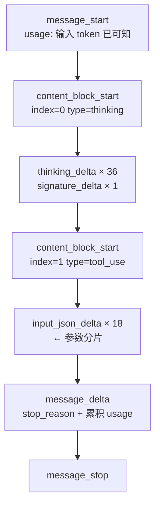

前两节你学会了数 token、避开了采样参数的坑。现在把注意力转向接口本身的形状。

这一节会拆开一次真实请求的完整生命周期 —— 包括那个很多人写错的地方：**流式响应里，工具调用的参数是一个字符一个字符到达的。**

## 一次请求长什么样

```python
import anthropic

client = anthropic.Anthropic()

response = client.messages.create(
    model="claude-sonnet-5",          # 必填
    max_tokens=1024,                  # 必填
    system="你是一个帮后端工程师解释概念的助手。",   # 顶层字段，不在 messages 里
    messages=[
        {"role": "user", "content": "什么是幂等性？"},
    ],
)

print(response.content[0].text)
```

### 三个必填参数

`model`、`max_tokens`、`messages` —— 只有这三个是必填的。

其中 `max_tokens` 最容易漏。判据很直接：[Messages API 参考](https://platform.claude.com/docs/en/api/messages)把每个可选参数都标了 `optional`，而这三个没有标记。

**注意 `max_tokens` 的含义**：它不是「最多输出这么长」的软提示，而是**硬截断**。达到上限就停，不会给你一个完整结构。第 2 章讲过的截断问题就来自这里。

### system 的位置：一个必须知道的差异

注意 `system` 是**顶层字段**，与 `messages` 平级。

官方文档对此有明确表述：

> there is no `system` role for input messages in the Messages API

而 OpenAI 的做法是把它作为 `messages` 数组里第一条 `role: "system"` 的消息。

这个差别看起来琐碎，但它是后面要写的**多厂商适配层**存在的直接原因 —— 上层业务代码不应该知道这件事。现在你只需要记住：**把 system 当成独立参数，不要试图塞进 messages**。

## 对话历史由你维护

API 是**无状态**的。每次请求你都要把完整对话历史发过去：

```python
messages = []

def chat(user_input: str) -> str:
    messages.append({"role": "user", "content": user_input})

    response = client.messages.create(
        model="claude-sonnet-5",
        max_tokens=1024,
        messages=messages,
    )

    reply = response.content[0].text
    # 关键：把模型的回复也追加进去，否则下一轮它不记得自己说过什么
    messages.append({"role": "assistant", "content": reply})
    return reply
```

这一点和 session 很像，但有一个关键差别：**这份历史每次请求都要重新发送、重新计费。**

而且成本是**平方级**增长的 —— 第 N 轮要发 N 条消息，累计成本是 O(N²)。一个 50 轮的对话，输入 token 总量是单轮的 1275 倍。这条在第 4 章会展开。

## 流式：不只是为了体验

设置 `stream=True`，响应会以 [Server-Sent Events](https://platform.claude.com/docs/en/build-with-claude/streaming) 逐块返回。

流式的价值不只是「让用户更快看到字」，还有两个工程意义：

1. **首字节延迟成为主要指标。** 生成 30 秒的内容，第一秒开始显示 vs 等 30 秒后一次性显示，是两个产品。
2. **可以中途放弃。** 用户改主意、或检测到输出跑偏时可以中断，不必为未生成的部分付费。

## 完整的流式事件序列

下面是**一次真实请求的完整事件流**。请求内容：带一个 `get_weather` 工具，问「北京今天天气怎么样？用摄氏度。」

```
（实测数据，deepseek-flash，2026-09-24。共 63 个事件，8268 字符原始流。）

message_start
  usage: {input_tokens: 333, output_tokens: 0}
content_block_start   index=0  type=thinking
  thinking_delta     × 36
  signature_delta    × 1
content_block_stop    index=0
content_block_start   index=1  type=tool_use  name=get_weather
  input_json_delta   × 18
content_block_stop    index=1
message_delta
  delta: {stop_reason: "tool_use"}
  usage: {input_tokens: 333, output_tokens: 92}
message_stop
```

这张图信息量很大，逐段看：



### 三种 delta 类型

| delta 类型 | 承载字段 | 用于 |
|---|---|---|
| `text_delta` | `text` | 普通文本输出 |
| `thinking_delta` | `thinking` | 模型的思考内容 |
| `input_json_delta` | `partial_json` | **工具调用的参数** |
| `signature_delta` | `signature` | 思考块的完整性签名 |

注意 `signature_delta` 的位置：**它紧挨在 `content_block_stop` 之前**。这是文档明确说明的行为，用来校验思考块没有被篡改。

另外还有两种事件不承载内容：`ping`（保活，可能穿插任意多个）和 `error`（例如高负载时的 `overloaded_error`，对应非流式下的 HTTP 529）。

### 一个容易忽略的细节：usage 是累积值

看上面 `message_delta` 里的 usage：`output_tokens: 92`。

**这是累积值，不是增量。** 文档专门用警告框标出了这一点。如果你把它当增量去累加，会得到一个虚高的成本数字。

## 工具调用的参数是一个字符一个字符来的

这是本节最实用的一条，也是最容易写错的地方。

上面那 18 个 `input_json_delta` 事件，逐个展开是这样的：

```
#1   partial_json="{"          #10  partial_json="\""
#2   partial_json="\""         #11  partial_json="unit"
#3   partial_json="city"       #12  partial_json="\""
#4   partial_json="\""         #13  partial_json=": "
#5   partial_json=": "         #14  partial_json="\""
#6   partial_json="\""         #15  partial_json="c"
#7   partial_json="北京"        #16  partial_json="elsius"
#8   partial_json="\""         #17  partial_json="\""
#9   partial_json=", "         #18  partial_json="}"
```

**拼起来才是完整的 `{"city": "北京", "unit": "celsius"}`。**

注意粒度：**连一个 `{`、一个 `"` 都是独立的事件**。官方文档对此的说明是：

> the deltas are *partial JSON strings*, whereas the final `tool_use.input` is always an *object*

### 三个必须知道的坑

**坑一：`input_json_delta` 只带 `index`，不带 `id`。**

上面 18 个分片，每一个都只有 `index=1`。而调用 `id`（`call_00_9TFhKbWafLOvSIvO2X3N6123`）只在 `content_block_start` 里出现过一次。

如果你想在流式过程中按调用 id 归集参数 —— **拿不到 id**。必须自己维护 `index → id` 的映射。

**坑二：不要在流式过程中解析半截 JSON。**

收到 `{"city": "北京` 就去 `JSON.parse`，必然失败。正确做法是累积字符串，**在 `content_block_stop` 时再解析**。

**坑三：事件之间有明显间隔。**

当前模型一次只发送一个完整的键值对，所以工具调用的事件之间**会有停顿**，看起来像卡住了。那不是故障。

### 正确的解析姿势

```python
# 按 index 累积工具调用，直到 content_block_stop 才能解析
pending = {}   # index -> {"id": ..., "name": ..., "args": ""}

for event in stream:
    if event.type == "content_block_start":
        block = event.content_block
        if block.type == "tool_use":
            # id 与 name 只在这里出现一次
            pending[event.index] = {"id": block.id, "name": block.name, "args": ""}

    elif event.type == "content_block_delta":
        delta = event.delta
        if delta.type == "input_json_delta":
            # 只累积，不解析
            if event.index in pending:
                pending[event.index]["args"] += delta.partial_json

    elif event.type == "content_block_stop":
        if event.index in pending:
            entry = pending.pop(event.index)
            entry["input"] = json.loads(entry["args"])   # 现在才解析
            handle_tool_call(entry["id"], entry["name"], entry["input"])
```

> 写流式解析时不要自己拼字符串。官方 SDK 提供了现成的累积与解析辅助，第 9 章手写适配层时我们会把这套逻辑自己实现一遍 —— 那时你就会明白 SDK 帮你省掉了什么。

## 一个结构性的观察

回头看那张事件序列图，注意 `thinking` 块和 `tool_use` 块是**并列的两个 content block**，各有自己的 index。

这意味着一次响应可以包含多个不同类型的内容块：

```
content[0] = thinking 块（模型的推理过程）
content[1] = tool_use 块（要调用的工具）
```

如果模型同时输出文本和工具调用，就会是三个块。**你的解析逻辑必须按 index 归位，不能假设只有一种块。**

## 工具定义如何影响模型行为

上面讲的是「结构」。但工具定义里的内容也会**直接改变模型的行为**，这一点值得用一个真实案例说明。

实验：给模型一个 `get_weather` 工具，但把 `city` 参数限定成只能取两个值：

```python
"input_schema": {
    "type": "object",
    "properties": {
        "city": {
            "type": "string",
            "enum": ["北京", "上海"],        # 只允许这两个
            "description": "只支持这两个城市",
        },
    },
    "required": ["city"],
}
```

然后问它一个**不在枚举范围**的问题：「深圳今天天气怎么样？」

模型的完整响应：

```
（实测数据，deepseek-flash，2026-09-24。）

stop_reason: end_turn

[thinking]
  The user asks about Shenzhen weather. The tool only supports Beijing
  and Shanghai. I should inform the user that I can't query Shenzhen.
  I shouldn't call the tool with an unsupported city since the enum
  only allows 北京 and 上海.

[text]
  抱歉，我目前只能查询北京和上海这两座城市的天气，无法查询深圳的天气。
  如果你想了解这两个城市中任意一个的天气，我可以帮你查询～
```

**关键点：它没有编造一个城市名。**

如果我当时把 `city` 写成一个自由字符串、再在代码里校验，模型很可能生成 `"深圳"` 然后被我拒绝，或者更糟 —— 生成一个看起来合理的值蒙混过去。

**`enum` 的作用是让非法值从一开始就无法被表达。** 这是第 4 章会展开的「poka-yoke 式工具设计」的第一个例子。

注意思考块里的那句话：模型明确说「我不应该用一个不支持的城市去调用工具」。**它读懂了约束，并且主动放弃了调用。** 这比事后校验更可靠 —— 因为它连一次无效的往返都省下了。

## 常见坑

**把 system 塞进 messages。** 这个 API 没有 system 角色。

**忘记 `max_tokens`。** 它是必填项。

**忘记把模型回复追加进历史。** 下一轮它就不记得自己说过什么了。这是自己维护对话历史时最常见的错误。

**按到达顺序拼接内容块。** 要用 `index`。上面例子里有两个块，靠到达顺序猜类型一定出错。

**试图在流式过程中解析半截 JSON。** 累积到 `content_block_stop` 再解析。

**把 `message_delta` 的 usage 当增量累加。** 它是累积值。

**以为工具调用的 id 在每个事件里都有。** 只有 `content_block_start` 有，其余只有 index。

**把事件之间的间隔误判为卡死。** 工具参数的键值对是逐个发送的，间隔是正常的。
