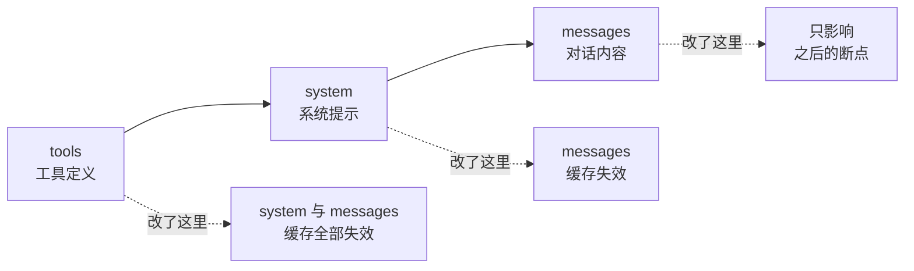

假设你有一个 3000 token 的系统提示 —— 里面写着角色设定、输出规范、几个示例、还有一份固定的参考文档。它每次请求都要发一遍，而它每次**一模一样**。

你正在为同样的内容反复付费。prompt caching 就是为此存在的。

## 实测：缓存到底能省多少

先看结果。下面是对同一个模型做的五组调用，用的是一段约 4350 字符的固定前缀：

```
（实测数据，deepseek-flash，2026-09-24。前缀是一段重复的技术规范文本，约 3000 token。）

场景                     | input | cacheRead | 耗时
① 首次调用                | 2688  |     0     | 423ms
② 相同前缀再问一次         |  256  |   2432    | 126ms
③ 前缀改了一个字           | 2688  |     0     | 204ms
④ 换回原来的前缀           |  259  |   2432    | 127ms
⑤ 短前缀（无长文档）        |   38  |     0     | 111ms
```

这五行数据，每一行都验证了缓存的一个特性。

### ① → ②：缓存的实际收益

输入 token 从 **2688 降到 256**（未缓存部分），其余 2432 走缓存读取。

**耗时从 423ms 降到 126ms —— 快了 3.4 倍。**

这个速度提升容易被人忽略。缓存不只是省钱的手段，也是**降低延迟**的手段，因为服务端不必重新处理那 2432 个 token。

### ③：改一个字，全部失效

把前缀里的「技术规范」改成「技术标准」—— **只动了一个词**：

```
input 从 256 回到 2688，cacheRead 归零
```

这验证了缓存最核心的规则：

> Cache hits require **100% identical prompt segments**

**不是"相似"，是完全相同。** 一个字符的差异就足以让整个缓存作废。

### ④：换回原前缀，又命中了

这一行说明缓存**不是"最近一次请求"**，而是**按内容哈希存储**的。

第 ③ 步改坏的前缀不影响第 ① 步写下的缓存条目。只要内容重新匹配上，就能命中。

这对工程实践有直接指导：**如果你的应用有多种稳定的前缀形态**（比如多套系统提示对应不同业务），它们各自的缓存可以共存，不必担心互相覆盖。

### ⑤：短前缀根本没有缓存

38 个 token 的前缀，`cacheRead` 是 0。

**不是失败，是它低于最小可缓存门槛。** 这是缓存最容易踩的坑之一 —— 因为**低于门槛时不会报错**，请求正常返回，只是静默地不缓存。你以为生效了，其实一直在付全价。

## 缓存怎么工作：前缀哈希

缓存的构建有固定的层级顺序：

```
tools  →  system  →  messages
```

这个顺序很重要：**修改任何一层，都会让它后面的所有内容失效**。改了工具定义，system 和 messages 的缓存全部作废。

而且哈希是**累积**的 —— 一个断点对应的是「从开头到这个断点」的哈希，不是这个断点本身。所以把变化的内容放在前面，后面就全部命中不了。



## 最小门槛：短 prompt 根本不缓存

各模型的最小可缓存 token 数**并不相同**（[prompt caching 文档](https://platform.claude.com/docs/en/build-with-claude/prompt-caching)）：

| 最小 token 数 | 模型 |
|---|---|
| 512 | Fable 5.1、Opus 5.5 等 |
| 1,024 | Sonnet 5、Sonnet 4.6、Opus 4 等 |
| 2,048 | Haiku 3.5 等 |
| 4,096 | Haiku 4.5、Opus 4.5 等 |

所以一个 800 token 的系统提示在 Sonnet 5 上**根本不会被缓存**，而你会以为它生效了。

**怎么确认？** 看响应的 usage 字段：

```python
if response.usage.cache_creation_input_tokens == 0 and \
   response.usage.cache_read_input_tokens == 0:
    # 两个都是 0 → 这次没有发生任何缓存
    print("警告：缓存未生效（可能是前缀太短，或内容有变化）")
```

## 怎么用

**方式一：自动缓存。** 在请求体顶层加一个 `cache_control`，系统会自动把断点放在最后一个可缓存的块上：

```python
response = client.messages.create(
    model="claude-opus-5-5",
    max_tokens=1024,
    cache_control={"type": "ephemeral"},   # 顶层，自动选择断点
    system=LONG_SYSTEM_PROMPT,
    messages=[{"role": "user", "content": user_question}],
)
```

**方式二：显式指定断点。** 把静态内容放在前面，在**可复用部分的末尾**标上 `cache_control`：

```python
system = [
    {"type": "text", "text": "你是……（角色设定）"},
    {
        "type": "text",
        "text": REFERENCE_DOCUMENT,               # 很长且很少变化
        "cache_control": {"type": "ephemeral"},   # 断点标在它的末尾
    },
]
```

工具定义也可以缓存：把 `cache_control` 放在 `tools` 数组的**最后一个**工具上，则包含它及之前的所有工具都会被缓存为一个前缀。

**每个请求最多 4 个断点**，断点本身不额外收费。

> 上面的实测里我没有显式传 `cache_control`，缓存仍然生效了 —— 说明部分平台会**自动缓存**，不需要显式标记。这是实现差异，不同厂商的行为需要各自验证。

## 定价与 TTL

缓存的费用结构是「写入时多付一点，读取时省很多」：

| 操作 | 相对基础输入价 |
|---|---|
| 缓存写入（5 分钟 TTL） | 1.25 倍 |
| 缓存写入（1 小时 TTL） | 2 倍 |
| 缓存读取 | 0.1 倍（部分新模型更低，见[定价页](https://platform.claude.com/docs/en/about-claude/pricing)） |

默认 TTL 是 **5 分钟**，而且有个很友好的设计：**被使用时免费刷新**。只要缓存不断被读到，它就会一直续下去。

两个容易忽略的细节：

**TTL 从请求开始计时，不是从响应结束。** 如果一次响应流式输出了 4 分钟，那么后续请求必须在它结束后约 1 分钟内发出，才能命中 5 分钟的缓存。

**需要更长间隔时用 1 小时 TTL**（`"ttl": "1h"`），写入贵一倍，但适合「比 5 分钟稀疏、比 1 小时频繁」的场景。

## 一个会让你算错成本的坑

缓存相关的 usage 字段有三个：

```
cache_creation_input_tokens   本次写入缓存的 token 数
cache_read_input_tokens       本次从缓存读取的 token 数
input_tokens                  最后一个断点之后的 token 数（即未缓存部分）
```

三者的关系是：

```
总输入 token = input_tokens + cache_read_input_tokens + cache_creation_input_tokens
```

**只看 `input_tokens` 会严重误判。** 回到上面的实测：

```
场景      | input_tokens | cache_read
① 首次    |    2688      |     0        ← 看起来"贵"
② 第二次  |     256      |   2432       ← 看起来"便宜了 90%"
```

实际成本差异**没有 90% 那么大** —— 因为 ② 里那 2432 个 cache read token 虽然按 0.1 倍计价，但**仍然是计费的**。

我在第 0 章做工具成本实验时就被这一点误导过：数据看起来自相矛盾（1 个工具比 3 个工具"贵"），追查后才发现是缓存命中污染了 `input_tokens`。**算成本必须用三项之和。**

## 什么会让缓存失效

内容变化会沿着 `tools → system → messages` 的层级向下传染。常见原因：

- 修改工具定义 —— 影响最广，会让后面全部失效
- 改动系统提示（**哪怕一个字符**，实测已验证）
- 请求参数变化：`tool_choice`、图片、thinking 参数等
- **改变顶层 `output_config.effort`** —— 见第 2 节，这是最容易踩的一个

反过来说，**稳定压倒一切**：把系统提示、工具定义、参考文档这些「每次都不变」的东西放前面且保持字节级一致，命中率就会很好。

## 常见坑

**把变化的内容放在前面。** 时间戳、「当前用户：xxx」这类每次都变的内容放在开头，命中率直接归零。

**prompt 太短，低于最小门槛。** 不会报错，只是静默不生效。用 usage 字段确认。

**修改工具定义后诧异「缓存怎么不命中了」。** 它会让 system 与 messages 的缓存一并失效。

**在依赖缓存的会话里改 effort。** 省下的缓存费可能超过 effort 省下的钱。

**只看 `input_tokens` 算成本。** 三项之和才是真实输入量。

**以为「兼容 Anthropic API」的第三方端点都支持缓存。** 这是个真实的坑：例如 DeepSeek 的 Anthropic 兼容端点会**忽略 `cache_control`** —— 请求成功，但显式缓存标记不生效（不过实测显示它有自己的自动缓存机制）。跨厂商时，这类「被静默忽略」的字段比报错更难排查。
